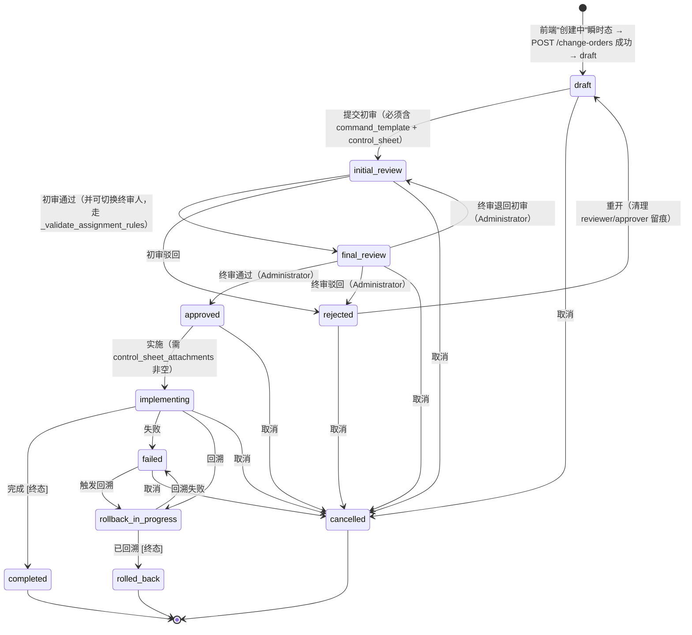

# change-order-management Bugfix Design

## Overview

本设计文档覆盖 `bugfix.md` 中定义的 5 组缺陷簇（1.1–1.5）与对应的期望行为（2.1–2.5），并约束修复不得破坏 3.x 中声明的回归保护项。整体思路是：

1. **把隐性契约显式化**：将"场景化命令模板必选"、"变更控制表结构化字段"、"审批人去重 / 权限组"、"状态机终态"、"各视图的过滤语义"统一升级为后端强制校验 + 数据库列 / 表 + 前端表单分步，产品文案与 `ALLOWED_STATUSES` / `ALLOWED_TRANSITIONS` 一致。
2. **把创建接口的校验逻辑抽成单一校验器**：`_normalize_assignment_payload` 只做 id↔username 归一化，审批人去重 / 权限组 / 禁止自审校验抽成独立函数 `_validate_assignment_rules(...)`，在 `POST /change-orders`、`PUT /change-orders/{id}`、`POST /change-orders/{id}/transition` 三条路径复用同一入口，消除 1.3 中通过 PUT 或 transition 绕过的路径。
3. **对流转和视图做"性质级"验证**：通过基于属性的测试（PBT）验证状态转移、驳回清理、视图过滤三类不变式，在 `bugfix.md §3` 列出的回归点上保留用例。

### 缺陷影响图（Impact Map）

| 缺陷簇 | 后端 API / 服务 | 数据库 | 前端页面 / 组件 |
|---|---|---|---|
| 1.1 命令模板强制化 | `api/change_orders.py::_build_command_template_snapshot`, `_normalize_command_template_payload`, `api_create_change_order`, `api_update_change_order`, `api_transition_change_order` | `change_orders.command_template_json`（已存在，语义强化）| `src/pages/ChangeOrderTab.tsx`（"Template mode but no scenario selected" 回落分支、审核面板四阶段视图） |
| 1.2 变更控制表 | **新增** `POST /api/change-orders/{order_id}/control-sheet`；`change_order_service.create_change_order / update_change_order` 接纳新字段；审计事件 `change_order.control_sheet_uploaded` | **新增列** `control_sheet_json`，**新增表** `change_order_control_sheet_attachments` | `ChangeOrderTab.tsx` 新增"变更控制表"Tab / 步骤；工单详情与时间线展示附件 |
| 1.3 审批人去重 / 权限组 | `_resolve_assignment_user`、`_validate_assignment_rules`（**新增**）、`api_create_change_order`、`api_update_change_order`、`api_transition_change_order` | —（纯校验逻辑，不变表结构） | `ChangeOrderTab.tsx` 表单已有下拉，依赖后端校验返回 400 并展示文案 |
| 1.4 状态机 / 回流 | `ALLOWED_STATUSES`、`ALLOWED_TRANSITIONS`、`api_transition_change_order`（驳回分支） | — | `ChangeOrderTab.tsx`、`App.tsx` 页面标题、`ModuleSubNav.tsx` 徽标 |
| 1.5 视图过滤语义 | `change_order_service.list_change_orders`（`my_todo` / `group_todo` / `my_drafts` 分支）、`get_summary` | — | `ChangeOrderTab.tsx`（Tab 文案"待我审核 / 待我实施"）、`navConfig.ts` 菜单、`ModuleSubNav.tsx` 徽标 |

## Glossary

- **Bug_Condition (C)**：触发任一缺陷簇的输入集合；下文 §Bug Details 对每一簇给出 `C_i(X)` 的形式化定义。
- **Property (P)**：在 `C_i(X)` 成立时，修复后接口应满足的行为。
- **Preservation**：`bugfix.md §3` 枚举的既有行为集，修复后必须与修复前等价。
- **F**：当前未修复的实现（`change_orders.py` 及 `change_order_service.py` 的现状）。
- **F'**：按本设计修复后的实现。
- **`_resolve_assignment_user(conn, user_id, stage)`**：位于 `backend/api/change_orders.py`，用 `users.change_groups_json` + `users.role` 校验初审 / 终审人资格。
- **`_normalize_assignment_payload(conn, payload)`**：同文件，归一化 `assigned_*_id` / `assigned_*_username` 字段。
- **`_normalize_command_template_payload(payload)`**：同文件，构造 `command_template` 快照并同步 `commands` / `rollback_plan`。
- **`api_update_change_order`**：`PUT /api/change-orders/{order_id}` 的处理函数。
- **`api_transition_change_order`**：`POST /api/change-orders/{order_id}/transition` 的处理函数。
- **`ALLOWED_STATUSES`**：允许写入 `change_orders.status` 的集合。
- **`ALLOWED_TRANSITIONS`**：从当前状态到下一状态的白名单映射。
- **`my_todo` / `group_todo` / `my_drafts`**：`list_change_orders` 的视图过滤参数。
- **变更控制表（Control Sheet）**：结构化字段 + 附件的集合，描述一次变更的实施计划与验证方案。
- **"创建中"（frontend-only transient state）**：用户在前端填写新建工单表单、尚未点击"提交"或 API 调用尚未返回时，UI 可显示"创建中…"加载态。**此状态不对应任何后端 `status` 值**，不落库，不出现在 `ALLOWED_STATUSES` 或 `ALLOWED_TRANSITIONS` 中。一旦 `POST /api/change-orders` 成功返回，工单即以 `draft` 状态持久化。前端代码中对应的是 `saving` 布尔状态变量（`ChangeOrderTab.tsx`），而非任何 `status` 字符串。

## Bug Details

### Bug Condition（多缺陷合成）

本 bugfix 覆盖五个并列缺陷簇；各簇的 `C_i` 定义如下，合成的 `isBugCondition(input) = ∃ i ∈ {1..5}, C_i(input)`。

**形式化说明（Pseudocode）：**
```
FUNCTION isBugCondition(input)
  INPUT: input — one of {CreateRequest, UpdateRequest, TransitionRequest, ListRequest, TimelineView}
  OUTPUT: boolean

  // C1 — 命令模板未强制
  IF input is CreateRequest OR UpdateRequest AND input.target_status != 'draft' THEN
    IF input.command_template is empty
       OR input.command_template.mode == 'manual'
       OR (input.command_template.mode == 'template' AND
           (input.command_template.scenario_id == '' OR input.command_template.preview.execute == []))
    THEN RETURN true
  END IF

  // C2 — 变更控制表缺失
  IF input is CreateRequest OR UpdateRequest AND input.target_status IN
     {'initial_review','final_review','approved','implementing','completed','rolled_back'} THEN
    IF input.control_sheet is missing-or-incomplete
       OR (input.target_status == 'implementing' AND input.control_sheet_attachments == [])
    THEN RETURN true
  END IF

  // C3 — 审批人去重 / 权限组
  IF assignees_rule_violated(input) THEN RETURN true
    // i.e. assigned_initial_reviewer == requester,
    //      assigned_final_approver == requester,
    //      assigned_initial_reviewer == assigned_final_approver,
    //      OR either assignee lacks its change_group membership.

  // C4 — 状态机 / 驳回回流
  IF input is TransitionRequest AND input.from_status IN {'rolled_back','rejected_after_reopen','completed','cancelled'}
     AND input.to_status != input.from_status
  THEN RETURN true
  IF input is TransitionRequest AND input.to_status == 'draft'
     AND input.from_status IN {'initial_review','final_review'}
     AND persisted_order_after_transition still carries
         (initial_reviewer_id, final_approver_id, approver_id,
          result_detail.initial_review_at, result_detail.approved_at)
  THEN RETURN true

  // C5 — 视图过滤语义
  IF input is ListRequest AND (
      (input.filter == 'my_drafts' AND input.result contains non-draft rows) OR
      (input.filter == 'my_todo'   AND input.result不能区分"待我审核"与"待我实施") OR
      (input.filter == 'group_todo' AND input.result contains rows with assigned reviewer/approver) OR
      (requester == assigned_initial_reviewer OR requester == assigned_final_approver)
  ) THEN RETURN true

  RETURN false
END FUNCTION
```

### Examples（逐簇）

- **1.1** 申请人在新建页切换到"手工命令"后直接提交 → `command_template == {}`，`commands == ['shutdown']` 原封入库，初审人只能看到一串命令。**修复后**：提交 `status != 'draft'` 时必须带 `command_template.preview.execute != []` 的快照。
- **1.1** 前端选中场景但未填必填变量，后端 `_build_command_template_snapshot` 已能抛 400；但前端 `ChangeOrderTab.tsx` 中 `commandMode === 'template'` 但无 `scenario_id` 的分支会把 `devicePlatform` 当 `scenario_id`，绕过后端校验。**修复后**：前端去掉该回落分支，后端对 `scenario_id == '' OR scenario does not exist` 直接 400。
- **1.2** 实施人在"完成"时尝试查找"变更控制表"归档 → 无该字段。**修复后**：控制表作为结构化字段 + 附件固化到工单，进入 `completed` 之前必填。
- **1.3** 申请人 `POST /change-orders` 指定自己作为初审人被拒；但改成 `PUT /change-orders/{id}` 把 `assigned_initial_reviewer_id` 改成自己 → 现在 `api_update_change_order` 接受。**修复后**：PUT 路径复用 `_validate_assignment_rules`，返回 400。
- **1.3** 初审人 transition 到 `final_review` 时 `body.assigned_final_approver_id` 填入自己或申请人 → 当前代码只查 `users.username` 就接受。**修复后**：transition 时同样走 `_validate_assignment_rules`，要求 `final_approver` 组 + `Administrator` 角色 + 去重。
- **1.4** 工单 `final_review → rejected → draft`，再次查看工单详情时 `initial_reviewer_username` / `final_approver_username` 仍显示上一轮的审批人。**修复后**：驳回到 `draft` 的路径里在同一事务清理审批留痕字段。
- **1.4** 状态为 `completed` 的工单传 `to_status: 'implementing'` 应返回 400。当前 `ALLOWED_TRANSITIONS` 未显式列出 `completed` 键，靠 `ALLOWED_TRANSITIONS.get(current_status, set())` 回落为空集，行为正确但**不可见**。**修复后**：终态显式声明为 `set()`，并加断言式单元测试锁定。
- **1.5** 当前用户打开"草稿箱"看到的列表包含 `status == 'rejected'` 的工单（UI 把"我参与 + 未终结"笼统归进去）。**修复后**：`my_drafts` 严格过滤 `status == 'draft'`；`rejected` 归入 `my_todo` 的"待我实施/待我跟进"类。
- **1.5** 组内待办中看到已指派初审人的工单（与其他组员争抢）。**修复后**：`group_todo` 仅返回 `assigned_initial_reviewer_id IS NULL OR ''` 的 `initial_review` 行 + `assigned_final_approver_id IS NULL OR ''` 的 `final_review` 行。

## Expected Behavior

### Preservation Requirements

**Unchanged Behaviors（对齐 `bugfix.md §3.1–§3.4`）：**
- **3.1 / 3.2**：`draft → initial_review → final_review → approved → implementing → completed` 的主路径一步不改；`BG+YYYYMMDD+NNNN` 生成规则不变；`actual_start` / `actual_end` / 时间线事件写入点不变。
- **3.3 / 3.4 / 3.5 / 3.6**：初审人 / 终审人 / 申请人 / Administrator 四类权限判定分支不变；`DELETE /api/change-orders/{id}` 仅 Administrator 可用；实施阶段状态仅由申请人或 Administrator 推进。
- **3.7**：列表接口的 `assignee / requester / search / priority / status / order_type / created_* / completed_* / scheduled_*` 参数语义与分页不变。
- **3.8**：中英双语展示既有字段不丢失。
- **3.9 / 3.10**：`/change-order-templates` CRUD、`/change-orders/{id}/bookmark` / `/change-orders-bookmarks` 接口契约不变。
- **3.11**：`GET /api/change-orders/validate-ticket/{order_number}` 规则（`approved / implementing` + 时间窗口）不变。

**Scope：**
不满足 `isBugCondition` 的所有输入（包括不涉及新字段的老工单读取、纯 `assignee` / `requester` 过滤的列表查询、模板库 CRUD、收藏 CRUD、自动化工单校验）SHALL 在 F' 下产生与 F 等价的响应。

## Hypothesized Root Cause

按缺陷簇分述：

1. **1.1 根因**：命令模式缺省为 `manual` 是历史遗留；`ChangeOrderTab.tsx` 为了兼容老数据在 `commandMode === 'template' && !scenarioId` 时回落到"用 `devicePlatform` 造一个空模板"，绕过 `_build_command_template_snapshot`。后端 `_normalize_command_template_payload` 只在 `command_template` 非空时触发校验，未对"提交到 `initial_review` 的工单必须有模板快照"做前置要求。

2. **1.2 根因**：`ChangeOrderCreate` / `ChangeOrderUpdate` 模型根本没有定义 `control_sheet_*` 字段；`database.py` 的 `change_orders` 表也没有对应列。早期方案把变更控制表当"人工文档 + 外链"，没有落到系统。

3. **1.3 根因**：
   - `_resolve_assignment_user` 中 `if groups and 'initial_reviewer' not in groups` 的 `if groups` 短路；空列表时跳过校验。
   - `_normalize_assignment_payload` 只做归一化，"申请人不能当审批人 / 两个审批人不能相同"的校验硬编码在 `api_create_change_order` 里，`api_update_change_order` 与 `api_transition_change_order` 没复用。
   - transition 到 `final_review` 时切换终审人只做 `SELECT username FROM users`，完全跳过 `_resolve_assignment_user`。

4. **1.4 根因**：
   - 产品术语"创建中"没有对应后端状态，文档和 UI 各说各话。
   - 驳回到 `draft` 的分支只写 `status` 和 `rejected_reason`，没有清理上一轮留痕。
   - `ALLOWED_TRANSITIONS` 对 `rolled_back / completed / cancelled` 依赖 `.get(k, set())` 的隐式空集，新人维护时容易漏加边。

5. **1.5 根因**：
   - `list_change_orders` 的 `my_todo` 分支把 `requester_username = ? AND status IN ('draft','rejected','approved')` 和"指派为初审 / 终审"两类并集一起返回，但前端 Tab 文案仍为"个人待办"，没有区分"待我审核 / 待我实施"。
   - `group_todo` 的 `gconds` 已经加了 `assigned_*_id IS NULL OR ''` 条件，但没有写进文档；`get_summary` 的同名查询未做等价保护，易于将来偏离。
   - `my_drafts` 过滤严格但文案与"被驳回的工单去哪儿"无对应说明，产生 1.16 的语义歧义。
   - 申请人同时是审批人这种"脏数据"场景，`_resolve_assignment_user` 没有从源头封死。

## Correctness Properties

Property 1：命令模板强制化 — 场景化模板必选

_For any_ `CreateRequest` 或 `UpdateRequest` 输入，若其目标 `status != 'draft'`，修复后的 `api_create_change_order` / `api_update_change_order` SHALL 拒绝 `command_template` 为空、`command_template.mode == 'manual'`、`scenario_id == ''`、或 `command_template.preview.execute == []` 的请求（HTTP 400）；接受的请求持久化后 `command_template_json` 反序列化为包含非空 `preview.execute` 的完整快照。

**Validates: Requirements 2.1, 2.2, 2.3**

Property 2：变更控制表结构化字段必填

_For any_ `CreateRequest` 或 `UpdateRequest` 输入，若目标 `status IN {'initial_review','final_review','approved','implementing','completed','rolled_back'}`，修复后的接口 SHALL 要求 `control_sheet` 字段集（`change_time`、`implementer`、`co_reviewer`、`device_ips`、`pre_check`、`execution`、`post_verify`、`business_verify`、`rollback_plan`）均非空，否则返回 HTTP 400；进入 `implementing` 前 SHALL 至少存在 1 条 `change_order_control_sheet_attachments` 记录。

**Validates: Requirements 2.4, 2.5, 2.6**

Property 3：审批人规则不变式

_For any_ 走过 `_validate_assignment_rules` 的请求（来自 POST 创建、PUT 更新或 transition 切换终审人三条路径），修复后的 F' SHALL 同时满足：
- `assigned_initial_reviewer_id != requester_id`
- `assigned_final_approver_id != requester_id`
- `assigned_initial_reviewer_id == ''` 或 `assigned_initial_reviewer_id != assigned_final_approver_id`
- 若 `assigned_initial_reviewer_id != ''`，其 `change_groups_json` 包含 `initial_reviewer` 且 `role != 'Viewer'`
- 若 `assigned_final_approver_id != ''`，其 `change_groups_json` 包含 `final_approver` 且 `role == 'Administrator'`
任一条不满足均返回 HTTP 400 / 403 且工单状态与持久化字段保持不变。

**Validates: Requirements 2.7, 2.8, 2.9**

Property 4：状态机与终态不变式

_For any_ `TransitionRequest`，修复后 `ALLOWED_TRANSITIONS[current_status]` SHALL 显式为一个集合（可空）。对终态 `{'rolled_back', 'completed', 'cancelled'}` 以及"重开路径之外的 `rejected`"以外的任何 `(current, next)` 组合，若 `next ∉ ALLOWED_TRANSITIONS[current]`，接口 SHALL 返回 HTTP 400 "Invalid transition"，且数据库 `change_orders.status` / `updated_at` / `result_detail_json` 不被写入。

**Validates: Requirements 2.10, 2.12**

Property 5：驳回回流清理不变式

_For any_ `TransitionRequest` 使工单从 `initial_review` 或 `final_review` 转为 `draft` 成功，修复后 F' SHALL 在同一事务内把下列字段置空：`initial_reviewer_id`、`initial_reviewer_username`、`final_approver_id`、`final_approver_username`、`approver_id`、`approver_username`、`result_detail.initial_review_at`、`result_detail.approved_at`；并保留 `rejected_reason` 与时间线驳回事件。

**Validates: Requirements 2.11**

Property 6：my_todo / group_todo / my_drafts 视图契约

_For any_ `ListRequest`：
- `my_drafts=U` 返回的每条记录 SHALL 满足 `requester_username == U AND status == 'draft'`。
- `my_todo=U` 返回的每条记录 SHALL 属于下列并集之一：
  - `(assigned_initial_reviewer_username == U AND status == 'initial_review' AND requester_username != U)`
  - `(assigned_final_approver_username == U AND status == 'final_review' AND requester_username != U)`
  - `(requester_username == U AND status IN {'draft','rejected','approved','implementing'})`
- `group_todo=G` 返回的每条记录 SHALL 满足
  - `status == 'initial_review' AND (assigned_initial_reviewer_id IS NULL OR == '')` 当 `'initial_reviewer' ∈ G`
  - 或 `status == 'final_review' AND (assigned_final_approver_id IS NULL OR == '')` 当 `'final_approver' ∈ G`
  - 且 `requester_username != exclude_requester`
- 修复后 F' SHALL 保证：不存在任何工单同时满足 `requester_username == X AND (assigned_initial_reviewer_username == X OR assigned_final_approver_username == X)`（从源头封死）。

**Validates: Requirements 2.13, 2.14, 2.15, 2.16**

Property 7：保护既有行为（Preservation）

_For any_ 输入不满足 `isBugCondition`，F'(input) 的返回 payload、数据库副作用、审计事件集合 SHALL 与 F(input) 等价（字段集合 ⊇ F 的字段集合；新增字段在旧数据上反序列化为空默认值）。

**Validates: Requirements 3.1–3.11**

## Fix Implementation

### 1.1 场景化命令模板强制化（对应 2.1 / 2.2 / 2.3）

**文件 / 函数**：
- `backend/api/change_orders.py::_build_command_template_snapshot`
- `backend/api/change_orders.py::_normalize_command_template_payload`
- `backend/api/change_orders.py::api_create_change_order` / `api_update_change_order` / `api_transition_change_order`
- `src/pages/ChangeOrderTab.tsx`（1380–1400 行左右的 "Template mode but no scenario selected" 分支）

**具体改动**：
1. 在 `api_create_change_order` / `api_update_change_order` 中新增前置校验：若 `payload.get('status')` 为 `{'initial_review','final_review','approved','implementing','completed'}` 之一，则 `command_template` 必须存在、`mode == 'template'`、`scenario_id` 非空、快照 `preview.execute` 非空；否则抛 `HTTPException(400, '提交初审前必须选择场景化命令模板并渲染出可执行命令')`。
2. `_build_command_template_snapshot` 对 `scenario_id == ''` 直接 400（已有，但路径覆盖在此加断言）。
3. 前端移除 `commandMode === 'template' && !scenarioId` 的回落分支，改为禁用提交按钮 + toast "请先选择场景并填写必填变量"。
4. 详情 / 审核页渲染四阶段（`preview.pre_check` / `preview.execute` / `preview.post_check` / `preview.rollback`）+ 平台 + 变量表。

### 1.2 变更控制表字段与附件（对应 2.4 / 2.5 / 2.6）

**文件 / 函数 / 表**：
- `backend/database.py`（`change_orders` 表新增列 `control_sheet_json`；新增表 `change_order_control_sheet_attachments`）
- `backend/services/change_order_service.py::create_change_order / update_change_order / _row_to_dict`
- `backend/api/change_orders.py`：新增 `POST /api/change-orders/{order_id}/control-sheet`；扩展 `ChangeOrderCreate` / `ChangeOrderUpdate` 的 `control_sheet` 字段；在 `api_transition_change_order` 的 `new_status in {'initial_review','implementing'}` 分支中校验控制表字段齐全、进入 `implementing` 必须有至少 1 个附件。
- `src/pages/ChangeOrderTab.tsx`：在创建 / 编辑流程中增加"变更控制表"步骤；在工单详情页、时间线、导出视图中展示控制表与附件清单。

**具体改动**：
1. `change_orders.control_sheet_json` 存结构化字段（见 §Data Model）。
2. 附件表 `change_order_control_sheet_attachments` 存 `id / order_id / filename / mime_type / size / storage_key / uploaded_by / uploaded_at`。
3. 新接口 `POST /change-orders/{order_id}/control-sheet`（multipart/form-data）支持 pdf / doc / docx / xlsx，MIME 校验 + 大小上限（例如 20 MiB）；成功后写入附件表并触发 `log_audit_event(event_type='change_order.control_sheet_uploaded', ...)`。
4. `GET /change-orders/{order_id}` 返回值新增 `control_sheet` 与 `control_sheet_attachments`。
5. `create_change_order` / `update_change_order` 接纳 `control_sheet` 字段（JSON 化后写入 `control_sheet_json`），`_row_to_dict` 反序列化。

### 1.3 审批人去重与权限组（对应 2.7 / 2.8 / 2.9）

**文件 / 函数**：
- `backend/api/change_orders.py::_resolve_assignment_user`
- **新增** `_validate_assignment_rules(conn, *, requester_id, payload, current_order=None, stage_hint=None) -> None`
- `api_create_change_order` / `api_update_change_order` / `api_transition_change_order`

**具体改动**：
1. `_resolve_assignment_user` 修正：`groups = _parse_change_groups(...)`，判断改为 `'initial_reviewer' not in groups`（移除 `if groups` 短路），空列表直接 400 "用户未加入 initial_reviewer 权限组"。`final` 分支同样处理。
2. 新增 `_validate_assignment_rules` 集中处理：
   - `assigned_initial_reviewer_id != requester_id`
   - `assigned_final_approver_id != requester_id`
   - `assigned_initial_reviewer_id != assigned_final_approver_id`（允许任一为空）
   - 调用 `_resolve_assignment_user` 完成权限组 / 角色校验
   - 违规抛 `HTTPException(400, '...')`，文案区分三种场景（"申请人不能作为初审人"、"初审人与终审人不能相同"、"用户未加入对应权限组"）。
3. `api_create_change_order`：把原来散落在函数体的 3 条 `if` 合并为 `_validate_assignment_rules(conn, requester_id=user['user_id'], payload=payload)`。
4. `api_update_change_order`：在 `_normalize_assignment_payload` 之后调用 `_validate_assignment_rules`，`requester_id` 来自 `existing.requester_id`。
5. `api_transition_change_order`：在 `new_status == 'final_review' AND body.assigned_final_approver_id` 的分支，先把 `existing + body` 合并为"模拟 payload"，再走 `_validate_assignment_rules(..., stage_hint='final')`。若校验失败，直接返回并**不写入** `updates`。
6. `api_transition_change_order` 在 `new_status IN {'initial_review','final_review','approved','rejected'}` 时额外校验：当前 actor SHALL NOT 等于 `existing.requester_id`（即"申请人不能审核自己的工单"）。

### 1.4 状态机与驳回回流（对应 2.10 / 2.11 / 2.12）

**文件 / 函数**：
- `backend/api/change_orders.py`：`ALLOWED_STATUSES`、`ALLOWED_TRANSITIONS`、`api_transition_change_order` 的驳回分支
- 文档：本设计文档 + `src/pages/ChangeOrderTab.tsx` / `App.tsx` 中的状态文案

**具体改动**：
1. `ALLOWED_TRANSITIONS` 显式列出终态：
   ```python
   ALLOWED_TRANSITIONS = {
       'draft': {'initial_review', 'cancelled'},
       'initial_review': {'final_review', 'rejected', 'cancelled'},
       'final_review': {'approved', 'rejected', 'cancelled', 'initial_review'},
       'approved': {'implementing', 'cancelled'},
       'implementing': {'completed', 'failed', 'rollback_in_progress', 'cancelled'},
       'rollback_in_progress': {'rolled_back', 'failed'},
       'failed': {'rollback_in_progress', 'cancelled'},
       'rejected': {'draft', 'cancelled'},          # 允许重开回 draft
       'rolled_back': set(),                         # 终态
       'completed': set(),                           # 终态
       'cancelled': set(),                           # 终态
       # Legacy paths kept
       'pending': {'approved', 'rejected', 'cancelled'},
       'executing': {'completed', 'failed', 'rollback_in_progress', 'cancelled'},
   }
   ```
2. **"创建中"去后端化（前端瞬时态声明）**：
   - "创建中"**不是**后端状态，不在 `ALLOWED_STATUSES` 中，不落库。
   - 它是前端在 `POST /api/change-orders` 请求飞行期间显示的 UI 加载态，对应 `ChangeOrderTab.tsx` 中的 `saving` 布尔变量（`setSaving(true)` → API 返回 → `setSaving(false)`）。
   - 工单一旦落库，其初始状态即为 `draft`（草稿）。
   - 六态正式词汇表（对齐 `bugfix.md §2.10`）：
     | 后端 `status` 值 | 中文显示 | 英文显示 |
     |---|---|---|
     | `draft` | 草稿 | Draft |
     | `initial_review` | 初审中 | Initial Review |
     | `final_review` | 终审中 | Final Review |
     | `approved` | 审批完成 | Approved |
     | `implementing` | 实施中 | Implementing |
     | `completed` | 完成 | Completed |
   - 前端 `STATUS_META`（`ChangeOrderTab.tsx`）与 `App.tsx` 页面标题均已使用上述六态词汇，**不包含** `creating` 或"创建中"键。任何新增状态标签必须先在 `ALLOWED_STATUSES` 中注册，再同步到 `STATUS_META`。
3. `api_transition_change_order` 的驳回分支（`new_status == 'draft'` 且 `current_status IN {'initial_review','final_review'}`，走 `rejected → draft` 的重开路径在 `new_status == 'rejected'` 后手动重开时也命中）新增字段清理：
   ```python
   if new_status == 'draft' and current_status in {'initial_review', 'final_review', 'rejected'}:
       updates['initial_reviewer_id'] = ''
       updates['initial_reviewer_username'] = ''
       updates['final_approver_id'] = ''
       updates['final_approver_username'] = ''
       updates['approver_id'] = ''
       updates['approver_username'] = ''
       rd = dict(existing.get('result_detail') or {})
       rd.pop('initial_review_at', None)
       rd.pop('approved_at', None)
       updates['result_detail'] = rd
   ```
   保留 `rejected_reason`；时间线事件由 `log_audit_event` 负责记录。

### 1.5 各视图过滤语义（对应 2.13 / 2.14 / 2.15 / 2.16）

**文件 / 函数**：
- `backend/services/change_order_service.py::list_change_orders`、`get_summary`
- `src/pages/ChangeOrderTab.tsx`（Tab 文案"待我审核 / 待我实施"）
- `backend/api/change_orders.py::_validate_assignment_rules`（双角色封死）

**具体改动**：
1. **`my_drafts` 严格化**：保持 `requester_username = ? AND status = 'draft'`，在本设计与 `list_change_orders` docstring 里把"被驳回工单归入 `my_todo`"写为契约，增加用例。
2. **`my_todo` 拆分返回标签**：后端 `list_change_orders` 不变语义，但在返回的 `dict` 中增加 `todo_kind` 字段，取值 `{'review','implement','follow_up'}`：
   - `review`：当前用户是指派的初审 / 终审人且 `status` 匹配阶段
   - `implement`：`requester_username == U AND status IN {'approved','implementing'}`
   - `follow_up`：`requester_username == U AND status == 'rejected'`
   - `draft`：`requester_username == U AND status == 'draft'`（仍展示在草稿箱，不进 todo）
   前端 `ChangeOrderTab.tsx` 的"个人待办"Tab 按 `todo_kind` 分两栏展示文案"待我审核"/"待我实施"/"待我修改"。
3. **`group_todo` 契约化**：把既有 `assigned_*_id IS NULL OR = ''` 条件写入本文档与 `list_change_orders` / `get_summary` 的同源 SQL；`get_summary` 中的 `gconds` 与 `list_change_orders` 中的 `gconds` 统一抽成私有常量 / 函数 `_build_group_todo_conditions(groups)`，避免未来偏移。
4. **双角色封死**：`_validate_assignment_rules` 内禁止 `requester_id ∈ {assigned_initial_reviewer_id, assigned_final_approver_id}`（已在 1.3 涵盖），从根源上排除"同一用户既是申请人又是审批人"的视图重复。
5. 对既有脏数据的一次性清理放入 §Migration。

## State Machine（修复后契约视图）



**终态声明（显式空集）：** `completed`、`rolled_back`、`cancelled`。任意指向非自身的 transition 一律 400。

## View Filter Semantics（契约）

| 视图 | 过滤参数 | SQL 契约（伪） | 排除条件 |
|---|---|---|---|
| 草稿箱 `my_drafts` | `my_drafts=U` | `requester_username = U AND status = 'draft'` | — |
| 个人待办 `my_todo` | `my_todo=U` | 见 Property 6；按 `todo_kind ∈ {review, implement, follow_up}` 分桶 | `requester_username == U` 的审核桶排除（不能审自己） |
| 组内待办 `group_todo` | `group_todo=G` + `exclude_requester=U` | `( status='initial_review' AND assigned_initial_reviewer_id IN (NULL,'') )` 当 `initial_reviewer ∈ G`；`( status='final_review' AND assigned_final_approver_id IN (NULL,'') )` 当 `final_approver ∈ G` | `requester_username != U` |
| 我参与的 `my_participated` | `my_participated=U` | `requester_username = U OR assigned_initial_reviewer_username = U OR assigned_final_approver_username = U OR initial_reviewer_username = U OR final_approver_username = U OR approver_username = U` | — |
| 我的关注 `bookmarked` | `bookmarked=UID` | `id IN (SELECT order_id FROM change_order_bookmarks WHERE user_id = UID)` | — |
| 全部工单 | 其它 | 既有 `status / priority / search / order_type / *_from / *_to` 组合 | — |

双角色（申请人同时是指派审批人）在 F' 下不可能发生；历史数据由迁移脚本纠正（§Migration）。

## Data Model Changes

### change_orders（新增列）

```sql
ALTER TABLE change_orders ADD COLUMN control_sheet_json TEXT NOT NULL DEFAULT '{}';
-- command_template_json 已存在，本次仅强化语义与校验，不改 DDL。
```

`control_sheet_json` 反序列化后形如：
```json
{
  "change_time": { "start": "2025-04-01T22:00:00Z", "end": "2025-04-01T23:00:00Z" },
  "implementer":  { "id": "u-123", "username": "alice" },
  "co_reviewer":  { "id": "u-456", "username": "bob" },
  "device_ips":   ["10.0.0.1", "10.0.0.2"],
  "pre_check":     "...",
  "execution":     "...",
  "post_verify":   "...",
  "business_verify":"...",
  "rollback_plan": "..."
}
```

### change_order_control_sheet_attachments（新表）

```sql
CREATE TABLE IF NOT EXISTS change_order_control_sheet_attachments (
    id TEXT PRIMARY KEY,
    order_id TEXT NOT NULL,
    filename TEXT NOT NULL,
    mime_type TEXT NOT NULL DEFAULT '',
    size_bytes INTEGER NOT NULL DEFAULT 0,
    storage_key TEXT NOT NULL,
    uploaded_by_id TEXT NOT NULL DEFAULT '',
    uploaded_by_username TEXT NOT NULL DEFAULT '',
    uploaded_at TEXT NOT NULL,
    FOREIGN KEY (order_id) REFERENCES change_orders(id) ON DELETE CASCADE
);
CREATE INDEX IF NOT EXISTS idx_control_sheet_attachments_order
    ON change_order_control_sheet_attachments(order_id);
```

`storage_key` 指向应用存储层（本地目录或对象存储）；具体存储实现不在本 bugfix 范围内，复用现有附件存储约定即可。若当前无通用附件存储，新增一个 `change_order_attachments` 目录（路径见 §Rollout）。

### command_template_json（语义强化）

保留 §Overview 中 `_build_command_template_snapshot` 的结构；本次改动 **禁止** 以 `{}` 形式在 `status != 'draft'` 时落库，并在 `_row_to_dict` 反序列化时为老数据填充 `{}` 以避免崩溃。

## API Surface Changes

### 新增：POST /api/change-orders/{order_id}/control-sheet

- **权限**：`Operator`（申请人、实施人、Administrator）
- **请求**：`multipart/form-data`，字段：
  - `file`：附件（`pdf / doc / docx / xlsx`，大小 ≤ 20 MiB）
  - 可选 `note`：描述
- **响应**：`{"success": true, "data": {"id": "...", "filename": "...", "size_bytes": ..., "uploaded_at": "..."}}`
- **校验**：
  - 工单存在；`status IN {'approved','implementing','completed','rolled_back'}`（或 `bugfix.md §2.6` 的归档语义集合）
  - MIME 白名单；拒绝 `application/x-msdownload` 等
- **审计**：`event_type='change_order.control_sheet_uploaded'`

### 扩展：POST /api/change-orders / PUT /api/change-orders/{order_id}

- 请求体新增 `control_sheet`（结构见 §Data Model）。
- 请求体 `command_template` 语义强化：提交 `status != 'draft'` 时必填；前端不再传空模板。
- 错误码：400 统一附带 i18n 友好文案，前端 `ChangeOrderTab.tsx` 捕获后 toast。

### 扩展：POST /api/change-orders/{order_id}/transition

- 新状态为 `final_review` 且 `body.assigned_final_approver_id` 非空时，经过 `_validate_assignment_rules`。
- 新状态为 `draft` 且 `current_status ∈ {'initial_review','final_review','rejected'}` 时，在同一事务清理审批留痕字段（见 §1.4）。
- 新状态为 `implementing` 时，校验 `control_sheet` 已填且至少有 1 个附件。
- 非白名单转移一律 400 `Invalid transition: X -> Y`；终态再转一律 400。

### 扩展：GET /api/change-orders / GET /api/change-orders/{order_id}

- 响应新增 `control_sheet`、`control_sheet_attachments`（摘要清单）、`todo_kind`（仅 `my_todo` 视图有效）。

## Testing Strategy

### Validation Approach

采用"先在未修复代码上暴露反例 → 再在修复代码上证实 + 保护既有"两阶段方法；多簇缺陷 × 多入口（POST / PUT / transition / 列表）的矩阵覆盖以 PBT 为主、定点单测 + 集成测为辅。

### Exploratory Bug Condition Checking

**Goal**：在未修复代码上复现五簇缺陷，验证根因分析。

**Test Plan**：
1. `test_manual_command_accepted_on_unfixed`：`POST /change-orders` 带 `command_template: {}` + `commands: ["shutdown"]` + `status: 'initial_review'`，断言返回 200（未修复时应通过）。
2. `test_put_bypass_assignment_check_on_unfixed`：先创建合法工单，然后 `PUT` 把 `assigned_initial_reviewer_id` 改为 `requester_id`，断言返回 200（未修复）。
3. `test_transition_final_reviewer_hijack_on_unfixed`：初审人在 `initial_review → final_review` 切换终审人为 `Operator` 非 `Administrator` 用户，断言成功写入（未修复）。
4. `test_reject_to_draft_leaves_stale_approver_on_unfixed`：驳回 → `draft` 后查询工单，断言 `initial_reviewer_username` 仍有值（未修复）。
5. `test_group_todo_contains_assigned_rows_on_unfixed`：构造"已指派 + `initial_review`"的工单，用别的组员查询 `group_todo`，断言未修复版本可能包含该行（或确认已排除以锁定现状）。
6. `test_empty_change_groups_accepted_on_unfixed`：构造 `change_groups_json = '[]'` 的 Operator 作为初审人，断言 `_resolve_assignment_user` 接受（未修复）。

**Expected Counterexamples**：
- 场景 1、2、3、4、6 将在未修复代码上成功复现 bug；
- 场景 5 根据当前代码分支，`group_todo` 已加 `assigned_*_id IS NULL OR ''` 条件，测试用来把该行为从"隐式"锁定为"显式契约"，防止后续回退。

### Fix Checking

**Goal**：在修复后，所有触发 `isBugCondition` 的输入都应按 Correctness Properties 返回预期响应。

**Pseudocode：**
```
FOR ALL input WHERE isBugCondition(input) DO
  result := handler_fixed(input)
  ASSERT expectedBehavior(result)
END FOR
```

### Preservation Checking

**Goal**：对 `NOT isBugCondition(input)`，F' 与 F 的响应等价。

**Pseudocode：**
```
FOR ALL input WHERE NOT isBugCondition(input) DO
  ASSERT handler_original(input) == handler_fixed(input)  // status code、body、DB 副作用、audit events
END FOR
```

**Testing Approach**：
- 对 "POST / PUT / transition / list" 四类 API 各自建立一个随机输入生成器（Hypothesis / fast-check 风格），分别产出 `C_i` 满足和不满足两支。
- 在 `list_change_orders` 与 `get_summary` 的视图契约上用 PBT 断言集合关系（∀ 行满足对应 WHERE 条件）。
- 对既有 `assignee / requester / *_from / *_to / search` 等保护路径用随机参数生成器，断言修复前后返回完全一致。

**Test Plan**：
1. **Mouse-click Preservation 对应**：对 `POST /change-order-templates`、`/change-orders/{id}/bookmark`、`/change-orders-bookmarks`、`/validate-ticket/{order_number}` 各跑一组 PBT，断言行为等价。
2. **主干流转 Preservation**：`draft → initial_review → final_review → approved → implementing → completed` 的合法序列 PBT，断言每步 200 + 时间戳/时间线符合 §3.2。
3. **权限 Preservation**：Administrator 删除任意工单（§3.6）、Administrator 角色切换等既有路径不被 1.3 的新校验误伤。

### Unit Tests

- `_resolve_assignment_user` 在空 `change_groups_json` 下返回 400（Property 3）
- `_validate_assignment_rules` 各禁令分支返回对应文案
- `ALLOWED_TRANSITIONS` 终态显式为 `set()`（`assert ALLOWED_TRANSITIONS['completed'] == set()` 等）
- 驳回 → `draft` 的字段清理（Property 5）
- `my_drafts` / `my_todo` / `group_todo` 三条 WHERE 精确性（Property 6）

### Property-Based Tests

- **P1 命令模板**：生成 `command_template ∈ {{}, manual, template-no-scenario, template-no-variables, template-valid}` × `status ∈ {'draft','initial_review','final_review','approved'}`，断言接受 / 拒绝矩阵。
- **P3 审批人规则**：生成 `(requester, reviewer, approver)` 三元组 ∈ `{same, pairwise-different, empty-group, viewer-role}`，断言 POST / PUT / transition 三条路径返回等价结果。
- **P4 状态机**：生成 `(from, to) ∈ ALLOWED_STATUSES²`，断言 `to ∈ ALLOWED_TRANSITIONS[from]` 时 200、否则 400。
- **P5 驳回清理**：生成 `initial_reviewer / final_approver / approver` 任意组合的既有工单，走 `→ rejected → draft` 或 `initial_review → draft` 路径，断言清理字段。
- **P6 视图**：生成 `N` 条工单（随机 requester / 指派 / 状态），用不同 `U` 调用 `my_todo` / `group_todo` / `my_drafts`，断言每条返回行满足对应 WHERE。
- **P7 Preservation**：对 `C` 反条件的输入空间，断言 F'(input) ≡ F(input)（body / status / DB diff / audit events 全量比较）。

### Integration Tests

- 端到端：Operator 创建模板工单 → 提交初审 → 初审通过（切换终审人）→ 终审通过 → 进入实施（上传控制表附件）→ 完成 → 详情页展示控制表 + 附件 + 时间线。
- 端到端驳回回流：创建 → 提交初审 → 初审驳回 → 回到 `draft`（审批人字段清空）→ 再次提交 → 最终完成。
- 跨视图：申请人 U1、初审人 U2、终审人 U3、组员 U4 四个账号并发查询 `my_todo` / `group_todo` / `my_drafts` / `my_participated`，断言各视图内容不冲突。
- 语言切换：中/英文下工单字段与时间线字段均展示（§3.8）。

## Regression Prevention Checklist（对齐 bugfix.md §3.x）

- [ ] **§3.1**：`BG+YYYYMMDD+NNNN` 编号规则测试保留；草稿保存不填审批人 / 不填命令仍可落库。
- [ ] **§3.2**：主干状态机 PBT 覆盖每一步，`actual_start / actual_end / 时间线` 写入点一致。
- [ ] **§3.3**：初审人 `Operator` + `initial_review` 阶段 transition 到 `final_review / rejected` 通路不变。
- [ ] **§3.4**：终审人 `Administrator` + `final_review` 阶段 transition 到 `approved / rejected / initial_review` 通路不变。
- [ ] **§3.5**：申请人 / Administrator 在 `approved / implementing` 阶段的操作权限不变。
- [ ] **§3.6**：Administrator 可删除任意工单（`DELETE`）。
- [ ] **§3.7**：`assignee / requester / search / priority / status / order_type / created_* / completed_* / scheduled_*` 列表参数语义与分页不变。
- [ ] **§3.8**：中英切换下字段与详情页展示完整。
- [ ] **§3.9**：`/change-order-templates` CRUD 接口不变；快照含 `command_template` 的模板保存 / 复用路径经 PBT 覆盖。
- [ ] **§3.10**：`/change-orders/{id}/bookmark` 与 `/change-orders-bookmarks` 接口契约不变。
- [ ] **§3.11**：`/validate-ticket/{order_number}` 对 `approved / implementing + 时间窗口` 的返回不变。

## Migration / Rollout

### 数据库迁移

1. `database.py` 启动时通过 `ensure_column('change_orders', 'control_sheet_json', "TEXT NOT NULL DEFAULT '{}'")` 幂等新增列；新建安装通过 `CREATE TABLE IF NOT EXISTS` 建 `change_order_control_sheet_attachments`。
2. 对既有 `change_orders` 行 `control_sheet_json` 默认 `'{}'`；未进入 `implementing` 的老工单不受影响；已经进入 `implementing / completed / rolled_back` 的在途工单在首次查询时给出"请补填变更控制表"提示（前端 banner），**不**强制阻塞展示，避免破坏 §3.5 的实施流。
3. 对存量脏数据（`requester_username == assigned_initial_reviewer_username` 或 `requester_username == assigned_final_approver_username`）执行一次性脚本：打印告警 + 把对应字段置空（保留审计事件），确保 Property 6 的双角色封死成立。

### 在途工单（in-flight orders）处理

| 当前 `status` | 处理策略 |
|---|---|
| `draft` | 不影响；下次编辑到 `initial_review` 时按新规则校验（必须选场景 + 填控制表）。 |
| `initial_review` / `final_review` | 保留流转；若 `command_template_json == '{}'`，在初审 / 终审页打出"历史工单未记录模板"只读提示，不强制回补（避免阻塞审批人），但转入 `approved` 前需由申请人补回控制表。 |
| `approved` / `implementing` | 允许继续实施；进入 `completed` 前提示上传至少 1 份控制表附件；老工单特批豁免通过 `authorization_exempt` 字段打标。 |
| `completed` / `rolled_back` / `cancelled` | 只读；详情页展示"历史工单未记录控制表"。 |

### 前端灰度

1. **Feature Flag**：在 `src/pages/ChangeOrderTab.tsx` 引入 `FEATURE_CONTROL_SHEET` 与 `FEATURE_TEMPLATE_REQUIRED` 两个开关（默认 on），便于在紧急回退时快速切换。
2. **分步上线**：先上线 1.3 / 1.4（纯后端校验与终态显式声明，不改数据）→ 灰度观察一轮 → 再上线 1.1 / 1.2（新增字段 + 前端表单步骤）→ 最后上线 1.5 的 UI 文案拆分。
3. **发布后验证**：打开 `my_todo / group_todo / my_drafts` 的线上探针，连续 24 小时观察返回行集与 Property 6 一致。

### 回滚预案

- 迁移列与新表均为 `IF NOT EXISTS`，回滚时保留表结构但下线前端入口，后端接口 5xx 返回 "feature disabled"。
- `ALLOWED_TRANSITIONS` 回滚到显式空集之前的形态（语义等价，仅可读性退化）。
- 驳回清理逻辑在 feature flag 关闭时跳过，避免与未修复版本行为冲突。
