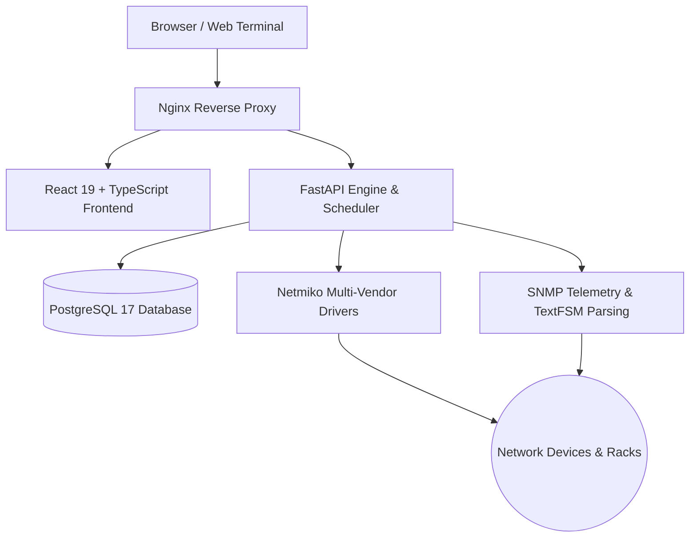

<div align="center">

# NEXORA

### Modern Network Operations Platform

**Everything your network team needs.**  
**One Platform. Total Network Control.**

`CMDB` • `IPAM` • `Monitoring` • `Automation` • `Configuration` • `Topology` • `Compliance` • `Audit`

<br/>

[](#-quick-start)
[](#-documentation)
[](#-roadmap)

<br/>

```text
═════════════════════════════════════════════════════════════════════════════════

                     ○───────────────○───────────────○
                     │               │               │
                  Device         Topology       Monitoring
                     │               │               │
                     ○───────────────○───────────────○
                     │               │               │
                   CMDB            IPAM         Automation
                     │               │               │
                     ○───────────────○───────────────○

═════════════════════════════════════════════════════════════════════════════════
```

</div>

<br/>

---

## Why Nexora?

Many organizations still maintain network inventory in spreadsheets, monitor devices using independent systems, back up configurations with separate tools, execute scripts from engineers' laptops, and document everything somewhere else.

As infrastructure grows, operational complexity grows even faster.

**Nexora was built to bring everything together.**  
A unified platform for network inventory, monitoring, automation, configuration management, topology, CMDB, IPAM, and operational workflows.

<br/>

```text
┌───────────────────────────────────────┐       ┌───────────────────────────────────────┐
│     Traditional Network Operations    │       │                 Nexora                │
├───────────────────────────────────────┤       ├───────────────────────────────────────┤
│                                       │       │                                       │
│  Inventory      ──────►   Excel       │       │    Inventory         Monitoring       │
│                                       │       │                                       │
│  Monitoring     ──────►   PRTG        │       │    Automation       Configuration     │
│                                       │       │           \               /           │
│  Configuration  ──────►   Oxidized    │  ──►  │            \             /            │
│                                       │       │             ▼           ▼             │
│  Terminal       ──────►   SecureCRT   │       │               NEXORA                  │
│                                       │       │             ▲           ▲             │
│  Documentation  ──────►   Wiki        │       │            /             \            │
│                                       │       │           /               \           │
│  Automation     ──────►   Python      │       │    CMDB            Topology           │
│                                       │       │                                       │
│          [ Disconnected Tools ]       │       │    IPAM             Reports & Audit   │
│                                       │       │                                       │
└───────────────────────────────────────┘       │         [ Everything Connected ]      │
                                                └───────────────────────────────────────┘
```

<div align="center">

> **Modern network operations should not rely on disconnected tools.**

</div>

<br/>

---

## Features

<br/>

<div align="center">

### 📦 Device Inventory
**Manage every network asset from one place.**

<br/>

### ⚙️ Automation
**Execute operations across hundreds of devices.**

<br/>

### 📈 Monitoring
**Monitor network health in real time.**

<br/>

### 📝 Configuration
**Never lose a configuration change again.**

<br/>

### 🗺️ Topology
**Understand your network visually.**

<br/>

### 🗃️ CMDB
**Build a trusted source of truth.**

<br/>

### 🌐 IPAM
**Manage IP resources efficiently.**

<br/>

### 📊 Reporting
**Operational visibility for every change.**

</div>

<br/>

---

## Architecture



<br/>

---

## Screenshots

<div align="center">

| **Dashboard** | **Device Inventory** |
| :---: | :---: |
| *Real-time operational overview & health status*<br/> | *Multi-vendor hardware & lifecycle management*<br/> |
| **Topology** | **Monitoring** |
| *Auto-discovered visual network map*<br/> | *Continuous SNMP telemetry & alert center*<br/> |
| **Configuration** | **Terminal** |
| *Automated backups & visual diff baseline comparison*<br/> | *Integrated secure Web SSH terminal*<br/> |

</div>

<br/>

---

## Quick Start

```bash
git clone https://github.com/libing28390-sketch/Release-netops.git
cd Release-netops
bash scripts/deploy-docker.sh install
```

<div align="center">

> **Ready in minutes.**

</div>

<br/>

---

## Documentation

- **[Quick Start Guide](./docs/deploy/docker.md)** — 5-minute Docker container deployment tutorial
- **[Deployment & Production](./DEPLOY.md)** — SSL/HTTPS configuration, volume management, and hardening
- **[User Guide](./docs/walkthrough/)** — Day-1 asset onboarding, topology mapping, and configuration diffs
- **[Administrator Guide](./docs/)** — Role-based access control, encryption keys, and system logs
- **[API Reference](./docs/)** — OpenAPI endpoints and external Webhook automation integration
- **[FAQ & Troubleshooting](./docs/)** — Solving common multi-vendor CLI prompts and SNMP telemetry issues

<br/>

---

## Roadmap

| Version | Planned Feature | Status |
| :---: | :--- | :---: |
| **1.1** | **AI Copilot** | 🚧 *In Progress* |
| **1.2** | **Syslog Center** | 📅 *Planned* |
| **1.3** | **Streaming Telemetry** | 📅 *Planned* |
| **1.4** | **RESTCONF / NETCONF Support** | 📅 *Planned* |
| **2.0** | **High Availability Cluster** | 📅 *Planned* |

<br/>

---

<div align="center">

## **Nexora —— One Platform. Total Network Control.**

</div>
