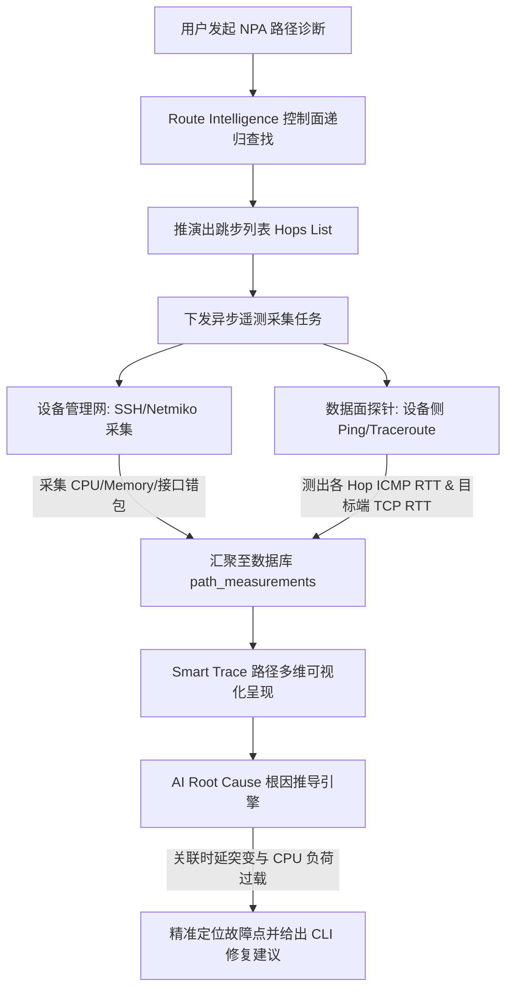

# Route Intelligence & NPA 路径性能诊断演进蓝图 (Architecture Blueprint)

本规划基于对标 Cisco ThousandEyes、Catalyst Center 以及 NetBrain 等业界领先的网络路径性能诊断系统设计，将本项目的网络智能路由发现（Route Intelligence）及智能路径诊断（Smart NPA）体系，从基础的**“路径可达性（Reachability）验证”**向深度的**“多维性能诊断（Performance Diagnostics）与遥测（Telemetry）”**演进。

---

## 1. 三层延迟测量体系 (Layered Latency Measurement Model)

为了消除“应用层 TCP 探测时延不等于真实网络传输 RTT”的固有偏差，系统底层的测量体系应重构为对标 DNA Center 的三层隔离模型：

| 测量层 (Measurement Layer) | 物理含义 (Physical Meaning) | 探测手段 (Detection Method) | 包含的延时成分 (Components) |
| :--- | :--- | :--- | :--- |
| **L3: Network RTT** | 纯网络往返时延 | 设备侧发起多包 Ping (`ping target repeat 5`) | 物理链路传输 + 沿途设备硬件 ASIC 查表转发时间 |
| **L4: TCP Connect RTT** | 三次握手应用连接时延 | TCP SYN 探针握手时耗 (`SYN` ➜ `SYN-ACK`) | Network RTT + 目标主机 TCP 内核协议栈响应时间 |
| **L7: Application RTT** | 应用层服务处理时延 | HTTPS GET / API 探测 (`curl` / HTTP 响应包) | Network RTT + TCP RTT + TLS 握手 + Web服务业务处理耗时 |

---

## 2. 数据库设计 (Route Intelligence Database Schema)

为了支撑每跳（Hop-by-Hop）的遥测数据存储与 AI 故障关联，新增性能指标历史记录表 `path_measurements`。

### SQLite / PostgreSQL DDL 建表脚本
```sql
-- 路径性能指标测量历史表
CREATE TABLE path_measurements (
    id INTEGER PRIMARY KEY AUTOINCREMENT,
    trace_id VARCHAR(64) NOT NULL,              -- 对应一次 NPA 诊断会话 ID
    src_ip VARCHAR(45) NOT NULL,               -- 源端 IP
    dst_ip VARCHAR(45) NOT NULL,               -- 目标 IP
    hop_index INTEGER NOT NULL,                 -- 第几跳 (0 代表源主机, 1, 2...)
    device_id INTEGER,                          -- 关联的系统内设备 ID (如果有)
    device_name VARCHAR(128),                   -- 设备名称 (如 R6, R9)
    interface_name VARCHAR(64),                 -- 出接口/入接口名称 (如 Gi0/0)
    vrf_name VARCHAR(64) DEFAULT 'default',     -- 路由上下文 VRF
    vlan_id INTEGER,                            -- 关联 VLAN
    hop_ip VARCHAR(45),                         -- 该跳节点的物理 IP
    icmp_rtt REAL,                              -- 纯物理网络时延 (ms)
    tcp_rtt REAL,                               -- 传输层握手时延 (ms)
    loss REAL DEFAULT 0.0,                      -- 该跳丢包率 (百分比)
    cpu_usage REAL,                             -- 设备当前时刻 CPU 利用率 (%)
    memory_usage REAL,                          -- 设备当前时刻内存利用率 (%)
    status VARCHAR(20) DEFAULT 'active',        -- active, timeout, congested, anomaly
    timestamp TIMESTAMP DEFAULT CURRENT_TIMESTAMP
);

-- 建立高频查询索引
CREATE INDEX idx_path_meas_trace ON path_measurements (trace_id);
CREATE INDEX idx_path_meas_ips ON path_measurements (src_ip, dst_ip);
```

---

## 3. Telemetry 采集与流向控制架构

在未来的采集机制中，数据流将不再单方面依靠服务器侧的简单套接字测试，而是实行“控制面递归推演 ➜ 数据面设备侧探针”的双向校验：



---

## 4. UI/UX 可视化演进蓝图 (UI Telemetry Overlay)

前端时序流与拓扑视图将不仅仅绘制发包、收包，还会在每个跳转节点中植入**微观性能指标悬浮卡片（Telemetry Chips）**：

### 拓扑/时序连线渲染示意
```text
9.9.9.9 (源主机)
   │
   ├─[R6] (Gi0/0) ── RTT: 1.2ms ── CPU: 18% ── Status: OK
   │
   ├─[R7] (Gi0/1) ── RTT: 2.1ms ── CPU: 22% ── Status: OK
   │
   ├─[R9] (Gi0/2) ── RTT: 18.5ms ── CPU: 94% ── Status: ⚠️ 异常 (时延陡增 / CPU过载)
   │
   └─192.168.96.133 (目标主机)
         TCP/443 (Connect RTT: 22.4ms)
```

---

## 5. AI 根因推导与遥测指标的融合机制 (Root Cause Correlation)

当 `path_measurements` 提供了性能数据后，AI 根因分析引擎将从原来的“基于静态 ACL 规则推断”升级为**“基于网络遥测时空关联推断”**：
1. **时序关联**：当发现 `hop_index = 3` 处的时延 `icmp_rtt` 在 1 分钟内从 `2ms` 暴涨至 `18ms` 时。
2. **多维交叉**：检索设备 `device_id = R9` 这一时刻的 CPU、内存和出接口错包（CRC）数据。
3. **因果推导**：发现其 CPU 达到 94% 且伴随接口丢包。
4. **决策生成**：判定为控制面压力过大或路由抖动引起转发表 ASIC 降级至 CPU 软件转发，输出报告：“路径连通但严重拥塞，核心故障点在设备 R9，建议查看 CPU 进程占用或更换出接口。”
