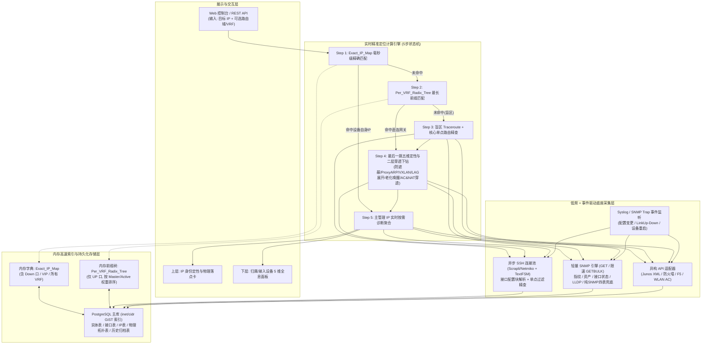
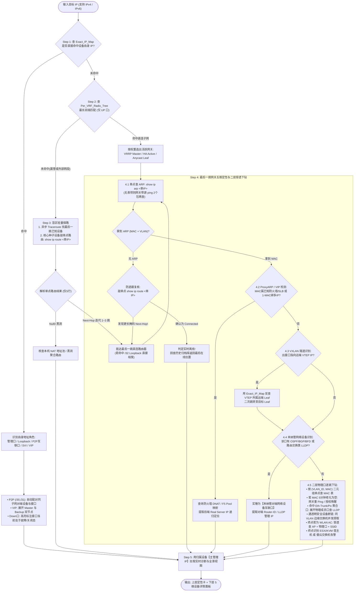

# 基于任意 IP 的网络设备全息采集与精准定位终极架构方案

> **文档版本**：v2.0（生产闭环终版）  
> **设计视角**：CCIE 网络架构 + NetDevOps 自动化工程落地  
> **适用范围**：多厂商异构园区网（有线/无线）、数据中心（传统二三层 / EVPN VXLAN / M-LAG）、广域网（MPLS VPN / 多 VRF）及安全边界（防火墙 HA / VSYS / NAT / 负载均衡）

---

## 一、 背景痛点：为什么常规采集与定位方案在生产网必翻车？

在真实的大中型生产网络中，当运维人员输入一个未知的 IP 地址希望获取“它属于哪台设备、在哪个接口、关联哪些 ARP/MAC 及设备详情”时，传统的 **“直接向目标 IP 发起 SSH/SNMP”** 或简单的 **“查 ARP ➔ 查 MAC”** 方案会遭遇六大生产级盲区：

1. **控制平面安全拦截（ACL / CoPP）**：规范网络均配置了 VTY ACL、SNMP ACL 或源接口绑定，仅允许访问带外管理口（`Mgmt`）或指定 `Loopback0`。直接连接设备的三层互联口（`/30`、`/31`）或业务网关（`Vlanif`）会全部超时，导致误判为“非网络设备”或“离线”。
2. **Loopback 环回口在二层“完全隐身”**：`/32` 的 Loopback 是纯三层逻辑接口，全网任何设备的 ARP 表和 MAC 转发表中均不存在该地址，纯二层溯源逻辑彻底失效。
3. **“一机多 IP”分身与虚拟化实体错乱**：一台核心交换机拥有上百个 `Vlanif` 与互联口，不做硬件级归一化会扫出上百台“重复设备”；反之，一台物理防火墙切分多个虚拟墙（`VSYS/Context`）或两台防火墙组成主备（`HA`），仅靠硬件序列号又会导致合并覆盖或查到备机空状态。
4. **全量拉取路由表引发 CPU 99% 生产事故**：骨干/核心设备路由表动辄数万至百万条，通过 `snmpwalk` 遍历路由表（因 OID 字典序重排）或高频执行无参数 `show ip route`，会直接打爆设备控制平面 CPU 并阻塞 VTY 线程。
5. **迷信单一 `ipAddressTable` 导致 15%~30% 地址漏采**：标准 SNMP `IP-MIB::ipAddressTable` (`.1.3.6.1.2.1.4.34`) 存在默认不返回非全局 VRF、重叠 IP 索引冲突、接口协议 `Down` 时 IP 凭空消失、漏采 `Secondary/sub` 从地址与 VRRP/HSRP 虚地址、部分固件掩码指针返回 `0.0` 等硬伤。
6. **深水区链路断裂**：未展开 `Eth-Trunk/Port-Channel` 物理成员口导致 LLDP 下钻中断、ARP（20分钟~4小时）与 MAC（5分钟）老化时间差导致半路丢目标、无线 CAPWAP 隧道集中转发落到 AC 口、EVPN VXLAN 分布式网关跳变、Proxy ARP 与 DNAT/SLB VIP 冒名顶替等。

---

## 二、 四大核心架构铁律

本方案通过以下四条工程铁律彻底解决上述全部痛点：

1. **绝不盲连目标 IP（实体反推原则）**  
   任何查询先通过底座索引或控制平面追踪反推出目标背后的**唯一设备实体（`Entity_ID`）**，再统一使用该设备的**主管理 IP（`Canonical Management IP`）**发起实时采集。
2. **零全量路由表采集（直连前缀树替代原则）**  
   **严禁定期采集全量路由表（RIB）！** 平时仅采集各设备自身的“本机接口 IP + 子网掩码”（全网 1,000 台设备仅几万条记录、内存不足 10MB），在内存中按路由域构建**直连网段前缀树（Radix Tree）**，0.1ms 直接定位最后一跳网关；未纳管盲区仅下发**带单个目标 IP 参数的单点路由查询命令**（设备 $O(1)$ 查找，仅返回 5~8 行文本，CPU 零波动）。
3. **动静分离、双源融合与低频事件驱动**  
   摒弃高频无脑轮询：准静态数据（拓扑、硬件资产、接口 IP 配置）采用**按天/半天低频巡检 + Syslog/Trap 事件触发增量更新**；配置态解析（100% 覆盖 VRF、从地址、VIP、Down 口）与运行态简要表（补齐 DHCP/PPPoE 动态 IP 与实时 Up/Down）双源融合。
4. **复合唯一主键与穿透式二三层状态机**  
   采用 `Chassis_SN + VSYS_ID` 复合主键归一实体，内置聚合口展开、老化唤醒、VXLAN 二跳、无线 AC 穿透、NAT/VIP 穿透及防遮蔽复核机制。

---

## 三、 系统总体分层架构



---

## 四、 核心数据模型与内存索引设计

### 4.1 核心数据库表结构（PostgreSQL 规范）

#### 1. 唯一网络设备实体表（`network_entity`）
解决“一机多 IP 分身”、“防火墙一虚多（VSYS）”及“双机热备多虚一（HA）”问题：

| 字段名 | 类型 | 约束/索引 | 说明 |
| :--- | :--- | :--- | :--- |
| `entity_id` | `VARCHAR(128)` | `PRIMARY KEY` | 复合唯一标识：`{chassis_sn}:{vsys_id}`（无虚拟化时 `vsys_id='default'`） |
| `chassis_sn` | `VARCHAR(64)` | `INDEX` | 机箱物理序列号（堆叠/IRF/CSS 取主框 SN，成员框存扩展 JSON） |
| `vsys_id` | `VARCHAR(64)` | `NOT NULL` | 虚拟系统名（如防火墙 `vsys_oa`、Nexus `VDC_1`、Cisco `Context`） |
| `hostname` | `VARCHAR(128)` | `INDEX` | 设备主机名（`sysName`） |
| `canonical_mgmt_ip` | `INET` | `NOT NULL, INDEX` | **唯一主管理 IP**（所有主动 SNMP/SSH/API 采集均连此地址） |
| `vendor` | `VARCHAR(32)` | `NOT NULL` | 标准化厂商枚举：`huawei`, `cisco_iosxe`, `cisco_nxos`, `h3c`, `juniper`, `fortinet`, `f5` 等 |
| `device_role` | `VARCHAR(32)` | `INDEX` | `CORE`, `AGG`, `ACCESS`, `BORDER_PE`, `FIREWALL`, `SLB`, `WLAN_AC` |
| `ha_cluster_id` | `VARCHAR(64)` | `NULLABLE, INDEX` | 双机热备集群组 ID（如华为 HRP、ASA Failover） |
| `ha_role` | `VARCHAR(16)` | `DEFAULT 'STANDALONE'` | `ACTIVE`, `STANDBY`, `STANDALONE`（实时查询永远路由至 `ACTIVE` 节点） |
| `base_mac` | `CHAR(12)` | `INDEX` | 背板基础 MAC（统一清洗为 12 位大写无分隔符，如 `4C1FCC123456`） |
| `os_version` | `VARCHAR(128)` | | 软件版本及补丁号 |
| `hardware_model` | `VARCHAR(128)` | | 硬件型号（由 `sysObjectID` 映射 + `ENTITY-MIB` 校验） |
| `uptime_seconds` | `BIGINT` | | 最近一次采集运行时长 |

#### 2. 设备接口与聚合/封装关系表（`device_interface`）
重点解决 **聚合口成员展开** 与 **单臂路由子接口真实 VLAN 提取** 问题：

| 字段名 | 类型 | 说明 |
| :--- | :--- | :--- |
| `entity_id` | `VARCHAR(128)` | 关联 `network_entity.entity_id` |
| `if_name` | `VARCHAR(64)` | 标准完整接口名（如 `TenGigabitEthernet1/0/1`、`Eth-Trunk10`、`Gi0/0/1.200`） |
| `if_index` | `INTEGER` | SNMP `ifIndex`（用于关联 MIB 表） |
| `if_type` | `VARCHAR(32)` | `PHYSICAL`, `LAG_MASTER`, `SUB_INTERFACE`, `SVI_VLANIF`, `LOOPBACK`, `TUNNEL_VXLAN`, `MGMT_OOB` |
| `parent_lag_name` | `VARCHAR(64)` | 若为聚合口成员物理口，记录所属聚合口名（如 `Eth-Trunk10`、`Port-Channel10`） |
| `member_ports` | `JSONB` | 若为 `LAG_MASTER`（含 M-LAG/vPC），直接缓存其下属所有成员物理口数组 `["Gi1/0/1", "Gi1/0/2"]` |
| `encap_vlan_id` | `INTEGER` | **真实业务 VLAN ID**（SVI 取 VLAN 号；子接口必须从配置 `dot1q termination vid <N>` 提取，严禁盲截接口名后缀！） |
| `vrf_name` | `VARCHAR(64)` | 绑定的 VRF / `vpn-instance` 名称（全局公网统一记为 `GLOBAL`） |
| `mac_addr` | `CHAR(12)` | 接口二层/三层 MAC（12 位大写十六进制归一化；Loopback 为 `NULL`） |
| `admin_status` | `VARCHAR(8)` | `UP` / `DOWN` |
| `oper_status` | `VARCHAR(8)` | `UP` / `DOWN` |
| `speed_mbps` | `INTEGER` | 协商速率（Mbps） |
| `duplex` | `VARCHAR(16)` | `FULL` / `HALF` / `UNKNOWN` |
| `description` | `TEXT` | 接口描述 `ifAlias` |
| `is_uplink_or_interconnect` | `BOOLEAN` | 是否为网络设备间互联口（由 LLDP 系统能力位或路由邻居自动打标） |

#### 3. 全量接口 IP 与虚拟地址表（`device_ip_address`）

| 字段名 | 类型 | 说明 |
| :--- | :--- | :--- |
| `ip_addr` | `INET` | 纯 IP 地址（不含掩码，如 `10.255.12.2`） |
| `prefix_len` | `SMALLINT` | 掩码长度（如 `30`, `24`, `32`, `128`） |
| `subnet_cidr` | `CIDR` | 自动计算出的网络号（如 `10.255.12.0/30`，建 PostgreSQL `GiST` 索引） |
| `routing_domain` | `VARCHAR(64)` | 路由域标识：`{network_zone}:{vrf_name}`（隔离不同园区/租户的重叠私网地址） |
| `entity_id` | `VARCHAR(128)` | 归属设备唯一 ID |
| `if_name` | `VARCHAR(64)` | 绑定接口名 |
| `ip_role` | `VARCHAR(32)` | `MGMT`, `LOOPBACK`, `P2P_INTERCONNECT`, `SVI_PRIMARY`, `SECONDARY_SUB`, `VIP_VRRP`, `VIP_HSRP`, `ANYCAST_GW`, `DYNAMIC_DHCP_PPPOE`, `NAT_POOL_VIP` |
| `vip_role` | `VARCHAR(16)` | 若为 VRRP/HSRP/HA 地址，标记当前状态：`MASTER`, `BACKUP`, `ANYCAST_ACTIVE` |
| `oper_status` | `VARCHAR(8)` | 冗余记录所属接口当前 `UP` / `DOWN` 状态 |

---

### 4.2 内存双索引结构定义（Python 工程伪代码）

服务启动及每次增量采集更新后，将 `device_ip_address` 同步加载至内存中的两套高速结构（1,000 台设备耗时 < 150ms，内存 < 10MB）：

```python
from dataclasses import dataclass
from typing import Dict, List, Optional
import pytricia  # 基于 C 实现的高性能内存 Radix Tree，单次 LPM 查询 < 0.01ms

@dataclass
class IPRecord:
    ip: str
    prefix_len: int
    routing_domain: str      # 例: "HQ:VRF_PROD" 或 "HQ:GLOBAL"
    entity_id: str           # 例: "210235A1B2C3:default"
    canonical_mgmt_ip: str   # 该设备唯一主管理 IP
    if_name: str
    ip_role: str             # LOOPBACK / P2P_INTERCONNECT / VIP_VRRP / SVI_PRIMARY ...
    vip_role: Optional[str]  # MASTER / BACKUP / ANYCAST_ACTIVE / None
    oper_status: str         # UP / DOWN (精确字典保留 DOWN 口用于故障直查!)
    encap_vlan_id: Optional[int]

# 索引 1：精确 IP 倒排字典（保留 DOWN 状态接口、Loopback、VIP、NAT VIP）
# Key: ip_str -> Value: List[IPRecord] (支持多 VRF 重名 IP 并列返回)
Exact_IP_Map: Dict[str, List[IPRecord]] = {}

# 索引 2：分域直连网段前缀树（严格剔除 oper_status == 'DOWN' 的接口，防止割接残留假命中！）
# Key: routing_domain -> Value: pytricia.PyTricia(128) (同时兼容 IPv4 与 IPv6)
# PyTricia Node Value: 按网关优先级排好序的 List[IPRecord]
Per_VRF_Radix_Tree: Dict[str, pytricia.PyTricia] = {}

def gateway_sort_key(rec: IPRecord) -> tuple:
    """同网段多网关候选排序权重：VRRP/HSRP Master 最优先 > Anycast > 主SVI > Backup 垫底"""
    role_weight = {
        "MASTER": 0,
        "ANYCAST_ACTIVE": 1,
        None: 2,
        "BACKUP": 9,
    }.get(rec.vip_role, 5)
    return (role_weight, rec.entity_id)
```

---

## 五、 后台底座采集规范（科学低频周期 + 零漏采多源融合）

### 5.1 降载后的生产级采集周期表

| 采集任务 | 定时全量校准周期 | 实时事件驱动触发源（Syslog / SNMP Trap） | 单台耗时与负载 |
| :--- | :--- | :--- | :--- |
| **硬件资产与实体基线**<br/>（SN、型号、版本、VSYS/HA） | **每 24 小时 1 次**<br/>（凌晨低峰期） | 监听设备重启 `coldStart` / `warmStart` 或 `sysUpTime` 翻转回零 | < 200ms，CPU 无感 |
| **全量接口 IP / VRF / VIP 底座** | **每 24 小时 1 次**<br/>（凌晨低峰期） | 监听配置变更事件（Cisco `%SYS-5-CONFIG_I`、华为 `hwCfgManEventlog`、H3C `CFGMAN_CFGCHANGED`）触发**单台增量重采** | 1~2 秒，文本 30~100KB |
| **LLDP / CDP 物理拓扑与聚合口关系** | **每 12 小时 1 次** | 监听 `lldpRemTablesChange` 或端口 `linkUp/linkDown` 触发单台局部刷新；**实时下钻时单点核验目标口** | 0.5~1.5 秒 |
| **接口 Up/Down 状态与基础计数** | **每 15~30 分钟 1 次**<br/>（或直接订阅现有监控系统） | 监听 `linkUp/linkDown` 实时改状态；**实时定位命中设备时单点 `SNMP GET` 目标口复核** | < 150ms |
| **历史 ARP / MAC 离线归档（可选）** | **每 2~4 小时错峰限速** | 仅用于“已断电离线终端”的历史最后在线位置溯源；采用限速 `GETBULK` | 限速安全拉取 |

> **高压红线**：任何后台定时任务或实时脚本中，**严禁配置对 `ipRouteTable` (`.1.3.6.1.2.1.4.21`)、`ipCidrRouteTable` (`.4.24`)、`inetCidrRouteTable` (`.4.24.7`) 的 SNMP Walk 操作！**

---

### 5.2 全量接口 IP 采集双通道实现细节

#### 通道 A（主权威源，覆盖率 100%）：SSH/API「接口配置块 + 运行态简要表」融合解析
为什么不拉整份 `running-config`（可能含数万行 ACL/BGP 策略），而只拉接口段 + 简要状态表？因为体积仅几十 KB，却能一次性解决 **VRF 隔离、重叠 IP、`sub` 从地址、VRRP/HSRP VIP、子接口真实 `dot1q vid`、Down 口残留 IP 以及 PPPoE/DHCP 动态获取地址** 全部问题！

| 厂商平台 | 1. 静态配置块提取命令（拿全主从 IP/掩码/VRF/VIP/dot1q） | 2. 运行态摘要补充命令（补齐 DHCP/PPPoE 实 IP 与 Up/Down） |
| :--- | :--- | :--- |
| **华为 VRP / CloudEngine** | `display current-configuration interface` | `display ip interface brief` + `display vrrp brief` + `display eth-trunk` |
| **华三 Comware V7** | `display current-configuration interface` | `display ip interface brief` + `display vrrp` + `display link-aggregation verbose` |
| **Cisco IOS / IOS-XE** | `show running-config \| section ^interface`<br/>*(老版本不支持 `section` 时降级为 `show ip interface` + `show vrf`)* | `show ip interface brief` + `show standby brief` + `show vrrp brief` + `show etherchannel summary` |
| **Cisco NX-OS** | `show running-config interface` | `show ip interface brief vrf all` + `show hsrp brief` + `show port-channel summary` |
| **Juniper Junos** | `show configuration interfaces \| display inheritance \| display xml`<br/>+ `show configuration routing-instances \| display xml` *(提取 VRF 归属!)* | `show interfaces terse \| display xml` |
| **FortiGate 防火墙** | REST API `/api/v2/cmdb/system/interface` + `/firewall/vip`<br/>或 CLI `show system interface` + `show firewall vip` | `get system interface physical` + `get system ha status` |
| **F5 BIG-IP 负载均衡** | iControl REST `/mgmt/tm/net/self` + `/mgmt/tm/ltm/virtual-address` | 同步获取 Pool & Pool Members (`Real Server IP` 映射关系) |

#### 通道 B（仅开放 SNMP 权限的黑盒设备兜底）：SNMP 四表合并采集器
当第三方代维设备不提供 SSH/API 账号时，必须按以下顺序拉取并按 `(ifIndex, IP)` 合并去重：
1. **`IP-MIB::ipAddrTable` (`.1.3.6.1.2.1.4.20`)**：100% 兼容老设备，优先提取最可靠的 `ipAdEntNetMask`（解决 `.4.34` 掩码指针 `0.0` 问题）。
2. **`IP-MIB::ipAddressTable` (`.1.3.6.1.2.1.4.34`) + `ipAddressPrefixTable` (`.1.3.6.1.2.1.4.32`)**：补齐 IPv6 地址及部分厂商暴露的从地址。
3. **`VRRP-MIB::vrrpAssoIpAddrTable` (`.1.3.6.1.2.1.68.1.4`) + `vrrpOperState`**：补齐标准 VRRP 虚 IP 与 Master/Backup 角色；思科设备叠加 `CISCO-HSRP-MIB::cHsrpGrpTable` (`.1.3.6.1.4.1.9.9.106.1.2.1`)。
4. **`IEEE8023-LAG-MIB::dot3adAggPortAttachedAggID` (`.1.2.840.10006.300.43.1.2.1.1.13`)**：纯 SNMP 场景下提取物理口与聚合口的绑定关系。

---

## 六、 实时精准定位引擎：5 步状态机全流程（核心算法）

当用户输入一个目标 `IP`（及可选路由域 `domain`，未指定则并发检索所有路由域并合并有效命中结果）时，执行以下确定性状态机：



### 6.1 关键步骤核心处理细则

1. **MAC 地址格式全链路标准化**：
   * 内存与数据库统一存储 12 位大写无分隔符字符串（如 `005056ABCDEF`）。
   * 下发单点 CLI 命令前，通过厂商 Driver 动态格式化：Cisco 转为 `0050.56ab.cdef`，华为/H3C 转为 `0050-56ab-cdef`，Junos/Linux/F5 转为 `00:50:56:ab:cd:ef`。
2. **Step 4.1 防大网段遮蔽复核（Supernet Shadowing Check）**：
   * 场景：上层防火墙配了 `10.10.0.0/16`，下层某台漏纳管的三层交换机拆了 `10.10.88.0/24`。本地前缀树会回退命中 `/16`。
   * 动作：当 `/16` 设备查不到 `10.10.88.5` 的 ARP 时，**严禁直接报离线**，必须在该设备上补敲一句 `show ip route 10.10.88.5`。若发现指向下级 `Next-Hop`，立即顺着下一跳精准揪出那台漏纳管的三层交换机！
3. **Step 4.5 二层下钻的四大保障算子**：
   * **算子 A（真实 VLAN 二元组防窜路）**：从网关接口表读取 `encap_vlan_id`（解决单臂路由子接口 `.999` 封装 `vid 100` 不一致问题），执行 `show mac address-table address <MAC> vlan <VID>`；仅当遇到跨交换机 `VLAN Mapping / QinQ` 查不到时，才降级为不带 VLAN 的纯 MAC 查询并标记 VLAN 转换。
   * **算子 B（ARP 与 MAC 老化时间差唤醒）**：网关 ARP 默认 20~240 分钟老化，接入交换机 MAC 默认 5 分钟（300 秒）老化。若网关有 ARP 但交换机 MAC 表为空，先由网关发单播 `ping` 唤醒；若目标主机开启系统防火墙禁 Ping 仍不回包，默认展示历史归档端口并提示“静默主机禁 Ping 导致二层 MAC 老化”，同时在界面提供受控按钮 **「强制二层 ARP 唤醒探测」**（仅对非网关普通终端单点清除该条 ARP 后立即 Ping，触发二层广播 ARP Request 强制唤醒网卡回复 ARP Reply 刷新全链路 MAC 表）。
   * **算子 C（聚合口成员物理口展开）**：查 MAC 返回 `Eth-Trunk10` / `Port-Channel10`（含 M-LAG/vPC 双归属）时，从 `device_interface.member_ports` 展开所有 `UP` 物理成员口，遍历成员口的 LLDP 邻居锁定下游交换机的主管理 IP 继续下钻。
   * **算子 D（透明串接设备兜底捞取）**：若核心与接入之间串接了纯二层透明防火墙/IPS（不提供 MAC 表查询），导致逐跳追踪中断，引擎自动在同园区、开放了该 `VLAN_ID` 的下游接入交换机列表中异步并发执行单点 `show mac ... <单MAC>`，剔除 Trunk 上联口后直接锁定边缘物理 Access 口。

---

## 七、 十二大生产级隐藏 Bug 防御验收清单（Checklist）

在代码上线前，研发与测试团队可直接对照以下 12 项极端场景逐条验收：

| 序号 | 经典踩坑场景 | 传统方案错误表现 | 本方案内置防御机制 |
| :---: | :--- | :--- | :--- |
| **01** | **互联口 / 业务口配了管理 ACL** | 直接对目标 IP 发 SSH/SNMP 超时，误判离线或普通主机 | 先查 `Exact_IP_Map` 或前缀树反推归属设备，始终走 **`canonical_mgmt_ip`** 采集 |
| **02** | **查询 `/32` Loopback 环回地址** | 查遍全网 ARP 和 MAC 表均无记录，定位失败 | `Exact_IP_Map` 直接命中；未纳管设备由单点路由 `/32` 主机路由精准锁定 |
| **03** | **核心/PE 设备路由表高达百万条** | `snmpwalk` 路由表导致设备 CPU 99% 告警、SSH 卡死 | **零全量路由表采集**；本地 10MB 直连前缀树 + 盲区单点 `show ip route <单IP>` |
| **04** | **`ipAddressTable` 漏 VRF/从地址/VIP/掩码** | 漏掉 15%~30% 业务网段，或掩码返回 `0.0` 无法建树 | 低频 SSH 解析 `interface` 配置块 + 运行态简要表融合；纯 SNMP 走四表合并兜底 |
| **05** | **割接残留 `shutdown` 接口配置未删** | 新旧两台核心都有相同子网配置，查到了旧核心空 ARP | `Exact_IP_Map` 保留 Down 口供直查，但 **`Per_VRF_Radix_Tree` 严格剔除 Down 口** |
| **06** | **VRRP / HSRP 主备网关双活在线** | 落到 Backup 备机上查 ARP 返回空，误报终端离线 | 前缀树候选网关按 `MASTER > ANYCAST > BACKUP` 权重排序，优先查主网关 |
| **07** | **多 VRF / 多园区私网 `192.168.1.0/24` 重叠** | 单棵全局树互相覆盖，张冠李戴指错设备 | 按 `routing_domain` 分域建多棵前缀树，未指定域时并发检索并列返回所有存活命中 |
| **08** | **防火墙 VSYS 一虚多 & HA 主备多虚一** | 10 台虚拟墙被合并成 1 台，或查到 HA 备机无活跃表项 | 复合主键 `chassis_sn + vsys_id`，HA 集群识别并强制路由至 `ACTIVE` 节点 |
| **09** | **网关有 ARP（20m），交换机无 MAC（5m）** | 静默打印机/服务器二层追踪断在半路找不到物理口 | 网关主动单播 Ping 唤醒 + 历史归档回查 + 可选受控单点重刷 ARP 二层广播唤醒 |
| **10** | **MAC 学在 `Eth-Trunk` / `Port-Channel` 上** | 拿逻辑聚合口名字去查物理口 LLDP 表无匹配，追踪中断 | 自动展开 LAG 物理成员口（含 vPC/M-LAG 双机成员）后再匹配 LLDP 下钻 |
| **11** | **EVPN VXLAN 网关 / 无线 AC / ESXi 宿主机** | 停在 VTEP 隧道口、停在连 AC 的万兆口、误报私接小交换机 | 识别 VTEP 自动二跳远端 Leaf；识别 WLAN AC 自动穿透查 `AP+SSID`；结合 LLDP/OUI 识别宿主机 |
| **12** | **开启 Proxy ARP 或查询 DNAT / F5 VIP** | 把代答 ARP 的防火墙/F5 当成目标终端主机 | 检测已知设备接口 MAC 及 `1-MAC 对多 IP` 特征，自动穿透查询 NAT/SLB Pool 真实后端 IP |

---

## 八、 标准化 API 输出与前端展示规范

### 8.1 标准 JSON 返回结构示例（涵盖设备自身口与终端穿透）

```json
{
  "query": {
    "input_ip": "10.255.12.2",
    "requested_domain": "ALL",
    "elapsed_ms": 185
  },
  "matches": [
    {
      "routing_domain": "HQ:VRF_PROD",
      "ip_classification": "NETWORK_DEVICE_P2P_INTERCONNECT",
      "online_status": "ONLINE",
      "location_summary": {
        "entity_id": "210235A1B2C3:default",
        "hostname": "BJ-DC-Agg-SW01",
        "canonical_mgmt_ip": "192.168.254.11",
        "bound_interface": "TenGigabitEthernet1/0/48",
        "subnet_cidr": "10.255.12.0/30",
        "encap_vlan_id": null,
        "mac_address": "4C:1F:CC:AA:BB:01",
        "mac_vendor_oui": "Huawei Technologies Co.,Ltd",
        "admin_status": "UP",
        "oper_status": "UP",
        "peer_relationship": {
          "peer_hostname": "BJ-DC-Core-SW01",
          "peer_mgmt_ip": "192.168.254.1",
          "peer_interface": "TenGigabitEthernet1/0/1",
          "peer_ip": "10.255.12.1",
          "protocol_state": "OSPF FULL / BFD UP"
        },
        "special_penetration": null,
        "edge_port_warning": null
      },
      "device_panorama": {
        "asset_identity": {
          "vendor": "huawei",
          "model": "CloudEngine 6865E-48S8CQ",
          "serial_number": "210235A1B2C3",
          "vsys_id": "default",
          "ha_status": "M-LAG_MASTER",
          "os_version": "VRP 8.220 (CE6800 V200R022C00SPC500)",
          "uptime": "412 days, 14:22:09",
          "sys_location": "BJ-IDC-Room2-Rack04-U22"
        },
        "target_port_diagnostics": {
          "description": "To_BJ-DC-Core-SW01_Te1/0/1",
          "speed_duplex": "10000Mbps / FULL",
          "rx_optical_power_dbm": -2.41,
          "tx_optical_power_dbm": -1.85,
          "in_utilization_pct": 14.2,
          "out_utilization_pct": 8.7,
          "crc_errors": 0,
          "input_drops": 0
        },
        "health_snapshot": {
          "cpu_usage_pct": 11.0,
          "memory_usage_pct": 38.5,
          "power_supply": "2/2 NORMAL (Redundant)",
          "fan_status": "NORMAL",
          "temperature_celsius": 36
        }
      }
    }
  ]
}
```

### 8.2 前端双层视图展示规范

1. **上层：目标 IP 身份定性与落点卡片（首屏直出结论）**
   * **明确的身份徽章（Badge）**：直观区分 `[管理口]`、`[Loopback 环回口]`、`[三层互联口]`、`[SVI 网关实地址]`、`[VRRP/HSRP 虚网关 VIP]`、`[NAT/SLB 映射 VIP]`、`[有线接入终端]`、`[无线 Wi-Fi 终端]`、`[虚拟化宿主机 VM]`。
   * **全路径可视化面包屑**：
     * *若是设备自身口*：`[BJ-DC-Agg-SW01 (管理IP: 192.168.254.11)]` ➔ `Te1/0/48 (10.255.12.2/30)` ⟷ 对端 `[BJ-DC-Core-SW01 Te1/0/1 (10.255.12.1/30)]`
     * *若是普通有线终端*：`网关 [SZ-Agg-SW03 Vlanif55]` ➔ `ARP [00:e0:4c:xx:xx:xx | Realtek]` ➔ `汇聚 [Eth-Trunk3 (Gi1/0/1)]` ➔ **最终物理落点 `[SZ-Acc-3F-SW02 Gi1/0/18 (1000M/Full, Access VLAN 55)]`**
     * *若是无线终端*：`网关 [SZ-Core Vlanif200]` ➔ `WAC [SZ-WAC-01]` ➔ **最终无线落点 `[AP: 3F-East-AP06 (连于 SZ-PoE-SW01 Gi1/0/5) | SSID: Corp-Office | -58dBm]`**
2. **下层：归属/接入网络设备 5 维全景详情（折叠/Tab 页按需加载）**
   * **Tab 1 - 设备身份与硬件状态**：SN、型号、版本、Uptime、堆叠/M-LAG/HA 角色、电源/风扇/温控/CPU/内存。
   * **Tab 2 - 全量三层接口与 VRF 视图**：展示该设备名下所有 VRF 的接口 IP、掩码、VIP 及状态，自动置顶高亮本次命中的接口。
   * **Tab 3 - 命中端口深度物理诊断**：端口描述、协商速率/双工（标红百兆半双工异常）、**光模块收发光功率（标红光衰临界告警）**、错包计数。
   * **Tab 4 - 关联 ARP 与 MAC 局部透视**：**严禁全表一次性渲染**，默认仅展示命中端口/VLAN 关联的前 50 条记录（标注端口下挂 MAC 总数），提供按 IP / MAC / VLAN 实时检索框。
   * **Tab 5 - LLDP / CDP 邻居拓扑列表**：展示本机所有物理互联邻居设备名、本端/对端口及对端管理 IP，支持点击邻居一键跳转。

---

### 8.3 客观物理边界与友好提示规范（绝不静默失败或抛未知异常）

当遇到超越网管协议物理可观测极限的两类客观场景时，系统按标准文案明确呈现：

1. **桌面私接非网管傻瓜交换机 / Hub**：
   * **判定条件**：最终边缘物理口为非上联口、无网络设备/宿主机/WAC 类 LLDP 邻居、非 IP 话机串接 PC 双 MAC 模式，但单端口同时学习到 `≥ 3` 个不同终端活跃 MAC。
   * **标准提示**：`已精准定位至最近受管交换机 [SZ-Acc-3F-SW02] 物理端口 [Gi1/0/12]；检测到该边缘端口下同时存在 N 个活跃终端 MAC，现场极可能私接了非网管桌面小交换机/Hub，请前往该信息点位排查。`
2. **目标 IP 当前彻底断电离线**：
   * **判定条件**：直连网关确认 `Connected`（排除遮蔽路由）且唤醒探测后仍无实时 ARP。
   * **标准提示**：`目标 IP [192.168.55.88] 当前实时状态为【离线】；经检索历史归档库，该 IP 最后一次在线时间为 [YYYY-MM-DD HH:mm]，当时绑定 MAC 为 [XX:XX:XX:XX:XX:XX]，接入位置为 [SZ-Acc-3F-SW02 -> Gi1/0/8]。`

---

## 九、 工程实施路线图（分阶段落地建议）

1. **Phase 1（底座与内存双索引，1~2 周）**：完成 `network_entity` / `device_interface` / `device_ip_address` 表建模，打通主流厂商（华为/H3C/思科）低频 SSH `interface` 配置块解析 + SNMP 四表兜底，构建内存 `Exact_IP_Map` 与 `Per_VRF_Radix_Tree`（至此已可 100% 毫秒级定位全网所有设备自身接口 IP、Loopback、互联口与 VIP）。
2. **Phase 2（二层穿透与防坑算子，1~2 周）**：实现最后一跳网关单点 ARP 查询、防遮蔽路由复核、LAG 聚合口成员展开、`(VLAN, MAC)` 下钻、ARP/MAC 老化唤醒及 Syslog/Trap 增量事件监听（至此搞定全网有线终端精准到物理口定位）。
3. **Phase 3（异构深水区扩展，按现网需求迭代）**：接入 EVPN VXLAN VTEP 自动二跳、WLAN AC 无线终端 AP 穿透、防火墙/F5 DNAT VIP 穿透及历史离线归档回查。
