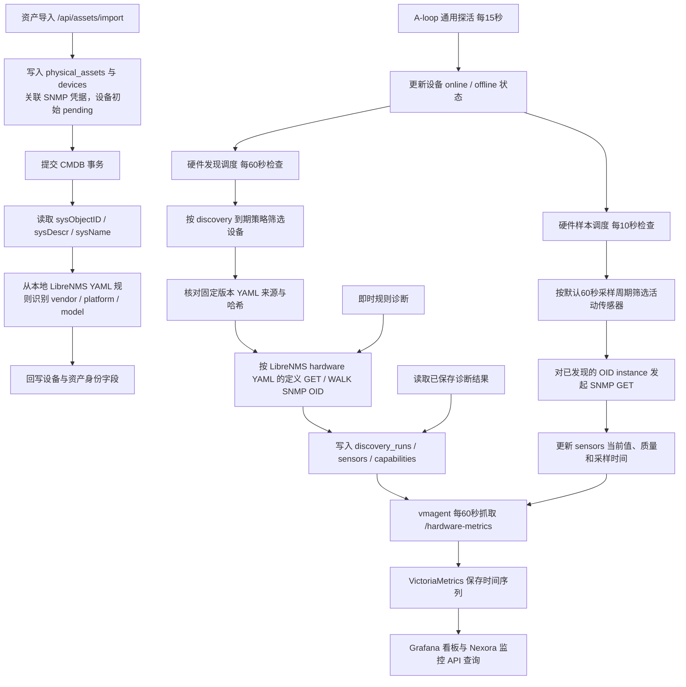

# Nexora SNMP 硬件采集全流程与代码索引

本文按当前代码说明设备身份识别、LibreNMS 规则解析、硬件发现、周期采样、数据存储和 Grafana 展示。这里的“LibreNMS 规则”指固定版本的 LibreNMS OS 检测与硬件发现 YAML；Nexora 用 Python 解析这些 YAML 并执行 SNMP 请求。项目没有启动 LibreNMS PHP/Laravel 运行时，因此不能据此宣称与 LibreNMS 完整 PHP 运行行为逐项等价。

## 流程图

## 1. 导入与身份识别

网络资产导入入口是 `POST /api/assets/import`，实现位于 `backend/api/assets.py` 的 `import_assets`。它先提交 `physical_assets`、`devices` 和凭据关联；新建设备初始状态是 `pending`。提交后可选的 LibreNMS 纳管是单独的外部 API 路径，与本地硬件采集不同。

导入后的本地身份探测由 `backend/services/snmp_import_identification_service.py` 的 `identify_imported_device` 执行，最多并发 5 台。它从设备读 `sysObjectID`、`sysDescr` 和 `sysName`，根据项目固定的 LibreNMS OS 检测 YAML 推导身份，只回写 vendor、platform、model、version。凭据缺失、SNMP 失败、识别冲突或规则歧义不会回滚已经提交的资产。这个阶段不做硬件传感器发现，也不绑定自定义 OID 指标 Profile。

不要把轻量 `POST /api/devices/import` 与资产导入混为一条链路：前者只创建 `devices`，没有上述资产导入后的 SNMP 身份识别步骤。

## 2. 规则与 MIB 文件如何参与

固定上游版本、文件哈希和本地路径记录在 `backend/vendor/librenms/source-manifest.json`。规则解析和同步入口在 `backend/services/librenms_rule_service.py`：

- `resources/definitions/os_detection/*.yaml` 用于 OS 身份匹配。
- `resources/definitions/os_discovery/*.yaml` 用于定义硬件类别、OID、索引、单位和转换方式。
- `backend/services/librenms_mib_service.py` 解析本地 MIB 并建立符号到 OID 的本地索引，供规则解释和诊断使用。它不是逐台设备的轮询器，也不会因导入 MIB 就产生传感器样本。
- `backend/services/librenms_source_policy.py` 校验采集结果对应的 discovery YAML 是否来自固定上游 commit、是否在 manifest 中登记且哈希匹配；没有通过来源校验的硬件结果不会作为可信传感器保存或导出。

规则选择依据是 OS detection/discovery YAML，不依据 MIB 目录名或 `platform_vendor_scope`。项目用 `backend/services/snmp_hardware_probe_service.py` 中的 Python 解析器执行 YAML 描述的 SNMP 操作，不执行 LibreNMS 的 PHP OS adapter、PHP sensor adapter 或 Laravel 模型。MIB 文件是协议符号索引资源，不能代替 discovery YAML。

### manifest 的厂商数量怎么读

`backend/vendor/librenms/source-manifest.json` 同时记了几种不同维度，数字不能互换：

| 清单维度 | 当前数量 | 含义 |
| --- | ---: | --- |
| Nexora 网络资产厂商 | 26 | 网络设备厂商枚举，包括 DPtech |
| Nexora 网络安全资产厂商 | 15 | 资产管理页面的安全厂商枚举 |
| 有 LibreNMS OS profile 的网络厂商 | 25 | 网络资产厂商中除 DPtech 外的厂商 |
| 固定上游有 OS profile 的安全厂商 | 10 | 包括 WatchGuard；其中仅选择有结构化硬件定义的 profile 入 bundle |
| OS profile | 156 | 136 个网络 profile 加 20 个安全硬件 profile；不是厂商数 |
| 有 hardware discovery YAML 的 bundled profile | 142 | 14 个网络 profile 在固定 LibreNMS commit 中没有 discovery YAML |
| 网络 YAML 未解析出硬件定义 | 31 | 未解析出 processors、mempools 或 sensors 的网络 YAML；安全无硬件产品 profile 不进入 bundle |
| 当前解析器至少识别一个硬件定义 | 111 | 仅说明解析器识别到结构化定义，不保证真实设备支持或采样成功 |
| 本地 MIB 顶层目录 | 32 | 31 个厂商分组目录，加 `standard` |
| MIB 上游来源目录 | 44 | LibreNMS `mibs/` 下的上游路径名称；多个目录会归入同一 Nexora 厂商分组 |

例如 `mibs/hp` 中的 ProCurve 文件放在本地 `mibs/aruba/_upstream/hp`，`mibs/fs` 中的 Fiberstore 文件放在 `mibs/ruijie/_upstream/fs`，`mibs/paloaltonetworks` 映射到 `mibs/palo-alto/_upstream/paloaltonetworks`。因此 32 个本地顶层目录和 44 个上游来源目录不是厂商支持数量。没有专属 MIB 目录本身不等于 discovery YAML 一定不能通过标准 MIB/OID 工作。

安全设备硬件规则目前覆盖 20 个 upstream OS profile、9 个资产安全厂商。Sangfor、Venustech、NSFOCUS、Topsec、Qi An Xin 在固定上游中没有 OS detection profile；WatchGuard 有识别 YAML，但没有可解析硬件定义。Barracuda Email Security Gateway 只有一个通用 count sensor，其他 Barracuda 产品 profile 与 Sophos UTM 没有可解析的硬件定义。PAN-OS 保留两个依赖设备型号/版本的条件，因此规则诊断级别是 partial。

可直接核实的文件是 `backend/vendor/librenms/source-manifest.json` 的 `asset_network_vendors`、`asset_security_vendors`、网络/安全 profile 清单、`mibs`、`mib_scope_mappings` 与 `notes` 字段；每条 MIB 的 `upstream_path` 是上游原路径，`bundle_path` 是本地包路径，`platform_vendor_scope` 只是 Nexora 离线索引分组。

## 3. 后台发现与采样周期

后台启动由 `backend/main.py` 调用 `backend/engine/orchestrator.py` 的 `start_loops`。普通探活流程每 15 秒运行，可将设备状态从 `pending` 更新为 `online` 或 `offline`；硬件调度只处理 online 且有管理 IP 的网络设备。因此新导入设备不是“资产提交后立即完成硬件发现”。

硬件发现和采样是两个独立循环：

- discovery loop 每 60 秒检查一次。首次发现或规则版本变化时可立即发现；成功或 `not_found` 默认 24 小时后重试，`partial` 默认 1 小时，`failed/unsupported` 默认 15 分钟。
- sample loop 每 10 秒检查一次 due 状态，但默认最短实际采样间隔是 60 秒。环境变量 `SNMP_HARDWARE_SAMPLE_INTERVAL_SECONDS` 可设为 15–3600 秒，超出范围会被钳制。
- discovery 按 OS YAML 中的规则发现传感器；后续 sampling 从数据库加载活动且来源可信的传感器，只对发现出的精确 OID instance 执行 SNMP GET。没有活动传感器计划时不会自行猜 OID。
- vmagent 的 `platform_hardware_inventory` 抓取间隔也是 60 秒。它抓取 API 当前暴露值的频率与设备端 SNMP 采样周期是不同的计时器。

调度及持久化的主要代码在 `backend/services/snmp_hardware_poller_service.py`：`_discovery_due`、`_discover_device`、`collect_device_hardware`、`_persist_discovery`。SNMP 命令和 YAML 解释在 `backend/services/snmp_hardware_probe_service.py` 的 `probe_librenms_hardware` 与 `poll_hardware_inventory`。

## 4. 数据写到哪里、如何显示

关系数据库保存设备/凭据、规则缓存和硬件库存：

- `devices`、`physical_assets` 保存设备身份与资产信息；SNMP 凭据由凭据记录/凭据解析服务提供给采集器，不进入 Prometheus 标签。
- `snmp_librenms_rules` 缓存已解析的 OS 检测和 discovery 定义；本地 MIB/OID repository 保存解析索引。
- `snmp_hardware_discovery_runs` 记录发现尝试，`snmp_hardware_sensors` 保存已发现传感器的身份和最近一次采样值/质量/时间，`snmp_hardware_capabilities` 保存发现能力汇总。
- 当前本地采集器更新 sensor 当前行，不在关系数据库为每个采样点写一条历史行。vmagent 每分钟抓取 `/hardware-metrics` 后，时间序列由 VictoriaMetrics 保存；Grafana 从 VictoriaMetrics 查询趋势。

硬件指标导出在 `backend/api/grafana_metrics.py`，由 `backend/services/snmp_hardware_inventory_service.py` 渲染；`monitoring/vmagent/scrape.yml` 中 `platform_hardware_inventory` 负责抓取。设备详情和网络总览看板由 `monitoring/grafana/generate_dashboards.py` 生成到 `monitoring/grafana/dashboards/`。监控报告 API 对长期趋势的查询则从 VictoriaMetrics 读取，并不是直接读取 sensor 当前行。

如果启用了外部 LibreNMS 实例，外部 `librenms_native` 投影是独立数据来源；本地 YAML 采集与其通过 `data_origin` 区分。不要把外部 API 请求、规则 YAML 的本地 SNMP 请求和 Grafana 抓取合并成一次采集。

## 5. 通用接口 SNMP 采集当前状态

接口流量与状态原本由另一条 `snmp_exporter`/Monitoring V1 链路提供，不属于硬件 discovery YAML。当前工作区已停止从数据库中的手工/厂商 OID module 生成 exporter 请求：`backend/services/monitoring_compiler.py` 的 `render_exporter_modules` 不发出没有固定 LibreNMS 来源证明的模块，随编译产物生成的 `snmp_exporter/snmp.yml` 因而是空 `modules`；仓库内的 `monitoring/snmp-exporter/snmp.yml` 也保留空配置。旧 `background_monitor_service` 中直接调用 `collect_interface_data` 的接口采集段已移除。

因此，当前本地 SNMP exporter 链路不会产出新的 `ifHCInOctets`、`ifOperStatus` 等接口样本；Grafana 中依赖 `job="network_snmp"` 的接口面板可能无新数据。VictoriaMetrics 中尚在保留期内的历史样本仍可能显示。不要把硬件 sensors 的采集成功解释成接口流量采集正常。

这是严格移除无上游来源自定义 module 后留下的功能缺口，不是 SNMP 采样间隔或 Grafana 刷新频率问题。要恢复接口采集，需要先确定并验证符合项目“LibreNMS 来源”要求的通用接口实现，再恢复 exporter 输出；不能直接恢复旧的手工厂商 OID module。`source-manifest.json` 明确只声明 OS identity 与硬件传感器来源，不为接口链路背书。

## 6. SNMP 诊断页做什么

`src/components/SnmpMib/components/LiveWalkInspector.tsx` 把 IP 解析为 Nexora 已登记设备，然后提供不同诊断操作：

- “LibreNMS 规则实时诊断”调用 `POST /api/platform-registry/snmp-librenms-rule-test`，执行同一固定 YAML 规则路径，但 `persist=False`，结果只用于当次诊断，不写入正式传感器库存。
- “硬件发现结果”调用 `POST /api/platform-registry/snmp-hardware-discovery-test`，读取已保存发现/传感器样本；它不会临时触发一轮 SNMP 采集。
- 通用 `snmp-walk-test` 任意 OID walk 接口已退役并返回 410，页面的硬件规则诊断不会使用一套独立于 LibreNMS YAML 的自定义厂商 OID 列表。
- 系统信息页直接读取 SNMP 系统身份字段；它不等于硬件 discovery 结果。

因此，“硬件规则诊断”来自固定 LibreNMS YAML；页面中系统身份信息来自标准系统 OID；保存结果页来自 Nexora 数据库。不要把三种结果的来源说成完全相同。

## 7. 已知限制与排查顺序

1. YAML 文件来源来自固定 LibreNMS commit，但执行器是 Nexora Python 实现，并非 LibreNMS PHP 运行时。源码相同不自动证明每个解析、转换和边界行为与 PHP 完全一致。
2. 14 个 OS profile 没有 discovery YAML；这表示该固定版本没有可供本地规则执行的硬件定义，不代表设备身份不能识别。接口监控是独立路径，当前状态见第 5 节。不要用 Nexora 自定义 OID 静默补齐。
3. 在线状态不代表 SNMP 凭据可用。排查时依次确认设备状态/IP、凭据解析、三项 sys* 身份读取、OS YAML 匹配、来源 commit/hash、发现记录、活动 sensor 和最近采样时间、`/hardware-metrics`、VictoriaMetrics 抓取和 Grafana 查询。
4. 规则身份匹配出现同分候选时，资产导入和定时采集都会拒绝选取，并报告 `rule_ambiguous` / `ambiguous_librenms_rule`；定时发现按 unsupported 退避重试，不会把排序后的首条候选当成唯一规则。
5. `AssetManagement` 导入反馈展示 SNMP 身份识别成功/失败；LibreNMS 外部纳管结果是独立状态，不应解读成硬件 YAML 规则绑定。
6. 接口 exporter 当前没有受 manifest 来源校验的 module，硬件采集正常也不会自动恢复接口指标；排查接口面板时先检查 `snmp_exporter/snmp.yml` 和 `network_snmp` 目标/抓取状态。
