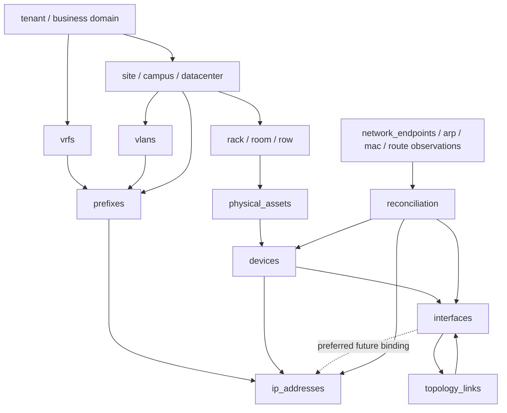

# CMDB/IPAM 当前数据模型关系图

## 结论摘要

当前项目已经具备网络 CMDB/IPAM 的核心数据骨架，但还没有完全形成企业级权威模型。

最重要的现状判断：

- `devices` 已经是网络可管理对象的事实主表。
- `interfaces` 已经具备独立表结构，并通过 `device_id` 归属到设备。
- `topology_links` 已经能绑定到 `source_interface_id` 和 `target_interface_id`，方向正确。
- `prefixes` 已绑定 VRF、VLAN、site、tenant，并能表达层级 prefix。
- `ip_addresses` 已绑定 subnet 和 device，也预留了 `interface_id`，但主要业务逻辑仍以 `interface_name` 字符串为主。
- `physical_assets` 和 `devices` 已通过 `asset_id` 联动，但存在 hostname、IP、VLAN、生命周期、凭据等字段重叠。
- `network_endpoints` 是发现数据表，字段包含 IP、MAC、switch、port、VLAN、VRF、site，但尚未形成统一 reconciliation 状态机。
- 当前 `/api/cmdb/*` 和 CMDB 页面主要覆盖 credentials、sites、racks、VRFs、VLANs、tenants，尚未把 `device + interface` 提升为 CMDB 主入口。

因此，当前模型与企业级整改建议“部分一致”：底层表已经接近，但产品层和 API 层仍需把 `device + interface` 明确提升为网络 CMDB 主骨架。

## 核心实体分层



## 当前表与职责

| 表/模块 | 当前职责 | 企业级定位 | 当前缺口 |
|---|---|---|---|
| `tenants` | 租户/业务域基础数据 | CMDB 组织边界 | VRF 唯一性仍偏全局，不够租户化 |
| `sites` | 站点基础数据 | CMDB 空间边界 | `devices.site` 仍是文本字段，未完全外键化到 `sites.id` |
| `racks` | 机柜、容量、功耗、U 位 | 物理空间模型 | 已较接近目标，需要和资产上架关系继续固化 |
| `device_types` | 设备型号规格 | 资产规格模型 | 可继续作为机柜/功耗/容量计算基础 |
| `physical_assets` | 资产台账、采购、维保、机柜、凭据/接管信息 | 物理资产权威 | 与 `devices` 存在 hostname、management_ip、vlan、lifecycle、credential 重叠 |
| `devices` | 可管理设备、连接信息、平台、状态、配置、监控字段 | 网络可管理对象权威 | `site` 仍是文本；凭据和资产字段重叠；接口/IP 关系未完全标准化 |
| `interfaces` | 设备接口、状态、速率、MAC、VRF、VLAN 信息 | 网络 CMDB 的核心子资源 | 尚未在 CMDB 页面/API 中成为一等资源 |
| `vrfs` | VRF 基础数据 | 三层隔离域 | 当前 `vrf_name` 全局唯一，企业多租户下应改为 `(tenant_id, vrf_name)` |
| `vlans` | VLAN 基础数据 | 二层广播域 | 有 `(site_id, vlan_id)` 查询索引，但缺数据库唯一约束和租户语义强化 |
| `prefixes` | IP prefix、VRF/VLAN/site/tenant 绑定、层级关系 | IPAM prefix 权威 | `prefix` 仍是文本，缺 PostgreSQL `cidr`/强约束 |
| `ip_addresses` | IP 地址记录、设备和接口名称绑定 | IPAM 地址权威 | `interface_id` 已预留但业务主路径仍依赖 `interface_name` |
| `ipam_pools` | 地址池 | IPAM 分配范围 | 需增加范围校验、重叠校验和生命周期规则 |
| `ipam_vips` | VIP 地址 | IPAM 特殊地址对象 | 与 `ip_addresses` 的冲突关系需统一 |
| `ipam_dhcp_leases` | DHCP 租约 | 动态地址观测/租约数据 | 需和静态 IPAM 地址做冲突检测 |
| `topology_links` | 接口到接口链路 | 拓扑权威/确认后链路 | 已有接口外键方向，需结合 discovery run 和确认状态 |
| `network_endpoints` | ARP/MAC/终端发现结果 | Discovery 观测事实 | 不应直接覆盖 CMDB/IPAM，需要 reconciliation 状态机 |

## 当前代码入口

### CMDB 基础数据入口

- API：`backend/api/cmdb.py`
- Service：`backend/services/cmdb_service.py`
- 前端：`src/pages/CmdbManagementTab.tsx`
- 当前对象：credentials、sites、racks、VRFs、VLANs、tenants

当前 CMDB 页面是“基础数据维护”视角，不是完整网络资源图视角。

### 设备与接口入口

- 设备 API：`backend/api/devices.py`
- 接口 API：`backend/api/interfaces.py`
- 接口表：`interfaces`
- 接口唯一性：`(device_id, interface_name)`

设备和接口已经支撑监控、拓扑、巡检、配置、IP 定位等模块，但还没有被 `/api/cmdb/*` 聚合为 CMDB 主视图。

### IPAM 入口

- API：`backend/api/ipam.py`
- Service：`backend/services/ipam_service.py`
- 前端：`src/pages/IPVlan/`
- 当前对象：prefixes、addresses、pools、VIPs、DHCP leases、utilization、reconciliation

IPAM 已经和 CMDB 的 site/VRF/VLAN/tenant 发生关系，但 IP 到 interface 的绑定还不够强。

## 关键关系

### 资产到设备

当前关系：

```text
physical_assets.id -> devices.asset_id
```

现状评价：

- 已有双向联动逻辑：资产创建可自动创建设备，设备创建也可补资产。
- 适合继续保留，但需要明确字段权威边界。

建议目标：

```text
physical_assets = 物理资产权威
devices = 可管理设备权威
asset_id = 两者一对一链接
```

### 设备到接口

当前关系：

```text
devices.id -> interfaces.device_id
interfaces unique(device_id, interface_name)
```

现状评价：

- 这是当前最接近企业级网络 CMDB 骨架的关系。
- 后续 CMDB/IPAM/Topology/Telemetry/Alert 都应围绕 `interfaces.id` 收敛。

建议目标：

```text
device
  -> interface
      -> ip_addresses
      -> vlan membership
      -> vrf binding
      -> topology_links
      -> telemetry
      -> alert_events
```

### Prefix 到 CMDB

当前关系：

```text
prefixes.vrf_id -> vrfs.id
prefixes.vlan_id -> vlans.id
prefixes.site_id -> sites.id
prefixes.tenant_id -> tenants.id
prefixes.gateway_device_id -> devices.id
prefixes.gateway_interface_id -> interfaces.id
```

现状评价：

- 方向正确。
- `gateway_device_id` 和 `gateway_interface_id` 已经体现了“prefix 与设备接口”关系。
- 仍缺 PostgreSQL `cidr` 字段、重叠约束和并发分配保护。

### IP 到设备/接口

当前关系：

```text
ip_addresses.subnet_id -> prefixes.id
ip_addresses.device_id -> devices.id (逻辑字段，schema 未强外键)
ip_addresses.interface_name -> interface name string
ip_addresses.interface_id -> interfaces.id (预留字段)
```

现状评价：

- 已经有 device/interface 绑定意识。
- 但 `interface_id` 尚未成为主路径，`interface_name` 字符串仍是主要业务字段。

建议目标：

```text
ip_addresses.interface_id -> interfaces.id
ip_addresses.device_id = denormalized helper or derived from interface
ip_addresses.interface_name = display/cache compatibility field
```

### Discovery 到权威数据

当前关系：

```text
network_endpoints.ip/mac/switch_id/switch_port/vlan/vrf/site
  -> get_ipam_reconciliation()
  -> undocumented / stale / mismatch result
```

现状评价：

- 已经有 IPAM 对账能力。
- 但发现结果还没有持久化的 finding/action 状态机。

建议目标：

```text
Discovery observation
  -> reconciliation finding
  -> user approved action
  -> CMDB/IPAM authoritative write
  -> audit event
```

## 与整改计划的一致性

| 整改建议 | 当前项目是否具备 | 评价 |
|---|---:|---|
| device + interface 作为网络 CMDB 主骨架 | 部分具备 | 底层表具备，CMDB 页面/API 未提升 |
| site/tenant/rack 作为空间和组织上下文 | 基本具备 | site/rack/tenant 已有，device.site 需外键化 |
| VRF/VLAN/prefix/IP 与设备接口关联 | 部分具备 | prefix 关联较好，IP 关联接口仍弱 |
| Discovery 不直接覆盖权威数据 | 部分具备 | 有 reconciliation 查询，但缺持久化流程 |
| PostgreSQL 原生 IPAM | 不充分 | IP/prefix 仍为 TEXT |
| 原子 IP 分配 | 不充分 | 当前 next available 和 create 分离 |
| 企业级审计和权限 | 部分具备 | 各模块有审计调用，但标准还不统一 |

## 后续整改落点

优先建议：

1. `CMDB-000`：确立 `device + interface` 为网络 CMDB 主骨架。
2. `CMDB-002`：资产、设备、接口关系重构。
3. `IPAM-003`：原子 IP 分配接口。
4. `IPAM-001`：PostgreSQL 原生 IPAM 字段迁移。
5. `REC-002`：IPAM 对账中心从查询升级为闭环处置。

