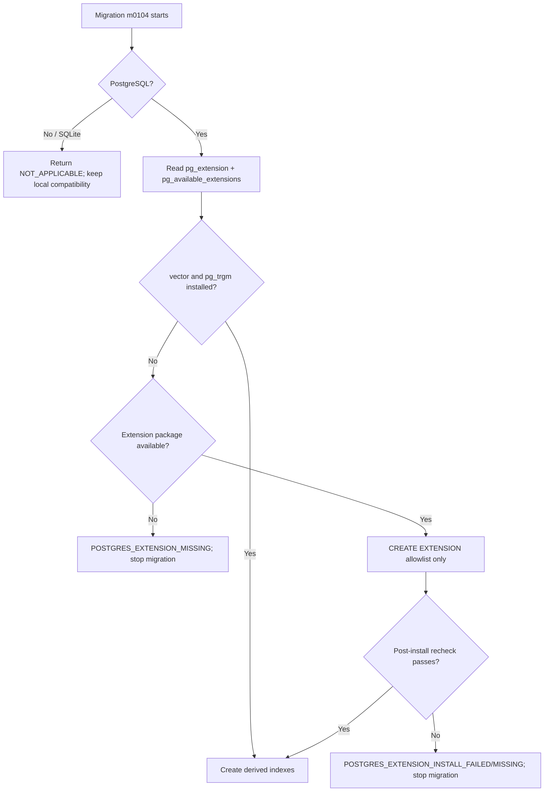

# DB-004 PostgreSQL vector / pg_trgm 扩展检查与错误处理

## 1. 结论

DB-004 已将 PostgreSQL 扩展从“迁移时尝试、异常吞掉”改为可观察、可重试、fail-closed 的检查：

- `vector`（pgvector）是 V2 向量存储/相似度索引的必需扩展。
- `pg_trgm` 是 Alias/拼写/短文本模糊匹配的必需扩展。
- `pgcrypto` 只作为可选能力；V2 UUID 工厂不依赖它，避免把可选安装误当硬依赖。
- 迁移前读取 `pg_extension` 与 `pg_available_extensions`，缺失时只对 allowlist 尝试 `CREATE EXTENSION IF NOT EXISTS`，安装后再次复查。
- 不可用、无权限、安装失败或复查仍缺失时抛出稳定错误码，阻断更高版本迁移；不再静默 `pass`。
- SQLite 只返回 `NOT_APPLICABLE`，允许本地测试，但不能作为 PostgreSQL 能力证据。

机器可读契约：[DB-004-POSTGRES-EXTENSION-CONTRACT.yaml](./DB-004-POSTGRES-EXTENSION-CONTRACT.yaml)。

## 2. 实现位置

`backend/database/postgres_extensions.py` 提供：

- `inspect_extensions()`：只读检查已安装/可用扩展，清理驱动异常，不泄露连接串或密钥。
- `ensure_required_extensions()`：校验 allowlist、按需创建、安装后复查，返回稳定 `ExtensionState`。
- `PostgreSQLExtensionError`、`POSTGRES_EXTENSION_INSPECTION_FAILED`、`POSTGRES_EXTENSION_MISSING`、`POSTGRES_EXTENSION_INSTALL_FAILED` 错误契约。

`backend/database/migrations/m0104_ai_pgvector_rag.py` 在建立派生索引前调用该 helper，同时检查 `vector` 和 `pg_trgm`。扩展不可用时 migration runner 会回滚当前事务并停止后续迁移，日志只保留扩展名、错误码和操作建议。

## 3. 检查流程

## 4. 错误处理与安全

| 场景 | 返回/异常 | 处理 |
|---|---|---|
| SQLite 本地测试 | `NOT_APPLICABLE` | 可继续离线测试，但不生成 PostgreSQL 能力证据 |
| 查询系统目录失败 | `POSTGRES_EXTENSION_INSPECTION_FAILED` | 检查连接、权限、服务健康；不吞异常 |
| 服务器没有 pgvector/contrib | `POSTGRES_EXTENSION_MISSING` | 安装对应包、重启 PostgreSQL、重试迁移 |
| 包可用但无 CREATE 权限 | `POSTGRES_EXTENSION_INSTALL_FAILED` | 由 DBA 授予权限或预安装；不绕过 Gate |
| 安装后仍不可见 | `POSTGRES_EXTENSION_MISSING` | 阻断更高迁移，核对目标数据库/连接 |

错误信息只包含扩展名、稳定错误码、包/权限/重启建议和 driver exception type；禁止输出 DSN、密码、API Key 或完整驱动 payload。扩展名经过字符 allowlist 校验，不允许 SQL 注入。

## 5. 数据库、索引和回滚边界

扩展和索引是数据库能力/派生结构，不是 Document/Source 事实。`m0104` 只在扩展 Gate 后创建既有派生索引；扩展 Gate 失败不写业务数据。未来索引的 fresh/upgrade/idempotent/downgrade 必须独立验证。回滚前检查其他对象依赖，必要时只撤销 V2 派生索引/extension，并关闭 V2 retrieval flag，回到 V1 或本地 lexical fallback；不删除原始文档或 V1 数据。

## 6. 验收范围

- helper 在 SQLite、已安装、不可用、无权限、安装后未生效五条路径下有测试。
- m0104 不再包含吞异常 `pass`，且扩展检查发生在派生索引之前。
- 必需扩展、错误码、无密钥日志、allowlist、重查和 SQLite NOT_APPLICABLE 均有 Evidence。
- pgvector 维度与模型/版本合同由 CHK/RET/DB 后续任务验证，本任务不假装完成向量质量或生产容量验证。

## 7. 最终结论

**PASS**：PostgreSQL `vector`、`pg_trgm` 与可选 `pgcrypto` 的边界、安装检查、错误处理、迁移阻断、SQLite 兼容和回滚规则已实现并测试。
