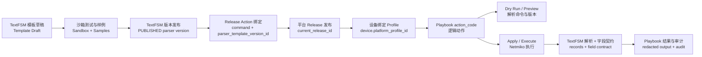

# TextFSM 注册模板关联 Playbook 用户手册（TextFSM-to-Playbook User Manual）

**适用版本 / Applicable date**：2026-08-04
**适用范围 / Scope**：平台注册表（Platform Registry）、TextFSM 模板注册表（Template Registry）、受控 Playbook（Controlled Playbook）和 Netmiko 只读动作（read-only actions）。

## 1. 先看结论（Executive summary）

发布 TextFSM 版本并不会自动让 Playbook 使用它。完整关联必须经过下面的链路：

1. 创建或 Fork 一个 TextFSM 模板，并把版本发布为 `PUBLISHED`。
2. 在平台 Release 的动作映射中，把 `parser_template_version_id` 指向这个已发布版本。
3. 发布平台 Release，使平台 Profile 的 `current_release_id` 指向它。
4. Playbook 只引用稳定的逻辑动作 `action_code`，不直接写模板名称、模板文件名或 CLI 命令。
5. 执行时，设备的 `platform_profile_id` 找到当前 Release；Release Action 再解析出实际命令和 TextFSM 版本。

也就是说，真正的绑定点是：

```text
platform_release_actions.parser_template_version_id
```

Playbook 与 TextFSM 之间不是直接按模板名称关联，而是通过 `action_code → platform release action → parser_template_version_id` 间接关联。

## 2. 完整运行链路（End-to-end flow）



## 3. 核心对象和字段（Objects and keys）

| 对象 / Object | 关键字段 / Key fields | 作用 / Purpose |
|---|---|---|
| 模板 / `parser_templates` | `platform_code`, `template_code`, `source` | 模板身份；`SYSTEM` 模板只读，租户模板可编辑 |
| 模板版本 / `parser_template_versions` | `id`, `status`, `content`, `checksum`, `field_contract_json` | TextFSM 的不可变版本；只有 `PUBLISHED` 版本可被 Release 引用 |
| 平台 Profile / `platform_profiles` | `platform_code`, `connection_driver`, `parser_platform`, `current_release_id` | 定义厂商平台、Netmiko 驱动和当前生效 Release |
| 平台 Release / `platform_releases` | `id`, `status`, `checksum`, `validation_status` | 一组经过校验和审批的动作映射发布单元 |
| 动作映射 / `platform_release_actions` | `action_code`, `command`, `parser_template_version_id`, `field_contract_json` | **TextFSM 与 Playbook 的实际绑定点** |
| Playbook 版本 / `playbook_versions` | `definition.phases`, `status`, `checksum` | 只保存声明式步骤；受控模式下的 action 步骤引用 `action_code` |
| 设备 / `devices` | `platform_profile_id` | 设备运行时使用哪个平台 Profile；Profile 的当前 Release 决定具体命令和解析器 |

### 3.1 字段名不要混用（Do not mix these keys）

- `platform_code`：模板的解析平台键，例如 `dptech_ios`、`ruijie_rgos`。
- `parser_platform`：平台 Profile 的解析器键，必须与模板的 `platform_code` 完全一致。
- `connection_driver`：连接驱动键，例如 `hp_comware`、`ruijie_os`；它不是 TextFSM 模板键。
- `action_code`：Playbook 使用的稳定逻辑动作，例如 `get_arp_table`；它不是命令字符串。
- `command`：Release Action 中实际发给设备的只读 CLI，例如 `show arp all`。
- `parser_template_version_id`：一个**已发布** TextFSM 版本的精确 ID。
- `field_contract`：解析结果的字段契约，包含必填字段、可选字段和类型。

## 4. 前置条件和角色（Prerequisites and roles）

### 4.1 系统前置条件

- `PLATFORM_REGISTRY_ENABLED=1`，并且 `/api/platform-registry/capabilities` 返回 `write_enabled: true`。
- 当前账号具有 TextFSM、平台 Release 和 Playbook 对应权限。
- 设备已经纳入资产，并绑定到正确的平台 Profile；不要只依赖设备型号字符串推断平台。
- 已准备脱敏的 CLI fixture（fixture output）或沙箱样例；不必为了模板发布先连接真实设备。

### 4.2 角色边界

- **模板开发者（Template Developer）**：创建/Fork、编辑草稿、沙箱测试、上传样例、提交审核。
- **平台维护者（Platform Maintainer）**：创建 Release、填写动作命令和模板版本绑定、校验 Release。
- **发布/审批者（Release Manager / Administrator）**：审批和发布；后端会阻止创建者自审批。
- **Playbook 作者（Playbook Author）**：编写 `action_code` 步骤，不能在受控模式写裸命令。
- **执行者（Operator）**：选择设备，先 Dry Run/Validation，再按授权 Apply。

当前后端对 TextFSM 版本的 `approve/publish` 还要求 Administrator 权限；页面上显示的按钮不是最终权限判断，后端响应才是准则。

## 5. 创建或 Fork TextFSM 模板（Create or fork）

### 5.1 进入页面

中文系统：`自动化（Automation） → 模板注册表（Template Registry）`。
默认入口：`/automation/textfsm-registry`。部分旧版本仍显示 `解析模板（Parse Templates）` 或 `/automation/textfsm`，从该入口切换到注册表页面即可。

### 5.2 创建租户模板

点击 **新建（New）**，填写：

| 页面字段 / UI field | 填写要求 / Requirement |
|---|---|
| 平台 / `platform_code` | 使用规范小写键，例如 `dptech_ios`，不要填中文厂商名 |
| 模板编码 / `template_code` | 大写字母、数字、下划线；例如 `DPTECH_IOS_SHOW_ARP_ALL` |
| 模板名称 / `name` | 便于运维人员识别的中英文名称 |
| 模板内容 / `content` | TextFSM 语法；字段名建议使用稳定英文名 |
| 字段契约 / `field_contract` | JSON 对象；至少声明关键字段和类型 |

一个最小可运行的示例：

```text
Value INTERFACE (\S+)
Value STATUS (up|down)

Start
  ^${INTERFACE}\s+${STATUS} -> Record
```

对应的字段契约（Field contract）：

```json
{
  "required": ["interface", "status"],
  "optional": [],
  "types": {
    "interface": "string",
    "status": "string"
  }
}
```

允许的类型为 `string`、`integer`、`number`、`boolean`。字段名会被规范化为小写下划线形式，因此 `INTERFACE` 会成为 `interface`。

### 5.3 SYSTEM 模板

系统模板显示 `SYSTEM 只读（SYSTEM read-only）` 时不能直接编辑。点击 **复制为租户模板（Fork）**，填写新的模板编码和名称，再在复制出来的租户副本上修改。中文界面统一显示“复制”，英文界面保留 “Fork”；后端来源值仍是 `FORKED`。不要通过前端绕过 SYSTEM 只读限制。

复制后，TextFSM 注册表页面顶部的“复制后怎么写？”和“字段说明”会提示每个输入项的用途。编辑器只负责解析设备回显，不保存 CLI 命令；命令绑定必须在 `平台注册表 → 平台 Profile → 命令映射` 中完成：

```text
Playbook action_code → Release command + parser_template_version_id
```

最小编辑顺序是：修改 `content`（`Value` 定义字段、`Start` 匹配、`Record` 输出）→ 粘贴脱敏回显 → Sandbox 测试 → 填写 `field_contract` 和期望记录 → 保存草稿。模板发布后，再回到命令映射选择这个 `PUBLISHED` 版本。

## 6. 沙箱测试、样例和版本发布（Test and publish the parser）

1. 点击 **保存草稿（Save draft）**，生成 `DRAFT` 版本。
2. 在 **Sandbox 测试（Sandbox test）** 中粘贴脱敏回显。
3. 确认结果记录（records）数量大于 0，字段名称和类型符合契约。
4. 点击 **上传加密样例（Upload encrypted sample）**，填写样例名和期望记录数组。
5. 点击 **历史回归（Regression）**，确认所有保留样例通过。
6. 按顺序执行：`提交审核（Submit） → 审批（Approve） → 发布（Publish）`。

版本状态只能按下面的顺序流转：

```text
DRAFT → IN_REVIEW → APPROVED → PUBLISHED
```

发布时后端会再次检查沙箱测试和历史样例回归；旧的 `PUBLISHED` 版本会转为 `DEPRECATED`。版本发布成功后，记录版本的 `id`，后续绑定 Release 时要使用这个 ID，而不是模板编码。

常用接口：

```text
GET  /api/parser-templates/{template_id}/versions
POST /api/parser-templates/sandbox-test
POST /api/parser-templates/versions/{version_id}/samples
POST /api/parser-templates/versions/{version_id}/submit
POST /api/parser-templates/versions/{version_id}/approve
POST /api/parser-templates/versions/{version_id}/publish
```

## 7. 把已发布 TextFSM 绑定到平台 Release（Bind the published parser）

这是最终目标中最关键的一步。

### 7.1 先确认 Profile 和 Release

进入 `平台注册表（Platform Registry）`，默认入口：`/automation/platforms`。

1. 选择目标厂商 Profile。
2. 在 **动作映射（Mappings）** 中确认正在编辑的是 `DRAFT` Release；已发布 Release 不可直接修改。
3. 确认 Profile 的 `parser_platform` 与 TextFSM 模板的 `platform_code` 完全相同。
4. 确认动作码已经存在，例如 `get_arp_table`、`get_interface_brief`。

### 7.2 在 UI 选择并绑定（推荐路径）

在 `命令映射（Command mappings）` 中点击 **编辑命令/解析版本（Edit command/parser）**。解析版本下拉框由后端按当前 Profile 实时过滤，只展示：

- `status = PUBLISHED` 的版本；
- 模板 `platform_code = Profile.parser_platform`；
- SYSTEM 全局版本，或当前 Profile 作用域内的 SYSTEM 版本；
- 当前租户、当前 Profile 作用域内的 CUSTOM/FORKED 版本。

选择版本后保存，页面会同时提交命令、`parser_template_version_id` 和该版本的字段契约。若旧绑定版本已不再兼容，页面会标记“当前版本不兼容，请替换”，必须改选兼容版本或取消绑定。

每个动作卡片的解析版本旁提供 **打开模板（Open template）** 快捷入口。点击后会带着 `template_id` 和 `version_id` 返回 TextFSM 注册表，并自动定位到同一模板和版本，便于查看内容、字段契约、测试样例和发布状态；该入口不会绕过 Release 的保存、校验、审批或发布流程。

新建自定义模板时，先选择目标 **平台 Profile**；页面会以 Profile 的 `parser_platform` 作为模板解析键，避免把设备平台编码误当成 TextFSM 解析键。SYSTEM 模板复制时也必须选择目标 Profile。

### 7.3 绑定接口（自动化/故障排查备用路径）

使用已经登录的会话调用下面的接口；不要把账号密码或会话令牌写入文档、脚本仓库或截图。

```http
PUT /api/platform-registry/releases/{release_id}/actions/{action_code}
Content-Type: application/json

{
  "command": "show arp all",
  "parser_template_version_id": "<PUBLISHED_TEXTFSM_VERSION_ID>",
  "field_contract": {
    "required": ["ip", "mac", "interface"],
    "optional": [],
    "types": {
      "ip": "string",
      "mac": "string",
      "interface": "string"
    }
  }
}
```

后端会拒绝以下情况：

- Release 不是 `DRAFT`；
- `action_code` 不在动作定义白名单；
- `command` 不是一条安全的只读 `show/display` 命令；
- TextFSM 版本不是 `PUBLISHED`；
- `parser_template_version.platform_code` 与 Profile 的 `parser_platform` 不一致；
- 模板或 Profile 超出当前租户/平台作用域。

保存成功后，系统会更新 `platform_release_actions`，并重新计算命令和 Release checksum。

### 7.4 绑定结果核对

绑定后可用下面的接口核对：

```text
GET /api/platform-registry/profiles/{profile_id}/actions?release_id={release_id}
```

如果需要独立核对页面下拉框的候选集，可调用：

```text
GET /api/platform-registry/profiles/{profile_id}/parser-versions
```

该接口和保存接口使用同一套平台、租户、Profile 作用域规则；候选集为空时，不要绕过校验强行绑定，应先修正模板的 Profile 归属。

返回的动作行中，以下三项必须同时正确：

```text
action_code                  = get_arp_table
command                      = show arp all
parser_template_version_id   = <刚发布的 TextFSM version id>
```

### 7.5 发布平台 Release

在 Release 页面依次执行：

1. **验证（Validate）**：检查动作数量、只读命令和绑定模板回归。
2. **提交审批（Submit）**：`DRAFT → IN_REVIEW`。
3. **批准（Approve）**：`IN_REVIEW → APPROVED`。
4. **发布（Publish）**：`APPROVED → PUBLISHED`。

发布后，Profile 的 `current_release_id` 会切换到新的 Release；旧的已发布 Release 会被废弃。以后设备运行时读取的是 Profile 当前 Release，而不是用户浏览器里之前打开的旧页面。

常用接口：

```text
POST /api/platform-registry/profiles/{profile_id}/releases
POST /api/platform-registry/releases/{release_id}/validate
POST /api/platform-registry/releases/{release_id}/submit
POST /api/platform-registry/releases/{release_id}/approve
POST /api/platform-registry/releases/{release_id}/publish
```

## 8. 在 Playbook 中引用动作（Reference the action in a Playbook）

### 8.1 进入受控版本编辑器

中文系统：`自动化（Automation） → 自动化任务（Automation） → Playbooks → 受控版本（Controlled versions）`。
默认地址通常为 `/automation/playbooks`；侧栏的 Automation 入口可能显示为 `/automation/tasks`，进入后切换到 Playbooks。

点击 **创建草稿（Create draft）**，在版本定义 JSON 的 `phases` 中填写逻辑动作，不要填写原始命令：

```json
{
  "phases": {
    "pre_check": [],
    "execute": [
      {
        "type": "action",
        "action_code": "get_arp_table",
        "parameters": {}
      }
    ],
    "post_check": [],
    "rollback": []
  }
}
```

说明：

- `action_code` 必须是小写字母开头的稳定动作码，例如 `get_arp_table`。
- `parameters` 必须是对象；只能使用该动作定义允许的参数。
- `repeat` 可选，最多 10 次；分支深度和总步骤数也有后端上限。
- `branch`、`notification`、`approval` 是受控步骤类型；审批步骤只能放在 `pre_check` 或 `execute` 顶层。
- `PLATFORM_REGISTRY_ENABLED=1` 时，字符串形式的裸命令会被拒绝，错误通常为 `RAW_COMMAND_DISABLED`。

Playbook 版本也必须流转：

```text
DRAFT → Validate → IN_REVIEW → APPROVED → PUBLISHED
```

提交前必须通过版本校验；创建者不能审批自己的 Playbook 版本。

### 8.2 Playbook 不保存 TextFSM version id

这是设计上的职责分离：

- Playbook 只保存业务动作 `action_code`；
- 平台 Release 保存具体命令和 `parser_template_version_id`；
- 这样同一个 Playbook 可以在 Cisco、华为、锐捷等平台上使用同一个逻辑动作，由各自 Release 提供不同命令和解析模板。

因此，Playbook JSON 中**不要**写模板文件名、模板编码或 `parser_template_version_id`。如果要切换解析模板，应创建新的 TextFSM 版本并更新 Release Action，再发布新的平台 Release。

### 8.3 替换已有 Playbook 使用的 TextFSM（Replace the parser used by an existing Playbook）

替换时不需要修改已发布 Playbook 的 `action_code`。按以下顺序操作：

1. 在 TextFSM 注册表中 Fork 或创建租户模板，修改内容并完成 Sandbox、加密样例和历史回归。
2. 将新版本依次 **提交审核 → 审批 → 发布**，确认状态为 `PUBLISHED`。
3. 在平台注册表选择同一个 Profile，创建或打开 `DRAFT` Release；在目标 `action_code` 的命令映射中选择新的兼容解析版本并保存。
4. 对 Release 执行 **Validate → Submit → Approve → Publish**。发布后，Profile 的 `current_release_id` 才会指向新 Release。
5. 对原 Playbook 运行 Dry Run，核对返回的 `platform_release_id`、`release_checksum` 和 `parser_template_version_id`；确认无误后再按权限 Apply。

Playbook 仍通过 `action_code → 当前 Profile Release → parser_template_version_id` 解析到新模板。此替换会影响使用该 Profile 和动作的所有 Playbook/设备；旧的已发布 Release 保留用于审计和回滚。如需只替换单个 Playbook，必须先使用独立 Profile 或另行实现版本固定功能。

## 9. Dry Run、审批和 Apply（Dry Run, approval and apply）

### 9.1 Preview Commands 和 Dry Run 的区别

- **Preview Commands（命令预览）**：展示场景中可渲染的命令和 `action_codes`，用于检查场景结构；受控 action 不会被渲染成裸命令。
- **Run Validation / Dry Run（运行校验）**：执行受控动作的 `preview_platform_action`，不建立设备连接，返回解析后的命令、Release checksum、命令 checksum 和 `parser_template_version_id`。
- **Apply Changes（应用/执行）**：调用 Netmiko 发送 Release 中的命令，然后在后端沙箱中解析回显，执行字段契约校验并返回 records。

受控动作的 Dry Run 结果重点检查：

```text
action_code
command
platform_release_id
release_checksum
parser_template_version_id
resolved_command_checksum
```

Dry Run 不会产生真实设备回显；要验证真实回显到 TextFSM 的完整链路，需要在测试设备上执行 Apply，或者先用脱敏 fixture 完成 Sandbox/Regression。

### 9.2 执行请求（Execution request）

受控执行的核心请求形态如下：

```json
{
  "scenario_id": "<scenario-id>",
  "playbook_version_id": "<PUBLISHED_PLAYBOOK_VERSION_ID>",
  "platform": "dptech_ios",
  "device_ids": ["<device-id>"],
  "variables": {},
  "dry_run": true,
  "concurrency": 1
}
```

接口：

```text
POST /api/playbooks/execute
```

返回 `execution_id` 后，前端通过 `/api/ws/playbook/{execution_id}` 订阅状态。若执行 action，事件中的 `platform_actions[].parser_template_version_id` 应与 Release Action 绑定的版本一致。

### 9.3 执行审批（Execution approval）

Playbook 版本审批和一次执行审批是两件不同的事：

- 版本审批：发布 Playbook 定义前的生命周期审批。
- 执行审批：在 `pre_check` 或 `execute` 顶层加入 `approval` 步骤后，本次执行会暂停。

执行审批接口：

```text
GET  /api/playbooks/{execution_id}/approvals
POST /api/playbooks/{execution_id}/approvals/{approval_id}/approve
POST /api/playbooks/{execution_id}/approvals/{approval_id}/reject
```

只有审批全部通过后，执行任务才会继续；拒绝会停止本次执行。

## 10. 如何确认“模板确实被 Playbook 使用”（Verification checklist）

按以下顺序核对，不要只看页面上的成功 Toast：

1. TextFSM 版本详情：`status = PUBLISHED`，沙箱测试为通过，历史样例回归通过。
2. 平台动作列表：`parser_template_version_id` 等于刚发布的版本 ID。
3. 平台 Release：`status = PUBLISHED`，`validation_status = PASSED`。
4. Profile：`current_release_id` 等于刚发布的 Release ID。
5. 设备：`platform_profile_id` 指向该 Profile，且设备在当前租户/站点/设备组作用域内。
6. Playbook JSON：步骤只有 `action_code`，没有裸命令。
7. Dry Run：返回相同的 `platform_release_id`、`release_checksum` 和 `parser_template_version_id`。
8. Apply：结果包含 `records` 和相同的 `parser_template_version_id`；原始回显在审计和错误路径会脱敏/加密保存。

模板注册表中的 **影响分析（Impact analysis）** 可用于查看动作和 Release 数量；如果设备或 Playbook 计数为空，应再以 Release Action、Profile 当前 Release 和 Dry Run 返回值为准。

## 11. 端到端示例：DPtech ARP 表（Worked example）

目标：让 Playbook 的 `get_arp_table` 动作使用 DPtech 的自定义 TextFSM。

### 11.1 模板侧

```text
platform_code  = dptech_ios
template_code  = DPTECH_IOS_SHOW_ARP_ALL
```

完成 Sandbox、样例和版本发布后，得到：

```text
PUBLISHED_TEXTFSM_VERSION_ID = <version-id>
```

### 11.2 Release 侧

确认 Profile：

```text
parser_platform   = dptech_ios
connection_driver = dptech_ios
```

在 `DRAFT` Release 中绑定：

```json
{
  "command": "show arp all",
  "parser_template_version_id": "<version-id>",
  "field_contract": {
    "required": ["ip", "mac", "interface"],
    "optional": [],
    "types": {
      "ip": "string",
      "mac": "string",
      "interface": "string"
    }
  }
}
```

完成 Release 的 Validate、Submit、Approve、Publish。

### 11.3 Playbook 侧

```json
{
  "phases": {
    "pre_check": [],
    "execute": [
      { "type": "action", "action_code": "get_arp_table", "parameters": {} }
    ],
    "post_check": [],
    "rollback": []
  }
}
```

Dry Run 应看到 `get_arp_table` 解析为 `show arp all`，并带出同一个 `<version-id>`。Apply 成功后，`records` 应是标准化的 `ip/mac/interface` 记录，而不是只返回未经处理的文本。

## 12. 故障排查（Troubleshooting）

| 错误 / Symptom | 常见原因 | 处理方式 |
|---|---|---|
| `PARSER_TEST_REQUIRED` | 未完成 Sandbox 或测试结果未持久化 | 对当前 DRAFT 运行 Sandbox，确认 `passed=true` 后再发布 |
| `PARSER_VERSION_NOT_PUBLISHED` | Release 绑定了 DRAFT/APPROVED 版本 | 只绑定 `PUBLISHED` 版本 ID |
| `PARSER_PLATFORM_MISMATCH` | 模板 `platform_code` 与 Profile `parser_platform` 不同 | 统一规范键；不要用中文厂商名替代 |
| `PARSER_SCOPE_DENIED` | 租户或 Profile 作用域不一致 | Fork/创建同一租户、同一 Profile 下的模板 |
| `RELEASE_IMMUTABLE` | 正在编辑已发布 Release | 创建新的 Draft Release |
| `RELEASE_VALIDATION_FAILED` | 没有动作、命令不安全或历史样例回归失败 | 查看 Release validation result，逐个修复动作 |
| `NO_PUBLISHED_RELEASE` | Profile 没有当前已发布 Release，或设备未绑定 Profile | 发布 Release，并检查设备 `platform_profile_id` |
| `UNSUPPORTED_ACTION` | 当前 Release 没有该 `action_code` 映射 | 在 Draft Release 添加动作并发布 |
| `RAW_COMMAND_DISABLED` / `RAW_COMMAND_NOT_BOUND_TO_PLATFORM_RELEASE` | Playbook 写了字符串命令，或旧命令无法精确映射 | 改为 `{ "type": "action", "action_code": "..." }` |
| `TEMPLATE_NOT_MATCHED` | 回显没有匹配记录或 TextFSM 规则不适配 | 先用同一 fixture 修正 Sandbox 和字段契约 |
| `FIELD_CONTRACT_VIOLATION` | 缺少 required 字段或类型不一致 | 调整 TextFSM 字段、契约或动作映射 |
| `CONNECTION_OR_COMMAND_FAILED` | 凭据、设备连通性或 Netmiko 平台键不正确 | 检查设备绑定、驱动键、凭据中心和命令兼容性 |
| 页面显示 `Parser version: Not bound` | 当前动作确实没有绑定解析版本，或选择了“使用平台内置解析” | 在 Draft Release 编辑动作并选择兼容的 `PUBLISHED` 版本；若无候选，先检查 Profile 的 `parser_platform`、模板 Profile 归属和租户作用域 |
| 页面下拉框显示“当前版本不兼容，请替换” | 历史绑定版本不再满足当前 Profile 的平台/租户/作用域规则 | 选择后端候选列表中的 `PUBLISHED` 版本并保存；保存接口仍会再次校验 |

## 13. 厂商和 Netmiko 边界（Vendor and driver boundary）

当前平台注册表的 SYSTEM 控制边界已覆盖以下九个主要平台族：

| 厂商/平台族 | 典型 `parser_platform` | 连接实现 |
|---|---|---|
| Cisco | `cisco_ios` | Netmiko native |
| Huawei | `huawei_vrp` | Netmiko `huawei` |
| H3C | `h3c_comware` | Netmiko `hp_comware`（仅连接适配边界） |
| Juniper | `juniper_junos` | Netmiko native |
| Arista | `arista_eos` | Netmiko native |
| ZTE | `zte_zxros` | Netmiko native |
| Ruijie | `ruijie_rgos` | Netmiko `ruijie_os` |
| DPtech | `dptech_ios` | 兼容注册到 Netmiko |
| Maipu | `maipu` | Netmiko native |

H3C 在平台和模板层只使用 `h3c_comware`。V5/V7/V9 的差异由 Profile、Release 和模板变体承载；新模板不接受 `hp_comware_...` 或 `h3c_comware9_...` 旧前缀，也不提供旧公共平台键的兼容别名。`hp_comware` 仅保留在 Netmiko 连接适配边界。

配置/模板目录还可能出现 Fortinet、Palo Alto、Hillstone、FiberHome、Custom 等扩展键；它们不等于已经完成平台注册表的 Release、动作白名单和 Netmiko 受控执行闭环。在为这些平台创建 Playbook 前，必须先确认 Profile、Release Action、驱动实现和测试覆盖都已存在，不能把未知键静默当作 Cisco。

## 14. 版本更新、回滚和安全（Updates, rollback and security）

- 更新 TextFSM：创建新版本 → 测试/回归 → 发布 → 创建新的平台 Draft Release → 重新绑定 `parser_template_version_id` → 发布 Release。
- 不要直接修改已发布版本或已发布 Release；发布对象通过 checksum 和审计记录保持可追溯。
- 回滚时同时检查 TextFSM 版本、平台 Release 和 Playbook 版本，避免只回滚其中一层。
- 样例回显应脱敏；系统对样例和失败回显采用加密/受限保存策略。
- 不要在手册、截图、fixture 或 PowerShell 历史中保存设备密码、Enable 密码、Token 或会话 Cookie。
- 生产执行前先用单台测试设备 Dry Run，再执行 Apply；Apply 返回的 `records` 是解析后的业务数据，原始回显不应作为业务接口的长期依赖。

## 15. 接口速查（API quick reference）

```text
# TextFSM
GET  /api/parser-templates?platform_code={platform_code}
GET  /api/parser-templates/{template_id}/versions
POST /api/parser-templates/sandbox-test
POST /api/parser-templates/versions/{version_id}/samples
POST /api/parser-templates/versions/{version_id}/submit
POST /api/parser-templates/versions/{version_id}/approve
POST /api/parser-templates/versions/{version_id}/publish

# Platform Registry
GET  /api/platform-registry/profiles
GET  /api/platform-registry/profiles/{profile_id}
GET  /api/platform-registry/profiles/{profile_id}/actions?release_id={release_id}
POST /api/platform-registry/profiles/{profile_id}/releases
PUT  /api/platform-registry/releases/{release_id}/actions/{action_code}
POST /api/platform-registry/releases/{release_id}/validate
POST /api/platform-registry/releases/{release_id}/submit
POST /api/platform-registry/releases/{release_id}/approve
POST /api/platform-registry/releases/{release_id}/publish
POST /api/platform-registry/actions/preview

# Playbook
GET  /api/playbooks/{playbook_id}/versions
POST /api/playbooks/{playbook_id}/versions
POST /api/playbook-versions/{version_id}/validate
POST /api/playbook-versions/{version_id}/submit
POST /api/playbook-versions/{version_id}/approve
POST /api/playbook-versions/{version_id}/publish
POST /api/playbooks/execute
GET  /api/playbooks/{execution_id}/approvals
```

## 16. 最终验收标准（Definition of done）

只有同时满足以下条件，才可以说“创建发布的 TextFSM 已经关联到 Playbook”：

- [ ] TextFSM 版本为 `PUBLISHED`，Sandbox 和历史样例回归通过。
- [ ] `platform_release_actions.parser_template_version_id` 指向该版本。
- [ ] Action 的 `command`、字段契约和模板平台键匹配。
- [ ] 平台 Release 为 `PUBLISHED` 且 Profile 的 `current_release_id` 已切换。
- [ ] 目标设备绑定正确的 `platform_profile_id`。
- [ ] Playbook 版本为 `PUBLISHED`，步骤使用 `action_code`，没有裸命令。
- [ ] Dry Run 返回预期的 Release、命令 checksum 和 TextFSM version id。
- [ ] Apply 返回解析后的 `records`，并且记录字段通过契约校验。
- [ ] 执行历史和审计中不出现未脱敏的敏感回显。
