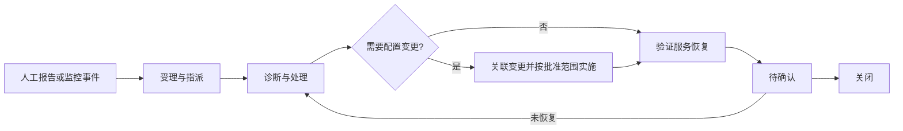

# Nexora 工单管理流程规范

| 项目 | 内容 |
| --- | --- |
| 文档版本 | V1.0 |
| 编制日期 | 2026-10-24 |
| 文档状态 | 产品与流程建设基线 |
| 适用范围 | 网络、服务器及相关 IT 服务的故障处理、服务申请和变更管理 |
| 执行边界 | 现行权限与后端校验继续执行；本文中的新增流程随相应功能建设、配置和启用后生效 |

## 1. 管理目标与基本规则

每张工单应能清楚回答：发生了什么或需要什么、影响哪些对象、现在谁负责、下一步做什么、结果是否已验证。

1. 工单记录业务事项，审批记录同意的内容，作业记录调度安排，运行记录每次实际执行结果。
2. 一件事项有一个主工单；跨故障、服务申请、变更的工作通过关联工单协作，避免反复录入相同资料。
3. 工单处于待处理、处理中或待确认时，应有明确责任组和当前负责人。暂未认领时由责任组负责人兜底。
4. 流转必须同时满足角色、资源范围、前置资料和当前状态要求，前端按钮不替代后端校验。
5. 审批通过、命令执行成功、告警恢复、业务恢复与工单关闭分别记录。
6. 审批、实施、失败、回退、验收和关闭均应留有可追踪记录。

本文规定目标业务流程；第 14 节说明当前源码已有能力与建设差距。不得用目标流程直接绕过现行系统约束。

## 2. 工单分类与关联

| 类型 | 适用情形 | 完成目标 | 示例 |
| --- | --- | --- | --- |
| 故障工单 | 已发生或持续恶化的服务异常 | 恢复服务并确认恢复结果 | 设备离线、链路中断、电源故障 |
| 服务申请 | 用户提出的常规服务或资源需求 | 交付已约定的服务并确认 | 巡检申请、备份申请、资源开通 |
| 变更工单 | 修改设备配置、软件或服务运行方式 | 在批准范围内完成修改并验证 | 路由调整、固件升级、配置修改 |

- 故障处理需要配置修改时，由故障工单关联创建变更工单；故障工单持续跟踪服务恢复，变更单负责变更授权和实施结果。
- 服务申请涉及配置修改时，按授权规则关联变更单；服务申请在交付被确认后完成。
- 同一根因引起多项告警时，优先关联同一故障事项。归并依据至少包括事件标识、目标对象、故障特征和发生时间，不能仅凭标题相同合并。
- 重复故障可关联后续问题记录，用于根因分析和永久修复；问题管理作为后续建设范围。
- 不应把每次只读查询、例行采集或调度运行都直接创建为变更工单。它们仍须满足各自的现行权限和审批规则。

## 3. 角色与责任

| 角色 | 主要责任 |
| --- | --- |
| 申请人／报告人 | 提出事项，说明目标与影响，补充资料，参与结果确认 |
| 受理人／调度人 | 分类、去重、确认优先级，指派责任组与负责人 |
| 当前处理人 | 推进工单、更新进展、协调资源，确保下一步有人接手 |
| 实施人 | 执行批准的操作，记录结果，发生异常时停止或回退 |
| 初审人／技术审核人 | 检查必要性、方案、影响范围、风险、验证及回退准备 |
| 终审人／变更授权人 | 确认变更授权、实施窗口和职责安排，批准或退回 |
| 验收／确认人 | 核对恢复或交付效果，接受结果或退回处理 |
| 责任组负责人 | 处理无人认领、资源冲突、超时升级及交接争议 |
| 平台管理员 | 维护权限和流程配置；管理权限不代表工单自动获批 |

职责规则：

- 申请人可以兼任实施人，也可指派其他具备执行资格的人员；不能仅因申请人与实施人相同而阻止实施。转派应记录原负责人、新负责人、原因和时间，并通知接手人。
- 创建变更可选填复核人（复用控制表 `co_reviewer` 字段），可以选择实施人以外的任何有效用户。实施完成并满足验证要求后提交实施结果复核：正常则关单，异常转原初审人审核最终实施结果；原初审人可确认结果关单或退回实施人处理。该实施后审核独立于实施前审批，不重新签发命令执行授权。未指定复核人时保留原验证和关单流程。
- 接手确认前由原负责人继续协调；人员离岗或账号停用时由责任组负责人接管。
- 申请人不能审批自己的变更。终审人与实施人应分离，保留当前后端已有的独立审批约束。
- 代理审批应有明确身份、范围、期限和审计记录；不通过共享账号或传递个人动态码代替代理。
- 当前实现按指定实施人控制实施阶段操作，允许其与申请人相同；实施人调整与转派沿用现有授权失效及重新审批规则，不能借此取得新的执行权限。

## 4. 优先级与变更风险

### 4.1 优先级

优先级决定处理顺序和时限，由影响范围与紧迫程度共同确定。

| 影响范围／紧迫程度 | 高：服务中断或持续扩大且无可用替代 | 中：服务降级或可短期绕行 | 低：影响可控且可计划处理 |
| --- | --- | --- | --- |
| 高：关键业务、核心网络或多个部门 | P1 紧急 | P2 高 | P3 中 |
| 中：单一业务、站点或部门 | P2 高 | P3 中 | P3 中 |
| 低：少量对象或非关键功能 | P3 中 | P3 中 | P4 低 |

- 业务影响以实际证据和资产／服务关联为依据；设备数量不能单独决定优先级。
- 调整优先级需记录理由；不能通过降级消除已有超时记录。
- 当前 UI 的紧急、高、中、低与 P1～P4 语义对应；具体数据映射由实施时处理。

### 4.2 变更风险

| 等级 | 判定参考 | 必备准备 |
| --- | --- | --- |
| 低风险 | 影响局部、操作可预测、回退可验证 | 明确目标、验证方法与恢复方式 |
| 中风险 | 可能影响单站点或单业务，需要协同 | 影响分析、实施窗口、备份与回退方案 |
| 高风险 | 涉及核心网络、管理通道、认证、安全或较大中断范围 | 独立技术复核、明确授权、验证与回退准备、协同值守安排 |

风险等级由方案及实际操作共同决定；命令扫描用于辅助提示，不能仅靠用户手动选择“低风险”降低审批要求。紧急程度高不代表变更风险低。

## 5. 故障工单流程

| 阶段 | 必须完成的事项 | 责任角色 |
| --- | --- | --- |
| 受理 | 核对影响、已有相同故障及责任范围，指派负责人 | 受理人 |
| 处理 | 记录诊断、临时恢复措施和进展，必要时关联变更 | 当前处理人 |
| 待确认 | 提交恢复时间、验证证据、剩余风险和后续事项 | 当前处理人 |
| 关闭 | 确认服务恢复、验证通过，留下确认人与关闭原因 | 确认人 |

- 告警恢复可作为恢复证据，不能单独证明业务验收通过。
- 等待厂商、备件或用户协助时记录等待对象、原因和下次跟进时间，责任人继续承担协调责任。
- 相同影响在确认阶段再次发生时退回处理；关闭后发生的新一轮故障建立关联新单，避免覆盖历史恢复记录。
- 错报、重复或不属于受理范围的事项，可说明理由后取消或合并；合并时保留来源及主单链接。

## 6. 服务申请流程

**提交 → 受理 → 按服务规则审批 → 处理／交付 → 待确认 → 完成**

- 服务目录应说明申请条件、交付范围、审批规则、责任组及验收标准。
- 资料不完整时退回补充并说明缺少内容；保留原申请和处理记录。
- 无需业务审批的服务按已启用规则进入处理；涉及配置变更或敏感权限时关联对应授权流程。
- 交付完成后说明交付对象、结果、使用条件及必要附件。申请人拒绝验收时填写具体差异并退回处理。
- 没有配置自动确认规则时，不因用户长时间未回复直接认定验收通过。

## 7. 变更工单流程

**草稿 → 初审 → 终审 → 待实施 → 实施 → 验证 → 完成**

“待实施”对应现有“审批完成”；“验证”是必须满足的业务阶段，当前可在实施阶段记录验证证据，后续再按需增加独立状态。

### 7.1 提交与审核

提交前至少准备：变更目的、目标设备或服务、操作方案或发布模板、影响与风险、实施窗口、实施人、验证标准、失败停止条件和回退方案。

- 初审核对方案是否可实施、影响是否明确、验证与回退是否充分。
- 终审核对授权、窗口、协同安排及风险是否可接受。
- 不通过时写明需要补充或修改的事项；退回后修改关键内容应重新审核。
- 同时作用于相同设备或服务的变更，应检查窗口冲突及依赖顺序。系统未提供冲突检查时，由审核人组织人工核对并记录。

### 7.2 审批策略

| 策略 | 适用情形 | 规范要求 |
| --- | --- | --- |
| 普通变更 | 尚未纳入标准授权的配置或服务修改 | 现阶段执行初审、终审及现行实施前身份验证 |
| 标准变更 | 经过验证、可重复且风险边界明确的模板操作 | 先审批模板版本、参数边界、设备范围、有效期和执行次数等授权条件；匹配后才能复用 |
| 紧急变更 | 为控制重大故障或紧迫风险必须及时实施 | 指定授权人与实施人，保留必要授权及身份验证，记录紧急原因并组织事后复核 |

标准变更授权与紧急审批通道均属于建设规则。未实现、未配置或不满足授权条件时，继续执行当前普通变更路径；“紧急”标签本身不授予执行权限。

### 7.3 审批内容与身份验证

- 业务审批记录谁在何时批准了哪一版本的目标、方案和范围。
- MFA 或验证码用于验证操作者身份，不能仅凭验证码存在就认定业务内容已获批准。
- 审批应绑定设备或服务范围、命令、模板／脚本发布版本、参数、窗口、风险、回退方案及相关执行条件。
- 上述关键内容变化后，原授权不能继续覆盖新内容，应重新申请审批。
- 备注、描述、附件等非执行字段是否需要重新审批，应有明确字段规则。规则未明确前遵循现行后端校验，不自动豁免。
- 当前变更实施的 MFA 与定时作业审批验证是不同的现有校验点；统一入口设计不能直接取消其中任一项。

### 7.4 实施与验证

实施前核对工单状态、实施身份、批准内容、目标在线及可达情况、备份、窗口和回退准备。窗口外执行需要重新安排并取得相应授权，不能静默延长窗口。

实施时：

1. 先完成前置检查，再运行批准的操作。
2. 记录每台设备的结果与时间，区分成功、失败、跳过、未知和部分成功。
3. 达到停止条件时暂停后续操作，评估回退；不能在结果未知时盲目重复提交。
4. 执行技术验证及适用的业务验证，保存配置差异、检查结果和验收结论。
5. 验证通过后填写结果摘要、实际完成时间和残留事项，完成变更。

## 8. 自动化、定时作业与授权

| 对象 | 负责记录 |
| --- | --- |
| 工单 | 业务目标、负责人、批准范围、实施及确认结论 |
| 作业／Playbook | 执行内容、发布版本、参数和调度安排 |
| 运行记录 | 某次运行的目标、时间、结果及关联证据 |

- 一张工单可以关联多次运行记录；关联关系不自动增加授权次数。
- 当前一次性执行授权按现行消费规则处理。重试或追加运行不得复用已消费授权，除非对应机制明确支持且仍在批准范围内。
- 周期作业应记录授权范围、有效期、发布版本及失效条件。次数、设备、参数或周期超出授权时，应停止并重新申请。
- 只读诊断和配置修改分别按实际操作权限校验。脚本或模板名称不能替代对实际执行内容的核对。
- 执行结果自动关联到工单，避免操作者重复粘贴日志；日志与导出应脱敏。
- 任何自动进入待确认或关闭的规则均应明确验证条件、观察期和责任人，不能仅使用任务结束信号。

## 9. 异常、回退与终止

| 情形 | 处理规则 |
| --- | --- |
| 审批退回／驳回 | 说明原因，申请人补充或修改后重新提交；保留审核历史 |
| 转派／交接 | 记录接收组、人、原因及交接内容；未接手时由原负责人或责任组兜底 |
| 执行失败／部分成功 | 保留实际成功与失败范围，停止越界重试，决定修复、回退或另建关联变更 |
| 执行结果未知 | 先核实设备状态及执行记录，避免重复产生副作用 |
| 启动回退 | 记录原因、发起人、回退范围和方案；完成后验证业务及配置状态 |
| 回退失败 | 保持未恢复结论，升级负责人并关联故障，不能标记变更成功 |
| 取消工单 | 有权人员说明原因；已实施的操作和未恢复影响不能通过取消隐去 |
| 已结束事项需追加变更 | 建立关联新单，保留原审批与执行事实，不修改原记录伪装成同一次授权 |

目标术语统一使用“回退”。当前页面中的“回溯”与后端 rollback 状态按现有实现识别，后续文案和状态迁移统一处理。

## 10. 验收与关闭条件

| 类型 | 必须满足的结束条件 |
| --- | --- |
| 故障工单 | 服务恢复证据、确认结论、恢复时间、遗留事项及接手安排 |
| 服务申请 | 交付结果符合申请范围和验收标准，申请人或指定确认人接受 |
| 变更成功 | 批准操作完成，技术及适用业务验证通过，结果及实际时间已记录 |
| 变更已回退 | 回退完成且恢复验证通过，原变更未达成的事实保留 |

- 工单结束应记录明确结论：成功、已回退、取消等，不能混用。
- 根因尚未查明但服务已恢复时，可在记录恢复证据、剩余风险及后续负责人后结束故障处理，根因由关联问题或后续事项跟进。
- 超时未确认的处理方式由服务策略配置；未配置时保持待确认并升级责任人。
- 当前变更 completed 状态不证明已有独立业务验收或关闭节点；产品建设时应补足所需证据和权限。

## 11. SLA、升级与通知

### 11.1 时限定义

| 时限 | 起点 | 结束点 | 计时要求 |
| --- | --- | --- | --- |
| 首次响应 | 有效事项提交或满足自动受理条件 | 责任人首次有效响应并承担处理责任 | 自动回执不算人工有效响应；技术性未指派不暂停计时 |
| 故障恢复 | 识别出的服务受影响时间 | 有证据的服务恢复时间 | 保留实际影响时长；合同口径的暂停另行记录 |
| 服务履约 | 服务申请有效受理时间 | 达到约定交付条件 | 起止、暂停及验收等待规则按服务目录版本确定 |
| 审批／待办处理 | 进入对应节点 | 该节点有效处理完成 | 作为流程处理时限，不混用业务恢复时长 |

- 时限策略应绑定服务、优先级、工作日历、时区、策略版本和升级对象。
- 本规范不预设未经确认的分钟或小时承诺。未配置时显示“未配置时限”，不能显示为未超时或已达标。
- 等待外部资源只有在适用策略明确允许且记录原因、起止及批准人时才能暂停合同计时；实际故障持续时间仍保留。
- 转派、提升级别或修改策略不能重置原提交时间或抹除超时事实；调整应保存原值、理由和版本。
- 工单处理 SLA 与 WAN／网络探测可用性 SLA 分开定义与统计。

### 11.2 升级与通知

- 指派、待审批、退回、待实施、执行失败、待确认和超时是主要通知事件。
- 临近时限提醒当前负责人，达到升级条件后通知责任组负责人；重大故障按组织值守规则升级。
- 通知应包含事项、当前状态、需要谁做什么及入口；归并重复告警与催办。
- 记录通知发送结果，发送失败不等于已通知成功，也不应自动改变工单业务状态。

## 12. 页面与字段规范

### 12.1 创建与详情

- 新建先展示类型、标题、关联设备或服务、说明和影响信息；按类型补充字段。
- 变更提交审批前必须补齐执行、验证、窗口和回退资料；分步或折叠展示不能省略必填校验。
- 系统自动带入资产、告警、模板及已知负责人，用户核对后使用，未知数据保持未确认。
- 同一信息只维护一个数据来源，控制表和导出复用已有方案、设备、窗口和回退信息。
- 下发命令是供设备执行的内容；控制表“实施步骤”是供操作人员阅读的操作说明，两者语义不同，应在界面标清并保留各自内容，不得自动互相覆盖。
- 详情顶部显示状态、当前负责人和下一步；按角色突出当前主要动作。
- 命令、长说明、审批历史、附件和运行日志按需展开，避免将所有内容直接堆进列表。

### 12.2 工作台与列表

- 默认工作台优先显示我的待办，提供我提交的、组内待办、我参与的、我的关注、全部工单和草稿等必要入口。
- 默认列为工单号与标题、类型、优先级、状态、当前处理人、截止时间和操作；没有截止策略时显示“未配置时限”。
- 默认每页 10 条，保留每页条数选择器；筛选后页码回到有效范围，统计与列表使用一致筛选口径。
- 通过操作区查看详情；适合使用小眼睛图标并提供文字提示。超长标题单行省略，悬停或详情可查看全文。
- 错误提示准确区分角色权限、审批失效、设备认证、超时和执行失败；列表显示简短结论，详情提供必要原因及处理入口。

## 13. 记录、审计与数据

每张工单至少记录编号、类型、标题、来源、关联对象、影响、优先级、状态、申请人、责任组、当前负责人、时间与关联记录。

变更另需保存方案／模板发布版本、参数、设备范围、窗口、风险、审核意见、审批内容版本、实施与验证结果及回退信息。

- 关键操作记录操作者、动作、时间、原因和前后版本；已产生的审批及执行审计保留原始事实。
- 工单不能通过普通删除操作抹除审批或执行证据；草稿删除等行为依现行权限及保留策略处理。
- 密码、令牌、MFA 动态码和明文凭据不进入普通工单、通知和导出。
- 附件按工单资源范围授权访问，记录上传者与时间；外链不绕过权限。
- 数据持久化采用 PostgreSQL。流程转移、并发审批和执行授权应具备一致性保护。
- 时区按配置显示，存储和排序统一时间口径；报表标明统计时区及时间范围。
- 保留期限由组织配置；未确认前不新增自动清理策略。

## 14. 当前能力与建设差距

以下为本次 M0–M5 改造前于 2026-10-24 形成的源码基线；实施结果和验证状态见工单改造计划及 walkthrough。目标实例尚未部署本次改造。

| 能力 | 当前可确认的源码情况 | 规范落地方式 |
| --- | --- | --- |
| 变更状态与审批 | 已有草稿、初审、终审、审批完成、实施、完成及异常分支 | 保留状态兼容，优化展示与必填资料 |
| 审批角色 | 申请人不能自审，最终审批要求管理员角色，并校验指定审核人／终审人 | 先遵循现行规则，后续变更策略单独设计与验证 |
| 实施身份 | 指定实施人操作，可与申请人相同；审批人与实施人分离，执行仍检查权限、窗口和快照 | 管理路径不应被理解为任意执行授权；可选复核人负责实施后的独立结果审核 |
| 实施前校验 | 已有审批快照校验及 PostgreSQL 运行路径 MFA 要求 | 保留并贯通工单与执行证据 |
| 执行与回退 | 已有实施、失败、回退中及已回退等状态 | 明确验证、部分成功与失败处置条件 |
| 监控事件 | 已有事件归并、确认／调查／恢复及时间线，变更单含 incident_id | 建设完整故障工单闭环；监控事件恢复不能替代工单确认关闭 |
| 定时作业 | 已有审批令牌、验证码、操作清单及内容绑定 | 统一关联入口，复用授权需单独实现和验证 |
| 服务申请、工单 SLA | 本次核对未确认完整服务目录、工单 SLA 策略及履约闭环 | 作为待建设范围；不把网络探测 SLA 当作已具备工单 SLA |
| 标准／紧急授权 | 已有紧急变更类型不能证明完整快捷授权流程已实现 | 先按现行流程，完成授权模型后再启用策略 |

核对入口：

- 变更状态和审批：`backend/api/change_orders/helpers.py`、`transition.py`。
- 字段与界面：`backend/api/change_orders/schemas.py`、`src/pages/ChangeOrder/`。
- 执行身份及授权：`backend/api/automation.py`。
- 监控事件：`backend/services/monitoring_incident_service.py`。
- 定时作业：`backend/api/scheduled_jobs.py`、`backend/services/scheduled_job_authorization.py`。

## 15. 建设顺序与验收场景

### 15.1 建设顺序

1. 第一阶段：简化现有变更表单、待办与详情；统一资料来源、术语、状态展示和失败反馈，保留现行权限。
2. 第二阶段：建设故障工单受理、指派、恢复确认和告警关联，明确与变更单的关联。
3. 第三阶段：建设服务申请、服务目录、工单时限、升级通知与统计。
4. 第四阶段：按实际运行情况引入标准变更授权、紧急变更通道、周期执行授权及问题管理。

### 15.2 代表性验收场景

| 场景 | 应达到的结果 |
| --- | --- |
| 多条同源设备不可达告警 | 关联同一故障事项，保留原告警及不同采集证据 |
| NTP 异常需要修改配置 | 故障单关联变更，批准后实施，验证同步恢复后确认结束 |
| 审批后更换设备或脚本版本 | 原批准内容不能授权新操作，提示重新审批 |
| 实施人缺少权限或身份验证 | 执行前拒绝，原因准确，不产生已执行成功记录 |
| 多设备执行部分失败 | 分别展示成功与失败设备，记录处理决定及后续授权 |
| 命令成功但业务验证失败 | 维持未验收结论，进入修复或回退处理 |
| 告警自动恢复 | 更新恢复证据，工单按配置的确认流程处理 |
| 工单 SLA 未配置 | 明确显示未配置，不显示达标率或虚构截止时间 |
| 周期运行超出批准范围或有效期 | 拒绝或停止相应执行，保留拦截原因及重新申请入口 |

## 16. 维护与参考

本规范作为 Nexora 自编流程建设基线。后续规则变更应记录版本、适用范围、生效方式及迁移影响，并同步到产品、后端校验、权限、通知与报表；不得只改页面文案就宣称流程已完成建设。

参考入口：

- [现有工单模块说明](README.md)
- [现有变更工单使用指南](features/change-orders/使用指南.md)

相关 ITIL 公开概念用于设计参考，本规范不代表 PeopleCert 官方认证或组织已作出的 SLA 承诺。
