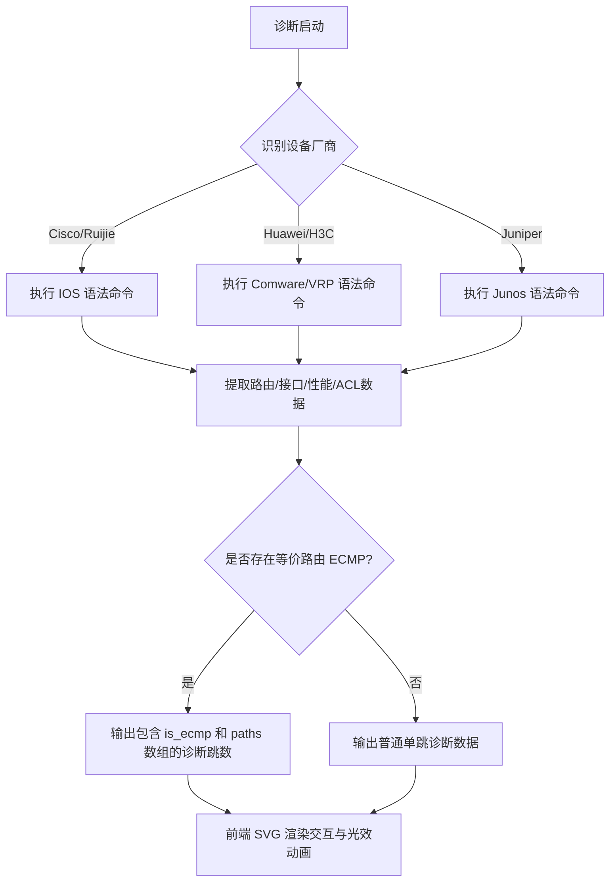

# Nexora NetOps 智能诊断多厂商适配与 ECMP 拓扑动效优化设计方案

本方案旨在解决以下两个痛点：
1. **多厂商适配深度**：在 `diagnose_service.py` 的设备侧路径诊断中，补齐华三（H3C Comware）与锐捷（Ruijie RGOS）在 BGP、VRF、FIB、HA、端口计数器等步骤的命令行适配及正则解析，解决非思科设备执行诊断指令报错或结果解析失败的问题。
2. **ECMP 拓扑动效优化**：重构路径诊断的单跳数据模型以支持等价多路径（ECMP）。前端拓扑图采用分叉与合并的 SVG 贝塞尔曲线，并结合 CSS 动效展现流量沿多条路径流动的动画效果。

---

## 1. 目标与实现路径



---

## 2. 详细设计方案

### 2.1 任务一：`diagnose_service.py` 多厂商命令适配与解析优化

#### 1. BGP 路由诊断命令适配
目前对 BGP 路由的详情查询在 `diagnose_service.py` 中写死了 `show ip bgp`。我们将对其进行多厂商适配：
*   **华为（Huawei VRP） / 华三（H3C Comware）**：
    *   全局表：`display bgp ipv4 unicast routing-table {target_ip}`
    *   VPN实例：`display bgp ipv4 unicast vpn-instance {current_vrf} routing-table {target_ip}`
*   **瞻博（Juniper Junos）**：
    *   全局表：`show route protocol bgp {target_ip}`
    *   路由实例：`show route table {current_vrf} protocol bgp {target_ip}`
*   **锐捷（Ruijie RGOS）**：
    *   同 Cisco 语法：`show ip bgp {target_ip}` 或 `show ip bgp vrf {current_vrf} {target_ip}`

#### 2. FIB/CEF 转发项验证适配
CEF 是 Cisco 特有技术，目前对非 Cisco 设备直接执行 `show ip cef` 会报错。我们将做如下适配：
*   **华三 / 华为**：
    *   全局表：`display fib {target_ip}`
    *   VPN实例：`display fib vpn-instance {current_vrf} {target_ip}`
*   **锐捷（RGOS）**：
    *   锐捷无独立的 CEF 用户命令，直接使用路由表匹配。在 `diagnose_service.py` 中判断为 `ruijie_rgos` 时，执行 `show ip route fast-forwarding` 或略过此步，默认 `cef_verified = True`。

#### 3. VRRP/HA 状态检测适配
目前对非华为/华三设备直接执行 `show standby brief`（HSRP），会导致 VRRP 部署的设备获取状态报错。我们将做如下适配：
*   **锐捷（RGOS）**：
    *   使用 VRRP 状态查询：`show vrrp brief` 或 `show vrrp`。

#### 4. 接口错误包与 CRC 计数器正则解析器（`parse_interface_counters`）
重构 `parse_interface_counters` 结构，解耦 input_errors 与 CRC 的严格顺序，支持匹配 H3C 和华为常见的两行式或逗号分隔的接口回显：
```python
def parse_interface_counters(output: str, platform: str) -> dict:
    counters = {"input_errors": 0, "crc": 0, "input_drops": 0, "output_drops": 0}
    
    # 匹配输入错误包 (支持 input errors, errors, Input errors: X)
    input_err_match = re.search(r'(\d+)\s+(?:input errors|errors\b)', output, re.I)
    if not input_err_match:
        input_err_match = re.search(r'Input errors:\s*(\d+)', output, re.I)
    if input_err_match:
        counters["input_errors"] = int(input_err_match.group(1))

    # 匹配 CRC 校验错
    crc_match = re.search(r'(\d+)\s+CRC', output, re.I)
    if crc_match:
        counters["crc"] = int(crc_match.group(1))
        
    # 匹配输出丢包
    drop_match = re.search(r'(?:Total output drops|output drops|discarded):\s*(\d+)', output, re.I)
    if drop_match:
        counters["output_drops"] = int(drop_match.group(1))
        
    return counters
```

---

### 2.2 任务二：ECMP 路径模型设计与前端 SVG 交互动效呈现

#### 1. 后端 ECMP 数据模型适配（`diagnose_service.py` 中的 `merge_hops`）
当 `trace_route_path_async` 检测到等价多路径路由时，在 `hops` 列表中输出符合前端逻辑的并行节点结构：
```json
{
  "hop": 3,
  "is_ecmp": true,
  "paths": [
    {
      "hop": 3,
      "ip": "10.254.2.2",
      "device_name": "Core-A",
      "device_id": "dev-core-a-id",
      "device_type": "switch",
      "status": "active",
      "detail": "GigabitEthernet0/1 (Egress)"
    },
    {
      "hop": 3,
      "ip": "10.254.3.3",
      "device_name": "Core-B",
      "device_id": "dev-core-b-id",
      "device_type": "switch",
      "status": "active",
      "detail": "GigabitEthernet0/2 (Egress)"
    }
  ]
}
```

#### 2. 前端 SVG 并行拓扑与分流路径渲染（`IPLocatorPage.tsx`）
在 `IPLocatorPage.tsx` 中，当 `viewMode === 'topology'` 时：
1.  **节点渲染布局**：
    *   遍历 `hops`，如果当前 hop 为 `is_ecmp === true`，我们渲染一个垂直排列的弹性容器 `<div className="flex flex-col gap-5 justify-center flex-shrink-0">`，把 `Core-A` 和 `Core-B` 上下重叠排列。
2.  **SVG 连接线动态绘制与流光动画**：
    *   设计一个自定义 of `ECMPConnector` 组件，通过绝对定位和 SVG `<path>` 绘制顺滑的贝塞尔曲线（S-curve），实现“单线分叉为双线”以及“双线合并为单线”的路由流动效果。
    *   利用 SVG `stroke-dasharray` 以及 CSS keyframe `strokeFlow` 动作，让蓝绿色的流光沿着曲线从左至右不断流过，完美展示 ECMP 负载均衡时的流量分担。

```css
@keyframes strokeFlow {
  to {
    stroke-dashoffset: -20;
  }
}
.ecmp-flow-line {
  stroke-dasharray: 6, 4;
  animation: strokeFlow 1.5s linear infinite;
}
```

---

## 3. 拟修改的文件一览

### 后端模块
#### [MODIFY] [diagnose_service.py](file:///e:/data/netsops/backend/services/diagnose_service.py)
*   重构 `parse_interface_counters` 支持多厂商接口统计回显。
*   重构 `merge_hops` 接口，输出包含 `is_ecmp` 标识和 `paths` 并行数组的结构.
*   在 `trace_recursive` 执行 CLI 诊断处，重构 BGP、FIB/CEF、VRRP 命令映射以深度兼容 `h3c_comware` 与 `ruijie_rgos`。

### 前端模块
#### [MODIFY] [IPLocatorPage.tsx](file:///e:/data/netsops/src/pages/IPLocatorPage.tsx)
*   重构 `viewMode === 'topology'` 中的节点遍历渲染：当遇到 `is_ecmp` 节点时，自动执行多节点垂直堆叠。
*   增加自定义 SVG 连接线组件，利用 `<path>` 元素及 SVG markers 绘制完美的分流（Split）与合流（Merge）流光动画连接线。
*   在 CSS 中加入 `.ecmp-flow-line` 以及全局关键帧 `strokeFlow` 以提升高级动效。

---

## 4. 验证计划

### 1. 单元测试（自动化）
*   在 `backend/tests/test_route_intelligence.py` 中补充测试用例，提供 H3C Comware 形式的 `display interface` 输出，验证 `parse_interface_counters` 是否能精准提领 `input_errors` 和 `crc`。
*   补充测试用例验证 ECMP 模式下的 `merge_hops` 序列是否包含 `is_ecmp: true` 结构。

### 2. 手动验证与效果预览
*   启动前端开发服务器（`npm run dev`），访问路径 `http://localhost:5010/assets/diagnose`。
*   输入测试数据 `Source IP = 10.1.1.10` / `Target IP = 172.16.1.100`（触发 Mock NPA 智能诊断路径测试）。
*   在拓扑面板中观察源主机与中继节点之间的 SVG 分叉流光动画、交互悬停卡片，确保在移动端和 PC 端均无任何显示变形。
