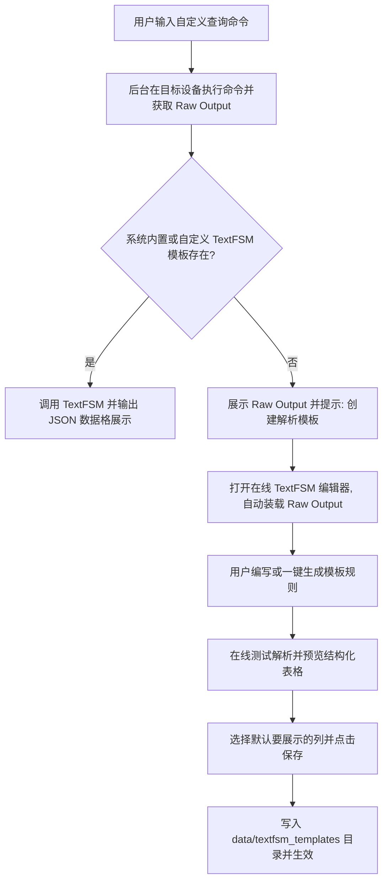

# 实施计划: 自定义 CLI 查看命令与动态 TextFSM 解析工具

为了满足对任意 CLI 只读查询命令的结构化解析需求（特别是针对华三、锐捷等缺乏内置模板的场景），我们需要设计和实现一个全套的 **CLI 自定义命令动态解析与展示工具**。

## 1. 目标与价值
1. **解决数据未结构化痛点**：目前当用户执行非预设的自定义命令时，如果 `ntc-templates` 中没有对应的解析器，前端只能展示杂乱的原始文本。
2. **降本增效**：允许用户在界面上“执行自定义查看命令 -> 在线编写/生成 TextFSM 模板 -> 实时测试解析 -> 一键保存”。
3. **成果持久化**：用户保存模板后，系统会在未来的设备数据采集、脚本执行或定时任务中自动加载并进行结构化展现。

---

## 2. 详细设计思路与架构

### A. 业务流向设计 (Workflow)

### B. 拟修改与新增文件

#### [NEW] [textfsm_builder_service.py](file:///d:/netops/netsops-main/backend/services/textfsm_builder_service.py)
- 提供智能引导和规则生成机制，例如：
  - 读取用户输入的表格样本，自动推断出 `Value` 列定义（字段名）。
  - 根据常见的表格首行特征，自动拼装标准的 TextFSM 状态机模板骨架。

#### [MODIFY] [textfsm_templates.py](file:///d:/netops/netsops-main/backend/api/textfsm_templates.py)
- 增加测试解析后的配置同步，保存时除了保存 `.textfsm` 模板，还需要关联保存该命令的“展示项选择（字段过滤）”元数据。

#### [MODIFY] [devices.py](file:///d:/netops/netsops-main/backend/api/devices.py)
- 在 `/api/devices/{device_id}/parsed-command` 接口执行完毕后，如遇未匹配状态（`unmatched`），返回友好的元数据，告知前端支持在线创建解析模板。

#### [NEW] [TextFSMDebugger.tsx](file:///d:/netops/netsops-main/src/pages/AutomationExecute/components/TextFSMDebugger.tsx)
- 在前端“自动化执行”页面右侧引入的一个抽屉式抽头（Drawer）或者独立 Modal。
- 提供分栏布局：
  - 左侧：TextFSM 语法高亮编辑器（基于轻量级编辑器组件） + 样本数据展示区。
  - 右侧：解析结果预览表格 + 字段多选确认器。

#### [MODIFY] [index.tsx (AutomationExecute)](file:///d:/netops/netsops-main/src/pages/AutomationExecute/index.tsx)
- 改进自定义命令的响应面板：支持如果返回状态为未解析，则展示“在线配对 TextFSM 模板”入口。

---

## 3. 实施步骤与分工

### 阶段一：后端 API 扩展与智能模板生成
1. 完善 `/api/textfsm/test` 接口，支持输入自定义参数直接返回匹配的字段列表与样本条数；
2. 新增一个 `/api/textfsm/auto-generate` 智能生成接口，支持输入 Raw Output，自动根据表头分析提取并组装模板骨架；
3. 将自定义模板在数据库或 `.config` 配置文件中记录“默认展示字段”，使其可以在前端直接过滤输出。

### 阶段二：前端“在线测试与模板编辑器”组件开发
1. 设计可视化 TextFSM 编辑器，提供模板语法校验和关键字高亮；
2. 接入后端测试解析接口，用户在修改模板内容时可以“一键执行解析”，并在下方以数据网格（Data Grid）直观预览解析出来的表格；
3. 支持一键同步和覆盖物理设备对应的 `platform` 模板。

### 阶段三：联动自定义快捷卡片
1. 用户在“快速查询”输入框输入 `show lldp neighbors` 并保存解析后，未来可直接自动进行 JSON 数据转换；
2. 完成对不同厂商（Cisco, Huawei, H3C, Ruijie）平台自定义解析模板的联合测试。

---

## 4. 验证与回滚计划
- **验证方式**：编写 pytest 并结合前端模拟，确保用户自定义的 TextFSM 模板保存后能即时热加载并用于下一次 `/parsed-command` 请求；
- **回滚方式**：不影响核心资产和监控，删除 `data/textfsm_templates/` 目录下的自定义 `.textfsm` 即可还原为原厂默认解析方式。
