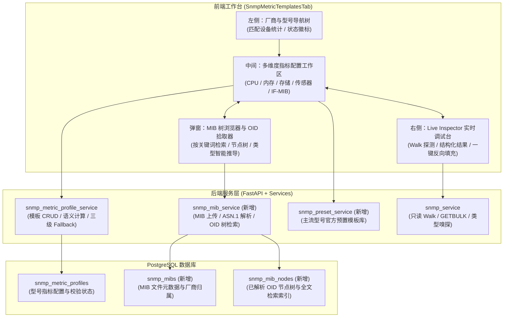

# SNMP 采集页面与 MIB 知识库企业级整改实施方案

## 1. 任务背景与目标

当前系统的 SNMP 指标模板功能（位于 `/management/snmp-metric-templates`）已具备基于“厂商 + 型号”的三级 Fallback 采集逻辑与在线 SNMP Walk 测试能力。但在实际网络运维场景中，仍存在以下痛点：
1. **OID 录入成本高**：运维人员需要到处翻阅厂商 MIB 手册，手动复制粘贴几十位数字的点分 OID（容易输错）。
2. **缺少 MIB 知识库管理**：不支持直接导入厂商提供的 `.mib` / `.my` 文件，无法可视化查看 MIB 树与对象定义。
3. **测试与配置割裂**：SNMP Walk 探测结果为文本域输出，无法将探测到的 OID 一键反向填充到配置字段中。
4. **页面交互层级深**：当前采用弹窗嵌套形式展示，在大屏下利用率有限。

### 整改目标
* **构建三栏式现代化 SNMP 采集工作台**：左侧厂商型号树、中间指标卡片配置区、右侧实时调试与反向填充台（Live Inspector）。
* **建设 MIB 知识库与智能 OID 拾取器**：支持 MIB 文件上传解析与树状检索，在配置指标时一键搜索并自动推导数据类型。
* **预置官方主流厂商型号模板库**：开箱即用支持 Cisco、Huawei、H3C、Arista、Ruijie 等主流设备，降低初始化成本。
* **打通“测-配-验”一体化闭环**：SNMP Walk 结果结构化呈现，支持一键将探测 OID 设为 CPU/内存/温度/风扇等指标。

---

## 2. 总体架构设计



---

## 3. 详细落地规划与实施步骤

### 阶段一：页面交互与工作台现代化重构 (Frontend Workbench)
1. **工作台三栏布局实现**：
   * **左栏（型号资产列表）**：按厂商（Cisco, Huawei, H3C, Ruijie, Arista, Juniper 等）分组，展示型号、在管设备数、硬件/接口验证状态（已验证/待验证/内置默认）。支持模糊搜索与快速过滤。
   * **中栏（指标卡片组）**：
     * **核心硬件卡片**：CPU 使用率、内存使用率、存储使用率。
     * **环境与动力卡片**：设备温度、工作电压、系统功耗、风扇状态（正常码/故障码）、电源状态。
     * **接口流量覆盖卡片（IF-MIB Override）**：展开式配置 18 个接口字段 OID 与 32/64 位宽模式。
   * **右栏（Live Inspector 实时调试面板）**：
     * 常驻或可收起调试抽屉，输入设备 IP 直接拉取凭据执行 SNMP Walk。
     * 结果表格化展示：`[OID]`、`[数据类型 (Gauge/Counter/Integer)]`、`[当前值]`、`[操作]`。
     * 每一行提供快捷填充按钮：`【设为 CPU】`、`【设为 内存】`、`【设为 温度】` 等，点击直接同步到中间表单中。
2. **官方预置模板库入口**：
   * 顶部提供 `【从官方模板库导入】` 按钮，弹出主流厂商型号库，点击即可一键克隆或覆盖。

### 阶段二：MIB 知识库与 OID 智能拾取器 (MIB Repository & Picker)
1. **MIB 文件解析引擎（后端）**：
   * 建立 MIB 解析与导入服务 `backend/services/snmp_mib_service.py`。
   * 支持用户上传单个 `.mib` / `.my` / `.txt` 文件或包含多个 MIB 的 `.zip` 压缩包。
   * 解析 MIB 文件中的 `OBJECT-TYPE` 结构，提取：
     * `node_name`（如 `hwEntityCpuUsage`）
     * `oid`（如 `1.3.6.1.4.1.2011.5.25.31.1.1.1.1.5`）
     * `syntax_type`（如 `Gauge32`, `Counter64`, `Integer32`, `OCTET STRING`）
     * `description`（MIB 注释与字段说明）
     * `parent_oid`（构建树状层级）
2. **MIB 树状检索 API**：
   * 提供毫秒级全文模糊搜索接口（支持按节点名 `cpu`、`fan`、`temp` 或 OID 搜索）。
3. **前端 OID 智能拾取器组件 (OidPickerModal)**：
   * 在每个指标的 OID 输入框右侧增加 `🔍 MIB 树拾取` 按钮。
   * 弹窗内支持按 MIB 文件分类浏览树，或全库搜索关键字。
   * 选中节点后，系统自动提取 OID 填入，并根据 `syntax_type` 自动预选最佳 `MetricMode`：
     * `Gauge32` / `Integer32` $\rightarrow$ 自动选 `direct_percent` 或 `direct_value`
     * `Counter64` $\rightarrow$ 自动选 `counter_rate_percent` 并锁定 64 位宽
     * `INTEGER { normal(1), abnormal(2) }` $\rightarrow$ 自动选 `status_code` 并填入正常码 `1`。

### 阶段三：预置主流厂商官方模板库 (Preset Profiles Center)
1. **主流型号模板预置**：
   * **Cisco**：Catalyst 2960 / 3850 / 9300 系列、Nexus 9000 系列、ISR 4000 路由器。
   * **Huawei**：S5700 / S6700 / S12700 园区交换机、CloudEngine 6800 / 12800 数据中心交换机、AR 系列路由器。
   * **H3C**：S5130 / S5500 / S6800 / S10500 系列、MSR 路由器。
   * **Arista**：7050X / 7280R 系列。
   * **Ruijie**：RG-S5750 / RG-S6220 / RG-S6500 系列。
2. **标准 MIB 预置**：
   * 预置通用 RFC 标准 MIB：`RFC1213-MIB`, `IF-MIB`, `HOST-RESOURCES-MIB`, `ENTITY-MIB`, `ENTITY-SENSOR-MIB`。

---

## 4. 数据库表结构变更设计 (PostgreSQL)

严格遵循 PostgreSQL 规范设计：

```sql
-- 1. MIB 文件元数据表
CREATE TABLE IF NOT EXISTS snmp_mibs (
    id VARCHAR(64) PRIMARY KEY,
    name VARCHAR(128) NOT NULL,
    vendor VARCHAR(64) NOT NULL DEFAULT 'General',
    filename VARCHAR(256) NOT NULL,
    file_size INTEGER NOT NULL DEFAULT 0,
    node_count INTEGER NOT NULL DEFAULT 0,
    source_type VARCHAR(32) NOT NULL DEFAULT 'user_upload', -- 'builtin' | 'user_upload'
    description TEXT,
    created_at TIMESTAMPTZ NOT NULL DEFAULT CURRENT_TIMESTAMP,
    updated_at TIMESTAMPTZ NOT NULL DEFAULT CURRENT_TIMESTAMP
);

CREATE INDEX IF NOT EXISTS idx_snmp_mibs_vendor ON snmp_mibs(vendor);

-- 2. MIB OID 节点与符号表
CREATE TABLE IF NOT EXISTS snmp_mib_nodes (
    id VARCHAR(64) PRIMARY KEY,
    mib_id VARCHAR(64) NOT NULL REFERENCES snmp_mibs(id) ON DELETE CASCADE,
    node_name VARCHAR(128) NOT NULL,
    oid VARCHAR(256) NOT NULL,
    parent_oid VARCHAR(256),
    syntax_type VARCHAR(64),
    access_type VARCHAR(32),
    status VARCHAR(32),
    description TEXT,
    created_at TIMESTAMPTZ NOT NULL DEFAULT CURRENT_TIMESTAMP
);

CREATE INDEX IF NOT EXISTS idx_snmp_mib_nodes_oid ON snmp_mib_nodes(oid);
CREATE INDEX IF NOT EXISTS idx_snmp_mib_nodes_name ON snmp_mib_nodes(node_name);
CREATE INDEX IF NOT EXISTS idx_snmp_mib_nodes_mib ON snmp_mib_nodes(mib_id);
```

---

## 5. 拟修改与新增文件清单

| 文件路径 | 变更类型 | 说明 |
| :--- | :--- | :--- |
| `backend/database/migrations/m0045_snmp_mib_repository.py` | [NEW] | 数据库迁移脚本：创建 MIB 库与节点索引表 |
| `backend/services/snmp_mib_service.py` | [NEW] | MIB 解析引擎、树构建、OID 模糊检索服务 |
| `backend/services/snmp_preset_service.py` | [NEW] | 官方主流型号模板中心与预置 MIB 种子数据 |
| `backend/api/devices.py` | [MODIFY] | 扩展 MIB 上传、节点搜索、预置模板导入 API |
| `src/pages/SnmpMetricTemplatesTab.tsx` | [MODIFY] | 升级为三栏式现代化工作台主入口 |
| `src/components/DeviceList/MetricOidProfilesModal.tsx` | [MODIFY] | 重构为响应式工作台卡片与反向填充逻辑 |
| `src/components/SnmpMib/OidPickerModal.tsx` | [NEW] | MIB 树状浏览器与智能 OID 拾取器前端组件 |
| `src/components/SnmpMib/MibUploadModal.tsx` | [NEW] | MIB 文件批量上传与解析状态展示组件 |

---

## 6. 验证与测试计划

1. **后端单元与集成测试 (`pytest`)**：
   * 测试 MIB 语法解析器对 Cisco/Huawei/H3C/RFC MIB 文本的容错与提取准确度。
   * 测试 OID 模糊搜索接口的响应速度（< 50ms）与分页性能。
   * 测试预置模板套用与数据库 Fallback 缓存一致性。
2. **前端交互与类型检查**：
   * 运行 `npm run lint` 确保 TypeScript 类型安全。
   * 测试三栏工作台在不同分辨率下的响应式布局。
   * 测试 OID 拾取器选中节点后表单自动填充与模式推导逻辑。
   * 测试 SNMP Walk 结果一键反向填充到 CPU/内存/温度字段的准确性。
3. **多厂商设备联调测试**：
   * 针对真实/模拟的 Cisco、Huawei、H3C 设备进行实时验证测试，确保指标采集无误。

---

## 7. 风险评估与回滚策略

* **风险 1：大型 MIB 文件依赖缺失或解析报错**
  * *应对策略*：解析器增加容错处理机制；系统预置包含 `SNMPv2-SMI`、`RFC1155-SMI`、`INET-ADDRESS-MIB` 等基础依赖库；解析异常时保留原始文件并给出友好的语法错误行号提示。
* **风险 2：旧版本型号模板数据兼容性**
  * *应对策略*：数据库迁移采用纯增量模式，现有的 `snmp_metric_profiles` 表结构和缓存逻辑保持 100% 向下兼容，不影响现网已配置设备的正常采集。
