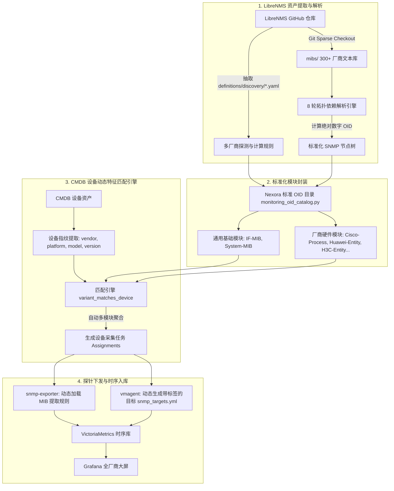

# LibreNMS 资产吸纳与 SNMP 模板体系重构实施方案

## 1. 任务背景与目标

依据选定的**“模式 A：资产吸纳模式”**，本方案旨在将工业级开源网络监控生态（LibreNMS 积累的 300+ 厂商 MIB 文本库与设备探测/计算规则）深度吸纳进 Nexora 现有的现代云原生监控流水线中，**避免部署沉重的 PHP 8.2 + MariaDB + RRDTool 容器堆栈**，实现零额外运维负担、多厂商开箱即用。

同时，针对现存的 `/management/snmp-metric-templates`（旧版 SNMP 型号单点 OID 模板体系）进行深度审查，解决两套监控体系脱节与重复维护的痛点，制定平滑废弃与全面收拢至统一监控体系（`monitoring_v1` + `snmp-exporter` + `VictoriaMetrics` + `Grafana`）的演进路径。

此外，针对监控大盘页面（`/monitor/dashboards`）内嵌 Grafana 存在的“双重侧边栏、双重顶栏、界面割裂”体验问题进行深度优化，提供纯净 Kiosk 模式、主题自适应与全屏沉浸式体验。

---

## 2. `/management/snmp-metric-templates` 深度审查分析

### 2.1 现状与架构双轨矛盾

当前系统中实际并存着**两套完全隔离的 SNMP 监控机制**，导致严重的用户认知混淆与研发维护负担：

| 维度 | 旧版体系（`/management/snmp-metric-templates`） | 新版云原生体系（`monitoring_v1`） |
| :--- | :--- | :--- |
| **入口位置** | 系统管理 -> SNMP 指标模板 | 监控中心 -> 采集计划 / 模块 / 运行时 |
| **数据载体** | 数据库表 `snmp_metric_profiles` | `snmp_modules` + `snmp_module_variants` + `monitoring_collection_plans` |
| **采集方式** | Python 协程使用 `pysnmp`/直连 GET 逐台轮询设备 | Go 编写的 `snmp-exporter` + `vmagent` 流水线异步拉取 |
| **数据去向** | 写入 CMDB `devices` 表的单字段（`cpu_usage`, `memory_usage`） | 写入高性能时序库 `VictoriaMetrics` |
| **呈现界面** | `/monitor/networks` 静态列表页 | **Grafana 工业级多维大屏与时序图表** |
| **致命问题** | **用户在此处配置的 OID，Grafana 根本不读取！** 两者数据完全不互通。 | 支撑 Grafana 的指标来源，但缺乏旧模板的某些单点自定义能力。 |

### 2.2 旧版体系的核心缺陷（为什么必须废弃？）

1. **单点 OID 模式极其脆弱**：
   - 旧模板要求按每个具体硬件型号配置单一标量 OID（例如配置固定的 `cpu_oid: .1.3.6.1.4.1.25506.2.6.1.1.1.1.6.3`）；
   - 现代企业级交换机/路由器普遍是多板卡、多槽位、多核 CPU，一旦槽位号变更或固件升级，硬编码的标量 OID 直接返回空值或采集异常；
   - LibreNMS 与 `snmp-exporter` 采用的是标准的 **Table-based Walk 机制**（自动遍历实体表、插槽索引并打标签），鲁棒性高出数个量级。
2. **型号数量爆炸，维护成本难以承受**：
   - 华为、华三、思科、锐捷等厂商有成千上万款具体型号，若为每个型号单独维护一份 OID 表单，维护工作无穷无尽；
   - 实际上同一厂商或 OS 家族（如 Huawei VRP、H3C Comware、Cisco IOS-XE）底层的 MIB 结构高度一致，按“厂商协议模块（Module）+ 能力变体（Variant）”抽象才是现代化做法。
3. **Python 直采的性能与网络瓶颈**：
   - `background_monitor_service.py` 依靠 Python 进程直连设备轮询，在设备量突破数百台时极易引发并发锁死、超时堆积与网络拥塞；
   - 而基于 Go 的 `snmp-exporter` + `vmagent` 原生支持毫秒级流水线与高效标签清洗，是云原生时序监控的事实标准。

---

## 3. LibreNMS 资产吸纳与设备自动关联机制设计

### 3.1 总体架构流向



### 3.2 LibreNMS 资产提取与解析机制
1. **轻量精准拉取（Sparse Checkout）**：通过 `backend/scripts/sync_librenms_mibs.py`，仅拉取官方仓库的 `mibs/` 目录，无需克隆整套庞大的 PHP/前端代码。
2. **8 轮符号拓扑解析（Multi-pass Symbol Indexer）**：针对 MIB 内部错综复杂的 `IMPORTS ... FROM ...` 交叉依赖，通过 8 轮依赖拓扑解析，将抽象对象标识符递归展开并计算为绝对数字 OID（例如将 `cpmCPUTotal1minRev` 解析为 `1.3.6.1.4.1.9.9.109.1.1.1.1.7`）。
3. **厂商命名归一化**：将 LibreNMS 原始目录名（如 `comware` 规范化为 `H3C`，`raisecom-mibs` 规范化为 `Raisecom`），注入系统 MIB 知识库。

### 3.3 LibreNMS Discovery 规则吸纳与全厂商/无线模块化
将 LibreNMS `includes/definitions/discovery/*.yaml` 经过工业级检验的硬件与无线规则转化为标准采集模块（`monitoring_oid_catalog.py`）：
* **通用基准模块**：`generic_ifmib_interface_std`（全端口流量、丢包、64位高容量计数器、端口状态）、`generic_system_std`（系统运行时间、设备描述）。
* **第一梯队主流网络厂商**：
  * **Cisco** (`cisco_common_std`)：`CISCO-PROCESS-MIB` 多核 CPU、`CISCO-MEMORY-POOL-MIB` 内存池、传感器温度。
  * **Huawei** (`huawei_common_std`)：`HUAWEI-ENTITY-EXTENT-MIB` 主控板卡 CPU、板卡内存与最高温度。
  * **H3C** (`h3c_common_std`)：`HH3C-ENTITY-EXT-MIB` Comware 实体 CPU、内存使用率、温度、风扇与电源状态。
  * **Ruijie** (`ruijie_common_std`)：`RUIJIE-DEVICE-MIB` 实体 CPU、内存池、整机温度、电源/风扇。
  * **Juniper** (`juniper_common_std`)：`JUNIPER-MIB` 操作表 CPU、缓冲区内存、温度、DRAM。
  * **Fortinet** (`fortinet_common_std`)：`FORTINET-CORE-MIB` 防火墙 CPU、内存、并发会话、磁盘。
* **第二梯队中国国内主流网络与安全厂商全面吸纳**：
  * **中兴 (ZTE)** (`zte_common_std`, Enterprise `1.3.6.1.4.1.3902`)：ZXR10 交换机/路由器 CPU 利用率、内存利用率、单板温度。
  * **迈普 (Maipu)** (`maipu_common_std`, Enterprise `1.3.6.1.4.1.5651`)：MyPower 交换机/路由器 CPU（5分钟均值）、内存利用率、整机温度。
  * **迪普 (DPtech)** (`dptech_common_std`, Enterprise `1.3.6.1.4.1.31648`)：交换机/安全网关 CPU、内存、温度、并发会话数。
  * **山石网科 (Hillstone)** (`hillstone_common_std`, Enterprise `1.3.6.1.4.1.24681`)：StoneOS 防火墙 CPU、内存利用率、当前活跃会话数。
  * **深信服 (Sangfor)** (`sangfor_common_std`, Enterprise `1.3.6.1.4.1.35047`)：Sangfor OS 网关 CPU、内存利用率、并发连接数。
  * **神州数码网络 (DCN)** (`dcn_common_std`, Enterprise `1.3.6.1.4.1.6339`)：DCN 交换机 CPU、内存利用率。
* **国内外主流无线控制器（WLAN AC/AP）专项吸纳**：
  * **华为无线 (Huawei WLAN)** (`huawei_wireless_std`, `1.3.6.1.4.1.2011.6.139`)：AC 在线 AP 数、离线 AP 数、当前在线关联无线用户数。
  * **华三无线 (H3C Dot11)** (`h3c_wireless_std`, `1.3.6.1.4.1.25506.2.75`)：AC 纳管在线 AP 数、当前在线无线客户端数。
  * **锐捷无线 (Ruijie Wireless)** (`ruijie_wireless_std`, `1.3.6.1.4.1.4881.1.1.10.2.75`)：AC 纳管 AP 总数、当前在线无线用户数。
  * **思科无线 (Cisco WLC / AireOS / C9800)** (`cisco_wireless_std`, `1.3.6.1.4.1.9.9.513/618`)：Up AP 数、Down AP 数、关联客户端总数。
  * **Aruba 无线 (Aruba Mobility Controller)** (`aruba_wireless_std`, `1.3.6.1.4.1.14823.2.2.1`)：接入 AP 数、在线无线终端数。
  * **Ruckus 优科无线 (ZoneDirector / SmartZone)** (`ruckus_wireless_std`, `1.3.6.1.4.1.25053.1`)：活跃 AP 数、已认证无线终端数。

### 3.4 CMDB 设备动态特征匹配引擎（四维匹配矩阵扩展）
网络工程师只需在 CMDB 录入设备，系统通过 `monitoring_compiler.py` 的 `variant_matches_device()` 自动完成匹配，**零人工配置 OID**：
1. **平台家族兼容匹配**（`_platform_selector_matches`）：自动识别 `comware`, `vrp`, `ios`, `iosxe`, `rgos`, `junos`, `fortios`, `zte`, `maipu`, `dptech`, `stoneos`, `sangfor`, `dcn`, `aruba`, `ruckus`。
2. **型号系列通配**（`_model_selector_matches`）：系列前缀匹配（如 `RG-S`, `QFX`, `FG-`, `ZXR10`, `MP`, `SG-`）。
3. **单设备多模块聚合（Module Fusion）**：一台无线 AC 控制器自动同时命中基础接口模块（IF-MIB）、整机性能模块（如华为 Entity）与无线专有模块（如华为 WLAN AC），一次编译自动下发全部指标。

---

## 4. Nexora 专属 Grafana 看板体系重构（包含无线大盘）

### 4.1 数据源统一接入标准
- Grafana 内置 Prometheus 数据源指向 VictoriaMetrics：`http://victoriametrics:8428`，统一 `uid: victoriametrics`，设置为 `isDefault: true`；
- 所有 Panel 查询直接利用 VictoriaMetrics 对 PromQL/MetricsQL 的高性能支持。

### 4.2 默认内置 5 套全场景监控看板矩阵

```text
Nexora Dashboards (V1)
├── 01 网络总览 (network-overview.json)
│   ├── 全局 KPI：在管网络设备数、无线在线 AP 总数、当前在线无线终端数、全网总吞吐、异常接口数
│   ├── Top 负载分析：全网 CPU 最高 TOP 5 设备、全网利用率最高 TOP 5 接口
│   └── 无线宏观走势：各站点在线无线终端走势、无线 AC 健康度
├── 02 网络设备详情 (network-device.json)
│   ├── 单设备下拉切换（跨 12+ 厂商自适应）
│   ├── 硬件多维指标：多核 CPU 走势、多内存池走势、温度变化、风扇与电源健康度
│   └── 接口状态概览：端口 UP/DOWN 分布、总收发包率
├── 03 无线专网监控 (network-wireless.json)  [★ 独立无线大盘]
│   ├── 控制器下拉筛选（华为 / 华三 / 锐捷 / 思科 / Aruba / Ruckus AC）
│   ├── AP 状态矩阵：纳管 AP 总数、在线 AP 数、离线告警 AP 数、AP 在线率
│   ├── 终端用户分析：当前关联终端数、历史峰值终端数、按 SSID 终端分布
│   └── 射频与信道：高密 AP TOP 排行榜、AP 离线历史事件记录
├── 04 接口流量与健康 (network-interface.json)
│   ├── 单设备单端口流量深度分析：双向 In/Out 速率、带宽利用率（%）
│   └── 链路质量诊断：报文速率（pps）、丢包率（discards）、错包率（errors）、CRC/FCS 校验故障
└── 05 SNMP 采集健康大盘 (monitoring-health.json)  [★ 运维神器]
    ├── 采集全局状态：在管目标数、采集成功数、超时失败数
    ├── 各厂商采集耗时分布：基于 scrape_duration_seconds 按 Vendor 对比
    └── Slowest Targets 慢设备 TOP 榜：精准定位高延迟、易超时设备与对应采集模块
```

---

## 5. 详细实施步骤与修改清单

| 模块 | 修改文件 | 说明 |
| :--- | :--- | :--- |
| **OID 目录** | `backend/services/monitoring_oid_catalog.py` | 增补国内厂商（中兴、迈普、迪普、山石、深信服、DCN）与主流无线控制器（华为、华三、锐捷、思科、Aruba、Ruckus）标准模块 |
| **匹配编译** | `backend/services/monitoring_compiler.py` | 扩展 OS 家族识别、型号通配、无线复合变体聚合（Module Fusion） |
| **时序驱动** | `backend/services/metric_provider.py` | 级联国内厂商 CPU/内存；新增 `wireless_ap_online_count`、`wireless_client_online_count` 聚合查询 |
| **数据源配置** | `monitoring/grafana/provisioning/datasources/victoriametrics.yml` | 固化 `uid: victoriametrics` 并启用 `isDefault: true` |
| **大盘套件** | `monitoring/grafana/dashboards/network-overview.json` | 01 网络总览看板（增补无线 AP / 客户端 KPI 与走势） |
| **大盘套件** | `monitoring/grafana/dashboards/network-device.json` | 02 网络设备详情看板（全厂商多核 CPU / 内存 / 温度自适应） |
| **大盘套件** | `monitoring/grafana/dashboards/network-wireless.json` | 03 无线专网监控大盘（AP 在线率、终端分布、高密 AP 榜） |
| **大盘套件** | `monitoring/grafana/dashboards/network-interface.json` | 04 接口流量与健康看板（利用率、丢包错包、CRC 诊断） |
| **大盘套件** | `monitoring/grafana/dashboards/monitoring-health.json` | 05 SNMP 采集健康看板（耗时分布、慢设备 TOP 排行榜） |
| **测试套件** | `backend/tests/monitoring/` | 增补国内厂商与无线模块的编译匹配、时序解析与隔离性单元测试 |

---

## 6. 验证计划

1. **多厂商与无线变体编译测试**：运行 `pytest backend/tests/monitoring/test_monitoring_v1_compiler.py`，验证新增国内厂商与无线变体全部正确解析。
2. **时序 PromQL 级联测试**：运行 `pytest backend/tests/monitoring/test_monitoring_provider_api.py`，验证有线与无线聚合查询。
3. **Grafana Dashboard JSON 校验**：Python 批量解析 5 套 Dashboard JSON 确保语法无误，字段合规。
4. **前端编译与类型检查**：运行 `npm run lint`（`tsc --noEmit`），确保零错误。
5. **系统预检**：运行 `python scripts/monitoring_poc_preflight.py` 确保全配置合规。
