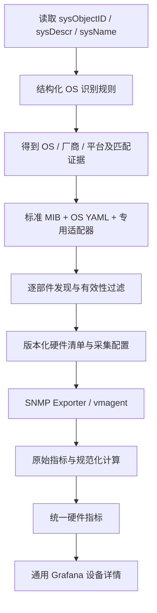

# LibreNMS 硬件采集对齐与 Grafana 设备详情整改计划

> 状态：按资产管理厂商目录扩大适配范围后，代码实施仍在进行；本任务不以 Docker、真实设备或 Grafana 验收作为停止条件。创建时间：2026-09-29，Asia/Shanghai。
> 本地审查基线：`4d8745715a7de27be61f0406159f59e560a3ecc6`，并检查当前工作树文件。
> LibreNMS 机制对照快照：`d567d6f3510880e5659631d289b14527c3858dab`。跨厂商规则盘点另读取本机 LibreNMS checkout 的 Git 对象 `9831e4e438e438f17445000c872817eb72511b1e`（2026-08-13）；二者都不代表目标部署当前导入的规则版本。
> 环境限制：本机没有 Docker 验证环境。本轮未访问部署数据库、设备 SNMP、VictoriaMetrics 或运行中的 Grafana；不得据此宣称首批厂商已实机验收。

## 1. 目标与结论

目标是以资产管理登记的厂商为范围，让 Nexora 自动识别系统类型、发现实际存在的硬件部件、按正确单位和状态语义持续采集，并在同一份 Grafana 设备详情中展示。新增同类硬件的厂商适配时，不再修改设备详情的厂商指标列表。

**当前实现与 LibreNMS 不一致。** 已具备 SNMP 身份读取、规则导入、设备级发现快照、采集配置编译和时序存储的基础，但导入的规则语义、发现粒度、采集输出与 Grafana 查询之间存在确定的断点。不能把“使用 LibreNMS 规则来源”理解为“已经实现 LibreNMS 的硬件采集机制”。

整改应同时覆盖识别、规则解释、传感器清单、采集发布、指标规范和展示。仅放开 Profile 检查、补几个 Grafana 指标名、增加更多静态厂商 OID，都不能独立完成目标。

“与 LibreNMS 一致”的交付口径：在指定厂商/型号/系统版本和脱敏样本上，发现对象、索引、单位、换算、有效值判断和状态含义达到约定的一致性；使用 Nexora 现有 VictoriaMetrics/Grafana 存储展示体系。不能宣称兼容所有 LibreNMS OS、PHP 扩展和全部传感器类型。

## 2. 多厂商自动识别与固定 JSON 的关系

### 2.1 当前哪些部分是固定的

| 层级 | 当前代码 | 固定内容与影响 |
| --- | --- | --- |
| 身份识别 | `snmp_discovery_service.py`、`librenms_rule_service.py` | 企业 OID 前缀、OS→厂商映射、已注册厂商集合、平台别名等；新厂商不是导入 YAML 后必然可识别 |
| 硬件适配 | `monitoring_oid_catalog.py`、Cisco 专用分支、静态平台 OID | 支持哪些 OID、内存表达方式、平台范围；识别到厂商不证明这些 OID 在该型号存在 |
| 计划编译 | `monitoring_compiler.py:853` 起 | 先匹配计划 module/variant 和平台，再考虑设备发现 override；新发现不能自动绕过不存在的计划条目 |
| 图表生成 | `generate_dashboards.py:906` 起 | CPU、内存、温度 PromQL 逐一列出厂商原始指标名 |
| 生成 JSON | `nexora-network-device.json` | 保存生成后的固定查询和布局；这里没有 SNMP 识别能力 |

固定的通用 Grafana JSON 可以适配多厂商，前提是它查询统一指标。现在的问题是查询与厂商原始命名绑定。

### 2.2 整改后的流程



新增厂商的正常工作是增加/更新识别规则与适配规则，产生已有 CPU、内存、温度等规范指标。同类指标的图表无需增加厂商 `or` 分支。新增全新的硬件类别，例如湿度，需要增加指标契约和展示能力。

支持状态分开报告：身份已识别、规则可解释、设备发现成功、配置已发布、指标已采到、图表已有数据。任一项成功都不能代替其余项。

### 2.3 覆盖范围以资产管理厂商目录为准

资产系统的范围来源是 [`src/pages/AssetManagement/constants.ts`](../../src/pages/AssetManagement/constants.ts) 中的 `NETWORK_VENDOR_NAMES` 与 `SECURITY_VENDOR_NAMES`，不是先前讨论时举例的几家厂商。前者 26 家是本轮网络设备主范围；后者 15 家单独作为安全设备范围保留。后端 `snmp_vendor_registry.py` 的规范名与具体平台别名按这两个列表及 `VENDOR_PLATFORMS` 同步。

| 资产组 | 完整厂商范围 | 当前接入方式 | 当前边界 |
| --- | --- | --- | --- |
| 网络设备（26） | Cisco、Huawei、H3C、Arista、Juniper、Ruijie、ZTE、Raisecom、Maipu、DPtech、DCN、FiberHome、Nokia、Aruba、Extreme Networks、Ruckus、MikroTik、Ubiquiti、D-Link、TP-Link、Dell、Brocade、Ciena、Alcatel-Lucent Enterprise、Allied Telesis、Edgecore | 通用 HOST-RESOURCES/ENTITY-SENSOR 探测对所有已识别设备执行；LibreNMS importer 按识别到的 OS key 读取可用 YAML；另复用现有 Nexora 目录和平台 OID adapter | YAML 存在不表示包含 CPU/内存/所有硬件类别；LibreNMS PHP OS class 尚未移植的行为仍需 Nexora 原生适配。DPtech 等无同名上游 OS key 的平台使用 Nexora 目录或标准 MIB。Edgecore `edgecore_ocnos` 对应上游 IP Infusion `ocnos` OS 规则，业务厂商以资产平台信息保留，不能把 IP Infusion 名称直接当 Edgecore 的 OID 证据。 |
| 网络安全设备（15） | Fortinet、Palo Alto、Hillstone、Sangfor、Check Point、Sophos、SonicWall、WatchGuard、F5、A10 Networks、Barracuda、Venustech、NSFOCUS、Topsec、Qi An Xin | 同样执行通用标准 MIB 与可匹配的 LibreNMS OS YAML；已有 Nexora Fortinet、Hillstone、Sangfor 等目录按具体平台匹配 | 资产登记/厂商识别不等于专用硬件适配完成；没有上游 OS/YAML 或 Nexora 已审查目录的设备只能报告标准 MIB 路径和实际发现结果，不生成猜测的私有 OID。 |

这两个资产组一共 41 个登记厂商。后端注册表覆盖用于名称与身份校验，平台映射用于将资产系统的具体平台码转为业务厂商；`adapter_descriptor` 则分别报告 LibreNMS、Nexora 目录、静态平台映射或标准 MIB fallback。不能用“41 个都能识别”替代“41 个都已有各自的 CPU、内存、板卡、风扇和电源专用规则”。

## 3. 对照 LibreNMS 的依据

以下是机制摘要，具体整改设计属于 Nexora 的实施方案。

1. LibreNMS 的 CPU/内存发现保留实例索引；内存定义区分 used、free、total 和 percent_used，支持标准 MIB 以及 OS 专用发现。来源：[CPU 与内存文档](https://github.com/librenms/librenms/blob/d567d6f3510880e5659631d289b14527c3858dab/doc/Developing/os/Mem-CPU-Information.md)。
2. 传感器定义包含类别、实际取值 OID、描述、索引、换算和过滤条件；发现对象用于后续轮询。来源：[硬件传感器文档](https://github.com/librenms/librenms/blob/d567d6f3510880e5659631d289b14527c3858dab/doc/Developing/os/Health-Information.md)。
3. 轮询从已登记传感器读取 OID，批量取值，应用换算和必要的 OS 特殊处理，然后写入时序。来源：[传感器轮询实现](https://github.com/librenms/librenms/blob/d567d6f3510880e5659631d289b14527c3858dab/includes/polling/functions.inc.php)。
4. H3C Comware 的 CPU 和内存发现有 PHP OS 类实现，不能仅通过读取该 OS 的 YAML 获得。来源：[Comware OS 类](https://github.com/librenms/librenms/blob/d567d6f3510880e5659631d289b14527c3858dab/LibreNMS/OS/Comware.php)。
5. 标准 ENTITY-SENSOR 发现同时读取传感器类型、量纲、精度、运行状态与实体描述，不把所有数值都视作温度。来源：[ENTITY-SENSOR 实现](https://github.com/librenms/librenms/blob/d567d6f3510880e5659631d289b14527c3858dab/includes/discovery/sensors/entity-sensor.inc.php)。

采用这些机制，并不表示复制上游所有历史行为。例如上游轮询代码对某些无效数值有置零路径；Nexora 应明确采用“无效/缺失不等于健康零值”的契约，记录这是有意差异。

## 4. 当前调用链与已有可复用能力

### 4.1 发现与两条消费路径

```text
SNMP 凭据 + 设备身份
  → background_monitor_service 定期判断发现是否过期
  → discover_device_oid_config
  → snmp_device_discoveries（每设备一份 metrics/interface/exporter JSON）
      ├─ 原生健康采集 → devices.cpu_usage/temp/fan_status 等摘要
      └─ monitoring_v1 加载 → compiler → 发布 runtime 配置
           → SNMP Exporter → vmagent → VictoriaMetrics → Grafana
```

原生健康摘要与 Grafana 时序是不同的数据消费路径。设备列表中有 CPU 数字，不能据此判断 Grafana 已经存在对应时序。`backend/api/grafana_metrics.py` 当前 `/metrics` 主要导出聚合指标，没有自动把这些设备硬件摘要转成 Grafana 所需的逐部件指标。

### 4.2 已有能力应复用

- 当前编译器支持 exporter 的 indexes、lookups、scale、offset 等字段；问题之一是在前面的发现步骤已丢失部分信息。
- 原生 `snmp_service.py` 已有百分比范围、类型、温度有效性、内存计算和状态映射的部分能力，可抽取公共语义规则。
- 已有 LibreNMS MIB 导入和符号索引，可评估复用；需保留 MIB 命名空间，不能仅用全局同名符号。
- 已有配置制品、编译/发布、重载和自动同步机制。`main.py:356` 起注册每 5 分钟的采集器同步；不能把问题描述为“发现后从不发布”。
- `m0243` 已向默认计划扩展内置硬件/无线模块；不能把当前代码定义的默认计划概括为“只有接口”。部署是否执行迁移仍需环境确认。
- 当前 Compose 固定 SNMP Exporter `v0.26.0`、Grafana `12.1.0`、vmagent `v1.103.0`；配置能力必须以这些版本验证。

## 5. 问题清单与证据

优先级说明：P0 为基础契约错误、错误语义或阻断数据链路，P1 为完整性和可诊断性，P2 为扩展体验。以下优先级用于整改顺序，不代表已确认生产故障发生率。

| ID | 优先级 | 代码证据 | 已确认的问题 | 后果/边界 |
| --- | --- | --- | --- | --- |
| H01 | P0 | `librenms_rule_service.py:139,224` | 导入把完整 `discovery` 列表存到 sysObjectID；匹配时把列表成员直接 `str()` | 嵌套 `{sysObjectID: ...}` 条件不能按其原意匹配；内置前缀兜底可能掩盖问题 |
| H02 | P1 | `librenms_rule_service.py:27`；`snmp_discovery_service.py:399,950` | 固定 OS→厂商映射、注册厂商集合；硬件发现另走 classify_identity 并可提前返回 | 新厂商和未知 OS 的扩展受多处约束；两个身份入口可能不一致 |
| H03 | P0 | `librenms_rule_service.py:72,100` | 仅提取 num_oid 一类字段，移除模板表达式，只保留类别/OID/路径 | 丢失取值字段、复合索引、描述、过滤、单位、状态、阈值；缺少 num_oid 的规则无法解释 |
| H04 | P0 | `librenms_rule_service.py:81,110` | 按 YAML 路径关键词推断类别，不读取规则本身的 value/state_name | H3C 风扇与电源 state 被归为 other；power 误归 power_supply |
| H05 | P0 | `snmp_discovery_service.py:868,882` | 每类仅选择一个定义；CPU/内存统一 direct_percent；风扇统一 status_code | 内存单位和风扇转速可能被错误解释；一个类别的后续 OID 表被忽略 |
| H06 | P0 | `snmp_discovery_service.py:993,1003` | LibreNMS 或目录只要发现任意硬件指标就提前返回 | 部分成功阻止其它来源补足 CPU/内存/板卡温度等 |
| H07 | P0 | `snmp_discovery_service.py:645,883,906`；`generate_dashboards.py:906` | LibreNMS 路径产出 cpu/memory/temperature 等通用原始名；Grafana 查厂商原始名 | 对走此分支的设备，采集成功也可能查不到图表数据 |
| H08 | P0 | `snmp_discovery_service.py:637,705` | LibreNMS 路径没有建立 table indexes；目录拷贝白名单丢失 scale/offset | 多行时不能可靠区分部件，换算可能丢失；具体 exporter 报错/碰撞须运行验收 |
| H09 | P0 | `snmp_discovery_service.py:94,475,1059`；`generate_dashboards.py:907,916,923` | Cisco 优先 5 分钟 CPU，而面板只查 1 分钟；cpm 高容量内存缺公式；温度命名为 entSensorValue 但面板不查它 | 多处采集/展示契约不匹配；envMon 温度与真正 ENTITY-SENSOR 原始值名称还被混用 |
| H10 | P1 | `snmp_discovery_service.py:500,508` | Cisco 内存不同表族都简化为一个 memory_pool_index/cpu_index | 对复合索引族需按 MIB 核实索引结构，避免不同实体同池号混合；当前设备影响未实测 |
| H11 | P0 | `snmp_discovery_service.py:450,1070`；`snmp_service.py:1486` | 自动发现产生 status_code，却未带正常/告警/故障值集合 | 原生路径无法正确解释未映射状态；也没有可供统一 Grafana 使用的状态契约 |
| H12 | P1 | `snmp_discovery_service.py:675,695,881`；`m0242:13` | 类别字典和首行 selector，无完整逐部件清单 | 原生摘要经常只取选中实例；目录/Cisco exporter 的已定义索引可能仍导出多行，不能误称所有采集只取一行 |
| H13 | P1 | `monitoring_oid_catalog.py:654` | 通用模块是 IF-MIB/system；本次检查的目录与发现链未建立通用 HOST-RESOURCES/UCD/ENTITY-SENSOR 硬件流程 | 支持标准 MIB 的其它设备缺少统一硬件兜底；结论范围不扩大到仓库内所有 SNMP 功能 |
| H14 | P0 | `monitoring_compiler.py:853,885,896` | 依赖预先存在的计划/variant；“模块有 metrics”可满足厂商门槛；同一发现模块可能用于多个厂商条目 | 新厂商发现不能独立加入；不同功能域可能重复导入同一整块硬件模块，须编译去重 |
| H15 | P1 | `monitoring_compiler.py:889`；`monitoring_v1.py:1142` | Profile 状态参与厂商放行，但此路径不直接解释 Profile 的具体 OID 定义 | Profile 验证成功不证明当前设备/版本/该模块的所有 OID 都有效；应绑定明确作用域与验证证据 |
| H16 | P1 | `snmp_discovery_service.py:1097` | Cisco 实际使用专用探测分支，匹配规则后可写 rule_source=librenms | 来源标记不能证明执行过对应上游发现语义，应分别记录身份规则源与指标适配源 |
| H17 | P1 | `background_monitor_service.py:66`；`snmp_discovery_service.py:1114` | 已有 6 小时过期判断和设备级快照，但没有本次目标要求的逐传感器生命周期 | 无法完整描述部件新增、移除、暂时超时、最后成功与来源切换 |
| G01 | P0 | `generate_dashboards.py:906` | 图表写死厂商原始指标列表 | 新增后端适配仍需修改看板，不具备厂商无关的消费契约 |
| G02 | P1 | `generate_dashboards.py:930,951` | CPU/内存均按设备平均，去掉部件索引；温度图例也没有部件名 | “多核/主备控”和“池走势”不能定位具体实体；内存简单均值也不代表整机占用 |
| G03 | P1 | `generate_dashboards.py:934`；`GrafanaDashboardPage.tsx:42` | 详情只有 9 个面板，无风扇/电源；入口文案声称包括它们 | 功能描述与实际不符 |
| G04 | P1 | `generate_dashboards.py:902,641` | 设备选择基于 hostname 正则，site/vendor 可 All | 同名设备可能合并到一个详情；改用稳定 asset_id 精确选择 |
| G05 | P1 | `GrafanaDashboardPage.tsx:238` | iframe URL 只携带主题、时间等，不携带选中设备上下文 | 从设备入口跳转需要显式传入设备 ID；当前不能假定已自动关联 |
| G06 | P1 | 详情硬件面板与当前指标契约 | 没有足够的能力覆盖、发现状态、每类采集质量和规范化健康信号 | No data 无法区分不支持、未发现、未发布、采集失败和处理失败 |

### 5.1 离线复核的具体例子

本次从本地 AST 取出 `_numeric_oid`、`_category`、`_collect_candidates` 三个纯函数，用固定上游快照中的实际 YAML 输入执行。没有导入服务、连接数据库或发起 SNMP。

**H3C Comware：**

| 上游定义 | 当前解析结果 | 应有含义 |
| --- | --- | --- |
| `modules.sensors.state.data[0]`，风扇状态 OID | `category=other` | 风扇运行状态，带状态映射 |
| `modules.sensors.state.data[1]`，电源状态 OID | `category=other` | 电源运行状态，带状态映射 |
| `modules.sensors.power.data[0]`，功率 OID | `category=power_supply` | 功率测量，按规则换算成 W |

结果不是“缺少一个 Profile”能够解释或解决的。功率 OID 若返回数据，还可能触发提前返回，阻止内置目录补足其它类别。这一后半段依赖设备实际返回值，属于有明确触发条件的代码推论。

规则来源：[Comware YAML](https://github.com/librenms/librenms/blob/d567d6f3510880e5659631d289b14527c3858dab/resources/definitions/os_discovery/comware.yaml)。

**华为 VRP：** 当前解析得到的首个温度候选是 `hwEntityOpticalTemperature`。该表有数据时，已存在 temperature 类别会使后续板卡/温度传感器表跳过。不能把光模块温度当作板卡温度的完整替代。

规则来源：[VRP YAML](https://github.com/librenms/librenms/blob/d567d6f3510880e5659631d289b14527c3858dab/resources/definitions/os_discovery/vrp.yaml)。

**嵌套身份条件：** Comware `discovery` 实际内容是包含 `sysObjectID` 字段的字典列表。对示例 `1.3.6.1.4.1.25506.1.123`，当前字符串匹配表达式返回 false；正确前缀条件应命中。示例 OID 是离线输入，不是实际设备观测。

### 5.2 全量规则树的跨厂商过滤核对

2026-09-29 又对本机 LibreNMS Git 对象中的 `resources/definitions/os_discovery` 做了只读批量解析。当前 sparse checkout 的工作目录只检出了 `mibs/`，规则 YAML 没在工作树；因此扫描用 `git ls-tree` / `git cat-file` 读取现有对象，没有拉取或改写 LibreNMS checkout。对象快照为 `9831e4e438e438f17445000c872817eb72511b1e`（2026-08-13），不是对当日上游 master 的完整重新同步。

| 快照统计 | 数量 | 说明 |
| --- | ---: | --- |
| OS discovery YAML | 695 | 当前 Git 对象中可读取的规则文件 |
| 含结构化硬件定义的 OS | 512 | 有 processors、mempools 或 sensors 定义 |
| 结构化硬件条目 | 6,908 | processors 170、mempools 164、sensor entries 6,574 |
| 带 `skip_values` 的定义 | 1,497 / 168 OS | 不是华为/华三特例 |
| `skip_values` 外部 OID 条件 | 1,459 / 149 OS | 常见于光模块状态、传感器类型和设备状态过滤 |
| `skip_value_lt` / `skip_value_gt` | 84 / 7 项，分布于 30 / 4 OS | LibreNMS 另有阈值过滤字段，不能只解析 `skip_values` |
| 设备型号/版本条件 `device:` | 10 项 / 4 OS | AirOS、APC、Enexus、PAN-OS；已把 `hardware` / `version` 映射到发现身份的型号/软件版本，缺值时保持 unsupported |
| `oid: index` 条件 | 30 项 / 10 OS | 条件值是当前实例索引，不是 MIB OID |
| OID 显式固定索引后缀 | 29 项 / 9 OS | 例如 `MIB::symbol.0`，必须查询指定行/标量 |
| `user_func` | 62 项 / 19 种函数 | 例如华氏转换、dBm 变换、状态位解码；未实现的函数必须阻止原始值冒充规范值 |

此前探测器支持表还缺少 LibreNMS 文档列出的字符串比较、正则、`exists` 等操作；快照里出现 84 个这类条件，涉及 Juniper Junos、Arista AOS、FortiGate、Ciena、Raisecom、Raritan PDU、Supermicro BMC 等 OS。此次代码增补了这些比较的安全子集、`oid: index`、带明确行后缀的 OID、完整 WALK 下的 `exists=false`，并把 class-level `options` 的 `skip_values` / `skip_value_lt` / `skip_value_gt` 与条目配置按索引覆盖规则合并。无效正则仍标记为需适配。

已支持的 `device: hardware` / `device: version` 条件使用设备身份中的型号/软件版本，值随轮询计划固定，发现和后续轮询采用同一判断；没有该字段值或遇到其它 device 字段仍标记为 unsupported，不会错误地拿传感器读数来比较。对尚无 Python 实现的 `user_func`，发现和后续轮询都将样本记为 `unsupported_mapping`，不写出误导性的规范值。规则兼容诊断继续暴露未完成项。LibreNMS 官方文档列出了完整 skip operator 及跨表/索引引用方式：[Health and Sensor Information](https://github.com/librenms/librenms/blob/master/doc/Developing/os/Health-Information.md)；`YamlDiscovery` 从设备缓存读取 device 字段并与预抓取 OID 一起判断；实现比较语义见 [YamlDiscovery](https://github.com/librenms/librenms/blob/master/LibreNMS/Device/YamlDiscovery.php) 和 [Compare](https://github.com/librenms/librenms/blob/master/LibreNMS/Util/Compare.php)。

这些数量证明的是当前 parser/probe 与规则快照之间存在跨厂商语义差异，不证明客户资产里有这些 OS，也不证明具体设备当前读数错误。实际设备型号、固件、OID 行关系和 SNMP 权限仍须按设备验证。`entPhysicalIndex_measured` 在快照中有 209 项、涉及 30 OS；字段虽被保留，端口/实体关联也仍需专用适配和样本核对。

## 6. 架构整改方案

### 6.1 统一身份解析

1. 将手动识别、后台发现、Profile 匹配、采集编译的身份输入收敛到统一解析结果。
2. 正确解释上游 discovery 列表、字典、字段组合、正负条件和正则。保留结构，不能用字典字符串代替规则执行。
3. 对已支持语法定义明确的组内/组间逻辑，并用上游真实规则样本验证；不支持的操作符必须返回 `unsupported_rule_feature`，禁止忽略条件后放宽匹配。
4. sysObjectID 按 OID 段匹配前缀，避免 `1.3.6.1.4.1.9` 错配 `...99`；优先更具体规则，冲突保留候选证据。
5. PHP/PCRE 风格正则与 Python re 不完全兼容；处理分隔符和已支持修饰符，不支持表达式给出诊断。
6. 区分 `os_key`、技术平台、业务厂商、OEM 品牌；Comware 不等同于业务厂商永远为 H3C。不得自动覆盖人工资产厂商。
7. 用规则包清单管理 OS、厂商与平台映射；已有资产注册表继续负责业务校验，未知 OS 可以保留识别证据并尝试标准 MIB。
8. 识别结果至少包含规则 ID、来源 commit、命中字段、冲突原因和置信依据。可信 OID 证据与资产录入值分字段存放。

### 6.2 结构化规则解释器

建立 Nexora 内部 `HardwareDefinition`，分别解析 processors、mempools、sensors，禁止从任意 YAML 路径中猜类型。

| 字段组 | 必须保留的语义 |
| --- | --- |
| 身份 | source、source_commit、os_key、rule_id、平台/型号/版本适用条件 |
| 采集 | table_oid、value_oid、scalar/table、完整索引结构、取值依赖 OID |
| 实体 | component_class、index、description、group、entPhysicalIndex、端口关联 |
| 数值 | measurement_type、unit、divisor、multiplier、offset、precision、处理函数标识 |
| 内存 | used/free/total/percent_used 对应 OID、allocation unit、pool_class |
| 状态 | 原始值→状态描述→正常/警告/严重/未知，另存 present/absence 语义 |
| 有效性 | skip_values、类型检查、哨兵值、有效范围、依赖列条件 |
| 阈值 | high/low/warn、阈值 OID、阈值来源，不凭空填默认厂商阈值 |

`num_oid` 不是唯一来源：可通过有命名空间的 MIB 符号解析 `MIB::symbol`，并保留模板及索引拼接语义。无法解析时保留“未支持原因”，而非生成看似有效的 OID。

规则兼容分级：`supported`、`partial`、`requires_adapter`、`unsupported`。规则包导入时产出兼容报告，导入文件数不能作为设备硬件支持率。

专用适配器以 Python 实现已选型号必需的行为，输出相同 HardwareDefinition。首批包括 Comware CPU/内存、Cisco CPU/内存族与 ENTITY-SENSOR；不在 Nexora 执行上游 PHP。上游代码语义需逐项记录到 fixture 和适配说明。

### 6.3 标准 MIB 与厂商规则协同发现

按设备证据探测各独立能力，来源包含标准 MIB、OS YAML、专用适配器和已验证 Profile。不同来源按传感器身份合并，不按类别首次成功终止。

- HOST-RESOURCES：CPU 实例、内存条目及分配单元；必须过滤存储类别，不能把磁盘当 RAM。
- UCD-SNMP：物理内存及必要的缓存语义；已用内存的口径须在定义中明确。
- ENTITY-MIB：实体名称、描述、类别、父子关系和索引。
- ENTITY-SENSOR：值、类型、量纲、精度和可用状态联合解释。
- 厂商私有 MIB：在规则明确的范围补充，不对企业根 OID 做无边界 WALK。
- 同部件同测量有多个来源时，适用且有验证证据的显式覆盖优先，专用精确规则优于宽泛兜底；保留选择原因。
- 同一类别不同部件全部保留；同一实体的 1 分钟和 5 分钟 CPU 分开标识窗口，不能混在一条线。
- 超时、认证失败、无权限、无实例、解析不支持分别记录。单次超时不等于设备不支持。

### 6.4 逐部件清单与生命周期

建议新增以下 PostgreSQL 表；名称为设计建议，迁移序号在实施时按仓库最新序号分配。

| 表 | 内容 |
| --- | --- |
| `snmp_hardware_discovery_runs` | 设备、规则版本、开始/结束、分类发现结果、失败原因、发现版本、制品版本 |
| `snmp_hardware_sensors` | 设备下每一个处理器、内存池、温度/转速/状态传感器的稳定身份与定义 |
| `snmp_hardware_capabilities` | 各硬件类别的支持/发现/发布/轮询状态与数量 |

传感器字段至少包括 tenant_id、device_id、asset_id、sensor_key、class、component_type、source_type、完整索引、poll OID/依赖 OID、实体名、group、单位/换算、状态映射、阈值、规则版本、first_seen、last_seen、last_success、discovery_status、enabled。

唯一性以设备 + 来源 + 测量类型 + 完整实例索引为基础；同一 CPU 实例的不同采样窗口还要纳入 `series_variant`。`sensor_key` 不使用当前读数、可修改描述或列表位置。OID/索引变化导致无法可靠关联时，创建新对象并保留历史关系，不承诺所有重启后 ID 永远不变。

发现成功时以事务提交新版本；单类别失败不清除其历史清单。建议连续两次完整、成功且确定覆盖该类的发现均未见部件，才标记 retired；明确的 notPresent 与无法采到分开。规则版本升级引起的清单变化需可预览、可回滚。

旧 `snmp_device_discoveries` 保留为兼容摘要，不把旧类别字典直接回填成“完整传感器清单”；旧设备标记待重发现。

### 6.5 采集配置与规范化计算的落点

目标是沿用现有 SNMP Exporter → vmagent → VictoriaMetrics 的接口采集链路。第一轮硬件采集选择了独立的后端 SNMP 硬件轮询和持久化规范值路径：

```text
SNMP 硬件发现 → snmp_hardware_sensors 清单/poll_plan
  → 后端每 60 秒按 OID 表批量轮询 → 按规则即时规范化 → 清单样本字段
  → /hardware-metrics → vmagent → VictoriaMetrics → 通用 Grafana 设备详情
```

设备接口采集仍使用现有 SNMP Exporter。硬件这条路径不生成 SNMP Exporter module，也不依赖 vmalert recording rules；这样内存依赖列、状态解释和 ENTITY-SENSOR 的逐行 scale/precision 在同一轮询器中按实例计算。硬件 exposition 已从低基数 `/metrics` 拆到专门的 `/hardware-metrics`，并在静态 scrape 配置和 local collector 编译器中登记。

此实现选择替代了本节最初提出的 exporter + vmalert 方案，减少了需要增加的运行服务；当前硬件路径由后端按逐传感器 poll_plan 读取原始 OID，按规则计算 used/free/percent 与标准传感器缩放，再更新库存样本。以下 exporter/vmalert 配置合同是未来若迁移采集路径时的要求，不属于当前交付：

1. Exporter 负责读取已发现的原始硬件值及依赖列。固定线性换算可在 exporter 进行，但同一个指标必须标记换算发生的位置，防止二次缩放。
2. 编译器按规则输出统一的原始测量族、索引标签和 relabel 映射；不能仅把所有厂商字段粗暴重命名为 `cpu`。
3. 新增 **vmalert recording rules** 作为派生指标计算器，计算内存百分比、状态规范化、逐行不同 scale/precision 的换算和有效值筛选，写回统一指标。
4. 硬件清单的 info、静态换算因子、阈值与能力状态通过专门的元数据指标端点输出，由 vmagent 抓取。轮询质量必须来自实际采集样本/执行结果，不能由数据库清单虚构。
5. Grafana 仅消费最终规范指标与必要的质量指标。

原 vmalert 方案仍是可选演进方向；本轮没有新增 vmalert、recording rules 或多消费者制品发布链路，因此不得把这些作为本轮已交付能力。

vmalert 支持从数据源执行 recording rules 并 remote write 输出；官方也提醒不能依赖前一条规则刚写入的数据立即可供下一条使用。因此同一阶段的派生表达式优先直接基于原始样本和元数据，避免同组多级依赖。[官方说明](https://docs.victoriametrics.com/victoriametrics/vmalert/)

选择第一轮实现的原因：snmp_exporter 的线性换算不能独立完成跨 OID 的 used/total 运算和全部状态语义；vmagent 的 relabel 也不是通用数值计算器。当前由后端轮询服务承担这部分计算，Grafana 面板不再分别实现厂商公式。后续如果迁移到 vmalert，应以规范化 fixture 与当前后端结果做等价验证。

配置合同要求：

- exporter metrics 精确对应标量或表列，标量优先 GET，表按实际 INDEX 定义，处理复合索引。
- 原始输出必须具备明确的 sensor_key 映射；以 metric name + 完整原始索引定位对象，在 vmagent relabel 中映射为稳定 sensor_key。发布前检验映射一对一。
- 动态换算元数据与原始样本按 `tenant_id,asset_id,sensor_key` 关联；不得按 hostname 或只有 pool index 关联。
- 同一设备的硬件 assignment 与接口 assignment 功能域分开；发现模块只分配一次，不能反复覆写到同厂商所有计划条目。
- 引入自动硬件能力条目，使有效发现可生成硬件 assignment；平台/凭据/租户和禁用策略仍须满足。
- 现有 256 OID/1024 metric 校验限制不能在逐传感器设计中无意突破。优先使用表列 + 索引，不为每个传感器制造一个 metric 定义；大模块按类别/预算拆分。
- schema 白名单必须与 exporter v0.26.0 严格兼容。Nexora 内部 unit、source 等元信息不得传入 exporter 不支持的字段。
- 规范化器不可用时，输出处理故障状态；不得把最后一次有效值伪装为当前读数。

### 6.6 Profile、发布与失败处理

Profile 保留为明确作用域内的验证/覆盖手段。记录适用 OS/型号/软件版本、验证 OID、单位、索引、测试时间；一个 `verified` 状态不能替整个厂商目录背书。原生采集与 Grafana 配置必须应用同一份覆盖定义。

发布制品包含：采集 targets、exporter module、传感器映射、元数据快照、recording rules、契约版本及完整 manifest。先在 staging 目录校验，再按版本切换。由于多个进程重载不是数据库事务，必须跟踪每个消费者实际加载版本；有任一失败则恢复上一完整版本，并显示 `publish_failed`，禁止宣布全部已应用。

已存在每 5 分钟自动同步应复用；增加发现成功后的去抖触发，以及 pending/compiled/applied/observed 四阶段状态。避免每次轮询数值变化触发重编译，只有身份、清单、定义或计划变化才生成新制品。

## 7. 统一指标契约

以下规范族已由硬件库存和 `/hardware-metrics` endpoint 实现。LibreNMS 类别暂时没有 Nexora 规范单位时，保留为 `nexora_hw_sensor_value` 并携带上游类别/单位；这不代表资产目录的每个型号均已有专用规则。

| 指标 | 单位/取值 | 粒度与规则 |
| --- | --- | --- |
| `nexora_hw_cpu_usage_percent` | 0–100 % | 每处理器/板卡；`window` 必须保留来源实际窗口（如 `1m`、`5m`）；未提供窗口的标准 MIB 样本标为 `unknown` |
| `nexora_hw_memory_used_bytes` | bytes | 每内存池，真实可推导容量才输出 |
| `nexora_hw_memory_total_bytes` | bytes | 同池总量，必须大于 0 才参与比值 |
| `nexora_hw_memory_usage_percent` | 0–100 % | 同池 used/total，或设备明确提供的百分比；只有百分比时容量保持缺失 |
| `nexora_hw_temperature_celsius` | °C | 每传感器；group 分环境、板卡、CPU、光模块 |
| `nexora_hw_fan_speed_rpm` | rpm | 风扇转速；百分比控制值另设指标，不命名为 rpm |
| `nexora_hw_component_state` | 0正常/1警告/2严重/3未知 | 每风扇、电源等部件，必须来自规则映射；不是对所有厂商统一解释原始整数 |
| `nexora_hw_component_present` | 0/1 | 仅当设备有明确存在性证据时输出；无样本不等于 0 |
| `nexora_hw_power_watts` | W | 功率测量，与电源运行状态分离 |
| `nexora_hw_voltage_volts` | V | 按类型发现的电压传感器 |
| `nexora_hw_current_amperes` | A | 按类型发现的电流传感器 |
| `nexora_hw_sensor_info` | 1 | 传感器名称、类别、group、部件关联、来源等展示信息 |
| `nexora_hw_sensor_quality` | 受控质量枚举 | good/missing/invalid/stale/unsupported_mapping；缺失的数值不补零 |
| `nexora_hw_sensor_last_success_timestamp_seconds` | Unix 秒 | 来自有效原始样本时间，不是 recording rule 重新计算的时间 |
| `nexora_hw_capability_status`、`_info`、`_active_sensor_count`、`_last_discovered_count`、`_last_success_timestamp_seconds` | 受控状态、数量、时间 | 由独立 capability exposition 按设备/来源/类别输出最近发现与轮询状态，不用清单伪造采集成功 |
| `nexora_hw_optical_power_dbm` | dBm | 已识别并转换的光模块收发功率；保留正负读数 |
| `nexora_hw_sensor_value` | 上游声明单位 | 暂无 Nexora 规范换算的 LibreNMS sensor 类别、原始类别与原单位 |
| 阈值指标 | 尚未输出 | 阈值暂存于硬件定义；当前没有 `nexora_hw_sensor_limit_*` 时序或通用告警阈值线 |

共同身份标签：`tenant_id`、`asset_id`、`sensor_key`。CPU `sensor_key` 同时区分 `series_variant/window`，避免同一设备同一 CPU 索引的 1m 和 5m 两条序列在发现、合并或数据库唯一约束中互相覆盖。展示标签通过 info 关联补充 hostname、site_name、vendor、platform、sensor_name、group、component_type。采集器/instance 用于运维诊断，不能替代稳定资产 ID。

标签限制：不把采样时间、当前数值、完整 sysDescr、完整错误堆栈、原始 YAML 放入标签。source_commit 留在版本/info 元数据，不挂在每条高频样本上。描述变化造成的时序变化应限制在 info 指标。

计算与质量要求：

1. 内存使用率 = `100 * used_bytes / total_bytes`；同池、同设备、同租户匹配，时间偏差不超过规定采样容差。
2. 缺少 total、total=0、无效计数和索引不对应时，不产生百分比，给出质量原因。
3. 不把不同容量内存池百分比简单平均称作整机占用。只有明确无重叠的池集合才允许加权汇总，并说明口径。
4. CPU 不混合采样窗口；0% 可以有效，不能通用过滤零值。规则有特定过滤条件时按适配说明执行。
5. 温度换算使用定义；0°C、负温度可能合法，不能通用过滤；厂商哨兵值按对应规则排除。
6. 风扇停转、未安装、不支持、采集失败是不同情况。PSU 缺席是否属于冗余故障由库存/策略判断，不能仅看到 notPresent 就一律告警。
7. 新鲜度建议阈值为 `max(3 × 实际采样间隔, 180s)`，可配置；不是硬编码所有设备 180 秒。后端清单保留原始成功时间，metrics exposition 不得刷新它来掩盖旧样本。
8. 采用规则契约版本；元数据版本切换期间不得用新 scale 去解释旧样本。使用配置 epoch 关联/生效时间门禁，避免跨版本误算。

## 8. Grafana 设备详情整改

### 8.1 页面职责与入口

页面回答：当前选中的设备哪里异常、具体哪个部件异常、何时开始、数据是否可信。保留接口简要诊断，并链接到已有接口详情。

保留 UID `nexora-network-device` 和 datasource UID `victoriametrics`。修改生成器并重新生成 JSON，不手工修 JSON 后留下生成器旧逻辑。

设备变量用 asset_id 作为值，显示 `hostname · 管理地址/站点`；设备详情强制单设备，不提供 All。tenant/site/vendor 作为导航筛选，最终取值仍精确约束 asset_id。切换筛选导致设备失效时显示请选择设备，不退成所有设备。租户变量不是权限隔离措施，API 与数据源范围仍由真实鉴权保证；本次不据此推断现网存在越权。

设备详情弹窗增加 Grafana 入口，传入 `asset_id`（缺失时回退到 `device_id`）；Grafana 前端据此默认打开 `nexora-network-device` 并传入 `var-asset_id`。当前设备详情看板按 asset_id 精确限定单设备，保留现有接口信息。增加 CPU 实际窗口、部件分组、名称和类别筛选，部件数量较多时用表格，不为每个传感器重复生成面板。

### 8.2 页面布局目标与当前生成器实现

采用 24 栅格布局。身份/状态在顶部；趋势每行两图；部件明细和采集诊断用整行表格。详细表格可折叠。

| 顺序 | 面板 | 类型/布局 | 数据与展示要求 | 对当前面板的处理 |
| --- | --- | --- | --- | --- |
| 1 | 设备身份与采集状态 | Table/Stat，整行 | hostname、地址、OS、型号、运行时长、最后有效采样、发现/发布状态；型号未知不猜测 | 扩展现有运行时长 |
| 2 | CPU 最高部件使用率 | Stat/Gauge，宽6 | 同一默认窗口的当前最大值，显示部件名称；标题带窗口 | 替换厂商列表，保留有意义的最高值摘要 |
| 3 | 内存最高池使用率 | Stat/Gauge，宽6 | 最大池占用及池名；明确不是整机平均 | 替换当前内存查询 |
| 4 | 最高板卡/环境温度 | Stat，宽6 | 默认排除光模块组；只有光模块数据时明确标注该范围 | 替换混合温度最大值 |
| 5 | 硬件异常与未知部件 | Stat，宽6 | 异常数量与未知数量分开；无清单不能显示“0个异常=健康” | 新增 |
| 6 | CPU 各部件走势 | Time series，宽12、高8 | sensor_name、group、window；默认最多10条，允许筛选并提示还有其它部件 | 取代设备平均曲线 |
| 7 | 内存池使用率走势 | Time series，宽12、高8 | 每池单独曲线；Last/Max/Avg 图例；不简单均值合并 | 取代当前平均值 |
| 8 | 温度走势 | Time series，宽12、高8 | 各传感器、分组筛选；阈值只在明确对应传感器时显示 | 修正无部件图例 |
| 9 | 风扇转速 | Time series，宽12、高8 | rpm 数据才绘图；只有状态数据时显示“设备仅提供运行状态” | 新增 |
| 10 | CPU/内存部件明细 | Table，整行 | 部件、窗口/池类别、使用率、used/total（有则显示）、最近成功、质量 | 新增 |
| 11 | 温度传感器明细 | Table，整行 | 名称、位置/组、当前值、上下限、数据质量；优先异常项 | 新增 |
| 12 | 风扇与电源状态 | Table，整行 | 名称、存在性、规范状态、原始状态描述、转速/功率可选、最后成功 | 补齐缺失硬件类别 |
| 13 | 风扇/电源状态历史 | State timeline，折叠 | 过滤选中部件；未知和缺口保持可见 | 新增 |
| 14 | 功率/电压/电流 | 按单位分开的 Time series，折叠 | 支持则展示，不把 W/V/A 混成同一 Y 轴 | 扩展项，基础五类完成后交付 |
| 15 | 接口异常清单与入口 | Table，整行 | 管理/运行状态、接口名/描述、当前速率与错误；进入接口详情 | 调整现有端口表 |
| 16 | 选定接口流量 | Time series，折叠 | 限定接口/Top N，保留入蓝出绿；不默认绘制全部端口 | 收敛现有接口曲线 |
| 17 | 硬件采集覆盖与诊断 | Table，折叠但异常时显著提示 | 每类发现数量、有效数量、缺失原因、规则版本、制品版本、最后成功 | 新增，解释 No data |

生成器已经切换到 `nexora_hw_*` 规范族并实现设备身份/连通性、单设备选择、CPU 窗口、逐部件趋势与当前值、状态/发现能力、采集质量、端口和流量面板；光模块 dBm 与其它上游单位读数也有独立明细表。该页面对 26 家网络厂商共用查询合同，不再根据厂商逐条列出 Prometheus 原始指标。上表仍是目标布局与信息合同，实际 Grafana 交互效果没有在本任务验收。

基础交付必须包含身份与质量、CPU、内存、温度、风扇状态、电源状态、逐部件明细与接口入口。功率/电流/电压可在第二批厂商覆盖中扩展，但类型模型第一阶段就必须分开，避免继续把 power 当 PSU 状态。

### 8.3 查询合同示例

以下是通用指标合同示例；第一轮已在硬件指标专用 endpoint 输出对应规范族，Grafana 使用单设备 asset_id 和 `sensor_key` 做 info 关联。

```promql
# 选定设备、实际存在窗口的 CPU 各实例
nexora_hw_cpu_usage_percent{asset_id="$asset_id",window="$cpu_window"}

# 最高 CPU 实例，保留 sensor_key 以便关联部件名称
topk(1, nexora_hw_cpu_usage_percent{asset_id="$asset_id",window="$cpu_window"})

# 逐池内存百分比，计算已经在规范化层完成
nexora_hw_memory_usage_percent{asset_id="$asset_id"}

# 每个温度传感器
nexora_hw_temperature_celsius{asset_id="$asset_id"}
```

CPU 的共同标准是“百分比 + 实际采样窗口”，不是强行把窗口改成同一个值。设备详情按所选设备动态列出实际可用窗口，并在 KPI、走势和明细中使用同一个窗口变量；`unknown` 表示来源未给窗口。跨设备总览必须按 `window` 分组比较，不得平均或合并 1m、5m 和 unknown 数据；不能从 5m 样本反推 1m 样本。

生产查询还必须关联新鲜度/质量门禁与 info。不得直接用新契约覆盖历史旧指标后，误把旧历史消失解释为没有采集；页面应标明新契约启用时间。需要历史连续性时，另做有明确映射范围的兼容查询，不猜测通用 `memory` 的单位。

状态计数必须以设备类别清单和有效状态样本共同判断。仅在已知该类有完整有效覆盖时，才可把“没有故障状态样本”解释为 0 个故障。禁止用无条件 `or vector(0)` 美化空白。

### 8.4 空态和状态设计

| 情况 | 展示 | 判断依据 |
| --- | --- | --- |
| 首次未发现 | 等待硬件发现 | 无成功发现版本 |
| 当前规则不支持 | 当前规则未支持此类硬件 | 解释器能力报告，不冒充设备不支持 |
| 设备未提供指标 | 当前设备未发现该指标 | 有成功探测证据；注明范围和时间 |
| 认证/超时 | 硬件采集失败 | 实际请求结果 |
| 发现成功未发布 | 等待应用采集配置 | discovered/compiled/applied 版本差异 |
| 规范化规则失败 | 指标处理异常 | 当前由轮询器将不支持的映射记为 `unsupported_mapping`，不能输出规范数值 |
| 部分缺失 | 显示有效部件，同时提示缺失数 | 清单与当前有效样本对照 |
| 超过新鲜度 | 数据已过期，显示最后成功时间 | 原始样本/有效采集时间 |
| 部件明确未安装 | 未安装 | 设备状态或库存证据 |
| 正常且当前值为0 | 显示0 | 当前有效测量，不是空值填充 |

Grafana 静态 provisioning 不承诺按查询结果动态隐藏任意行。采用折叠分类、准确空态和能力表；不为实现动态布局引入未经验证的插件。阈值颜色只是显示，不等于已建立告警通知规则。

## 9. 实施阶段、文件与退出标准

### 本轮执行状态

| 阶段 | 本轮结果 | 未覆盖项 |
| --- | --- | --- |
| A 契约/样例 | 部分完成：确定 canonical family、sensor identity、quality、window；ENTITY-SENSOR 转换有离线回归 | 完整的 Cisco/H3C/Huawei 样本矩阵、SNMP Exporter strict schema 与实机比对未执行 |
| B 身份/规则 | 已实现结构化 LibreNMS 识别条件、规则定义解析、兼容诊断和身份优先级；补齐常见 skip 运算符安全子集、外部 OID/索引、型号/软件版本条件和类级 options 合并；修正现有 sparse checkout 未包含 OS 规则目录的问题 | PHP `user_func` 和 `entPhysicalIndex_measured` 关联仍需适配；并非所有导入规则都已支持 |
| C 清单/发现 | 已新增 PostgreSQL 硬件清单、发现 run/capability、完整索引与窗口变体身份、成功覆盖后连续缺失退役；标准 MIB 与 LibreNMS 来源合并 | 当前无发现 API 的独立展示端点；现场迁移、并发重发现与设备样本未验收 |
| D 采集/规范化 | 已走后端 OID 批量轮询路径，存储 raw/canonical/quality，专用 `/hardware-metrics` 路由进入 local vmagent 配置 | 没有 exporter 硬件 assignment/vmalert；VictoriaMetrics 是否真正收到新族尚未运行验证；清单规则变更的发布回滚仍需后续补充 |
| E 原生摘要/Profile | 保持原生健康摘要路径不变，避免改动现有告警统计口径 | 两条路径尚未共享所有计算与 Profile 覆盖；后续要用同一 fixture 对照 CPU/内存/状态 |
| F Grafana | 生成器和设备看板改为规范指标；页面支持设备 asset_id 深链，设备详情弹窗可打开 Grafana 硬件详情 | Grafana 12.1.0 的实际渲染、交互和窄屏效果未验证 |
| G 厂商/环境验收 | 本任务不执行厂商验收；实现范围按资产管理 26 家网络设备厂商，并单列 15 家网络安全厂商 | 不把注册表覆盖率当作硬件适配率；尚未移植的 PHP OS class、上游规则不含的部件类别与具体型号差异继续标记为需要专用适配 |

### 阶段 A：冻结契约与技术可行性（P0）

工作：确定 sensor_key、复合索引、元数据输出、质量/新鲜度、规范化计算位置；选 Cisco/H3C/Huawei 各一组脱敏 fixture；验证 exporter v0.26.0 strict schema 与 recording rules 的最小闭环。

产物：指标合同、规则支持矩阵、预期传感器清单、示例 runtime 制品。验证范围先是本地离线，完整闭环留给可运行环境。

退出标准：同一个内存池的 used/free 计算、一个缩放温度、一个复合索引、一个离散状态均有确定输入输出；不能仅完成 JSON 命名草案。

### 阶段 B：识别和规则导入（P0）

本轮已修改：

- `backend/services/librenms_rule_service.py`
- `backend/services/snmp_discovery_service.py` 中身份入口
- `backend/services/librenms_mib_service.py` 及现有 MIB resolver（必要时）
- `backend/tests/snmp/test_librenms_rule_service.py`、`backend/tests/snmp/test_snmp_hardware_probe_service.py`
- `backend/tests/snmp/test_librenms_mib_source_sync.py`

本轮完成：嵌套 sysObjectID 可按结构匹配；不能解释的规则带兼容诊断；既有 sparse checkout 会在拉取时扩展到 OS detection/discovery YAML；补齐通用过滤语义的安全子集。H3C state/power 分类和硬件发现适配另由对应发现/清单实现承担。

仍未达到的退出标准：型号/软件版本规则只在发现身份字段有值时可执行；所有 PHP OS class 与 `user_func` 尚无通用执行器；只更新 YAML 就支持任意上游 OS 仍不成立。遇到缺字段或未实现函数的定义须保持 `requires_adapter` / `unsupported_mapping`，不能发布猜测值。

### 阶段 C：传感器清单与发现生命周期（P0/P1）

拟修改：

- `backend/services/snmp_discovery_service.py`
- `backend/services/background_monitor_service.py`
- 新增 `backend/services/snmp_hardware_inventory_service.py`
- 新增 PostgreSQL migration；扩展 discovery API schema

退出标准：一个设备可有多个 CPU、多个内存池、多个温度表、多个风扇/PSU；部分来源成功仍补其它来源；超时不清空清单；身份变更和部件移除行为可解释。

### 阶段 D：编译、规范化与发布（P0）

拟修改：

- `backend/services/monitoring_compiler.py`
- `backend/api/monitoring_v1.py`
- `backend/services/collector_artifact_service.py`
- `backend/services/collector_sync_service.py`
- 新增 `backend/services/hardware_metric_contract.py` 与规范化规则生成服务
- 新增硬件元数据指标 API/服务；避免直接把高基数逻辑堆进原聚合 `/metrics`
- `monitoring/vmagent/scrape.yml` 与运行时配置生成处
- 新增 `monitoring/recording-rules/`；`docker-compose.yml` 及部署/启动说明中新增规则执行器

退出标准：有效发现独立生成一次硬件 assignment；raw→canonical 每个对象一对一；所有消费者确认同一版本；失败可回滚；没有把单位等非法字段传给 exporter；接口数据与既有凭据路径保持正常。

### 阶段 E：原生健康摘要与 Profile 对齐（P1）

拟修改：`snmp_metric_profile_service.py`、`snmp_service.py`、`background_monitor_service.py`、必要的 `metric_provider.py`。

复用同一传感器定义和规范化公式生成原生摘要。过渡期可保留两条轮询执行路径，但 OID/单位/状态解释不能各写一套。确认依赖后再决定是否让原生页面消费统一时序，避免这次顺带重构所有告警。

退出标准：同一 fixture 的同一部件在原生结果和规范时序结果一致；摘要最大值/加权值口径有明确名称；Profile 修改作用于两条路径。

### 阶段 F：Grafana 设备详情与入口（P1）

拟修改：

- `monitoring/grafana/generate_dashboards.py`
- `monitoring/grafana/dashboards/nexora-network-device.json`
- `src/pages/GrafanaDashboardPage.tsx`
- 实际设备页/详情跳转调用方与相关路由类型（实施时定位）
- 概览到设备详情的链接生成处；生成器重写的其它 JSON 逐一审查

退出标准：查询不再依赖厂商原始指标列表；同名设备不串数据；CPU/内存/温度按部件显示；风扇/电源和数据质量可见；与 Grafana 12.1.0 兼容，UID 保持稳定。

### 阶段 G：按资产目录持续补齐专用实现（P1/P2）

实现顺序以资产管理目录中的具体平台码与 OS 为准，不把工作限制在 Cisco、Huawei、H3C、ZTE、Ruijie。26 家网络设备厂商全部进入识别/通用探测范围；15 家网络安全厂商作为独立资产组进入同一标准 MIB、规则导入和能力状态链路。对每个资产平台先映射 LibreNMS OS key，再将上游 YAML 与 PHP OS class 分开盘点：YAML 条目由结构化 importer 解释；PHP 才有的 CPU、内存、收发器和板卡逻辑需要逐项用 Python adapter 移植；没有可信的上游/本地 OID 定义时只启用标准 MIB，不猜厂商私有 OID。

当前已知需特别跟踪的平台差异包括：H3C Comware 的 PHP CPU/内存/收发器处理；Cisco NX-OS 的 hardware YAML 覆盖与 IOS 家族差异；资产目录的 Ruckus FastIron 与 Brocade FastIron 是两个业务厂商平台；Edgecore OcNOS 的上游 OS 识别名是 IP Infusion `ocnos`；DPtech 与部分安全厂商没有一一对应的 LibreNMS OS key。遇到上游 key 不足以唯一决定业务厂商时，保留资产 `vendor/platform` 与观测 OS 证据分列，不因品牌/代工差异阻断可复用的规则。

本任务不要求以真实设备、Docker 或 Grafana 运行环境验收作为停止条件。代码能力和规则兼容状态按 OS/规则语义记录；任何型号未经现场数据确认时，不写成该型号已经实机验证。

## 10. 验证计划

以下为实施后验证结果和仍需环境完成的验收。

### 10.1 本地无需 Docker 的检查

| 测试组 | 最小样本/场景 | 预期结果 |
| --- | --- | --- |
| 身份条件 | 单/多前缀、嵌套 AND/OR、负条件、正则、相似 OID 前缀、OEM、资产冲突 | 可重复选择规则；未知语法不静默放宽 |
| 规则解释 | Comware state/power、VRP 多温度表、缺 num_oid、符号 OID、模板复合索引 | 类别和完整定义正确保留 |
| 专用适配 | Comware CPU/内存、Cisco 5m/1m/legacy、不同 memory table family | 保留窗口、池/实体索引和正确公式 |
| 单位 | 温度 425/10=42.5、功率 125000/1000=125W、内存 allocation units | 不丢缩放，不重复缩放 |
| 内存 | used=256/free=768 同池→25%；total=0；索引不匹配；只有百分比 | 正确公式；非法输入不输出伪百分比或伪容量 |
| 状态 | 正常/告警/严重/未安装/未知代码、只有风扇状态没有转速 | 状态映射明确，缺失不变成健康 |
| 多实例 | 2 CPU、3 内存池、2种温度表、4风扇、2PSU；同一 CPU 索引同时有 1m/5m；两个实体均有 pool=1 | 全部实例可区分，没有重复 labelset |
| 部分失败 | 一个来源成功其它超时、无权限、空表、规则不支持 | 保留成功与历史，显示不同原因 |
| 生命周期 | 发现相同结果、新增部件、一次缺失、两次确认移除、升级、身份变化 | 幂等版本、有限退役、历史可追踪 |
| 编译 | 不在静态目录的新 OS、多个同厂商计划条目、禁用硬件、无凭据 | 有能力才编译，单次分配，策略一致 |
| 发布 | exporter/规则执行器任一重载失败、制品不同步 | 不标记完整 applied，恢复上一完整版本 |
| 时序质量 | 原始数据停止但规则仍计算、元数据 scale 更新、规则执行失败 | stale/版本门禁正确，不刷新旧样本的成功时间 |
| 设备范围 | 同 hostname 不同 asset_id/tenant；改名/IP变化 | 详情不合并，稳定身份可追踪 |
| 看板合同 | 生成器与 JSON、一致 datasource、唯一 panel ID、变量、单位、空态 | 没有未知指标、非法映射或厂商硬编码分支 |

测试文件建议：新增聚焦的规则解析、发现清单、硬件指标合同测试；扩展现有 `backend/tests/monitoring/test_monitoring_v1_compiler.py`、`backend/tests/snmp/test_snmp_metric_semantics.py`、`backend/tests/platform_registry/test_platform_identification.py`。现有识别测试部分 mock 了 LibreNMS 规则入口，不能代替真实 YAML 回归。

实施时使用相关质量 skill 选最小测试范围；典型检查包括 Python 编译、聚焦 pytest、生成 JSON 解析、`git diff --check`；修改 TS 后按仓库要求 lint。运行生成器前检查全部输出范围和已有用户改动。

本轮已执行：

- 跨厂商语义增补后的聚焦测试：`test_librenms_rule_service.py`、`test_snmp_hardware_probe_service.py`、`test_snmp_discovery_hardware_adapters.py`，结果 **22 passed、1 deselected**（排除需要完整测试依赖的同步场景）；`test_librenms_mib_source_sync.py` 单独 **1 passed**；硬件清单指标渲染专项 **1 passed、9 deselected**。这些数字是本轮实际执行的各组结果，不合并推算成全量测试通过数。
- 看板生成器和设备 JSON：子任务检查了生成器编译、12 份 JSON 解析、设备看板查询/变量静态断言；重生成后只有目标设备详情 JSON 改变。
- SNMP 指标合同：离线核对 RFC 3433 的 ENTITY-SENSOR 类型、scale 与 precision；测例覆盖 425/10 = 42.5、无效状态和未知 sensor type。
- 跨厂商规则盘点：读取 695 个 OS discovery YAML；共 1,497 个定义使用 `skip_values`，并发现 84 个原探测器未覆盖的字符串/正则/exists 运算符实例，以及跨表索引、`device:`、`user_func` 和实体关联差异。此为规则覆盖差异，不是生产设备故障清单。
- Grafana 设备入口与 scrape 配置：编译器测试检查本地 collector 的 `/hardware-metrics` job；`npm run lint`、全部 12 份 dashboard JSON 解析、触及 Python 文件 `py_compile`、PostgreSQL-only 静态扫描（0 violation）和 `git diff --check` 均通过。
- 本地 pytest 使用轻量 `database` stub；未运行完整后端测试集合。Docker、数据库、SNMP 设备、VictoriaMetrics 和运行中 Grafana 均未验证。

### 10.2 必须有环境才能完成的验收

1. PostgreSQL 迁移、事务与并发重发现检查。
2. 用目标版本 snmp_exporter 加载生成 YAML，检查 strict schema、复合索引和 Prometheus exposition 唯一性。
3. 真实设备对照：同一时间窗口读取关键 OID，核对每个部件值、单位和状态；至少覆盖 H3C、Huawei、Cisco 首批样本。
4. 检查制品版本、exporter 实际 module、vmagent target、原始指标、recording 输出、Grafana Query Inspector，逐段保留脱敏证据。
5. Grafana 12.1.0 浏览器验收：有数据、部分缺失、无数据、同名设备、窄屏、部件多于100等场景。
6. 记录 SNMP 请求数、耗时、超时、每设备序列数量；建议 P95 采集耗时低于采样间隔一半作为初始目标。超过预算应调度拆分，不能无限重试。
7. 接口回归：流量、状态和错误计数与改前一致，硬件新任务不造成已有接口采集超时。
8. 停止规则执行器、设备 SNMP 不可达、规则回滚、部件拔除等故障演练。

本机没有 Docker 不能阻止规则与配置单测，但不能把离线检查写成“监控已验收”。

## 11. 风险与回滚

| 风险 | 控制 | 回滚 |
| --- | --- | --- |
| 新契约与旧时序断开 | 双写/影子阶段、明确启用时间、仅对确定语义做旧指标兼容 | 看板切回旧生成版本，保留旧原始指标 |
| 规则升级扩大/缩减发现 | 固定上游 commit、兼容报告、发现 diff、每类覆盖统计 | 规则包与清单映射恢复上一版本 |
| 重复来源/重复模块 | 传感器主键、assignment 去重、来源优先级、重复 labelset 校验 | 禁用新硬件能力条目 |
| 多部件产生高基数 | 表列复用、限制元数据标签、控制每设备清单和请求预算 | 降低硬件频率/按类禁用，不影响接口 |
| 规范化器新增依赖 | 独立健康指标、规则错误可见、发布版本确认 | 恢复上一套制品与看板；原始采集继续可诊断 |
| 数据库升级 | 加法迁移、旧快照兼容、分批重发现，不直接大规模回填 | 先回滚应用消费路径，保留新表，避免破坏历史 |
| 部件移除被误判 | 完整成功发现才参与退役，多次确认，超时不清空 | 恢复 active 清单版本 |
| 原生告警行为改变 | 保持告警策略独立；先验证值和状态语义，再评估阈值 | 切回原生摘要消费路径 |

建议新增按采集器/设备分批启用的硬件契约版本开关。首次部署以少量设备影子运行，对比原始值和规范值，再切换详情页面。生产发布与真实设备操作按项目授权流程执行。

## 12. 工作量与里程碑建议

以下是规划量级，按一名熟悉项目的工程师估算；厂商样本可用性和专用适配复杂度会改变工期，不是交付承诺。

| 批次 | 范围 | 估算 |
| --- | --- | --- |
| M0 | 合同与最小 exporter/规范化原型 | 1–2 人日 |
| M1 | 结构化识别/规则、首批适配、清单与发现生命周期 | 5–8 人日 |
| M2 | 编译、规范化、发布/回滚、质量指标和原生摘要对齐 | 4–7 人日 |
| M3 | Grafana 详情、设备入口、离线合同回归 | 3–5 人日 |
| M4 | 首批真实设备与环境验收、故障演练 | 2–4 人日，依赖环境 |

原 15–26 人日估算只覆盖最小链路与少数样例，不代表本次 26 家网络设备厂商和 15 家安全厂商的适配范围或完成承诺。厂商专用部分按资产目录的 OS/平台键持续移植；不能把“增加几张图”或“识别到厂商”作为完成标准。

## 13. 最终完成标准

- [x] 规则解释保留嵌套识别结构，并有离线样例测试。
- [x] 第一轮实现区分 CPU、内存池、温度、风扇转速、状态与功率规范族；不支持类型不会冒充温度值。
- [~] 多实例索引、部分成功合并和清单生命周期已有实现；厂商范围已扩到资产管理 26 家网络设备与 15 家安全设备，具体 OS 类硬件规则仍需按目录覆盖矩阵补齐。
- [~] HOST-RESOURCES、LibreNMS 线性换算与 ENTITY-SENSOR scale/precision 有代码级检查；全部上游适配公式和状态语义尚未覆盖。
- [~] 清单传感器会生成后端轮询计划并进入专用 scrape route；没有 exporter module assignment 与制品发布/回滚链路。
- [ ] 规范指标已实现 exposition 合同，但是否实际进入 VictoriaMetrics 尚未在运行环境确认。
- [x] Grafana 设备详情查询使用统一 `nexora_hw_*` 规范族，不列厂商原始指标分支。
- [~] 设备详情含 CPU/内存/温度/风扇转速/状态/功率明细，另保留未知 LibreNMS 类别及原始单位；厂商定义里尚未移植的 PHP-only 类型仍不会变成规范数据。
- [~] 发现失败、unsupported_mapping、missing/stale 和能力结果可见；发布阶段状态不适用于本轮直接后端采集方案。
- [x] 按 pinned source bundle 生成 136 个 OS profile 的静态能力矩阵；显式区分无 discovery YAML、缺失 MIB、静态 poll candidate 与设备实测，见 [`docs/librenms-hardware-profile-capability-matrix.md`](../librenms-hardware-profile-capability-matrix.md)。
- [x] 手动光模块查询与 `get_transceivers` 共用本地 LibreNMS 硬件探测；旧 `collect_optical_snmp()` 和品牌硬编码 adapter 已删除，兼容记录投影不会将 `entPhysicalIndex` 误标成 `ifIndex`。
- [x] CPU 窗口按设备实际值筛选，窗口不混合；增加一个同类硬件适配不会要求改通用 Grafana 查询。
- [ ] 接口无回归、Grafana 运行效果与完整制品回滚尚未做环境验收；用户已明确本任务不以这些验收作为停止条件。
- [x] 未把资产厂商登记/OS 识别宣称为型号级硬件兼容；厂商/OS 未覆盖项按标准 MIB、LibreNMS YAML、Nexora 目录或需适配分别报告。

## 14. 本次交付边界

本轮修改了 SNMP 规则解释、硬件发现/清单/轮询、规范指标 endpoint、vmagent local scrape job、Grafana 设备详情生成器/JSON、Grafana 页面深链和设备详情弹窗，并更新本计划、走查和 source matrix。未运行 Docker、真实 SNMP 设备、VictoriaMetrics 或 Grafana 浏览器环境。已有凭据与资产页面等无关工作树改动保持原状；Git 提交和 push 状态以当前交接记录为准。
