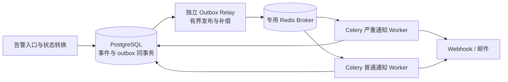

# Nexora 告警与后台任务资源隔离：Celery + Redis 完整任务清单

创建时间：2026-10-12 08:25（Asia/Shanghai）。最近更新：2026-10-12（告警网页复测与远端部署）。
对应记录：[walkthrough_20261012_0825_01_告警集中负载.md](../walkthrough/walkthrough_20261012_0825_01_告警集中负载.md)。

## 目标、范围与当前状态

**当前执行快照（2026-10-12）**：Celery/Redis 实施与会话认证修复均已推送 main，GitHub Linux release gate Run 712 通过；用户授权的 Docker 验证虚机已更新镜像并复测。用户后来澄清卡顿指告警网页，当前确认的主 API 热点与修复证据见文末 2026-10-12 补充记录。以下原 T10/T21 的 RestartCount、未部署等内容是部署前快照，不代表当前容器状态；长时间稳定性、故障注入和 500/1000/5000 条 SLO 压测仍未完成。

采用 **Celery + 专用 Redis Broker + 独立 Docker Worker** 作为 Nexora 统一后台任务方向，首阶段落地告警通知资源隔离。开发机本地保持纯进程模式，不依赖 Docker；隔离的 Relay/Worker 运行在远端 Linux Docker 虚机。PostgreSQL 继续保存业务事实、通知意图、投递状态与审计；不新增第二套关系数据库。

截至本次复核，用户已授权推送 main 检查 Actions，并明确授权对远端 Docker 验证虚机 SSH 测试、必要修改及重建相关服务。Linux release gate Run 712 通过，后续公开 Release-netops 同步已由 workflow 完成；当前服务状态与复测见文末。资源隔离为硬上限和背压，不代表 CPU 独占或任意输入量零影响。

已实施代码范围：保留告警统计/事件投影 SQL 减负；新增 PostgreSQL 投递代次与发布租约、精确 Worker 执行、独立 Relay/Celery、专用 Redis Compose 服务，并迁入网络告警、Grafana、主机资源和定时任务失败通知。告警状态持久化已增加每 100 项一批的 LLDP 事务；B-loop 扫描已从 asyncio 事件循环卸载。离线设备的 A-Loop 快速探测已增加 60 秒退避；Worker 启动参数已关闭不需要的 gossip/mingle/heartbeat。实施已推送 main，发布门禁通过且验证虚机服务已更新；CPU profile、完整故障注入和突发压测尚未完成。
- 远端 UI/容器只读检查确认活动告警风暴：告警中心显示 558 条待处理，首屏为一分钟内集中产生的 Device Offline 严重告警；仪表盘 CPU 73.3%。这证明两者同时发生，因果仍须受控基线/压测验证。
- 远端 Redis healthy、Relay 能发布任务；部署中的 critical/normal Worker command 仍没有本地新增的关闭参数，RestartCount 快照已升至 90/91。Celery Mingle 的 Redis PUBLISH 被 ACL 拒绝是已确认的启动故障；Redis ACL 保持最小权限。
- 用 `docker compose run --rm --no-deps` 在隔离的 `alert_notify_smoke` 空队列启动 Worker，成功连接专用 Redis 并报告 ready，随后热退出；临时容器已自动移除。该冒烟只验证 Worker/ACL 启动，不代表真实通知队列可安全放行，也没有重建现有服务。

已确认的热点证据与剩余边界：
- 事件列表、详情和影响读取不再在 GET 同步全量 incident 投影；改由 15 秒周期任务刷新。当前没有可靠的投影更新时间元数据，无法安全报告精确新鲜度，故 T14 部分完成。
- LLDP 链路状态已每 100 项共用连接和事务，并批量写 transition-state；每项 event/activity/outbox 与状态更新仍处于同一批事务。B-loop 的整个查询/扫描路径已用取消屏蔽的线程工作卸载。BGP/OSPF/BFD peer 已离开 asyncio loop；本地跟进改造已用 100 项告警批写并将 peer 快照 DELETE+INSERT 合并到单事务，进程缓存仅在快照提交后更新。跨实例采集 owner fencing 仍未做，T15 部分完成。
- 网络/协议告警、恢复、维护窗口解除、Grafana webhook、主机资源告警和定时任务失败都写 PostgreSQL outbox。纯验证码、登录验证和手动渠道测试保留即时发送语义。
- Compose 独立 Relay/Worker/Redis 与 API outbox consumer 已隔离；Redis 只在内部告警网络。远端 Docker 部署由 Relay/Worker 消费；本地开发默认 `ALERT_NOTIFICATION_CELERY_ENABLED=0`，用纯进程 FastAPI 和进程内 PostgreSQL outbox consumer，不要求本机 Docker/Celery/告警 Redis，但不提供本机 CPU 隔离。仅在共享测试/预发布环境通过受控网络连接相同 PostgreSQL 时才启用开关 `1`，由远端 Relay/Worker 处理。Celery 官方不支持 Windows，故 Worker 固定在远端 Linux 虚机。
- 采集与规则评估仍运行在 FastAPI 主容器；新通知 Worker 的 CPU 配额不限制 API 的评估 CPU，也不限制 PostgreSQL 处理告警 SQL 的 CPU。若它们仍是 profile 命中的热点，需另行拆分计算进程并定义唯一采集 owner。
- 同库多实例 telemetry loops 没有跨实例租约；是否实际同时运行待确认。纯通知 Worker 不会导入 FastAPI 或启动这些 loops。
- Celery 对失败消息不自动 broker requeue；Relay 现在对 attempts=0 的已发布 PG 记录以 1/2/4/8/16/30/60 分钟退避持续补发，首次 PG claim 后停止同代补发。真实 Broker/Worker 故障注入仍待运行。
- Relay 已在批量发布时为 normal 预留至少 `max(1, floor(N/4))` 个名额（N≥2），一类空闲时另一类可补位；单条批次仍 critical 优先。每通道/租户/目的地共享速率配额仍未做，T12 部分完成。

## 目标架构与固定契约



| 边界 | 固定要求 |
| --- | --- |
| PostgreSQL | 告警、通知意图、业务重试次数、available_at、终态和审计的权威来源；保留现有 delivery_key 和历史 |
| Redis Broker | 分发任务引用，不保存唯一业务事实；专用服务/ACL/命名空间/不淘汰策略，与可重建缓存分离 |
| Relay | 领取发布意图、有限批量发布、标记发布结果、故障补偿；不发送通知，不启动 FastAPI/采集循环；独立资源预算 |
| Celery task | 载荷仅包含 delivery_id 与 dispatch_generation；按该记录精确领取，禁止调用旧的批量消费者去领取其他记录 |
| dispatch_generation | 一次逻辑调度代次；发布重试沿用同代，业务重试或过期执行回收推进下一代。旧代任务不能发起通知或写回状态 |
| 领取与写回 | 原子校验状态、代次、执行租约、到期时间；成功取得执行权才增加业务 attempt。完成状态、attempt/activity 审计一起提交，仅有效 owner + generation 可写回 |
| 业务重试 | 外部渠道失败只由 PostgreSQL 计算退避、次数与终态；Celery 不再独立 autoretry 同一业务失败。基础设施重投/worker 崩溃由幂等领取和 Relay 补偿承接 |
| 发布一致性 | 发布成功不等于通知成功。PG 标记与 Broker 发布的崩溃窗口可重复发布，必须由精确领取吸收；Redis 重启/丢消息后可从 PG 补发 |
| 外部副作用 | 按至少一次处理；对支持幂等键的渠道传递稳定键。发送成功到 PG 回写前崩溃仍可能重投，不承诺通用 exactly-once |
| 队列 | 显式 alert_notify_critical / alert_notify_normal；各有专用消费者与容量，禁止默认队列或普通任务占用通知专用 Worker |
| 告警合并 | 合并通知、保留原始事件和关联审计；以租户/对象/规则/渠道/目的地为边界，不能跨租户或打乱触发/恢复语义 |
| API | 外部故障不回退为 API 内同步发送；返回真实的“已接收/已入队”语义。异步化时检查原有响应/调用方契约 |

Celery app 实际位于 `backend/celery_app.py`，容器入口使用 `celery -A celery_app:app worker`；worker 不导入 FastAPI `main`，不启动 telemetry loops。Broker key 使用 `nexora_alert_` 前缀，关闭 Celery remote control/events 以配合最小 Redis ACL。

## 初始资源预算（压测参数，不是保证值）

| 角色 | 初始 CPU 上限 | 初始内存上限 | 并发/连接要求 |
| --- | --- | --- | --- |
| API 主容器 | 保留当前 2.0 vCPU | 保留当前 2304 MiB | API 连接与请求预算独立 |
| 严重通知 Worker | 0.25 vCPU | 512 MiB | concurrency=1、prefetch multiplier=1；数据库池初始 min=1/max=2/overflow=0 |
| 普通通知 Worker | 0.25 vCPU | 512 MiB | 同上；独立进程及队列 |
| Outbox Relay | 0.1 vCPU | 192 MiB | 单 owner、有界批次和发布耗时，小数据库池 |
| 专用 Redis Broker | 0.25 vCPU | 384 MiB | maxmemory 初值 128 MiB，留持久化/缓冲余量；noeviction + 发布背压 |
| 告警计算 Worker | 后续按热点定标 | 后续按热点定标 | 仅在计算/同步确为热点时纳入后续批次，不消费通知队列 |

通知 Worker 合计上限 0.5 vCPU / 1 GiB；Relay 和 Broker 另计，告警服务总上限为 0.85 vCPU / 1.6 GiB。Compose 为四个新增告警容器设置 `cpu_shares=64`，这只是争用时的相对调度权重，不是 CPU 保留。全栈预算还要包括 PostgreSQL、缓存 Redis、VictoriaMetrics、Grafana、采集器和宿主机余量。CPU 配额不是独占或预留，Worker 的限额不会限制 PostgreSQL 为它执行 SQL 的开销；需先根据目标宿主机容量和压测结果调整。

池配置在每个 Celery 子进程内初始化，不能复用 fork 前已建立的数据库连接。资源初值不满足冷启动/峰值/SLO 时，按同负载证据调整或降低支持负载，不能仅靠 OOM 重启或无期限排队通过验收。

## 完整任务清单

方括号表示当前完成状态；未完成项是本次范围之外或尚缺运行/性能证据的工作。

### 阶段 0：基线与契约

- [ ] **T00 / P0：冻结实施范围和接口。** 通知隔离、代次、队列、配置开关、错误码和重试状态已实现；目标宿主机容量、实际渠道配额和业务峰值尚未确认，SLO 仍是待压测门禁。完成容量确认后再冻结支持范围。
- [ ] **T01 / P0：建立可复现基线。** 隔离 PostgreSQL、测试 Broker、mock Webhook/SMTP；覆盖 500/1000/5000 条突发、稳定活动告警、重复样本、批量恢复以及 20 个并发页面。记录 API/DB/worker CPU 时间、RSS、SQL/WAL、连接等待、loop lag、任务年龄与 throttling。禁止生产造告警或真实设备操作。
- [x] **T02 / P0：保留已完成的查询减负补丁。** alerts API、incident service 与两个回归测试文件；16 项已通过。实现期间代码状态改变时再按影响补测，不把旧测试当作新架构的验证。

### 阶段 1：PostgreSQL 可靠投递基础

- [x] **T03 / P0：新增兼容迁移。** `m0283_alert_delivery_celery_dispatch` 增加 generation、发布租约/结果、priority 和 Grafana 渠道约束；保留业务状态/历史并创建发布/失租约索引，降级不删积压。PostgreSQL 重复执行迁移的验证已加入。
- [x] **T04 / P0：事件与入队同事务。** enqueue 支持借用连接；网络告警开/恢复、Grafana webhook、主机资源告警、维护窗口重新打开和计划任务失败在事务中写事件/活动/投递意图，提交后才推进内存投影。包含 enqueue 失败回滚测试。
- [x] **T05 / P0：实现精确执行入口。** 使用 delivery_id + dispatch_generation 精确领取；状态、租约和 owner fencing 阻止重复/旧代执行或虚假审计，业务失败仅由 PostgreSQL 回退/记数。

文件边界：`backend/services/monitoring_notification_outbox_service.py`、`backend/services/background_monitor_service.py`、`backend/services/alert_maintenance_service.py`、`backend/database/schema.py` 和新编号 migration。数据库、事务和共享接口由主 Agent 决策，锁定契约后分派；使用 netops-data-migrations / netops-monitoring-telemetry / netops-backend。

### 阶段 2：Celery、Broker 与独立执行进程

- [x] **T06 / P0：实现 Outbox Relay。** 独立 Relay 以有限批次、SKIP LOCKED、短发布租约运行；PG 提交后发布 Celery task，成功后 fenced 标记，失败退避。若 Worker 在 PostgreSQL claim 前失败，attempts=0 的已发布记录按 1/2/4/8/16/30/60 分钟退避持续补发；首次业务 claim 后停止同代补发，业务代次不重复计数。
- [x] **T07 / P0：实现 Celery app 和任务。** 固定 `celery[redis]==5.6.3`；显式 critical/normal 队列、JSON、ignore_result，任务载荷仅为 delivery_id + generation，并只调用精确处理入口。默认队列为 normal；Worker CLI 只消费各自队列。
- [ ] **T08 / P0：统一 ACK、租约和重试。** 已配置 late ACK、worker-lost fencing、Redis visibility timeout=120 秒、DB 执行租约=90 秒、Celery hard/soft limit=60/50 秒、Worker stop grace=75 秒；Celery failed message 不 requeue，由 PG outbox redrive/lease recovery 补偿。真实 Broker 下 SIGTERM、强杀、OOM 与断连仍待 Docker 故障注入。
- [x] **T09 / P0：部署专用 Redis Broker。** Compose 已配置 Redis 内部网络、受限 ACL/key 前缀、noeviction、AOF、持久卷、资源上限和健康检查；远端 `docker compose config --services` 已确认含四个告警服务且插值通过。用户手动启动后，`nexora-alert-redis` 实际为 healthy，Relay 正常连接并发布，Redis 部署验收完成。Worker 启动时的 `PUBLISH` 权限问题记录在 T10，不放宽 Broker ACL。
- [ ] **T10 / P0：部署两类通知 Worker 和 Relay。** Compose 已配置两个单并发 Worker 与一个不启动 FastAPI lifespan 的 Relay，关闭 Celery remote control/events 并设置连接池、CPU/内存/PID 上限及停止宽限期。部署脚本曾遗漏 Redis/Relay/两个 Worker，用户手动 `docker compose up` 后现已创建四个容器。Relay 能从 PostgreSQL 领取并发布。当前部署的 Worker command 缺少关闭 gossip/mingle/heartbeat 的参数，RestartCount 快照为 90/91；本地已补参数并通过独立 `alert_notify_smoke` 空队列启动冒烟，Redis ACL 无需扩权。回归通过；代码推送后仍需由运维按真实通知积压策略更新服务，并完成稳定性、端到端消费和断连恢复测试。
- [x] **T11 / P0：迁入全部告警通知入口。** 网络/协议告警、恢复、维护窗口解除、Grafana webhook、主机资源告警、定时任务失败已统一写 PG outbox；Grafana 重复 firing 只更新投影、不重复通知。全仓调用审计已区分验证码/登录验证/手动渠道测试等非告警即时消息，并将其保留。

拟新增：`backend/celery_app.py`、`backend/tasks/alert_notification_tasks.py`、`backend/services/alert_delivery_relay_service.py`、独立 worker/relay CLI、专用测试。共享修改：`backend/main.py`、`backend/api/alerts.py`、`backend/api/health.py`、`backend/requirements.txt`、`docker-compose.yml`、部署示例/脚本和相关文档。文件所有权以主 Agent 工作包为准；使用 netops-release / netops-backend / netops-monitoring-telemetry。

### 阶段 3：背压、降噪与残留热点

- [ ] **T12 / P0：通道/租户限流与公平调度。** Relay 批次 N≥2 时 critical 使用 `N - max(1, floor(N/4))` 的保底名额，normal 至少获得 `max(1, floor(N/4))`；某类不足时从另一类补足，claimed 数不超过 N。定向 PostgreSQL 测试覆盖持续 critical、严重级别判定、空队列补位和 N=1 兼容行为；单条批次无持久公平游标。每通道、目的地、租户的实际发送配额和跨 Worker 共享速率控制、饱和告警仍待确定与实施。
- [ ] **T13 / P1：持久化通知聚合。** 普通告警初始 10～30 秒窗口按明确 grain 合并；保留逐条事件、聚合成员、投递审计和可追溯 key。关键告警首条及时发送，后续同源重复受控；短时触发/恢复合并需表达真实时间线。重启、窗口边界、跨租户、修改渠道、部分目标失败与重试均覆盖。
- [ ] **T14 / P0：事件读写解耦。** GET 默认只读；incident 投影由 15 秒单实例调度刷新，人工确认/分派状态和租户语义回归通过。当前组级 upsert 与首次打开时间线已在本地改为每批最多 500 组；500/1000/5000 组 PostgreSQL 集成回归通过。精确投影刷新时间/延迟缺少可信元数据，独立 alert-process 容器也未纳入；本项部分完成，补齐 freshness 契约并完成验证虚机前后测量后关闭。
- [ ] **T15 / P0：采样状态批量持久化与探测退避。** LLDP 每 100 项批量事务；BGP/OSPF/BFD 在线与设备离线告警复用 100 项批写，peer 快照替换在同一事务完成并提交后更新缓存。现场发现 A-Loop 每 15 秒重探所有设备，包括已 offline 的设备；本地把连续失败设备的重试改为 60/120/240/300 秒封顶指数退避，在线设备仍按 15 秒周期，恢复会清除退避状态。单测通过；代码尚待更新验证虚机并测量探测量、CPU 和恢复发现延迟。跨实例采集 owner fencing 与设备删除后的孤儿活动告警闭环仍待处理。
- [ ] **T16 / P1：优化数据库热点。** EXPLAIN ANALYZE/BUFFERS 和 pg_stat_statements 定位 dedupe、活动告警、投递记录、发布补偿及历史查询；只为证实的查询增加索引，清理按现有保留策略和受控批次执行，保护 API 查询和连接预算。
- [ ] **T17 / P2：减少浏览器空刷新。** 告警搜索已增加 250ms 防抖、取消前一请求、序号保护，并在刷新期间保留当前列表；Vitest 覆盖快速输入合并与旧响应不覆盖新结果，TypeScript 检查通过。无变化通知复用状态、隐藏页降低轮询及完整 UI 性能验收仍待完成。该项独立验收，未纳入首批实现时不阻塞通知隔离发布；接口变化涉及前端则同步类型检查。

先完成通知隔离，再依据 T01 结果安排 T14/T15 计算拆分的先后；主机可用性完整目标要求消除已证实的剩余热点，不能凭“Celery 已上线”宣布全部整改结束。

### 阶段 4：观测、故障、性能与交付

- [ ] **T18 / P0：建设观测与独立故障告警。** Compose 已包含 cAdvisor、PostgreSQL exporter 与 VMAgent；本地 Prometheus exporter 新增按 critical/normal 拆分的 PG outbox backlog、最老待处理/执行年龄、当前代未确认发布量、过期发布/执行租约指标；Prometheus/PostgreSQL 集成测试通过。Worker/Broker 运行状态、实际 CPU/RSS/throttling/连接等待、到达/处理速率及渠道超时仍需远端抓取验证；Worker 离线/严重积压告警须通过独立于该 Worker 的链路送达，尚未配置/演练。
- [ ] **T19 / P0：完成集中回归与故障注入。** 使用隔离 PG 和专用 Broker、mock 设备/渠道。验证同事务失败回滚、租户隔离、去重、旧代 fencing、精确领取、失租约审计、业务失败次数、恢复顺序、维护解除、邮件多 profile、Broker 满/断连/重启丢消息、发布前后各崩溃窗口、worker 强杀/优雅退出及渠道超时。清理仅限明确验证过的测试资源。
- [ ] **T20 / P0：完成联合压测门禁。** 同硬件/同背景负载比较 500/1000/5000 条突发及稳定轮询，持续至少 15 分钟；同时读页面、确认、恢复和采集。各负载分别记录 CPU/内存、数据库压力、事件/通知延迟、积压排空和错误率，不能把低 CPU + 长积压视为通过。
- [ ] **T21 / P0：形成部署候选。** GitHub Actions 对提交 `7d325869307e34805ab4b7f90af51354e005b764` 的 Linux release gate 已成功；本轮代码待推送并检查 Actions。远端 Redis healthy、Relay up；真实 Worker 的 command 缺少新参数且 RestartCount 快照为 90/91。使用空的 `alert_notify_smoke` 队列已验证 Worker 连接 Redis、报告 ready 并热退出；没有消费真实告警队列。目标虚机为 2 vCPU、约 7.7 GiB RAM；现场前端展示 CPU 73.3%，告警中心显示 558 条待处理，数据库快照显示 Device Offline 活动记录持续增加并包含大量已删除设备的残留行，这些均为现场观察，不等于受控性能验证。代表设备 `10.255.0.14:22` 从 NetOps 容器探测返回 errno 113（No route to host）。迁移升级、端到端真实通知处理、旧积压处置、故障注入和性能门禁仍待执行，部署候选门禁未通过。
- [ ] **T22 / P0：按授权执行灰度切换。** 先部署兼容 schema/全部 API 的模式门控，保持旧消费者；Broker/Relay/Worker 就绪但未消费。暂停旧 consumer、处理在途任务、确认所有实例模式及执行权后切换；再启 Relay/Worker。Broker 故障期间 API 仅持久化，不同步外发；观察后扩到目标负载。生产重启/部署仍须明确授权；`main` push 之前需单独告知会触发公开 release 仓库强制同步。
- [ ] **T23 / P0：演练回滚。** 停 Relay 新发布，停止/排空 Worker 并确认在途执行权；完成必要代次失效/租约回收后恢复旧 PG 消费。保留全部 schema、PG 积压与历史，兼容字段不得妨碍旧消费者，不删除队列/记录来回滚。未知外部发送结果按至少一次风险处理，旧 Worker 不可写回新 owner 的状态。
- [x] **T24 / P0：完成统一交付记录。** 更新本计划、walkthrough、部署说明和 docs/fixes；记录代码范围、验证结果、资源预算、未验证项与风险。内部协作材料不进入公有发布树。

## 工作包与依赖

主 Agent 负责需求、数据契约、数据库迁移、共享文件、计划和最终集成；所有执行者为 Luna 6 Max，最多两个并行，不创建下一级子 Agent。每包注明允许文件、skill、接口、依赖、验收命令；共享文件不得双写。

| 工作包 | 范围 | 依赖 | 执行边界 |
| --- | --- | --- | --- |
| A | T00/T01、迁移与 T04/T05 契约 | 先行 | 主 Agent 定接口后交 backend_worker；共享告警/数据库文件统一归属 |
| B | T06 Relay | A 接口冻结 | backend_worker，仅 Relay service/CLI/test |
| C | T07/T08 Celery 精确执行 | A 接口冻结 | complex_worker，仅 Celery app/task/helper/test；与 B 可并行 |
| D | T09/T10 部署、T11 入口迁移 | A～C 可运行 | 部署与调用方可分包；main/Compose/requirements 归主 Agent 合并 |
| E | T12/T13、T14～T17 | 隔离完成及热点证据 | 后端/前端角色按明确文件拆包，迁移由主 Agent 协调 |
| F | T18～T24 | 对应实现代码冻结 | verification_worker 跑指定检查，主 Agent 统一门禁和授权切换 |

Relay/Celery 任务不能直接套现有 process_alert_delivery_outbox(limit=1)：它会领取队列里其他记录并在 claim 时递增 attempts。按目标 ID/代次的新入口是 B/C 同时开工的先决接口。

## 最终验收与失败处理

- 每个告警事件与通知意图完整可追溯，重复任务不重复取得有效执行权；维护/静默/恢复、人工状态和租户边界通过。
- 主 API p95 初始目标 ≤1 秒、相对同机基线恶化 ≤20%，5xx ≤0.1%；健康检查无超时，主容器无 OOM/异常重启，采集未明显失速。最终支持资产/规则/事件峰值必须写入报告。
- 活动事件/投影可见目标 ≤5 秒；关键告警首条通知目标 ≤60 秒。该目标按约定峰值、目的地数量及聚合策略验证，达不到必须调整容量/策略并明确支持上限；不能保证无限关键告警都在 60 秒发送。
- 平台对整机 CPU 增量平均初始目标 ≤10 个百分点；统一逻辑核 CPU 口径并按同背景负载测量。实际总预算通过硬限额和 DB 工作量控制落实，不能只测 Worker 自身 CPU。
- 任务/连接/内存有界，Broker 满或停机时 PG 保留意图、发布退避可观测，主 API 可用；恢复后队列逐步排空，不能无限积压或静默丢弃。
- 发布补偿、业务重试、Celery 重投互不重复计数；Redis/worker/DB/外部渠道各故障窗口均有可复核证据，所有未知外部结果符合至少一次语义。
- 首批通知隔离候选要求 T00～T12、T18～T24 的相关 P0 完成；T13 与剩余热点根据首批 SLA/证据决定是否必须提前。完整整改完成另要求 T14/T15 及证实的数据库热点通过；未选入的 P2 单独排期，不用其阻塞无关发布。

任何门禁失败均回到对应任务定位，不能弱化断言、清空队列或删历史以通过。原有 TEXT 时间排序/first_seen 身份风险独立记录，性能改造不顺手扩大修复范围。

## 2026-10-12 告警网页卡顿复核与当前状态

用户澄清实际症状是告警网页卡顿，不是网卡故障。复核在用户提供的 2 vCPU Docker 验证虚机上进行，告警中心有 744 条待处理告警；页面服务端分页，默认 10 条，最大 100 条。本轮没有在远端数据库人为制造额外告警。

### 根因与修复

- 修复前 GET /api/alerts 在 744 条活动告警时耗时 2.34 秒，其中身份认证占 2.32 秒、请求处理约 18 毫秒。瓶颈主要在认证等待，不是浏览器一次渲染全部告警。
- 会话认证验证曾通过 asyncio 默认线程池执行；该线程池同时承载设备探测工作，探测并发使网页 API 的认证等待被放大。RBAC 依赖还会对同一请求重复查询会话。
- backend/main.py 为会话认证设置独立有界线程池（4 个 worker），backend/core/rbac.py 复用请求内认证结果。修复提交 271f4807（perf(api): isolate session auth from probe load），定向安全测试 2 passed，Python 编译与 git diff --check 通过。
- GitHub Linux release gate Run 712 成功，完整后端 3,203 项通过；前端 typecheck、测试与构建通过。已将发布同步后的代码构建为 Docker 镜像，并只重建 API、critical/normal Worker 与 Relay；数据库、Redis、Nginx 和监控服务未重建。

### 验证结果

- 部署后首次接口热身请求为 630 毫秒，其中认证 27 毫秒、处理 603 毫秒；当时多个页面接口并发加载且数据库/Worker 正在启动收敛，不能当作稳态结果。随后重新登录并复测告警列表，页面刷新约 620 毫秒（包含浏览器自动化点击与可访问性状态读取）；未再观察到超过 LOG_SLOW_REQUEST_MS=500 阈值的告警列表慢请求。
- 默认 10 条页面返回 744 总数；临时切换为 100 条后，DOM 确认 100 行已渲染，用时约 605 毫秒；恢复为默认 10 条用时约 273 毫秒。以上是浏览器操作与渲染的端到端采样，不是纯网络请求计时。
- 部署后 nexora-netops 健康，API/critical Worker/normal Worker/Relay 重启计数均为 0；critical 与 normal Worker 日志未发现 Redis PUBLISH ACL 错误或 traceback。Worker 各自限制为 0.25 vCPU / 512 MiB，单并发、prefetch=1，并关闭 gossip/mingle/heartbeat。
- 复测时宿主机 3 个采样点 CPU idle 为 76–90%；API CPU 约 0.28%，critical/normal Worker 约 0.05%/0.03%，数据库单点约 8.67%。内存无 swap I/O。此结果说明当前 744 条告警与 100 行分页下主机余量充足，不代表更大突发或长时间压测。

### 剩余门禁与风险

- 服务更新与启动验证已完成；真实队列长期稳定消费、通知端到端语义、Redis/Worker 断连和强杀恢复仍并入 T19/T20 验证，不以容器处于 Up 作为完整通过。
- T20 的 500/1000/5000 条负载、至少 15 分钟联合压测仍未运行。应只在隔离测试数据与 mock 通知目标中压测；不得通过生产造告警来凑量。
- Celery Worker CPU 配额不能限制 PostgreSQL 代其执行 SQL 的负载；Redis、数据库和磁盘仍是共享资源。若主业务在隔离后仍受告警数据读写影响，按 pg_stat_statements/EXPLAIN 与持续采样证据再处理 T14/T16。
- 本轮没有发现需要追加网页端批量渲染优化的证据；当前 UI 已服务端分页，100 行测试也在本轮容器与主机余量内完成。后续仍按 SLO 完成完整压测后再关闭总体资源整改。

## 验证命令与本次计划更新

本轮进行代码与文档整改，定向 PostgreSQL 回归 **62 passed / 301.06s**；修正审计记录排序后，`test_missing_grafana_feishu_webhook_is_terminally_skipped` **1 passed / 49.76s**，整个 outbox 测试文件 **13 passed / 92.90s**。新增离线探测退避与 Worker/deploy contract 的组合回归 **20 passed / 53.17s**。Python 全量语法编译、PostgreSQL-only 扫描（0 violations）、Compose YAML/资源网络静态契约和 `git diff --check` 均通过。完整 `.venv\Scripts\python.exe -m pytest backend/tests -q` 结果为 **3641 passed, 30 failed, 1 skipped, 26 subtests passed in 5203.78s**。告警相关失败为随机文本 ID 排序竞态，修复并单测通过；其余 29 项位于本次未修改的变更单/审批、资产导入/凭据及拓扑模块，未做 baseline comparison，不能宣称为通过。

本轮已执行的定向命令（12 个测试文件，PostgreSQL 隔离数据库）：

```powershell
.venv\Scripts\python.exe -m pytest backend/tests/alerts/test_grafana_alert_webhook.py backend/tests/monitoring/test_health_resource_execution.py backend/tests/monitoring/test_monitoring_incidents.py backend/tests/monitoring/test_monitoring_notification_outbox.py backend/tests/monitoring/test_alert_delivery_relay.py backend/tests/monitoring/test_alert_notification_celery.py backend/tests/monitoring/test_alert_state_outbox_atomicity.py backend/tests/monitoring/test_alert_state_write_batching.py backend/tests/monitoring/test_alert_storm_statistics.py backend/tests/monitoring/test_alert_lldp_tenant_and_outbound_history_projection.py backend/tests/monitoring/test_telemetry_orchestrator_execution.py backend/tests/scheduled_jobs/test_scheduler_failure_outbox.py -q
```

结果：**62 passed in 301.06s**。静态验证：`.venv\Scripts\python.exe -m compileall -q backend`、`.venv\Scripts\python.exe scripts\validate_postgresql_only.py`（0 violations）、Compose YAML/资源和网络断言、`git diff --check` 均通过。完整后端回归 **3641 passed, 30 failed, 1 skipped, 26 subtests passed in 5203.78s**；其中告警 outbox 审计测试曾按随机 ID 排序、误读开始态，已改用 `created_at DESC, id DESC`，定向复测 1 passed。其余 29 项失败位于未修改的变更单/审批、资产导入/凭据及拓扑模块，未做 baseline comparison，不作为通过处理。

开发机没有 Docker CLI；远端通过 SSH 只读检查了现有服务，并用 `docker compose run --rm --no-deps alert-notify-critical celery -A celery_app:app worker --queues=alert_notify_smoke --without-gossip --without-mingle --without-heartbeat --concurrency=1 --prefetch-multiplier=1 --loglevel=INFO` 做空队列启动冒烟。Worker 成功连接 Redis 并 ready，Ctrl+C 热退出，`--rm` 已移除临时容器；真实 critical/normal 队列没有被消费，现有服务未重建。之后读取到部署 Worker command 仍缺少新启动参数且 RestartCount 为 90/91。仍需在明确积压通知策略下更新现有服务，再做故障注入、500/1000/5000 告警同机联合压测和 SLO 报告；无前端改动，不执行前端 lint/build。


## 2026-10-12 14:00 真实运行态复核与下一轮修复

上一节的认证修复已经生效，但不能代表平台整体卡顿已解决。本次在用户授权的 Docker 验证虚机上只读复核；没有写入告警、清理投递记录、暂停采集或消费真实通知。

### 当前证据

- 宿主机为 2 vCPU、7.7 GiB RAM；uptime load average 为 4.72/2.74/3.58。单次 `docker stats` 显示 API 51.89% CPU、数据库 20.93%、vmagent 31.16%、SNMP exporter 33.34%；两个 Celery Worker 分别为 0.15%/0.28%，Relay 1.21%。这是瞬时快照，不能单独当作稳态 CPU 均值。
- PostgreSQL 当前有 744 条活动 `network_monitor` 告警，引用 744 个设备 ID，其中 540 个设备 ID 已不在 `devices` 表；设备当前状态为 204 offline、17 online。告警通知 outbox 当前快照为 1,604 条终态 failed、13 条 succeeded，没有 pending/processing；因此通知 Worker 不是当前活跃的主要 CPU 消费者。
- `pg_stat_statements` 显示 `INSERT INTO monitoring_incidents ... ON CONFLICT` 累计约 308,671 次执行，平均执行约 0.09 ms，仅返回 757 行；与 15 秒 incident 投影定时任务和约 744 个活动事件组吻合。`sync_incidents()` 每轮逐组执行一条 upsert，即使数据库 `WHERE` 条件最终避免更新，仍反复执行数百次 SQL。
- 同一 API 容器还每 60 秒响应一次 `/hardware-metrics` 抓取：读取 3,902 行、涉及 15 台设备，返回约 7.58 MB，观测耗时 1.69–3.34 秒。该周期性指标开销与告警工作负载共享 API/数据库资源，需保留为联合压测的背景负载。
- A-Loop 已有 60 秒 offline 重查间隔，但对持续失败设备固定重复，并按完成结果逐条写 collection status；在离线设备数量增长时还需检查真实周期、重试退避和数据库写放大。告警页搜索则每个按键立即发起请求，慢响应可能互相覆盖。

### 下一轮实施范围

1. 将 incident projection 的组级 upsert 和首次打开时间线改为有界 multi-values 批次，保持每 15 秒投影刷新、租户可见性、人工确认状态、根因切换和事务原子性；500/1000 个独立告警组时 SQL statement 数应随批次数增长，而不是随告警数增长。
2. 对连续 offline 设备使用有上限的指数退避并分散重查时间，在线设备仍保留快速周期；补上对实际调度门控、恢复清理和计数写入的定向测试，不在真实虚机上制造不可达目标。
3. 告警搜索加入短防抖、过期请求取消/序号保护，并保持旧列表可见直到新结果到达，避免逐字符并发请求和整表闪烁。
4. 保留 `/hardware-metrics` 的真实耗时与大小作为基线；先验证活动告警修复后的 API/DB CPU 变化，再决定是否调整指标新鲜度、缩减序列或移出 API 进程，避免未经确认就牺牲监控时效。

### 验收边界

- 本地 PostgreSQL 隔离测试覆盖 500/1000/5000 组的 incident 语义与 bounded SQL 调用数；前端测试证明快速输入只提交最终搜索、旧响应不覆盖新响应；离线退避测试覆盖持续失败、恢复和上限。
- 如需更新验证虚机，仍只对该测试环境构建和部署，并在部署前先完成本地代码与测试；不推送新提交、不触发公开 release workflow。使用现有线上告警数据仅做只读页面/API 与 `docker stats`/`pg_stat_statements` 前后对比，不清理真实积压或发出真实通知。
- 只有完成同背景负载下的持续 CPU、API p95、数据库压力、活动告警变化和队列年龄对比，才能关闭 T01/T15/T16/T20 和“平台资源不受告警影响”的总体验收；本轮之前的分页冒烟与低负载采样不满足该门禁。

## 2026-10-12 代码修复与本地验证

基于上述现场证据完成一轮局部热点处理：

- `sync_incidents()` 对 incident upsert 和新建 timeline 使用 500 行上限的 multi-values SQL；现有用户状态、根因更新、关联写入和事务提交语义保持不变。
- 离线设备重试采用 60/120/240/300 秒封顶退避，成功恢复后清除失败计数；在线设备仍按现有 A-Loop 周期探测。
- 告警搜索增加 250ms 防抖、AbortController 与请求序号保护；请求期间保留已有表格行。

本地 PostgreSQL 集成回归覆盖 500、1000、5000 个独立告警组和重复同步；定向 incident/orchestrator 测试通过。前端 AlertDesk 搜索竞态测试、`npm run lint`、Python 编译、PostgreSQL-only 扫描和 `git diff --check` 通过。随后已在用户授权的 Docker 验证虚机部署此轮四个运行时代码文件并成功重建 `nexora-netops` 镜像；`docker compose up -d --no-deps netops` 只重建主 API 容器。部署后主容器为 healthy、RestartCount=0、OOMKilled=false，资源上限为 2 vCPU / 2304 MiB。

本轮聚焦 `nexora-netops` 的低负载现场复核：14:45:31–14:46:01 每 5 秒采样 6 次，CPU 为 0.44%–16.80%，内存约 478 MiB；连续采样界面另见瞬时值最高 28.02%。近 3 分钟 API 日志中每分钟一次的 `/hardware-metrics` 请求耗时 1479、2793、1767 ms；未见超过 500 ms 门槛的 `/api/alerts` 慢请求日志。浏览器复测告警台仍有 744 条待处理，默认显示 10 条；搜索 `AC_228` 返回 3 条，清空搜索后恢复默认列表。该现场没有注入合成告警或请求压力，不能将低负载采样当作压测结论；`/hardware-metrics` 是仍需纳入主容器联合负载评估的周期性热点。至少 15 分钟的 500/1000/5000 条联合压测、API p95、数据库与容器 CPU/内存、错误率和通知队列年龄验收仍未完成，不能据此关闭主机资源保护目标。

## 2026-10-12 资产与配置重点页面核验

在用户提供的 Docker 验证虚机上只读检查了资产管理、网络设备、服务器、NPA 表单、网络事实库、标签、CMDB 资产目录/资源检索/设备/接口，以及配置备份、备份计划、配置对比、配置搜索和配置模板，共 15 个路由。设备台账共 219 台、资产目录 221 项、服务器 2 台、标签 61 个；网络设备列表和资产目录均切到 100 行并确认页面实际显示 100 行。CMDB 搜索 AC_100 返回 1 条；配置搜索 VLAN 100 返回 0 条，后端记录 5 ms。配置对比加载 219 台设备、当前没有快照；备份计划显示 0 条策略，备份中心没有批次；S3 状态最终为连接通过、2 个对象、待处理/失败均为 0。没有启动备份、路径诊断或设备操作。

导航逐页的浏览器计时约 1.57–1.84 秒，计时包含固定 1.4 秒等待，并非纯接口时延。网络事实库首次并发读取 5 个接口时，服务日志出现 3.55–3.80 秒请求；随后一组热读约 0.40–0.60 秒。备份中心首次对象存储检查的 GET /api/storage/status 为 6.23 秒、结果成功；再次打开时页面约 0.91 秒显示连接通过。该冷检查属于远端 S3 健康查询的延迟，不能据此归为持续 CPU 过载。浏览器控制台没有异常，只看到 THREE.Clock 弃用提示和一次图表容器尺寸为 -1 的 Recharts 警告。

测试时 nexora-netops 限额为 1.5 CPU / 2304 MiB，容器 healthy、RestartCount=0、OOM=false。采样的内存约 358–457 MiB；CPU 瞬时快照从 0.44% 到 22.17%，cgroup 的 nr_throttled 与 throttled_usec 均为 0。每分钟 /hardware-metrics 抓取仍耗时约 1.24–2.41 秒，是主容器的周期负载背景。页面核验没有观察到持续 CPU 打满；这不是告警突发联合压测结论。

现场发现资产概览严重度卡片和筛选逻辑不一致：部署页面显示“严重故障 0 / 运行正常 221”，同一页网络设备中实际有离线设备；点严重故障卡后列表只在当前页筛出 10 行。已在本地工作区修正为服务端严重度汇总及服务端分页筛选，避免前端只过滤当前 10 行；API 新增 by_severity 汇总字段及受限 severity 查询参数。后端 PostgreSQL 合同测试 1 passed，资产页前端测试 9 passed，Python 编译和 PostgreSQL-only 策略扫描（0 violations）通过。此处记录的是部署前状态：VM 源仓库 HEAD 为 87a0791，本地 main 为 271f4807；后续按远端基线适配并部署的结果见本计划末尾。

T20 的 500/1000/5000 告警联合负载和至少 15 分钟 SLO 压测仍未运行；资产/配置页面在当前 219–221 项数据规模下的通过，不构成大数据规模门禁通过。现有 alert 页面及主机资源保护的总体完成状态继续保持未验收。

### 页面修正门禁补充

`npm run lint`（`tsc --noEmit`）以退出码 0 完成；`node node_modules/vite/bin/vite.js build --outDir dist-codex-validation-asset-severity-20261012` 成功，Vite 处理 4320 个模块并在 39.62 秒完成；`git diff --check` 通过，只有既有 LF/CRLF 提示。构建输出保存在隔离目录，没有覆盖默认 dist。

## 2026-10-12 15:55 远端适配部署与页面复核

上节“尚未部署”是当时状态，现已被本节更新。验证 VM 仓库 HEAD 与本地不同，原补丁不能直接套用；确认远端三个资产源文件没有用户改动后，按远端代码形态移植同一修正，没有覆盖告警相关工作树改动。Dockerfile 生产构建成功，随后只重建 nexora-netops。主容器 healthy、RestartCount=0、OOMKilled=false，CPU 上限 1.5 核、内存上限 2304 MiB；没有重建数据库、Redis 或其他服务。容器启动时短暂处于 health starting，启动日志随后正常完成初始化。

资产页复核结果：221 项资产汇总为严重 204、重要 0、关注 2、正常 15；严重卡片筛选后服务端总数为 204、共 21 页，关注卡片为 2 项/1 页，正常卡片为 15 项/2 页。列表显示离线设备与严重度筛选一致，证明分页不再只过滤当前页。资产 PostgreSQL 合同测试 1 passed、资产页前端测试 9 passed；本机前端 lint/build 通过，远端 Dockerfile 中 npm run build 也成功。远端主机未安装 tsc，因此直接运行远端 npm run lint 不可用；生产镜像构建不依赖远端宿主机的 node_modules。

配置页面重访：备份中心连接检查通过、S3 中 2 个对象、0 个待处理和失败；首次连接状态接口本轮约 2.998 秒，属于冷检查。备份计划显示 1 条启用策略，本轮未执行备份；配置对比加载 219 台设备、没有历史快照；配置搜索入口正常；模板中心加载 132 个模板，未执行创建或配置操作。

现场资源与告警页面：测试机为 2 vCPU、约 7.7 GiB RAM，load average 1.52/2.30/1.90。告警台显示 745 条待处理、默认 10 条/页；日志记录 GET /api/alerts 总耗时 784.12 ms，其中认证 67.22 ms、处理 716.68 ms。主容器约 30 秒间隔抽样的 CPU 快照为 0.8%–27.69%，内存约 332–371 MiB；这些是离散快照，不能当连续峰值。通知 Worker 仍无重启/OOM，CPU 限额分别为 critical 0.25 核、normal 0.25 核、Relay 0.1 核、Redis 0.25 核；采样的内存约 70、54、37、4 MiB。主容器 cgroup OOM 计数为 0，节流计数为 15/2066 周期，累计节流约 0.391 秒。页面检查期间没有生成告警、确认/恢复事件、执行备份或发送通知。

这次部署证明资产严重度统计/分页缺陷已在验证 VM 修正，也证明 745 条现有告警下告警页能加载；它仍不证明告警风暴下主机资源完全不受影响。尚未运行隔离 mock 环境 500/1000/5000 告警、15 分钟并发采集/页面/通知负载和队列排空门禁；禁止用生产告警行制造压测。用户批准自测仅覆盖验证虚机，不等于批准推送这些新工作区改动。
