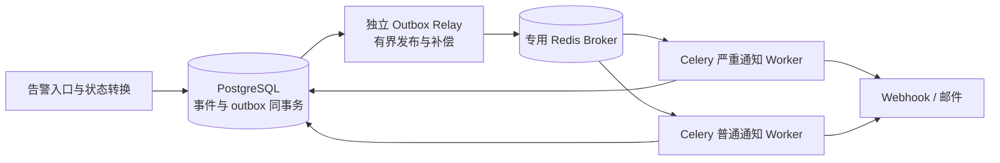

# Nexora 告警与后台任务资源隔离：Celery + Redis 完整任务清单

创建时间：2026-10-12 08:25（Asia/Shanghai）。更新：2026-10-12 11:38。
对应记录：[walkthrough_20261012_0825_01_告警集中负载.md](../walkthrough/walkthrough_20261012_0825_01_告警集中负载.md)。

## 目标、范围与当前状态

采用 **Celery + 专用 Redis Broker + 独立 Docker Worker** 作为 Nexora 统一后台任务方向，首阶段落地告警通知资源隔离。开发机本地保持纯进程模式，不依赖 Docker；隔离的 Relay/Worker 运行在远端 Linux Docker 虚机。PostgreSQL 继续保存业务事实、通知意图、投递状态与审计；不新增第二套关系数据库。

当前任务已进入实施。用户要求完成代码整改、推送 `main` 并检查 GitHub Actions；未授权生产部署或重启。现有 `.github/workflows/release.yml` 在 `main` push 成功后还会把净化后的发布树强制推送到公开仓库 `Release-netops`；此额外公开发布副作用须在推送前明确告知用户。告警处理必然消耗资源；本次以通知进程 CPU/内存硬限额、相对调度权重和队列背压约束资源，不承诺任意硬件、任意输入量下对主机或主业务零影响。

已实施代码范围：保留告警统计/事件投影 SQL 减负；新增 PostgreSQL 投递代次与发布租约、精确 Worker 执行、独立 Relay/Celery、专用 Redis Compose 服务，并迁入网络告警、Grafana、主机资源和定时任务失败通知。告警状态持久化已增加每 100 项一批的 LLDP 事务；B-loop 扫描已从 asyncio 事件循环卸载。代码与测试仍在本地工作区，未提交、推送或部署。CPU 实际降幅、完整故障注入、Docker Compose 运行验证和突发压测尚未完成；当前容器上限只是初始值。

已确认的热点证据与剩余边界：
- 事件列表、详情和影响读取不再在 GET 同步全量 incident 投影；改由 15 秒周期任务刷新。当前没有可靠的投影更新时间元数据，无法安全报告精确新鲜度，故 T14 部分完成。
- LLDP 链路状态已每 100 项共用连接和事务，并批量写 transition-state；每项 event/activity/outbox 与状态更新仍处于同一批事务。B-loop 的整个查询/扫描路径已用取消屏蔽的线程工作卸载。BGP/OSPF/BFD peer 已离开 asyncio loop，但仍逐 peer 持久化，T15 部分完成。
- 网络/协议告警、恢复、维护窗口解除、Grafana webhook、主机资源告警和定时任务失败都写 PostgreSQL outbox。纯验证码、登录验证和手动渠道测试保留即时发送语义。
- Compose 独立 Relay/Worker/Redis 与 API outbox consumer 已隔离；Redis 只在内部告警网络。远端 Docker 部署由 Relay/Worker 消费；本地开发默认 `ALERT_NOTIFICATION_CELERY_ENABLED=0`，用纯进程 FastAPI 和进程内 PostgreSQL outbox consumer，不要求本机 Docker/Celery/告警 Redis，但不提供本机 CPU 隔离。仅在共享测试/预发布环境通过受控网络连接相同 PostgreSQL 时才启用开关 `1`，由远端 Relay/Worker 处理。Celery 官方不支持 Windows，故 Worker 固定在远端 Linux 虚机。
- 采集与规则评估仍运行在 FastAPI 主容器；新通知 Worker 的 CPU 配额不限制 API 的评估 CPU，也不限制 PostgreSQL 处理告警 SQL 的 CPU。若它们仍是 profile 命中的热点，需另行拆分计算进程并定义唯一采集 owner。
- 同库多实例 telemetry loops 没有跨实例租约；是否实际同时运行待确认。纯通知 Worker 不会导入 FastAPI 或启动这些 loops。
- Celery 对失败消息不自动 broker requeue；Relay 现在对 attempts=0 的已发布 PG 记录以 1/2/4/8/16/30/60 分钟退避持续补发，首次 PG claim 后停止同代补发。真实 Broker/Worker 故障注入仍待运行。
- Relay 当前按 critical 优先排序，没有 normal 的公平份额；critical 持续超过发布吞吐时存在 normal 饥饿风险，T12 的公平调度仍未完成。

## 目标架构与固定契约



| 边界 | 固定要求 |
| --- | --- |
| PostgreSQL | 告警、通知意图、业务重试次数、available_at、终态和审计的权威来源；保留现有 delivery_key 和历史 |
| Redis Broker | 分发任务引用，不保存唯一业务事实；专用服务/ACL/命名空间/不淘汰策略，与可重建缓存分离 |
| Relay | 领取发布意图、有限批量发布、标记发布结果、故障补偿；不发送通知，不启动 FastAPI/采集循环；独立资源预算 |
| Celery task | 载荷仅包含 delivery_id 与 dispatch_generation；按该记录精确领取，禁止调用旧的批量消费者去领取其他记录 |
| dispatch_generation | 一次逻辑调度代次；发布重试沿用同代，业务重试或过期执行回收推进下一代。旧代任务不能发起通知或写回状态 |
| 领取与写回 | 原子校验状态、代次、执行租约、到期时间；成功取得执行权才增加业务 attempt。完成状态、attempt/activity 审计一起提交，仅有效 owner + generation 可写回 |
| 业务重试 | 外部渠道失败只由 PostgreSQL 计算退避、次数与终态；Celery 不再独立 autoretry 同一业务失败。基础设施重投/worker 崩溃由幂等领取和 Relay 补偿承接 |
| 发布一致性 | 发布成功不等于通知成功。PG 标记与 Broker 发布的崩溃窗口可重复发布，必须由精确领取吸收；Redis 重启/丢消息后可从 PG 补发 |
| 外部副作用 | 按至少一次处理；对支持幂等键的渠道传递稳定键。发送成功到 PG 回写前崩溃仍可能重投，不承诺通用 exactly-once |
| 队列 | 显式 alert_notify_critical / alert_notify_normal；各有专用消费者与容量，禁止默认队列或普通任务占用通知专用 Worker |
| 告警合并 | 合并通知、保留原始事件和关联审计；以租户/对象/规则/渠道/目的地为边界，不能跨租户或打乱触发/恢复语义 |
| API | 外部故障不回退为 API 内同步发送；返回真实的“已接收/已入队”语义。异步化时检查原有响应/调用方契约 |

Celery app 实际位于 `backend/celery_app.py`，容器入口使用 `celery -A celery_app:app worker`；worker 不导入 FastAPI `main`，不启动 telemetry loops。Broker key 使用 `nexora_alert_` 前缀，关闭 Celery remote control/events 以配合最小 Redis ACL。

## 初始资源预算（压测参数，不是保证值）

| 角色 | 初始 CPU 上限 | 初始内存上限 | 并发/连接要求 |
| --- | --- | --- | --- |
| API 主容器 | 保留当前 2.0 vCPU | 保留当前 2304 MiB | API 连接与请求预算独立 |
| 严重通知 Worker | 0.25 vCPU | 512 MiB | concurrency=1、prefetch multiplier=1；数据库池初始 min=1/max=2/overflow=0 |
| 普通通知 Worker | 0.25 vCPU | 512 MiB | 同上；独立进程及队列 |
| Outbox Relay | 0.1 vCPU | 192 MiB | 单 owner、有界批次和发布耗时，小数据库池 |
| 专用 Redis Broker | 0.25 vCPU | 384 MiB | maxmemory 初值 128 MiB，留持久化/缓冲余量；noeviction + 发布背压 |
| 告警计算 Worker | 后续按热点定标 | 后续按热点定标 | 仅在计算/同步确为热点时纳入后续批次，不消费通知队列 |

通知 Worker 合计上限 0.5 vCPU / 1 GiB；Relay 和 Broker 另计，告警服务总上限为 0.85 vCPU / 1.6 GiB。Compose 为四个新增告警容器设置 `cpu_shares=64`，这只是争用时的相对调度权重，不是 CPU 保留。全栈预算还要包括 PostgreSQL、缓存 Redis、VictoriaMetrics、Grafana、采集器和宿主机余量。CPU 配额不是独占或预留，Worker 的限额不会限制 PostgreSQL 为它执行 SQL 的开销；需先根据目标宿主机容量和压测结果调整。

池配置在每个 Celery 子进程内初始化，不能复用 fork 前已建立的数据库连接。资源初值不满足冷启动/峰值/SLO 时，按同负载证据调整或降低支持负载，不能仅靠 OOM 重启或无期限排队通过验收。

## 完整任务清单

方括号表示当前完成状态；未完成项是本次范围之外或尚缺运行/性能证据的工作。

### 阶段 0：基线与契约

- [ ] **T00 / P0：冻结实施范围和接口。** 通知隔离、代次、队列、配置开关、错误码和重试状态已实现；目标宿主机容量、实际渠道配额和业务峰值尚未确认，SLO 仍是待压测门禁。完成容量确认后再冻结支持范围。
- [ ] **T01 / P0：建立可复现基线。** 隔离 PostgreSQL、测试 Broker、mock Webhook/SMTP；覆盖 500/1000/5000 条突发、稳定活动告警、重复样本、批量恢复以及 20 个并发页面。记录 API/DB/worker CPU 时间、RSS、SQL/WAL、连接等待、loop lag、任务年龄与 throttling。禁止生产造告警或真实设备操作。
- [x] **T02 / P0：保留已完成的查询减负补丁。** alerts API、incident service 与两个回归测试文件；16 项已通过。实现期间代码状态改变时再按影响补测，不把旧测试当作新架构的验证。

### 阶段 1：PostgreSQL 可靠投递基础

- [x] **T03 / P0：新增兼容迁移。** `m0283_alert_delivery_celery_dispatch` 增加 generation、发布租约/结果、priority 和 Grafana 渠道约束；保留业务状态/历史并创建发布/失租约索引，降级不删积压。PostgreSQL 重复执行迁移的验证已加入。
- [x] **T04 / P0：事件与入队同事务。** enqueue 支持借用连接；网络告警开/恢复、Grafana webhook、主机资源告警、维护窗口重新打开和计划任务失败在事务中写事件/活动/投递意图，提交后才推进内存投影。包含 enqueue 失败回滚测试。
- [x] **T05 / P0：实现精确执行入口。** 使用 delivery_id + dispatch_generation 精确领取；状态、租约和 owner fencing 阻止重复/旧代执行或虚假审计，业务失败仅由 PostgreSQL 回退/记数。

文件边界：`backend/services/monitoring_notification_outbox_service.py`、`backend/services/background_monitor_service.py`、`backend/services/alert_maintenance_service.py`、`backend/database/schema.py` 和新编号 migration。数据库、事务和共享接口由主 Agent 决策，锁定契约后分派；使用 netops-data-migrations / netops-monitoring-telemetry / netops-backend。

### 阶段 2：Celery、Broker 与独立执行进程

- [x] **T06 / P0：实现 Outbox Relay。** 独立 Relay 以有限批次、SKIP LOCKED、短发布租约运行；PG 提交后发布 Celery task，成功后 fenced 标记，失败退避。若 Worker 在 PostgreSQL claim 前失败，attempts=0 的已发布记录按 1/2/4/8/16/30/60 分钟退避持续补发；首次业务 claim 后停止同代补发，业务代次不重复计数。
- [x] **T07 / P0：实现 Celery app 和任务。** 固定 `celery[redis]==5.6.3`；显式 critical/normal 队列、JSON、ignore_result，任务载荷仅为 delivery_id + generation，并只调用精确处理入口。默认队列为 normal；Worker CLI 只消费各自队列。
- [ ] **T08 / P0：统一 ACK、租约和重试。** 已配置 late ACK、worker-lost fencing、Redis visibility timeout=120 秒、DB 执行租约=90 秒、Celery hard/soft limit=60/50 秒、Worker stop grace=75 秒；Celery failed message 不 requeue，由 PG outbox redrive/lease recovery 补偿。真实 Broker 下 SIGTERM、强杀、OOM 与断连仍待 Docker 故障注入。
- [ ] **T09 / P0：部署专用 Redis Broker。** Compose 已配置 Redis 内部网络、受限 ACL/key 前缀、noeviction、AOF、持久卷、资源上限和健康检查；必须生成 URL-safe `ALERT_NOTIFICATION_BROKER_PASSWORD`。静态 YAML 已解析；开发机无 Docker CLI，远端 Linux 虚机上的 Compose 插值校验与容器实启仍待验证。
- [ ] **T10 / P0：部署两类通知 Worker 和 Relay。** Compose 已配置两个单并发 Worker 与一个不启动 FastAPI lifespan 的 Relay，关闭 Celery remote control/events 并设置连接池、CPU/内存/PID 上限及停止宽限期；Docker 启动、实际健康检查和断连恢复测试尚未完成。
- [x] **T11 / P0：迁入全部告警通知入口。** 网络/协议告警、恢复、维护窗口解除、Grafana webhook、主机资源告警、定时任务失败已统一写 PG outbox；Grafana 重复 firing 只更新投影、不重复通知。全仓调用审计已区分验证码/登录验证/手动渠道测试等非告警即时消息，并将其保留。

拟新增：`backend/celery_app.py`、`backend/tasks/alert_notification_tasks.py`、`backend/services/alert_delivery_relay_service.py`、独立 worker/relay CLI、专用测试。共享修改：`backend/main.py`、`backend/api/alerts.py`、`backend/api/health.py`、`backend/requirements.txt`、`docker-compose.yml`、部署示例/脚本和相关文档。文件所有权以主 Agent 工作包为准；使用 netops-release / netops-backend / netops-monitoring-telemetry。

### 阶段 3：背压、降噪与残留热点

- [ ] **T12 / P0：通道/租户限流与公平调度。** 当前 Relay 先发布 critical，没有 normal 保底份额。明确每通道、目的地、租户的实际发送配额，任务并发与每秒速率分别控制；多 Worker 下仍执行共享配额，不能把 Celery 单 Worker rate limit 当全局限流。关键/普通独立容量，关键配额饱和有告警，普通不永久饿死。
- [ ] **T13 / P1：持久化通知聚合。** 普通告警初始 10～30 秒窗口按明确 grain 合并；保留逐条事件、聚合成员、投递审计和可追溯 key。关键告警首条及时发送，后续同源重复受控；短时触发/恢复合并需表达真实时间线。重启、窗口边界、跨租户、修改渠道、部分目标失败与重试均覆盖。
- [ ] **T14 / P0：事件读写解耦。** GET 默认只读；incident 投影由 15 秒单实例调度刷新，人工确认/分派状态和租户语义回归通过。精确投影刷新时间/延迟缺少可信元数据，独立 alert-process 容器也未纳入；本项部分完成，补齐 freshness 契约后关闭。
- [ ] **T15 / P0：采样状态批量持久化。** LLDP 每 100 项批量事务、状态 executemany、event/activity/outbox 同事务回滚；整个 B-loop LLDP 扫描已卸载事件循环。协议 peer 已 offload，但仍逐 peer transaction；未引入跨实例采集租约。故本项部分完成，peer 批量写和采集 owner fencing 仍待处理。
- [ ] **T16 / P1：优化数据库热点。** EXPLAIN ANALYZE/BUFFERS 和 pg_stat_statements 定位 dedupe、活动告警、投递记录、发布补偿及历史查询；只为证实的查询增加索引，清理按现有保留策略和受控批次执行，保护 API 查询和连接预算。
- [ ] **T17 / P2：减少浏览器空刷新。** 无变化通知复用状态、隐藏页降低轮询、取消过时请求，保持分页上限和错误/权限态。该项独立验收，未纳入首批实现时不阻塞通知隔离发布；接口变化涉及前端则同步类型检查。

先完成通知隔离，再依据 T01 结果安排 T14/T15 计算拆分的先后；主机可用性完整目标要求消除已证实的剩余热点，不能凭“Celery 已上线”宣布全部整改结束。

### 阶段 4：观测、故障、性能与交付

- [ ] **T18 / P0：建设观测与独立故障告警。** API/relay/两类 Worker/Broker/DB 分别监控 CPU、RSS、throttling、连接等待、任务到达/处理速率、最老待发布/待执行年龄、处理/重试/终态、租约回收和渠道超时。业务延迟以 PG 记录为准，Broker 消息数量不是唯一真相。Worker 离线/严重积压告警不能依赖同一个已失效消费者发送。
- [ ] **T19 / P0：完成集中回归与故障注入。** 使用隔离 PG 和专用 Broker、mock 设备/渠道。验证同事务失败回滚、租户隔离、去重、旧代 fencing、精确领取、失租约审计、业务失败次数、恢复顺序、维护解除、邮件多 profile、Broker 满/断连/重启丢消息、发布前后各崩溃窗口、worker 强杀/优雅退出及渠道超时。清理仅限明确验证过的测试资源。
- [ ] **T20 / P0：完成联合压测门禁。** 同硬件/同背景负载比较 500/1000/5000 条突发及稳定轮询，持续至少 15 分钟；同时读页面、确认、恢复和采集。各负载分别记录 CPU/内存、数据库压力、事件/通知延迟、积压排空和错误率，不能把低 CPU + 长积压视为通过。
- [ ] **T21 / P0：形成部署候选。** Compose YAML 解析和 worker/网络/资源契约测试已通过；开发机无 Docker CLI，远端虚机上的 Compose v2 config、镜像启动/健康检查、迁移升级和旧积压仍待验证。完整后端回归结果为 3641 passed、30 failed、1 skipped、26 subtests passed（5203.78s）；1 条告警 outbox 失败是按随机 ID 排序造成的测试竞态，已改按 created_at 排序并单测通过。其余 29 条位于未修改的变更单/审批、资产导入/凭据及拓扑模块，尚未做基线归因，需独立排查，故部署候选门禁保持未通过。无前端改动，不需运行 lint/build。
- [ ] **T22 / P0：按授权执行灰度切换。** 先部署兼容 schema/全部 API 的模式门控，保持旧消费者；Broker/Relay/Worker 就绪但未消费。暂停旧 consumer、处理在途任务、确认所有实例模式及执行权后切换；再启 Relay/Worker。Broker 故障期间 API 仅持久化，不同步外发；观察后扩到目标负载。生产重启/部署仍须明确授权；`main` push 之前需单独告知会触发公开 release 仓库强制同步。
- [ ] **T23 / P0：演练回滚。** 停 Relay 新发布，停止/排空 Worker 并确认在途执行权；完成必要代次失效/租约回收后恢复旧 PG 消费。保留全部 schema、PG 积压与历史，兼容字段不得妨碍旧消费者，不删除队列/记录来回滚。未知外部发送结果按至少一次风险处理，旧 Worker 不可写回新 owner 的状态。
- [x] **T24 / P0：完成统一交付记录。** 更新本计划、walkthrough、部署说明和 docs/fixes；记录代码范围、验证结果、资源预算、未验证项与风险。内部协作材料不进入公有发布树。

## 工作包与依赖

主 Agent 负责需求、数据契约、数据库迁移、共享文件、计划和最终集成；所有执行者为 Luna 6 Max，最多两个并行，不创建下一级子 Agent。每包注明允许文件、skill、接口、依赖、验收命令；共享文件不得双写。

| 工作包 | 范围 | 依赖 | 执行边界 |
| --- | --- | --- | --- |
| A | T00/T01、迁移与 T04/T05 契约 | 先行 | 主 Agent 定接口后交 backend_worker；共享告警/数据库文件统一归属 |
| B | T06 Relay | A 接口冻结 | backend_worker，仅 Relay service/CLI/test |
| C | T07/T08 Celery 精确执行 | A 接口冻结 | complex_worker，仅 Celery app/task/helper/test；与 B 可并行 |
| D | T09/T10 部署、T11 入口迁移 | A～C 可运行 | 部署与调用方可分包；main/Compose/requirements 归主 Agent 合并 |
| E | T12/T13、T14～T17 | 隔离完成及热点证据 | 后端/前端角色按明确文件拆包，迁移由主 Agent 协调 |
| F | T18～T24 | 对应实现代码冻结 | verification_worker 跑指定检查，主 Agent 统一门禁和授权切换 |

Relay/Celery 任务不能直接套现有 process_alert_delivery_outbox(limit=1)：它会领取队列里其他记录并在 claim 时递增 attempts。按目标 ID/代次的新入口是 B/C 同时开工的先决接口。

## 最终验收与失败处理

- 每个告警事件与通知意图完整可追溯，重复任务不重复取得有效执行权；维护/静默/恢复、人工状态和租户边界通过。
- 主 API p95 初始目标 ≤1 秒、相对同机基线恶化 ≤20%，5xx ≤0.1%；健康检查无超时，主容器无 OOM/异常重启，采集未明显失速。最终支持资产/规则/事件峰值必须写入报告。
- 活动事件/投影可见目标 ≤5 秒；关键告警首条通知目标 ≤60 秒。该目标按约定峰值、目的地数量及聚合策略验证，达不到必须调整容量/策略并明确支持上限；不能保证无限关键告警都在 60 秒发送。
- 平台对整机 CPU 增量平均初始目标 ≤10 个百分点；统一逻辑核 CPU 口径并按同背景负载测量。实际总预算通过硬限额和 DB 工作量控制落实，不能只测 Worker 自身 CPU。
- 任务/连接/内存有界，Broker 满或停机时 PG 保留意图、发布退避可观测，主 API 可用；恢复后队列逐步排空，不能无限积压或静默丢弃。
- 发布补偿、业务重试、Celery 重投互不重复计数；Redis/worker/DB/外部渠道各故障窗口均有可复核证据，所有未知外部结果符合至少一次语义。
- 首批通知隔离候选要求 T00～T12、T18～T24 的相关 P0 完成；T13 与剩余热点根据首批 SLA/证据决定是否必须提前。完整整改完成另要求 T14/T15 及证实的数据库热点通过；未选入的 P2 单独排期，不用其阻塞无关发布。

任何门禁失败均回到对应任务定位，不能弱化断言、清空队列或删历史以通过。原有 TEXT 时间排序/first_seen 身份风险独立记录，性能改造不顺手扩大修复范围。

## 验证命令与本次计划更新

本轮进行代码与文档整改，定向 PostgreSQL 回归 **62 passed / 301.06s**；修正审计记录排序后，`test_missing_grafana_feishu_webhook_is_terminally_skipped` **1 passed / 49.76s**，整个 outbox 测试文件 **13 passed / 92.90s**。Python 全量语法编译、PostgreSQL-only 扫描（0 violations）、Compose YAML/资源网络静态契约和 `git diff --check` 均通过。完整 `.venv\Scripts\python.exe -m pytest backend/tests -q` 结果为 **3641 passed, 30 failed, 1 skipped, 26 subtests passed in 5203.78s**。告警相关失败为随机文本 ID 排序竞态，修复并单测通过；其余 29 项位于本次未修改的变更单/审批、资产导入/凭据及拓扑模块，尚需单独排查。未运行 Docker Compose、真实 Redis/Worker、容器故障注入或 CPU/内存突发压测，不宣称主机零影响已通过验收。

本轮已执行的定向命令（12 个测试文件，PostgreSQL 隔离数据库）：

```powershell
.venv\Scripts\python.exe -m pytest backend/tests/alerts/test_grafana_alert_webhook.py backend/tests/monitoring/test_health_resource_execution.py backend/tests/monitoring/test_monitoring_incidents.py backend/tests/monitoring/test_monitoring_notification_outbox.py backend/tests/monitoring/test_alert_delivery_relay.py backend/tests/monitoring/test_alert_notification_celery.py backend/tests/monitoring/test_alert_state_outbox_atomicity.py backend/tests/monitoring/test_alert_state_write_batching.py backend/tests/monitoring/test_alert_storm_statistics.py backend/tests/monitoring/test_alert_lldp_tenant_and_outbound_history_projection.py backend/tests/monitoring/test_telemetry_orchestrator_execution.py backend/tests/scheduled_jobs/test_scheduler_failure_outbox.py -q
```

结果：**62 passed in 301.06s**。静态验证：`.venv\Scripts\python.exe -m compileall -q backend`、`.venv\Scripts\python.exe scripts\validate_postgresql_only.py`（0 violations）、Compose YAML/资源和网络断言、`git diff --check` 均通过。完整后端回归 **3641 passed, 30 failed, 1 skipped, 26 subtests passed in 5203.78s**；其中告警 outbox 审计测试曾按随机 ID 排序、误读开始态，已改用 `created_at DESC, id DESC`，定向复测 1 passed。其余 29 项失败位于未修改的变更单/审批、资产导入/凭据及拓扑模块，未做 baseline comparison，不作为通过处理。

开发机没有 Docker CLI；Docker 部署位于远端 Linux 虚机，本次未登录该虚机执行 `docker compose config --quiet`，也未启动真实 Broker、Relay 或 Worker。后续需在远端虚机完成 Compose 配置/启动、容器故障注入、500/1000/5000 告警同机联合压测及 SLO 报告；无前端改动，不执行前端 lint/build。
