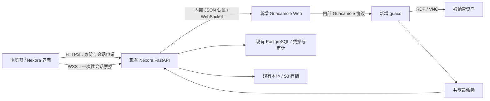

# Guacamole RDP/VNC 纳管任务清单

## 本次范围与状态

用户已要求按清单开始执行。T01—T07 已实现；GitHub Actions 与 Linux 部署环境的 Compose 启动、服务健康、认证路由、迁移表和共享录像卷验收通过。用户已授权将本机 Windows 测试资产 LEERBON（192.168.204.1）纳入 WH-DC-02，并绑定 Nexora 已存的普通凭据 tete 与特权凭据 admin。RDP profile 保存时发现前端 body 多发了协议字段，后端 extra-forbid 校验拒绝；修复并部署后继续真实会话与录像验证。VNC 目标尚未指定。逐项结果记录于对应 walkthrough。

用户已选择 Guacamole 容器化方案。实施前已重新核对工作树，确认 m0285 可用，并再次检查 Compose、PAM、权限、录像存储与前端调用链。

## 任务目标

为 Nexora 资产提供浏览器内 RDP 和 VNC 访问，复用平台身份、资产授权、凭据中心、PAM 审计和存储。新增两个可选容器：`guacamole/guacamole` 与 `guacamole/guacd`。Guacamole 使用 JSON 认证，不新增独立用户数据库、PostgreSQL 容器或 Redis 容器。

RDP/VNC 目标不需要安装 Nexora Agent：RDP 目标需启用远程桌面及相应登录权限；VNC 目标需运行兼容的 VNC Server。HTTP/HTTPS 继续使用现有 Web PAM，保持独立访问链路。

## 已有依据与问题

- 项目已有 FastAPI 后端，运行在现有 Nexora 服务内。
- 访问中心 RDP 入口目前为占位提示，尚无完整 VNC 接入。
- 已有凭据中心、租户/资源权限、PAM 会话、管理员 MFA、录像存储及会话审计页面。
- Compose 默认服务较多，新增服务采用 `remote-desktop` 可选 profile，避免未使用图形接入的部署启动额外服务。
- 当前 `main` 工作树有用户未提交变更，尤其 `backend/api/assets.py` 和部分 CMDB 页面。实施时采用独立 profile API 和组件，保留这些变更。
- 官方 Guacamole 1.6.0 支持 Docker、RDP/VNC、JSON 认证及图形会话录制；官方 `guacamole-common-js` 1.6.0 发布包包含浏览器客户端与原生录像播放器。

## 选定架构

- 浏览器只获得短时 Nexora 会话票据；目标密码、JSON 认证载荷和 Guacamole 授权 Token 留在服务端。
- 图形通道通过现有 FastAPI 转发；Nginx 代理 Nexora WebSocket，无需公开 Guacamole 管理界面或 REST API。
- 资产连接地址来自受授权的资产数据，客户端不得在握手中覆盖目标主机、端口或凭据。
- 凭据不重复保存到 Guacamole，profile 只保存配置和现有凭据引用。
- 普通访问与管理员访问分开。管理员访问复用实际 PIN/TOTP 校验，必须填写用途；不能仅靠前端标签放行。
- 图形会话采用原生 `.guac` 录像与独立播放器。图形操作不具备现有 SSH 命令解析与危险命令拦截能力，审计界面应准确表达能力边界。

## 任务列表

| 编号 | 任务 | 负责人 | 依赖 | 交付与验收条件 | 状态 |
| --- | --- | --- | --- | --- | --- |
| T01 | 资产 RDP/VNC 配置与数据库迁移 | 主 Agent | 无 | 同一资产可分别配置 RDP/VNC；端口合法；凭据引用合法；租户和资产范围校验有效；迁移幂等且覆盖新装/升级 | 已实现；PostgreSQL 迁移测试通过 |
| T02 | Guacamole 服务端认证适配 | 主 Agent | 无 | 正确实现官方 JSON 签名/加密及内部 Token 换取；支持 RDP/VNC 参数；错误脱敏；浏览器与日志不含目标密码或 Guacamole Token | 已实现；服务和日志脱敏测试通过 |
| T03 | PAM 图形会话与 WebSocket 代理 | 主 Agent | T01、T02 | 短时票据原子消费且不能复用；管理员 MFA；建连/失败/关闭审计；跨 worker 强制断开；超时与异常回收 | 已实现；与 PAM 现有会话测试通过 |
| T04 | 图形录像归档与恢复 | 主 Agent | T03、T07 | guacd 录像可写；关闭后归档到现有存储；失败保留待重试；恢复后可重试；未完成文件不标记可播放 | 已实现共享卷 UID/启动顺序和归档逻辑；容器共享卷及目录权限通过部署环境检查；真实会话录像归档待目标联调 |
| T05 | 资产配置与访问中心图形客户端 | 主 Agent | T01/T03 契约先确定 | RDP/VNC 配置表单、协议筛选、普通/管理员入口、用途/MFA、全屏/缩放/键鼠、断开与错误态；批量加载配置 | 已实现；TypeScript 检查和生产构建通过 |
| T06 | PAM 图形审计与原生录像播放 | 主 Agent | T04 契约先确定 | 正确标识协议、访问级别和录像格式；原生录像播放/暂停/进度；强制断开；SSH/Web 原有播放保持兼容 | 已实现；TypeScript 检查和生产构建通过 |
| T07 | 两容器部署与运维配置 | 主 Agent | 无，可与 T01/T02 并行 | 固定一致版本；可选 profile；启用时检查密钥；内部网络及共享录像卷；无公开 4822/8080 端口；部署脚本和说明同步 | 已实现；部署契约通过；Linux 部署环境中的两个容器、版本、健康状态和共享卷检查通过 |
| T08 | 集成、验证与交付记录 | 主 Agent | T01—T07 | 聚焦后端/迁移/权限/前端/Compose 检查；真实 RDP/VNC 联调单独记录；完成 walkthrough 与回滚说明 | 基础 CI 与部署验收通过；正在修正 RDP profile 请求契约并验证 RDP；VNC 目标待提供 |

## 各任务实施边界

### T01：配置与迁移

新增 `asset_remote_desktop_profiles` 表：资产引用、协议（`rdp`/`vnc`）、名称、端口、启用状态、普通/管理员凭据引用，以及必要的 RDP 域/安全模式配置。一个资产每种协议最多一个配置。

- RDP 默认端口 3389，VNC 默认端口 5900；支持修改，不复用 SSH 的管理端口。
- 未指定协议凭据时，明确继承对应访问级别的资产凭据；显式绑定失效时返回错误，不能静默降级到其他凭据。
- VNC 支持仅密码的认证方式，不能套用 RDP 必须有用户名的校验。
- RDP 默认使用 NLA；证书校验及自签名例外需显式配置和审计，不默认关闭证书验证。
- schema 与迁移保持一致。实际迁移为 `m0285_pam_remote_desktop.py`，与已有 m0284 顺序衔接。

已实现接口：

- `GET /api/assets/{asset_id}/remote-desktop-profiles`
- `PUT /api/assets/{asset_id}/remote-desktop-profiles/{protocol}`
- `GET /api/pam/remote-desktop-profiles?asset_ids=...`：访问中心批量查找，单次最多 200 个资产；按授权租户/站点范围在单条 SQL 中过滤。

响应统一包含 `success` 和 `data`；不返回密码。保存 profile 需要资产编辑权限，读取及启动分别检查对应权限和资产范围。

### T02：Guacamole 适配

- 在 `backend/services/guacamole_service.py` 实现内部 HTTP/WS 适配。
- 独立 `GUACAMOLE_JSON_SECRET_KEY`，使用官方要求的 32 位十六进制密钥；不能复用凭据加密密钥。
- JSON 含唯一会话身份、短时有效期和唯一连接；签名/加密遵循官方 HMAC-SHA256 + AES-128-CBC 格式。
- Token 通过内部 POST 交换；连接标识和数据源从实际响应解析，不依赖连接名称的编码猜测。
- 服务端构造 RDP/VNC 参数；默认关闭驱动器、打印机及文件传输重定向。剪贴板按明确策略开启。
- 会话结束释放 Guacamole 授权。JSON 有效期只限制认证载荷的接收，不能当作已打开会话的强制截止时间。

### T03：会话与代理

创建接口：`POST /api/pam/remote-desktop-sessions`。

请求：`asset_id`、`protocol`、`access_level`、`reason`；管理员请求附带现有 `fixed_pin`、`mfa_code`。响应：`session_id`、`session_token`、`expires_at`、`protocol`、`connect.ws_url`，不包含目标凭据与 Guacamole Token。

实际通道：`/api/pam/remote-desktop-ws/{session_token}`；浏览器仅可提供受限的显示尺寸/DPI参数。

- profile 启用、凭据绑定、用户有效性及资产授权在申请和消费票据时校验。
- 票据用安全随机数生成，短时有效，数据库保存哈希；PostgreSQL 条件更新/事务确保并发消费只有一次成功。
- 按真实 Guacamole 建连结果更新 `connecting`、`active`、`closed`、`error`，不能在申请成功时写成连接成功。
- 支持同源校验、消息大小限制、连接超时、最大会话时长和断线清理。
- 强制断开及状态恢复依赖数据库状态/租约，不能仅依赖进程内会话字典，兼容多 worker。
- 票据所在 WS 路径关闭访问日志；异常消息不泄露内部授权参数。

### T04：录像

- guacd 与 Nexora 共享录像卷，路径及文件名由服务端生成并校验；已确认官方镜像 UID/GID 为 1000，部署环境挂载和容器用户已检查；真实会话录像写入待目标联调。
- 使用 Guacamole 原生录像参数；关闭并确认文件写入完成后，经现有 PAM StorageService 归档。
- 记录格式、大小、摘要及存储状态；扩展现有录制下载和重试逻辑以支持 `.guac`。
- 空文件、仍在写入的文件及上传失败均不得标记 `READY`；进程异常后由恢复任务处理遗留录像。
- 授权播放/下载复用 PAM 权限并加强资产范围校验。

### T05/T06：前端

- 新增远程桌面 API、客户端和资产 profile 编辑组件；主要修改 `AccessCenterTab.tsx`、`AssetModal.tsx` 与 `PAMAuditTab.tsx`。
- 官方客户端使用固定版本的本地静态资源，保留 Apache License/NOTICE 和来源信息；不运行时依赖公网 CDN。
- 访问中心按已启用 profile 显示 RDP/VNC，VNC 不受 Windows 平台判断限制。使用批量请求，避免每行资产单独发请求。
- 新资产先保存获得 ID 再保存 profile；部分失败明确反馈，不误报整套配置保存成功。
- 键盘仅在图形视图聚焦时捕获；关闭、切换或断开时释放键鼠事件与连接。
- 录像按格式选择原生图形播放器或现有 SSH/Web 播放器，覆盖不可用、加载失败及存储重试中状态。

### T07：部署

已修改 `docker-compose.yml`、`.env.example`、`nginx/nginx.conf`、`scripts/deploy-docker.sh`、`docs/deploy/docker.md`。

- 使用两个官方镜像，初始版本选定 1.6.0；正式实施前复核版本与兼容性，两镜像和 JS 客户端保持一致。
- 使用 `remote-desktop` profile。默认关闭；启用开关与部署脚本一致，启用时检查 JSON 密钥。
- profile 关闭时，缺失 Guacamole 密钥不能阻止原有 Nexora 部署。
- Guacamole API/guacd 仅在可信容器网络可达；guacd 使用单独出向网络连接资产，目标防火墙允许网关出口地址。
- 不增加宿主机 4822/8080 端口映射；Nginx 只代理现有后端图形 WebSocket。
- 录像卷持久化，明确容量、清理和备份策略；不修改或重置现有数据库卷。
- 环境文件按数据处理，部署解析兼容 LF/CRLF，不能直接 `source` 整份 `.env`。

## 执行与集成

实施期间曾尝试分派前后端工作，但运行时撤销了子 Agent 的应用网络权限；主 Agent 接手并完成实现，保留了工作树中已有的用户修改。部署配置、前后端、迁移、录像处理、文档和测试由主 Agent 集成检查。实机联调中确认 `RemoteDesktopProfileInput` 不应把路径已明确的 `protocol` 再发送到 JSON body，且 `rdp_domain` 应按后端 `str` schema 提交空字符串而不是 null；前端输入类型与序列化逻辑需要同步修正。

## 验证结果与剩余联调

- 后端、迁移、凭据错误脱敏、录像稳定性、现有 PAM Web 会话和部署契约：定向 pytest 共 17 项通过；Compose 权限/启动顺序调整后，部署契约测试再次通过。
- 前端：`npm run lint` 通过；Vite 生产构建写入隔离目录并成功生成；未覆盖既有 `dist`。
- Python：本次后端/迁移文件 `py_compile` 通过；PostgreSQL-only 扫描 0 项违规。
- 部署脚本：`bash -n scripts/deploy-docker.sh` 通过；YAML 由部署契约测试解析。
- GitHub Actions 后端、前端、lint、构建及 release sync 全部通过；首次 CI 异步测试修复后的运行结果见交付记录。
- Linux 部署环境已执行常规更新，并在新同步的 checkout 使用 `bash scripts/deploy-docker.sh update --force` 启动可选 profile；两容器运行、guacd 健康、应用健康接口和内部 Guacamole HTTP 均通过。数据库迁移对象和共享录像卷已核实。
- 本机 Windows 未运行 Docker；未触碰远端数据库卷。已创建并按用户确认将本机 Windows 测试资产归属 WH-DC-02，普通/特权凭据已绑定；RDP profile 保存遇到前后端请求契约不一致，修正并部署后继续真实连接和录像联调。VNC 仍需一台运行 VNC Server 的目标资产。

## 风险与回滚思路

- FastAPI 图形代理增加现有后端连接与带宽负载，实施时验证并发容量及代理超时。
- 标准 VNC 的目标侧传输可能没有加密；按 VNC Server 能力使用加密模式或受控专网，不能因浏览器使用 HTTPS 就宣称整条链路加密。
- 图形操作可录制回放，不能承诺 SSH 级命令过滤。
- 回滚通过停用入口与 Compose profile、恢复相关路由和前端完成；新增表/字段前向兼容，保留审计和录像，不删除现有凭据或数据库卷。
- 本计划指导代码、部署配置及离线验证；真实部署、目标端访问与录像兼容性需另以实际环境联调确认。

## 参考资料

- [官方 Docker 部署](https://guacamole.apache.org/doc/gug/guacamole-docker.html)
- [官方 JSON 认证](https://guacamole.apache.org/doc/gug/json-auth.html)
- [连接与录制参数](https://guacamole.apache.org/doc/gug/configuring-guacamole.html)
- [官方 JavaScript 客户端](https://guacamole.apache.org/doc/gug/writing-you-own-guacamole-app.html)
- [官方录像播放说明](https://guacamole.apache.org/doc/gug/recording-playback.html)

## 本次完成记录

T01—T07 已完成；T08 的自动验证与 Linux 部署基础链路验收通过。剩余工作是修正并部署 RDP profile 请求契约，完成本机 RDP 真实连接、录像归档/回放联调；VNC 需提供运行 VNC Server 的目标资产。详见 [walkthrough](../walkthrough/walkthrough_20261013_0958_01_Guacamole_RDP_VNC纳管.md)。
