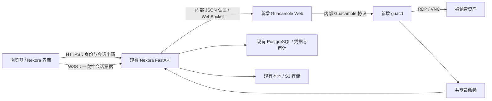

# Guacamole RDP/VNC 纳管任务清单

## 本次范围与状态

用户已要求按清单执行 Guacamole RDP/VNC 纳管。T01—T07 已实现；用户授权将本机 Windows 资产 LEERBON（192.168.204.1）纳入 WH-DC-02，并绑定已有普通凭据 tete 与特权凭据 admin。用户选择固定证书指纹；已实现单资产 SHA-256 pin，空值保持严格系统证书校验。test 账号 NLA 认证成功后，已在访问中心实际显示 Windows 桌面；修复 WebSocket 子协议协商和活动态识别后，PAM 状态在 `ready/sync` 时转为 `active`，断开后归档状态为 S3 `READY`。Windows 10 Pro 的单交互桌面限制会切换/断开本机桌面，不要求注销。之后用户授权在 LEERBON 安装 TightVNC 测试服务；VNC 已从访问中心实机连通，录像归档状态为 S3 `READY`。

用户已选择 Guacamole 容器化方案。实施前已重新核对工作树，确认 m0285 可用，并再次检查 Compose、PAM、权限、录像存储与前端调用链。

## 任务目标

为 Nexora 资产提供浏览器内 RDP 和 VNC 访问，复用平台身份、资产授权、凭据中心、PAM 审计和存储。新增两个可选容器：`guacamole/guacamole` 与 `guacamole/guacd`。Guacamole 使用 JSON 认证，不新增独立用户数据库、PostgreSQL 容器或 Redis 容器。

RDP/VNC 目标不需要安装 Nexora Agent：RDP 目标需启用远程桌面及相应登录权限；VNC 目标需运行兼容的 VNC Server。HTTP/HTTPS 继续使用现有 Web PAM，保持独立访问链路。

## 已有依据与问题

- 项目已有 FastAPI 后端，运行在现有 Nexora 服务内。
- 访问中心 RDP 入口目前为占位提示，尚无完整 VNC 接入。
- 已有凭据中心、租户/资源权限、PAM 会话、管理员 MFA、录像存储及会话审计页面。
- Compose 默认服务较多，新增服务采用 `remote-desktop` 可选 profile，避免未使用图形接入的部署启动额外服务。
- 当前 `main` 工作树有用户未提交变更，尤其 `backend/api/assets.py` 和部分 CMDB 页面。实施时采用独立 profile API 和组件，保留这些变更。
- 官方 Guacamole 1.6.0 支持 Docker、RDP/VNC、JSON 认证及图形会话录制；官方 `guacamole-common-js` 1.6.0 发布包包含浏览器客户端与原生录像播放器。

## 选定架构

- 浏览器只获得短时 Nexora 会话票据；目标密码、JSON 认证载荷和 Guacamole 授权 Token 留在服务端。
- 图形通道通过现有 FastAPI 转发；Nginx 代理 Nexora WebSocket，无需公开 Guacamole 管理界面或 REST API。
- 资产连接地址来自受授权的资产数据，客户端不得在握手中覆盖目标主机、端口或凭据。
- 凭据不重复保存到 Guacamole，profile 只保存配置和现有凭据引用。
- 普通访问与管理员访问分开。管理员访问复用实际 PIN/TOTP 校验，必须填写用途；不能仅靠前端标签放行。
- 图形会话采用原生 `.guac` 录像与独立播放器。图形操作不具备现有 SSH 命令解析与危险命令拦截能力，审计界面应准确表达能力边界。

## 任务列表

| 编号 | 任务 | 负责人 | 依赖 | 交付与验收条件 | 状态 |
| --- | --- | --- | --- | --- | --- |
| T01 | 资产 RDP/VNC 配置与数据库迁移 | 主 Agent | 无 | 同一资产可分别配置 RDP/VNC；端口合法；凭据引用合法；租户和资产范围校验有效；迁移幂等且覆盖新装/升级 | 已实现；PostgreSQL 迁移测试通过 |
| T02 | Guacamole 服务端认证适配 | 主 Agent | 无 | 正确实现官方 JSON 签名/加密及内部 Token 换取；支持 RDP/VNC 参数；错误脱敏；浏览器与日志不含目标密码或 Guacamole Token | 已实现；服务和日志脱敏测试通过 |
| T03 | PAM 图形会话与 WebSocket 代理 | 主 Agent | T01、T02 | 短时票据原子消费且不能复用；管理员 MFA；建连/失败/关闭审计；跨 worker 强制断开；超时与异常回收 | 已实现；与 PAM 现有会话测试通过 |
| T04 | 图形录像归档与恢复 | 主 Agent | T03、T07 | guacd 录像可写；关闭后归档到现有存储；失败保留待重试；恢复后可重试；未完成文件不标记可播放 | guacd 录像名与 `.guac` spool 路径对齐；远端会话已验证归档到 S3 并为 `READY` |
| T05 | 资产配置与访问中心图形客户端 | 主 Agent | T01/T03 契约先确定 | RDP/VNC 配置表单、协议筛选、普通/管理员入口、用途/MFA、全屏/缩放/键鼠、断开与错误态；批量加载配置 | 已实现；TypeScript 检查和生产构建通过 |
| T06 | PAM 图形审计与原生录像播放 | 主 Agent | T04 契约先确定 | 正确标识协议、访问级别和录像格式；原生录像播放/暂停/进度；强制断开；SSH/Web 原有播放保持兼容 | 已实现；TypeScript 检查和生产构建通过 |
| T07 | 两容器部署与运维配置 | 主 Agent | 无，可与 T01/T02 并行 | 固定一致版本；可选 profile；启用时检查密钥；内部网络及共享录像卷；无公开 4822/8080 端口；部署脚本和说明同步 | 已实现；部署契约通过；Linux 部署环境中的两个容器、版本、健康状态和共享卷检查通过 |
| T08 | 集成、验证与交付记录 | 主 Agent | T01—T07 | 聚焦后端/迁移/权限/前端/Compose 检查；真实 RDP/VNC 联调单独记录；完成 walkthrough 与回滚说明 | RDP、VNC 的浏览器建连、桌面显示、PAM 状态和 S3 `READY` 均已实机验证 |

## T08 后续排查（2026-10-13）

### 目标与现状

- 已将 Nexora 的测试凭据校正为用户授权的 `test` 账号对应密码；Windows Security 4624 与 RemoteConnectionManager 1149 确认 NLA 登录成功，guacd 确认 RDPDR 用户登录。
- 实测 Windows 主机当前为 Windows 10 Pro。桌面版单交互会话会令本机桌面与 RDP 会话互相切换；注销不是建立 RDP 的前提。
- 最初前端一直停在“正在建立受控会话…”。诊断确认未协商浏览器请求的 `guacamole` WebSocket 子协议；修复后客户端正常收发 Guacamole 帧并显示桌面。后端最初只按 `ready` 更新活动态，实测可见画面同步 `sync` 但审计状态仍停在 `connecting`。

### 影响范围与拟修改文件

- 首选只读检查 Guacamole 客户端握手、Nginx WebSocket 代理和 FastAPI 双向转发；确认具体丢帧方向后再修复。
- 如需安全诊断，修改范围限于 `backend/api/remote_desktop.py` 和 `backend/tests/pam/test_remote_desktop_tunnel_proxy.py`，仅记录协议指令名称/计数，不记录帧内容、票据或凭据；不得将明文或完整协议帧写入日志。
- 更新本计划及对应 walkthrough；不修改 Windows 用户或会话策略，不注销/结束用户桌面应用。

### 实施与验证步骤

1. 检查浏览器 Guacamole.js 的握手及 WebSocket 路径、FastAPI `/api/pam/remote-desktop-ws/{ticket}` 双向代理、Nginx `Upgrade`/`Connection` 转发；代理必须协商客户端请求的 `guacamole` WebSocket 子协议。
2. 在 Ubuntu 容器临时部署脱敏握手计数并通过现有授权的真实 RDP 资产复测，确认是否收到客户端 `select/size/connect`、服务端 `args/ready`，以及内部 tunnel UUID 是否正确协商。
3. 已修复代理子协议协商，并在收到 Guacamole `ready` 或服务端首个 `sync` 画面指令时将 PAM 会话转为活动态；5 项后端定向 pytest、`py_compile` 和 `git diff --check` 通过。已将变更模块同步到授权 Ubuntu 环境并实测桌面渲染、PAM 状态与 S3 录像。
4. RDP 实机验证完成后，按用户授权安装 VNC Server 并完成 VNC 实机联调；确认只允许网关来源、录像归档后更新 walkthrough。

### 风险与回滚

- 重连可能切换 LEERBON 的唯一交互桌面会话；不得执行注销，不保存或读取用户桌面内容。
- 如临时诊断日志无法安全限定为指令名称/计数，则直接撤销诊断代码；部署回滚为恢复上一版本 `remote_desktop.py` 并重启 Nexora 容器，不动数据库、测试账号或录像。

### 实际结果（2026-10-13）

- FastAPI WebSocket 现在只在浏览器请求 `guacamole` 子协议时接受，并在握手中回显该协议；这使官方 Guacamole.js 能完成双向协议握手。活动态识别兼容 `ready` 和首个服务端 `sync`。
- 用户授权的普通凭据 `test` 已通过 NLA 登录。`quser` 确认 `test` 的 RDP 会话为 `Active`；访问中心状态为“RDP 已连接”，画面显示 Windows 桌面。会话关闭后，数据库为 `closed/upstream_closed`，录像为 `uploaded/READY`，存储后端为 S3。
- 为测试用 `tsdiscon 1` 断开本机 `tete` 会话，没有注销或关闭其应用；RDP 测试结束后 `tete` 与 `test` 均为 `Disc`。尝试用当前权限执行 `tscon 1 /dest:console` 恢复本机控制台时返回 Access Denied；需本机管理员操作恢复桌面会话。
- 远端模块与工作区 SHA-256 一致；Ubuntu 上 Nexora 容器重启后健康接口 HTTP 200。VNC Server 后续由用户授权安装；实测结果见“VNC 实机验证收尾”。

## 各任务实施边界

### T01：配置与迁移

新增 `asset_remote_desktop_profiles` 表：资产引用、协议（`rdp`/`vnc`）、名称、端口、启用状态、普通/管理员凭据引用，以及必要的 RDP 域/安全模式配置。一个资产每种协议最多一个配置。

- RDP 默认端口 3389，VNC 默认端口 5900；支持修改，不复用 SSH 的管理端口。
- 未指定协议凭据时，明确继承对应访问级别的资产凭据；显式绑定失效时返回错误，不能静默降级到其他凭据。
- VNC 支持仅密码的认证方式，不能套用 RDP 必须有用户名的校验。
- RDP 默认使用 NLA；证书校验及自签名例外需显式配置和审计，不默认关闭证书验证。
- schema 与迁移保持一致。实际迁移为 `m0285_pam_remote_desktop.py`，与已有 m0284 顺序衔接。

已实现接口：

- `GET /api/assets/{asset_id}/remote-desktop-profiles`
- `PUT /api/assets/{asset_id}/remote-desktop-profiles/{protocol}`
- `GET /api/pam/remote-desktop-profiles?asset_ids=...`：访问中心批量查找，单次最多 200 个资产；按授权租户/站点范围在单条 SQL 中过滤。

响应统一包含 `success` 和 `data`；不返回密码。保存 profile 需要资产编辑权限，读取及启动分别检查对应权限和资产范围。

### T02：Guacamole 适配

- 在 `backend/services/guacamole_service.py` 实现内部 HTTP/WS 适配。
- 独立 `GUACAMOLE_JSON_SECRET_KEY`，使用官方要求的 32 位十六进制密钥；不能复用凭据加密密钥。
- JSON 含唯一会话身份、短时有效期和唯一连接；签名/加密遵循官方 HMAC-SHA256 + AES-128-CBC 格式。
- Token 通过内部 POST 交换；连接标识和数据源从实际响应解析，不依赖连接名称的编码猜测。
- 服务端构造 RDP/VNC 参数；默认关闭驱动器、打印机及文件传输重定向。剪贴板按明确策略开启。
- 会话结束释放 Guacamole 授权。JSON 有效期只限制认证载荷的接收，不能当作已打开会话的强制截止时间。

### T03：会话与代理

创建接口：`POST /api/pam/remote-desktop-sessions`。

请求：`asset_id`、`protocol`、`access_level`、`reason`；管理员请求附带现有 `fixed_pin`、`mfa_code`。响应：`session_id`、`session_token`、`expires_at`、`protocol`、`connect.ws_url`，不包含目标凭据与 Guacamole Token。

实际通道：`/api/pam/remote-desktop-ws/{session_token}`；浏览器仅可提供受限的显示尺寸/DPI参数。

- profile 启用、凭据绑定、用户有效性及资产授权在申请和消费票据时校验。
- 票据用安全随机数生成，短时有效，数据库保存哈希；PostgreSQL 条件更新/事务确保并发消费只有一次成功。
- 按真实 Guacamole 建连结果更新 `connecting`、`active`、`closed`、`error`，不能在申请成功时写成连接成功。
- 支持同源校验、消息大小限制、连接超时、最大会话时长和断线清理。
- 强制断开及状态恢复依赖数据库状态/租约，不能仅依赖进程内会话字典，兼容多 worker。
- 票据所在 WS 路径关闭访问日志；异常消息不泄露内部授权参数。

### T04：录像

- guacd 与 Nexora 共享录像卷，路径及文件名由服务端生成并校验；已确认官方镜像 UID/GID 为 1000，部署环境挂载和容器用户已检查；真实会话录像写入待目标联调。
- 使用 Guacamole 原生录像参数；关闭并确认文件写入完成后，经现有 PAM StorageService 归档。
- 记录格式、大小、摘要及存储状态；扩展现有录制下载和重试逻辑以支持 `.guac`。
- 空文件、仍在写入的文件及上传失败均不得标记 `READY`；进程异常后由恢复任务处理遗留录像。
- 授权播放/下载复用 PAM 权限并加强资产范围校验。

### T05/T06：前端

- 新增远程桌面 API、客户端和资产 profile 编辑组件；主要修改 `AccessCenterTab.tsx`、`AssetModal.tsx` 与 `PAMAuditTab.tsx`。
- 官方客户端使用固定版本的本地静态资源，保留 Apache License/NOTICE 和来源信息；不运行时依赖公网 CDN。
- 访问中心按已启用 profile 显示 RDP/VNC，VNC 不受 Windows 平台判断限制。使用批量请求，避免每行资产单独发请求。
- 新资产先保存获得 ID 再保存 profile；部分失败明确反馈，不误报整套配置保存成功。
- 键盘仅在图形视图聚焦时捕获；关闭、切换或断开时释放键鼠事件与连接。
- 录像按格式选择原生图形播放器或现有 SSH/Web 播放器，覆盖不可用、加载失败及存储重试中状态。

### T07：部署

已修改 `docker-compose.yml`、`.env.example`、`nginx/nginx.conf`、`scripts/deploy-docker.sh`、`docs/deploy/docker.md`。

- 使用两个官方镜像，初始版本选定 1.6.0；正式实施前复核版本与兼容性，两镜像和 JS 客户端保持一致。
- 使用 `remote-desktop` profile。默认关闭；启用开关与部署脚本一致，启用时检查 JSON 密钥。
- profile 关闭时，缺失 Guacamole 密钥不能阻止原有 Nexora 部署。
- Guacamole API/guacd 仅在可信容器网络可达；guacd 使用单独出向网络连接资产，目标防火墙允许网关出口地址。
- 不增加宿主机 4822/8080 端口映射；Nginx 只代理现有后端图形 WebSocket。
- 录像卷持久化，明确容量、清理和备份策略；不修改或重置现有数据库卷。
- 环境文件按数据处理，部署解析兼容 LF/CRLF，不能直接 `source` 整份 `.env`。

## 执行与集成

实施期间曾尝试分派前后端工作，但运行时撤销了子 Agent 的应用网络权限；主 Agent 接手并完成实现，保留了工作树中已有的用户修改。部署配置、前后端、迁移、录像处理、文档和测试由主 Agent 集成检查。实机联调确认 `RemoteDesktopProfileInput` 不应把路径已明确的 `protocol` 再发送到 JSON body，且 `rdp_domain` 应按后端 `str` schema 提交空字符串而不是 null；前端输入类型与序列化逻辑已修正。第一次真实连接记录为 `GUACAMOLE_TUNNEL_FAILED`，远端后端设置 HTTP/HTTPS 代理且 websockets 已升级至 17.2；现已为内部 Guacamole WebSocket 显式设置 `proxy=None`，依赖下限同步调整到 15.0。

## 验证结果与剩余联调

- 后端、迁移、凭据错误脱敏、录像稳定性、现有 PAM Web 会话和部署契约：定向 pytest 共 17 项通过；Compose 权限/启动顺序调整后，部署契约测试再次通过。
- 前端：`npm run lint` 通过；Vite 生产构建写入隔离目录并成功生成；未覆盖既有 `dist`。
- Python：本次后端/迁移文件 `py_compile` 通过；PostgreSQL-only 扫描 0 项违规。
- 部署脚本：`bash -n scripts/deploy-docker.sh` 通过；YAML 由部署契约测试解析。
- GitHub Actions 后端、前端、lint、构建及 release sync 全部通过；首次 CI 异步测试修复后的运行结果见交付记录。
- Linux 部署环境已执行常规更新，并在新同步的 checkout 使用 `bash scripts/deploy-docker.sh update --force` 启动可选 profile；两容器运行、guacd 健康、应用健康接口和内部 Guacamole HTTP 均通过。数据库迁移对象和共享录像卷已核实。
- 2026-10-13 请求契约修复提交 `7c779c7e` 的 GitHub Actions `38361424851` 成功：后端 3,229 passed / 1 skipped，前端 501 passed。代理绕行提交 `e5b7e50c` 的 GitHub Actions `38365533896` 成功；本次指纹格式修复的 Actions 尚未运行。
- 为不等待 Actions，按用户授权将后端修改文件直接注入 Ubuntu 的 `nexora-netops` 容器并重启，健康接口均恢复 HTTP 200。内部隧道不再报 `GUACAMOLE_TUNNEL_FAILED`。实机发现 FreeRDP 2.11.7 要求 `cert-fingerprints` 的摘要字节带冒号分隔；后端现按该版本格式传值，保持 `ignore-cert=false`。
- 同一会话的录像文件在 Nexora/guacd 共享卷内真实生成，但 guacd 按 `recording-name` 原样写入无扩展名文件，而数据库 spool 路径预期 `.guac`；实际 storage_status 为 `ERROR`、错误 `PAM recording spool is missing`，尚未上传到 S3。连接参数已修正为将录像名明确设为 `.guac`；与 profile 指纹、归档格式相关的 14 个定向测试通过，远端 S3 上传/播放待复验。
- 用户选择 LEERBON 固定指纹。已确认 Windows `Win32_TSGeneralSetting` 的 RDP-Tcp SHA-1 指纹与 `LocalMachine\Remote Desktop` 证书 Thumbprint 相同，计算得到 SHA-256 `4CE56BB09B6F1B96A521AE58EFCEA743ECBB632A9C8D29F999D01CE47F9FF80E`。Profile 保存值为连续 64 位十六进制；后端适配 FreeRDP 2.11.7 的冒号分隔格式。重试的 guacd 日志不再报告 `Certificate validation failed`，而是 `RDPDR user logged on`；Windows Event 25 确认远端会话重连成功，随后 Event 40 code 5 表示被其他连接替换。`query user` 显示本机 `tete` 控制台仍活动。普通凭据已通过初始登录；稳定图形桌面待创建临时测试账号后复测。VNC 仍需一台运行 VNC Server 的目标资产。
- 最新测试会话 `pam-rdp-5dd121aeb5fe4efb8c3a84faec419b2e` 已确认 profile pin 生效；guacd 不再报告证书错误，而 Windows Security 4625 显示 `TargetUserName=test`、`TargetDomainName=LEERBON`、`Status=0xc000006d`、`SubStatus=0xc000006a`，说明账号识别成功但提交的密码不匹配。凭据表中的测试记录存在非空加密密码；未读取明文。该失败会话仍生成录像并归档到 S3，数据库状态 `recording_status=uploaded`、`storage_status=READY`。需用户在凭据中心输入当前旧密码并将新密码设为用户选定值后再试。

## 风险与回滚思路

- FastAPI 图形代理增加现有后端连接与带宽负载，实施时验证并发容量及代理超时。
- 标准 VNC 的目标侧传输可能没有加密；按 VNC Server 能力使用加密模式或受控专网，不能因浏览器使用 HTTPS 就宣称整条链路加密。
- 图形操作可录制回放，不能承诺 SSH 级命令过滤。
- 回滚通过停用入口与 Compose profile、恢复相关路由和前端完成；新增表/字段前向兼容，保留审计和录像，不删除现有凭据或数据库卷。
- 本计划指导代码、部署配置及离线验证；真实部署、目标端访问与录像兼容性需另以实际环境联调确认。

## 参考资料

- [官方 Docker 部署](https://guacamole.apache.org/doc/gug/guacamole-docker.html)
- [官方 JSON 认证](https://guacamole.apache.org/doc/gug/json-auth.html)
- [连接与录制参数](https://guacamole.apache.org/doc/gug/configuring-guacamole.html)
- [官方 JavaScript 客户端](https://guacamole.apache.org/doc/gug/writing-you-own-guacamole-app.html)
- [官方录像播放说明](https://guacamole.apache.org/doc/gug/recording-playback.html)

## VNC 实机验证收尾（2026-10-13）

- 用户授权在 LEERBON 安装 VNC Server。已从 TightVNC 官方站点下载 2.8.90 64 位安装包并验证 Authenticode 签名有效；用户完成本机安装、许可和服务口令设置。服务以 Windows 服务运行，TCP 5900 监听。
- LEERBON 的 Windows Defender 防火墙配置文件均处于关闭状态，因此没有把新增防火墙规则误当作有效隔离。用户授权的来源限制通过 TightVNC 自身 IP 访问控制实现：首条规则只放行 `192.168.204.128`，后续 IPv4 全地址规则拒绝其余来源；重启服务后读取到规则值且服务仍运行。应用层规则没有开启或修改整机防火墙。
- Nexora 中为 LEERBON 启用了 VNC Access Center 入口，端口 5900，复用已有凭据引用 `test-rdp-leerbon`；VNC 连接只使用其密码字段，不发送用户名。没有在代码、文档或日志中记录密码值。
- 从 Nexora 操作工作台发起普通级别的 VNC 会话，前端显示“LEERBON VNC 已连接”，实际显示 Windows 桌面。会话 ID 为 `pam-vnc-5adeb00d914f4f928951263e738da7fe`，持续 21 秒后主动断开；“我的历史记录”显示状态“已关闭”、方式“VNC 图形会话”、录像“可用”。
- 数据库记录为 `closed`、`recording_status=uploaded`、`storage_status=READY`、对象键存在、录像大小 `1,401,015` 字节；这确认本次 `.guac` 录像已归档到现有 S3 兼容存储。
- TightVNC 的传统 VNC 认证有效密码最多使用 8 个字符，且本次测试口令较弱，只适合受限测试环境。生产使用前应改为高熵唯一口令，并继续保持仅可信网关可达；当前 Windows 防火墙仍关闭。

## 本次完成记录

T01—T07 已实现；RDP 与 VNC 均已通过浏览器内图形会话实机验证，PAM 关闭状态与 S3 录像归档均为 `READY`。详见 [walkthrough](../walkthrough/walkthrough_20261013_0958_01_Guacamole_RDP_VNC纳管.md)。
