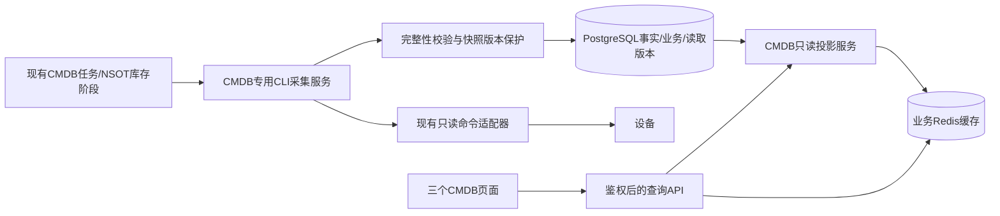

# CMDB 接口、VLAN 与业务绑定：采集与 Redis 缓存实施方案

- 创建时间：2026-10-27 12:37（Asia/Shanghai）
- 阶段：本次约定范围的实现与发布门禁已完成。代码提交 `0aa1136293f2d3bdc11972fe96b2561c60a51ae0` 已在 `origin/main`，对应 GitHub Actions run `40535628669` 最终成功。CMDB独立快照、接口/VLAN分页、独立SSH容量池和动态数据直读策略已落地；接口/VLAN/业务页读操作已验收。Redis运行验收依用户要求忽略；原生Network面板证据、额外平台覆盖和重复性能对比仍未验证，不记为通过。
- 对应记录：`docs/walkthrough/walkthrough_20261027_1237_01_CMDB采集与Redis缓存.md`。
- 页面范围：`/cmdb/interfaces`、`/cmdb/vlans`、`/cmdb/vlan-business`。
- 用户硬约束：**严禁修改监控相关代码。此约束优先于任何性能、采集或缓存改造建议。**

## 1. 目标、成功标准与实施边界

### 1.1 要达到的结果

1. 页面查询、刷新、搜索、翻页、缓存过期均不连接设备；设备访问只由明确的采集任务执行。
2. CMDB 接口库存与 VLAN 事实采用 CLI 获取完整业务字段，停止这两类库存采集中的“先尝试 SNMP 再执行 CLI”；不更改监控 SNMP。
3. CLI 结果必须验证字段覆盖、输出结束和解析状态；不得把“命令执行成功”当成“采集完整”。
4. PostgreSQL 保存成功事实、业务绑定和版本；Redis 保存可淘汰、可重建的查询投影。
5. 修复 VLAN 翻页跳回和重复加载；列表、统计、分类树使用一致的数据版本与统计口径。
6. 能区分采集失败、成功空表、已有旧结果、无权限、缓存不可用，展示真实采集时间。
7. 不丢失已有接口 ID、监控阈值、接口角色、IPAM 关联或人工业务字段。

### 1.2 监控保护边界

禁止修改以下代码及对应配置/默认值：

- `backend/api/monitoring.py`、监控采样服务、指标编译/遥测服务、Grafana 配置。
- `backend/services/snmp_service.py`、`snmp_collection_policy_service.py`、监控 SNMP 开关和凭据解析。
- `backend/services/scheduler_service.py`、`backend/main.py`：不调整任何监控或现有后台任务调度频率、注册方式。
- `backend/services/ip_locator_service.py`：不改变 ARP/MAC/路由的协议、重试、VRF、调度和持久化行为。
- `backend/services/collection_status_service.py`、告警规则/事件/通知、探测服务及状态判定。
- `backend/services/network_access_limiter.py`、`network_access_lease_service.py`、通用命令适配器和驱动：原边界为仅调用。2026-10-27用户已明确授权例外：仅新增CMDB专用SSH容量池，整体最多3条、同设备1条，本机gate与PostgreSQL租约均隔离；现有`network_ssh`默认池和监控/SNMP/probe行为保持原样。允许局部修改limiter、lease、BaseDriver与PlatformActionSession的显式容量类透传，不改解析或凭据逻辑。默认旧池20条之外CMDB可额外使用3条；PAM仍独立，设备自身VTY容量不由软件隔离保证。
- `interface_collection_service.py` 内 `refresh_snmp_interface_inventory`、`_collect_snmp_interfaces`、`_collect_snmp_interface_domains`、`_upsert_snmp_interfaces` 等监控调用链及其默认语义。
- 不修改监控阈值、监控接口选择、设备健康状态、流量计数器、监控 Redis/告警队列、LibreNMS 服务。

允许的库存调用边界：现有 `job_worker → collect_interface_status_target` 与 `run_unified_nsot_sync → collect_interface_status_for_online_devices` 的 CMDB 库存阶段。先记录调用者，再在该边界路由到新建的 CMDB 专用 CLI 服务；监控入口继续走原函数。

现有 `interfaces` 是监控、拓扑和CMDB共享事实。M0源码审计已确认CLI更新`description/admin_status/oper_status/IP/interface_type`会改变监控报表、设备接口状态或拓扑读取结果，即使监控代码本身不修改。因此本次按更严格边界执行：CMDB CLI采集不得写入共享`interfaces`/`vlans`事实；CLI成功快照只写CMDB独立观察投影，再由CMDB读接口叠加。现有共享阈值、ID/关联及监控读值保持不受CMDB采集改变。

### 1.3 本次不扩大的范围

- ARP/MAC 继续按现有链路采集，CMDB 只读取它们的成功结果；本方案不保证它们改成 CLI。
- 不引入新 UI 框架、不更换状态管理、不新增容器、不用 Redis 取代 PostgreSQL。
- 不全局关闭 SNMP；不调整每日 NSOT、ARP Sweep 等现有时间表。
- 不把补采、数据回填、清除共享缓存、真实设备访问视为“编写方案”的授权。

### 1.4 只读复核后补充的边界

- `collect_interface_status_for_online_devices` 是NSOT共享库存facade，不能称为CMDB私有函数。改变其中接口/VLAN库存协议会影响NSOT的对应阶段；必须保持其设备范围、领域开关、执行顺序和其他阶段不变，且不修改调用它的 `ip_locator_service.py`。
- 新路径优先在 `_collect_interface_status_target` 的库存编排边界委托专用服务；保留公共返回字段及既有任务wrapper。不为引入新状态而重写现有监控 `record_collection_result`，新领域状态只写CMDB专属快照表。
- `/cmdb/interfaces/sync` 当前只按Operator角色校验并复用全局活动任务，和接口列表的站点读取范围不对称。本次不改变采集授权、全局job复用或目标选择规则；新增更细授权属于独立契约任务，不能把缓存scope当成采集授权。
- M0字段审计确认共享事实写入会影响监控/拓扑读值。M0299现已将CLI writer隔离到CMDB接口/VLAN/端口观察表，CMDB读者按successful_generation选择last-good；不写共享interfaces/vlans/ip_inventory，prefix共享投影跳过。

### 1.5 用户追加的开发服务恢复要求

- 本地CMDB页面不可达时由执行者检查并自动启动/恢复项目开发服务，不要求用户手动重启。
- `scripts/dev-internal.mjs` 监测前端和后端HTTP健康，进程退出或连续健康检查失败时使用有上限的指数退避重新启动；只调用既有 `dev-backend.mjs` / `dev-frontend.mjs` 入口。
- 恢复范围仅为当前Windows登录会话的开发服务；不注册Windows开机/登录任务、不启动Compose、不改变后台监控/采集调度，不修改监控代码。

## 2. 当前源码证据及修复要求

| 编号 | 已确认事实 | 文件/位置 | 设计处理 |
| --- | --- | --- | --- |
| F01 | VLAN 已服务端分页，通用分页却用当前页条数计算总页数，可将第 2 页改回第 1 页 | `src/pages/CmdbManagementTab.tsx`：`totalForTab`、通用 clamp effect | 为三种列表明确服务端分页模式；总页数只取服务端 total |
| F02 | 页面挂载额外预取完整 VLAN 目录 | 同文件：`loadVlanCatalog` | 仅在相关表单打开时按需查询，禁止首屏全量请求 |
| F03 | VLAN 搜索提示字段多于后端实际搜索字段 | 同文件搜索框；`cmdb_service.list_vlans` | 搜索契约统一，支持提交搜索；避免逐字符请求 |
| F04 | VLAN 查询全量关联、按设备展开后才切页，多处逐 VLAN 查询 | `backend/services/cmdb_service.py`：`list_vlans`、`_expand_vlan_rows_by_device` | SQL 先确定符合条件的设备/VLAN键和总数，再批量关联当前页 |
| F05 | 空站点条件 `(? = '' OR ...)` 会解除站点约束 | 同上 | “未分配站点”仅匹配规范化站点为空的设备，绝不等于全站 |
| F06 | 只有 ARP/MAC 证据、没有接口记录的设备可能被展开逻辑跳过 | `_expand_vlan_rows_by_device` | 设备元数据独立读取；允许显示明确标注证据不足的行 |
| F07 | Q-BRIDGE VLAN名称缺失仍可成功，端口模式由成员关系推断 | `snmp_service.collect_qbridge_interface_vlan_data`、库存写入代码 | CMDB库存改 CLI；上述 SNMP 函数不修改 |
| F08 | IP-MIB前缀指针可为空，地址域仍可能视为成功 | `snmp_service._ip_mib_prefix_length`、库存完整性判断 | CMDB接口地址/掩码独立校验；不改监控SNMP实现 |
| F09 | SNMP落库失败与采集complete标记分离，可能不触发CLI补缺 | `_collect_interface_status_target` | 新CMDB服务按领域报告获取、验证、提交结果，事务提交才算成功 |
| F10 | 汇总已有事实时会更新 VLAN last_discovered_at | `vlan_discovery_service.sync_observed_vlans` | 新CMDB成功快照保存真实observed_at，查询/缓存时间单独记录 |
| F11 | 接口列表查询中执行 DELETE ip_inventory 并commit | `cmdb_service.list_cmdb_interfaces` | 读取函数纯查询；清理移至明确的CMDB维护入口，见第7节 |
| F12 | 接口API有站点/权限过滤；业务绑定接口当前主要为角色校验 | `backend/api/cmdb.py` | 缓存必须在鉴权后；接口沿用真实资源范围，其他两页不借缓存改变现有授权 |
| F13 | 三类列表尚无共享Redis读缓存；已有IP定位缓存适配器 | `cmdb.py`、`ip_locator_cache_service.py` | 新建CMDB缓存模块，复用连接策略，不耦合定位业务键与TTL |

### 实施状态（2026-10-27）

- 已完成：移除接口GET内孤儿数据DELETE/commit；业务绑定支持可选服务端分页、状态和关键词过滤且保留旧数组响应；修复VLAN未分配站点和ARP/MAC-only设备展开；VLAN关键字段搜索；三类列表的服务端分页、搜索提交、取消旧请求及按需加载VLAN目录；接口采集手动任务CLI路由、generation状态、版本化Redis读缓存与fail-open。M0299已完成独立观察writer与read API接入，监控共享事实不由新CMDB采集修改。
- 已完成：VLAN列表默认不带端口/ARP/MAC全量明细；增加按VLAN/站点/设备读取的详情API及版本化缓存；列表关联从逐VLAN查端口、ARP/MAC和绑定改为批量查询，轻量路径保留计数、时间、设备展开和SVI掩码回退；导出显式传 `include_details=true` 保持既有字段。
- 已完成按页完整投影：接口/VLAN仅物化当前页完整字段；VLAN summary/tree复用轻量全局候选，列表不加载全量端点。接口在唯一候选场景先用共享Python规范化器检查窄身份键，再由SQL窗口统计并LIMIT/OFFSET；重复别名、搜索、CLI快照、有效IP库存回退和非ASCII排序字段保持原Python路径。完整导出仍按显式请求读取全部详情。
- 历史设备证据（当时快照）：原任务`job-d0f2b48c2ae5`共9台、4成功/5失败；`platform_action_runs`显示CLI动作传输成功，失败在解析/CMDB校验。AC_11的brief只有裸IPv4，现仅在prefixless header场景调用已发布的`get_interfaces`，其地址集合与brief原始输出完全一致且详细action带CIDR后才接受。F1090-10的尾提示符由共享V7模板支持；S6850-3的`RAGG34`由CMDB本地名称守卫支持。随后对原5台失败目标串行重跑CMDB单设备服务，5/5成功：AC_11 generation 10/30条，F1090-9和F1090-10 generation 10/各25条，S6850-3和S6850-4 generation 10/各57条。该时点9台`interface_inventory`快照均为success。原job仍保留`partially_failed`历史结果；没有重跑9台整批job。监控及共享接口采集器未修改。
- 验证快照（2026-10-27）：共享parser/runtime/catalog与CMDB采集定向组合92 passed；PostgreSQL-only扫描0 violations；`git diff --check`通过。前端页14 passed、`npm run lint`及隔离目录Vite构建此前通过。目标页面HTTP 200，当前无浏览器DOM/Network交互证据。
- 服务恢复：本轮诊断时发现监督器与前后端进程均未运行，自动启动隐藏`dev-internal.mjs`监督器后，后端`127.0.0.1:15310/api/health`和页面`192.168.56.1:5400/cmdb/interfaces`恢复HTTP 200；监督器进程PID 3840。恢复仍限当前Windows登录会话，不注册开机任务。
- 未完成：M0重复采样P95、Redis冷热/禁缓存A-B及其他平台profile/action核验；Huawei VRP与H3C V5/V9地址/掩码parser、Cisco VLAN/parser与VLAN名称完整性矩阵；空IP/多IP快照契约；隔离Redis跨worker、恢复、TTL和容量验证；M4浏览器交互。
- 服务恢复：在隔离5410端口终止受监督的Vite子进程后，启动器自动重试并恢复HTTP 200；隐藏监督器接管当前5400/15310服务，旧开发启动器退出后页面和后端均恢复。当前启动器对受管子进程连续3次健康失败后重启；对已在运行但探测短暂失败的服务也先累计3次再尝试启动，避免一次超时就重复拉起。恢复范围为当前登录会话；未配置跨Windows重启的开机任务。
- 历史未完成项，已由上方当前状态更新：同一数据集bypass性能采样、VLAN轻量summary/tree与接口SQL唯一候选页逻辑已完成；重复采样P95、Redis冷热/禁缓存A-B仍未完成。
- 静态CLI/parser覆盖快照（源码盘点，不等于现场验收）：

| Profile/parser族 | 接口状态CLI | 接口IP action | 描述CLI/模板 | VLAN CLI/模板 | 结论 |
| --- | --- | --- | --- | --- | --- |
| Cisco IOS | `show ip interface brief`；存在common状态模板 | `get_ip_interfaces`映射`show ip interface`；存在common模板 | Quick Ops目录`show interfaces description`，存在common模板；built-in Registry命令映射为空，需published profile或同版本TextFSM fallback | `show vlan brief`静态命令存在，未找到同命令本地TextFSM模板 | profile/action与fallback组合未跑集成fixture；VLAN解析/完整性仍待证明 |
| Huawei VRP V5 | `display interface brief`；存在V5模板 | `get_ip_interfaces`映射`display ip interface brief`；当前本地模板清单未证实该精确命令 | Quick Ops目录`display interface description`，存在V5模板；需确认profile fallback是否命中 | `display vlan`；存在V5模板 | V8/其他VRP profile需单独核对；不能从V5推导全部VRP |
| H3C Comware V5/V7/V9 | `display interface brief`；三个版本各有模板 | `get_ip_interfaces`映射`display ip interface brief`；V7共享模板已验证CIDR和提示符尾行，prefixless AC_11经已发布`get_interfaces` action匹配补足；V5/V9待核 | `display interface brief description`；三个版本各有模板 | `display vlan brief`；三个版本各有模板 | V7目标9台快照均已成功；其他版本/平台覆盖仍待验 |

- action definitions必需字段：`get_interface_brief.interface`；`get_ip_interfaces.interface/ip_address/prefix_length`；`get_interface_description.interface/link/protocol`（description为optional）；`get_vlan_table.vlan/name`。四类action的最大记录数分别为2000/2000/5000/4096。新CMDB采集器检查matched、必需记录、触顶和分页标记；同接口多个不同IP仍拒绝无损声明并保留旧快照。
- Cisco/Huawei的Quick Ops `COMMAND_CATALOG`确有接口描述只读命令，但这不等于已发布profile action可用；Registry缺action时只会在命令与同parser/version TextFSM精确匹配时fallback。当前仓库静态盘点尚未对每个profile执行该fallback解析fixture。
- `core.textfsm.list_templates()`的本机静态索引现为1167项：新增`h3c_comware_v7_display_ip_interface_brief.textfsm`，action元数据为`get_ip_interfaces`。Cisco IOS可见brief/IP/description三类common模板，但未见`show vlan brief`精确模板；Huawei VRP V5可见interface brief、interface description、`display vlan`模板，未见`display ip interface brief`精确模板；H3C V5/V7/V9可见对应版本的interface brief/description/VLAN模板。Cisco VLAN和Huawei IP parser仍有明确覆盖缺口；其他H3C版本不由V7模板推断。
- 以上仅为当前仓库的静态action catalog、Quick Ops命令、TextFSM manifest/fixture索引；尚未逐一确认设备当前published release、模板真实匹配、命令结果未被设备/驱动端复用、完整输出和实际账号授权。接口描述不支持时快照metadata显式记录 `unsupported_fields`；其它关键域不完整则失败并保留最后成功快照。
- 已在S6850-5执行一次单目标只读CMDB接口采集并成功落入独立观察快照；这只证明该设备/当前profile/当前命令路径。没有生产Redis验收。页面HTTP 200不能替代浏览器DOM、交互或Network验收；尚未取得这些证据，也未测性能目标。

证据限于当前源码。尚未获取真实设备同一时刻的 CLI/SNMP 对账、现场网络请求轨迹和性能基线；不得把上述实现缺口表述为“所有设备的SNMP都不完整”或已测得资源浪费。

## 3. 总体架构与职责



- 采集服务只负责设备事实及提交；查询服务不调用采集服务。
- 缓存不能成为采集队列、分布式权限来源或业务持久化数据库。
- 现有监控/ARP/MAC仍按原流程更新其表。CMDB读取这些外部事实时采用“关联依赖水位+短TTL”，不往监控写入链路加失效代码。
- 先保证无Redis时结果正确，再启用Redis。缓存不是掩盖全量查询、统计错误或分页故障的补丁。

## 4. CMDB CLI采集契约

### 4.1 字段和协议选择

| 领域 | 本次默认来源 | 完整性要求 | 失败处理 |
| --- | --- | --- | --- |
| 接口身份/状态 | CLI接口目录/状态查询 | 规范化名称唯一、状态合法、输出结束明确、完整接口集合 | 保留上次成功该领域事实 |
| 接口描述 | CLI描述/接口详情 | 已覆盖目标接口；合法空描述与缺列不同 | 标记该领域不完整，不宣称全部完成 |
| 接口IP/掩码 | CLI地址/接口详情 | 地址、地址族、掩码/前缀、所属接口可校验；支持多地址 | 缺掩码不得推算成/32冒充网段 |
| VLAN清单/名称 | CLI VLAN表 | ID 1–4094、名称/状态有来源、合法空表可证明 | 不使用默认名称掩盖缺字段 |
| VLAN端口归属/模式 | CLI VLAN成员及接口交换配置 | 采到配置或将模式标为unknown；明确access/native/allowed语义 | 不把成员集合直接当作完整配置 |
| ARP/MAC | 现有只读数据库结果 | 保留各自观测时间/采集状态；不声称与CLI库存同一批 | 不修改采集协议，不连接设备补查 |
| 业务归属 | 人工维护 | 站点/VRF/VLAN/业务唯一性、审计 | 数据库事务失败不更改缓存版本 |

“描述”需区分 VLAN 名称、VLAN描述、SVI接口描述；不得把一者替代另一者后标成已完整采集。允许设备明确不提供可选字段，返回 `unsupported_fields`；关键字段缺失应为partial/failed。

### 4.2 命令与凭据

1. 复用 `read_only_collection_adapter.collect_read_only_evidence` 和现有平台命令目录，不在新服务中硬编码厂商命令。
2. 校验 vendor → platform → profile/action → 驱动 → parser 的一致性；Cisco、Huawei、H3C分别使用现有IOS/VRP/Comware规则，不允许缺平台回退Cisco。
3. 第一阶段先核查每平台现有 `interfaces`、`interface_description`、`vlan` 分类是否覆盖全部所需字段；缺失项列为阻塞证据，不修改被保护的通用驱动。
4. 有缺口时仅允许在CMDB专用组合层调用目录中已发布的只读action；若必须修改通用驱动/监控共用解析器，则该平台保持旧成功结果并明确未完成，不强行扩大范围。
5. 普通只读凭据优先；不新增管理员凭据自动回退，不改变现有凭据策略。只有SNMP凭据的设备返回 `cli_credentials_missing`，不能静默回SNMP或当成成功空表。
6. 同设备尽量复用一次现有会话/证据批次；必须确认复用API已有支持，不自行绕过限流创建连接。
7. 记录 transport=`ssh`、协议策略=`cli`、action/profile版本、parser版本/状态、领域覆盖、run_id、开始/结束时间；不保存密码/community/原始敏感配置。
8. 核对既有action是否可能复用命令结果缓存；使用已有的强制新采集参数或携带原结果observed_at。缓存命令输出不能标成本轮刚采得；若必须改受保护适配器才能实现，则列为该平台未完成，不扩展修改范围。

### 4.3 结果与状态

CMDB内部结果建议包含：

```json
{
  "device_id": "<id>",
  "run_id": "<uuid>",
  "domain": "interface_ip",
  "transport": "ssh",
  "status": "success|empty_confirmed|partial|failed|skipped",
  "complete": true,
  "observed_at": "<设备查询结束时间>",
  "generation": 12,
  "record_count": 24,
  "missing_fields": [],
  "error_code": "",
  "truncated": false
}
```

- 新模块内部使用明确枚举；对外现有任务字段保持兼容，新增领域详情。
- `matched`仅说明解析器匹配，不足以证明完整；还检查分页残留、设备错误、命令超时、输出/记录截断和必要命令全部完成。
- 0条结果只有在设备显式空表且对应命令/解析器支持该语义时，才能是 `empty_confirmed`；空字符串、零匹配和超时均不能清旧数据。
- 部分领域成功可分别提交；任务必须标partial并列出失败领域。每个领域必须事务原子提交，不出现半张成功快照。
- 无法证明完整时保留旧成功事实；更新last_attempt和错误，不改last_success和observed_at。

### 4.4 并发、重入和旧任务保护

- 按用户补充授权，CMDB使用独立`cmdb_cli`本机及PG容量池，整体上限3、同设备1；原后台池默认上限及监控调用不变，PAM独立会话。CMDB job并发同步收敛到3，不再挤占后台设备槽。复用既有租约表的purpose维度，不新增表或迁移；成功、失败及连接异常均释放自身租约，续租/释放按purpose与token隔离。
- 手动和定时库存任务以device+domain获取短事务快照generation；执行设备命令时不持有数据库行锁。
- 提交时锁定对应快照行并比对generation。较旧任务不得覆盖更新attempt的结果；被拒结果标记 `superseded`，不更新读取版本。
- 最新attempt失败时保留最后成功generation。不能让一个更老但晚完成的结果冒充最新成功。
- 超时、任务取消、进程终止保持最后已提交结果；租约恢复复用现有机制。
- 不改调度器；NSOT入口与手动库存入口在现有公共库存facade处复用新服务。

## 5. PostgreSQL数据模型与兼容

### 5.1 原表的职责

- `interfaces`：继续保留原接口骨架及现有人工监控配置，不重建ID、不删除被引用接口。
- `vlans`：站点+VLAN业务主记录；人工名称、状态和业务维护信息不得被自动发现无条件覆盖。
- `vlan_business_bindings`：继续保存人工业务事实，不向Redis单写。
- `arp_table`、`mac_table`、`ip_inventory`、`prefixes`、`vrfs`、`devices`：关联读取，遵守现有所有权。

### 5.2 建议新增的CMDB专属表

迁移编号实施前读取最新编号分配；不预占历史编号。新增迁移与fresh-schema初始化同步，索引由查询计划证明。

| 表（建议名） | 主键/关键字段 | 用途 |
| --- | --- | --- |
| `cmdb_collection_snapshots` | `(device_id, domain)`；attempt_generation、successful_generation、attempt_status、last_attempt_at、last_success_at、observed_at、transport、run_id、metadata_json | 保存CMDB领域状态、真实成功时间及旧任务提交保护；不修改监控状态表 |
| `cmdb_interface_observations` | `(device_id, normalized_interface_key)`；interface_name、CLI状态/描述/IP/掩码、端口VLAN字段、generation、observed_at、run_id | 保存CMDB CLI接口与VLAN端口事实，替代对共享`interfaces`事实表的CLI写入 |
| `cmdb_device_vlan_observations` | `(device_id, vlan_id)`；site_id、observed_name、observed_status、generation、observed_at、run_id | 直接记录某设备实际观测的VLAN，避免仅靠接口/ARP反推设备归属，保留无成员端口VLAN |
| `cmdb_read_versions` | domain主键；revision BIGINT、updated_at | 在业务事务内递增共享读取版本，供各worker构造缓存键 |

必要时在快照metadata中保存字段覆盖与缺失信息，不把大量命令原文塞入metadata。快照状态不是新的监控健康度来源。

### 5.3 事务顺序

1. 获取新attempt generation，短事务提交。
2. 设备查询与校验在事务外执行。
3. 成功领域事务：核对generation → 更新本领域拥有的事实/设备VLAN观测 → 更新成功快照 → 递增受影响CMDB读取版本 → commit。
4. 失败领域只记录attempt结果；如页面显示失败状态，递增CMDB状态版本，不覆盖成功事实。
5. 业务绑定CRUD：写入与相关revision递增必须同一事务；之后再处理可选Redis预热。现有service内部commit需要在CMDB边界调整，避免先commit再改revision的空窗。
6. 第3步任一步失败整体rollback；缓存不得标新版本。

### 5.4 数据迁移与历史兼容

- 不把旧记录的discovery_source直接当成可靠原始来源；历史数据标 `legacy_unknown`，已有可信时间原样保留。
- 初始没有新快照的设备显示历史记录并标注待重新采集；不在查询/启动时自动批量连设备。
- 不把当前时间回填成历史last_success；不全量删除旧接口/VLAN。
- CLI成功完整快照才可淘汰该设备该领域已消失的旧观测；只清理CMDB拥有的观察表/字段。
- 对有外键/监控/人工绑定的骨架行保留身份；不要凭一次缺失物理删除。
- 原有Prefix投影继续调用现有入口，不修改IPAM/监控逻辑；新结果必须验证接口地址、掩码和名称与原契约兼容。无法兼容的字段保留独立投影并报告。

## 6. 三类查询API与前端请求设计

### 6.1 通用返回契约

保留现有 `{success,data,message}` 外层；分页 `data` 至少有 `items,total,page,page_size`。新增：

```text
data.meta.inventory_revision
data.meta.dependency_watermark
data.meta.snapshot_at             # 查询数据视图时间，不等于采集时间
data.meta.last_success_at         # 真实成功采集/人工更新时间，必要时按领域返回
data.meta.cache_state             # hit/miss/bypassed/degraded
data.meta.stale_domains           # 来源过期领域，不能只看Redis TTL
```

不破坏未传page时仍消费旧数组的调用者：先枚举 `src/api/cmdb.ts`、Prefix表单、导出、业务选择器等；以显式分页参数兼容过渡。新详情/目录端点是拟新增契约，不能直接替换旧端点而遗漏消费者。

### 6.2 接口页

- 保留 `/api/cmdb/interfaces` 的has_ip、device_id、search、page/page_size和资源权限过滤。
- 默认显示范围继续为配置了IP的三层接口，不因为CLI返回物理全表就扩大页面口径。
- 统一接口名称规范化与去重，多地址不能产生重复接口行。
- 在SQL或受控分步查询中完成总数/当前页，避免全量关联后Python分页。
- 列表只返回显示字段和必要摘要；设备详情、完整IP/链路证据通过详情端点按需分页。
- 保留监控阈值编辑入口和契约；不修改阈值逻辑。已有更新成功后的本地重载可继续使用，缓存可通过依赖水位识别阈值变更。

### 6.3 VLAN页

- 默认行粒度明确为设备×VLAN；统计同时区分 `record_count` 与站点×VLAN的 `vlan_domain_count`，不再把两者都称“VLAN总数”。
- 先确定设备/VLAN键，批量获取当前页的接口、网关/前缀、端点摘要、业务绑定；不逐行扫描全站接口。
- 显式未分配站点和“全部站点”是不同参数语义；统一站点ID解析，不把历史站点文字当成可直接join的主键。
- 搜索字段契约：VLAN ID/名称、设备名称/IP、网段、网关、业务系统；复杂字段用数据库匹配相关键，不能分页后再过滤。
- 无SVI的VLAN网关为空；多个SVI/多地址用详情明确展示。网关表示接口观测地址，不自动宣称是VRRP/HSRP虚拟地址。
- ARP/MAC来自独立采样，分别展示来源时间；不能把CLI快照时间附到旧ARP/MAC上。
- 只有ARP/MAC证据的行可标 `observation_only`；不能伪造接口配置、名称、网关。
- 详情按设备+VLAN定位；如用 `GET /api/cmdb/vlans/{vlan_pk}/devices/{device_id}/details`，必须校验该设备与VLAN归属和站点范围，返回端口/端点分页。
- 全量导出在用户显式操作时执行，通过现有导出入口逐页或流式获取；首屏不因导出能力预加载全量。

### 6.4 业务绑定页

- `/api/cmdb/vlan-business-bindings` 增加显式page/page_size/q/status组合查询；旧无page数组调用逐步迁移。
- 超500条强制服务端分页；大目录使用远程搜索，不在前端全量过滤。
- 新增/修改/删除先走现有校验及审计，再提交版本。编辑校验与唯一性始终查PostgreSQL，不信任缓存。
- 关联站点/VRF/VLAN名称有变化时，失效显示投影；不修改绑定自身的业务更新时间来伪装人工编辑。
- 缓存不能扩展当前授权；资源权限如需调整作为单独安全任务，不在缓存项目中顺手重构。

### 6.5 自动刷新与请求约束

1. 首屏每类主列表只发一个有效查询；删除非必要全量目录预取。
2. 首版三个页面均不新增定时列表刷新。现有接口任务的2秒进度轮询仅在确有任务时保留，终态立即停止。
3. “刷新列表”只重新读缓存/数据库；“采集接口/VLAN”明确创建现有权限约束下的后台任务，不能共用含糊按钮。
4. 搜索采用回车/按钮提交，提交搜索、筛选和页码更新为一次状态转换；取消旧请求且只有最新请求能更新loading/rows。
5. 使用后端total计算总页数；不对服务端当前页再次slice；接口/VLAN/业务绑定各用自身分页元数据。
6. 请求失败保留已显示成功数据并给出重试，不因一次失败清空后立即触发目录/分页连锁请求。
7. React开发StrictMode与HMR可能造成额外开发请求；验收同时记录开发环境和生产构建行为，不将两者混为业务轮询。

## 7. 查询纯化与数据清理

- 从 `list_cmdb_interfaces` 移除读时DELETE/commit，任何GET不得为修复历史数据而写库。
- 孤立候选定义为 `NULLIF(BTRIM(COALESCE(ip_inventory.device_id, '')), '') IS NULL`，或 `device_id` 非空但 `NOT EXISTS (SELECT 1 FROM devices WHERE devices.id = ip_inventory.device_id)`；按 `missing_device_id` 与 `device_not_found` 分组计数，二者互斥。
- dry-run 设计为独立、只读的 CMDB maintenance 操作：单个 PostgreSQL `SET TRANSACTION ISOLATION LEVEL REPEATABLE READ, READ ONLY` 快照；输出扫描时间、两类及总候选数、样例数量和 `dry_run=true`；最多20条样例只展示原因、类型、日期，IP/掩码、设备ID、接口名全部脱敏。禁止在 GET、页面加载、定时任务或采集任务中调用；dry-run 不写库、不连设备、不清缓存。
- `ip_inventory` 是共享派生表，被 IPAM、接口采集、拓扑等路径读取且没有设备外键，不能认定为 CMDB 独占数据。后续若要显式执行，须另行授权、先核验这些消费者并复算候选集合；执行模式与 dry-run 使用不同入口，未获授权不实现或运行删除。
- 不改共享设备删除服务/调度器来顺手挂清理任务；当前列表用设备关联过滤孤立数据即可，不依赖每次DELETE。影响与外键检查范围已明确；本计划不执行维护。

## 8. Redis详细设计

### 8.1 实例、键与配置

- 复用业务 `REDIS_URL` 和现有 `redis` 实例；**不得使用 `alert-redis`、告警broker URL或LibreNMS Redis**。
- 新模块建议 `cmdb_cache_service.py`，独立命名空间 `nexora:<environment>:cmdb:v1`。不复制定位模块全部业务逻辑，不修改定位缓存语义。
- 使用已有ACL允许的GET/SET/DEL/EVAL等能力；JSON字符串配SET EX/NX，不以方案为由增加Redis管理员权限。
- 新增CMDB专用设置：`CMDB_CACHE_BACKEND=disabled|redis`、namespace、列表TTL、详情TTL、目录TTL、连接/读超时、故障冷却。若需扩展 `core/config.py`，只添加CMDB字段，现有监控字段与默认值零变更。
- 初期建议列表30秒、统计/树30秒、详情15秒、业务目录60秒，加入±10%随机抖动；都是待压测参数，不是实际观测值。故障冷却建议30秒，连接/读超时不超过现有1秒预算。
- 同一成功结果不重复存“大列表+全部详情”；分页、详情、目录有大小上限，超限跳过缓存并计数。

键示例：

```text
nexora:production:cmdb:v1:interfaces:<inventory_rev>:<dependency_rev>:<scope_hash>:<query_hash>
nexora:production:cmdb:v1:vlans:<inventory_rev>:<dependency_rev>:<scope_hash>:<query_hash>
nexora:production:cmdb:v1:bindings:<binding_rev>:<reference_rev>:<scope_hash>:<query_hash>
```

query_hash取规范化参数JSON摘要：page/page_size/search/status/site/device/分类/排序/返回模式；不放凭据和原始敏感搜索内容。环境或schema版本不同不得命中同键。

### 8.2 权限隔离

1. 先执行请求鉴权及现有资源范围解析，再构造缓存键。
2. scope_hash由租户兼容字段、规范化授权站点集合/全量标记、角色/脱敏模式等实际结果生成，不能只用角色名，也不能只信任请求中的site_id。
3. 权限收窄后下一请求重新计算scope，旧键不再可达；不缓存未鉴权响应或错误响应。
4. 绑定/详情写操作、唯一性/外键检查、授权判断始终直接访问PostgreSQL。

### 8.3 版本和跨worker旧响应保护

仅使用“commit后DEL键”不够：另一个worker可能把旧查询结果重新写回。采用数据库版本键：

1. 查询在短生命周期、一致性数据库读取中获取领域revision与关联水位。
2. 根据版本/权限/参数读取Redis；命中才返回。
3. miss使用同一一致性视图构建结果，写入包含原版本的键；后续新版本请求不再读取该键。
4. 业务事务写事实时同时递增revision。旧worker晚完成只能写旧revision键，不能污染新revision。
5. 单请求若需要多条SQL，使用只读REPEATABLE READ或等价的版本前后复核；不得在READ COMMITTED下先读旧版本、后读新事实却声称统一快照。
6. 成功commit之后开始的请求必须看到新revision；commit前已开始的请求允许返回其一致性旧视图。缓存命中不能拿缓存创建时间冒充observed_at。
7. 旧键依赖短TTL自然淘汰，禁止用KEYS/全库flush清理。允许受限SCAN做离线维护，不能放在列表请求内。

### 8.4 不修改监控代码条件下的关联变化发现

ARP/MAC、拓扑、监控阈值/共享接口等写入路径不加缓存失效hook，采用以下边界：

- CMDB拥有的写入口：事务内递增revision，提供写后立即可见。
- 受保护模块写入的依赖：查询以授权范围内的现有updated_at/last_updated、记录数量等构造依赖水位，并以短TTL兜底。水位是变化线索，不宣称MAX(timestamp)+COUNT能检测所有任意原地修改。
- 关键页面要求严格立即可见且依赖表无可靠版本时，对相应动态字段直接查询数据库，不缓存整份混合响应；例如CMDB缓存接口静态摘要，再批量读取当前阈值/IP/链路摘要。
- 不为自动失效而修改监控写入代码、不在共享监控表上新增触发器。先采用可证明正确的分层缓存，性能不够再另立边界方案。
- 每种依赖的允许旧数据时间写入验收表；对ARP/MAC等外部采样最多承诺缓存TTL内更新，而非设备事实即时更新。

### 8.5 失效矩阵

| 事件 | interfaces | VLAN | bindings | 处理者 |
| --- | --- | --- | --- | --- |
| CMDB接口CLI成功 | 库存/状态revision | 网关/端口相关revision | 目录依赖 | CMDB采集事务 |
| CMDB VLAN CLI成功 | VLAN端口字段依赖 | 库存revision | VLAN名称目录依赖 | CMDB采集事务 |
| 业务绑定CRUD | 如展示业务摘要则失效 | 业务汇总revision | binding revision | CMDB CRUD事务 |
| 站点/VRF/VLAN人工修改 | 参考依赖 | 参考依赖 | 参考依赖 | 已在cmdb_service的写入口事务；外部入口用水位/短TTL |
| ARP/MAC现有采集完成 | 不改采集链 | 动态端点水位/短TTL | 通常无影响 | 仅CMDB读侧感知 |
| 监控刷新/阈值/拓扑变化 | 动态字段直接读或依赖水位 | 必要动态依赖 | 通常无影响 | 不修改监控写入代码 |
| 权限变化 | 新scope键 | 新scope键 | 按现有授权新scope键 | 每请求鉴权 |
| Redis重启/淘汰/故障 | DB回源 | DB回源 | DB回源 | CMDB缓存适配器 |

### 8.6 防并发重建、故障与容量

- 相同版本/参数投影重建使用短SET NX PX租约；持有者写结果后用token校验释放。租约长度按查询P95设置，不能比查询超时更短却无续约机制。
- 非持有者只做有上限的短等待；超时回源受进程内并发上限约束，禁止无限等待、无界重建或触发设备采集。
- Redis故障快速熔断回源，保留正常业务返回，日志不包含连接URL/凭据；独立记录degraded指标。
- 业务写成功、Redis预热失败仍是业务成功，因为版本在PostgreSQL已生效；重试不会重写业务记录。
- 不使用Redis订阅作为唯一失效机制，不把缓存TTL与设备采集周期绑定。
- 容量验收统计每类键大小/数量/命中率/淘汰量；CMDB缓存首期预算不超过业务Redis配置maxmemory的10%，达到预算优先少缓存大详情。不得增加监控/告警实例资源预算。

## 9. 文件与函数改造边界

以下为拟修改清单，不代表本次已修改；新增文件名可在实施时按现有命名微调。

| 归属 | 拟修改/新增文件 | 允许的职责 |
| --- | --- | --- |
| 主Agent | 本计划、配套walkthrough、每次提交的docs/fixes记录 | 统一设计、集成、证据与交付 |
| CMDB后端 | `backend/services/cmdb_cli_collection_service.py`（新增） | 专用CLI编排、完整性、领域提交；只调用既有适配器 |
| CMDB后端 | `backend/services/cmdb_snapshot_service.py`（新增） | CMDB快照/观测/版本事务与generation保护 |
| CMDB后端 | `interface_collection_service.py` 中CMDB任务facade及其专用target区段 | 有限路由到新服务；监控函数及其helpers保持原实现 |
| CMDB后端 | `cmdb_service.py` | 纯读投影、分页、关联批量化、业务CRUD版本提交 |
| CMDB后端 | `backend/services/cmdb_cache_service.py`（新增） | Redis键、读取版本、回源/降级、防重建 |
| CMDB API | `backend/api/cmdb.py` | 查询契约、鉴权后缓存、CMDB详情；监控阈值路由行为保持 |
| 仅CMDB元数据 | `nsot_collection_preview_service.py` | 仅接口/VLAN操作的transport说明反映CMDB新策略；不改其他分类 |
| 配置/迁移 | `core/config.py`、`database/schema.py`、新增migration、必要env示例 | 仅CMDB新增设置和表，不改现有字段、监控默认值、Compose拓扑 |
| 前端 | `CmdbManagementTab.tsx`、`src/api/cmdb.ts`、`src/types/cmdb.ts`、`cmdbExport.ts` | 三页请求、分页、来源时间、按需详情/选择器 |
| 前端局部模块 | 新增CMDB hooks/helper/type文件（按需） | 提取请求状态与DTO，避免继续扩大页面内业务逻辑 |
| 验证 | 对应CMDB/采集/缓存/迁移测试 | 覆盖新增行为；不修改监控测试来接受行为回退 |

实施前保存保护文件和保护函数基线摘要，结束比较diff/AST函数体摘要。禁止通过改公共默认参数或配置间接改变监控调用行为。若发现允许文件内无法隔离监控依赖，停止该项实施并在记录中列明具体调用证据，不绕开硬约束。

## 10. 分阶段工作包、依赖与交付

### M0：基线和字段契约（后续实施的第一步）

- 记录三页实际请求、翻页跳回条件、响应大小、SQL数量/耗时；固定同一数据集与构建模式。
- 列出所有接口/VLAN库存调用者、监控保护调用者、三个API的消费者。
- 记录每平台CLI action和字段覆盖；缺少设备样本则标未验证，不猜测支持。
- 建立监控代码基线、Redis实例区分、权限样例；不启动设备采集。
- 当前实现后的隔离路由基准已补齐（100设备/10,000接口/2,000设备VLAN观察/500业务绑定，bypass+SQL计数），但实施前基线没有捕获；因此不能据此宣称整个改造相对原版本改善了某个百分比，也不能替代真实浏览器请求记录。
- 出口：字段矩阵、允许文件/函数清单、可复现请求证据、性能基线。缺关键CLI覆盖的平台不进入默认切换。

### M1：请求和查询正确性

- [x] 移除GET清理写入；孤立IP inventory记录由设备join排除，不在请求中清除。
- [x] 修正空站点约束；补充只存在ARP/MAC证据的设备展开。
- [x] 后端VLAN关键字段搜索；业务绑定可选服务端搜索/筛选/分页并兼容旧数组。
- [x] 修复前端服务端分页clamp、搜索提交、取消旧请求、移除首屏全量VLAN目录。
- [x] VLAN列表批量加载站点、prefix/IP、端口、ARP/MAC聚合、绑定及设备VLAN观察；轻量列表与按需明细API分离，明细缓存纳入版本键。
- [x] VLAN summary/tree从轻量候选计算，仅物化当前页完整端口/终端明细；全局候选扫描仍待同数据集性能验收。
- [x] 接口页候选查询改为轻量全局身份集；先归并别名再切页，完整行/IP/拓扑关联只查当前页别名集。
- [x] CMDB service 对共享接口名归一化加有界进程内memoization，仍调用同一共享规范化函数且不改变别名规则；同一隔离数据集的单次bypass HTTP样本显示接口/VLAN列表端到端耗时下降（不代表P95或生产SLA）。
- [x] 唯一接口候选通过原Python规范化器窄字段预检后，未搜索列表由SQL窗口函数统计并LIMIT/OFFSET；别名重复、搜索、CLI快照、有效IP库存回退或排序字段不满足安全条件时保留原Python归并路径，不复制/改变共享别名规则或筛选、总数口径。
- [x] 业务绑定前端使用服务端分页。
- [x] 仅定义独立、只读、脱敏的孤立 `ip_inventory` dry-run 契约（见第7节）；不实现/调用自动删除，不在本轮清理共享数据库残留。
- 出口：不依赖Redis也能正确翻页/筛选；空闲无VLAN列表轮询；查询GET零写库。

### M2：CMDB独立快照和CLI路径

- [x] 新增CMDB读取revision表的迁移，历史行不回填来源/时间。
- [x] 按平台建立源码字段/命令/现有parser矩阵；详见walkthrough静态CLI/parser矩阵。该项是源码盘点，不等同运行profile或现场覆盖。
- [x] 核实当前已绑定设备的published profile/action映射与CMDB命令结果缓存路径：当前DB有9台H3C绑定`h3c_comware` release 1（PUBLISHED），覆盖接口brief/description/IP/VLAN action；CMDB走`PlatformActionSession.send_command`，全仓`core.cmd_cache`调用仅在IP Locator路径，不在CMDB action链。
- [ ] 其余8台设备未绑定profile；Cisco/Huawei及其它profile/action现场覆盖仍未验证。按用户指示，不修改解析模板逻辑。
- [x] 新增CMDB库存领域generation/snapshot与device-VLAN观察表。
- [x] 手动CMDB任务由独立CLI service执行；M0299独立观察表及CMDB读者均已接入，失败保留last-good。监控/SNMP/调度与NSOT默认入口不变；其他平台action完整性和现场采集验收另列未完成。
- [x] CMDB `get_ip_interfaces` 路径补上同profile/version精确TextFSM重解析、缺发布action时只接受带`get_ip_interfaces` action元数据的模板，拒绝legacy接口简表替代，以及TextFSM List标量校验；fallback失败仍失败关闭。
- [x] CMDB VLAN 快照缺少名称时失败关闭；隔离PostgreSQL回归验证失败尝试不覆盖last-good观测、成功时间或读取revision。
- [ ] Huawei VRP与H3C Comware V5/V9地址掩码parser、VRP VLAN无名输出及Cisco VLAN action/template仍未验证；用户要求本轮不处理解析模板，保持此项打开，不跨平台推断。H3C V7九台CLI-only快照成功是历史证据。
- 完整/不完整/空表/超时/解析失败/代际冲突均按契约处理；保护原接口身份和人工字段。
- 出口：Cisco/Huawei/H3C fixture覆盖，CMDB目标不调用SNMP；监控保护函数无差异；缺凭据明示失败。

### M3：Redis与写后可见性

- [x] 新CMDB缓存模块，先bindings再interfaces/VLAN；读取鉴权后构造scope/query hash，Redis异常fail-open。
- [x] 业务绑定、VLAN、站点/VRF维度及CMDB快照在PostgreSQL写事务内递增revision；接口阈值命中缓存后实时从DB读取。
- [x] 未分页站点目录缓存键加入PostgreSQL `sites` revision；站点/VRF的6个SQL写入口均在业务事务内递增对应revision，并以隔离PostgreSQL回归测试覆盖跨worker写后可见。
- [x] 审计CMDB参考列表：sites使用共享revision键，vlans/bindings使用各自revision，VRFs直接查PostgreSQL不缓存，tenants接口已禁用；site/VRF/VLAN/binding写入均有相应事务revision测试。
- [ ] 使用隔离Redis验证跨worker冷启动、过期锁、旧worker回填、故障冷却与恢复、权限收窄和容量预算；用户于2026-10-27明确要求因本机未部署而忽略此项，本轮没有连接已配置地址，保持未验收。
- [x] 只读审计ARP/MAC/IPAM写入水位：ARP只有部分collector状态且写表失败仍可能留下成功状态；MAC writer没有一致设备级成功状态；`ip_inventory`只有行级`last_seen`且多写入源无source；IPAM prefix虽有`source_type/last_observed_at`，当前CMDB VLAN读取未取这些字段。
- [x] 对无可信依赖版本/成功水位的动态字段保持直接数据库读取：接口、VLAN列表及VLAN详情在CMDB投影入口直接绕过缓存，且不初始化Redis客户端；移除15秒时间桶，`dependency_watermark`返回null，避免冒充外部成功水位。VLAN业务等具有事务revision的投影保留原路径。Redis运行验收按用户要求暂缓。
- 不改业务Redis/alert broker现有配置；未向生产Redis写入。
- 出口：跨worker旧写不污染新版本、权限收窄立即生效、Redis故障不丢业务数据、不触发设备采集。

### M4：验收、性能及交接

- [x] 按用户补充授权新增CMDB独立SSH池：本机/PG global与device capacity均按`cmdb_cli`隔离，硬上限3/1；默认`network_ssh`池及监控/SNMP/probe策略不变。CMDB入口、BaseDriver与PlatformActionSession显式透传，任务并发为3；定向回归52 passed。
- [x] Redis排除后，同一合成数据集bypass重复性能采样完成：10类请求各10次，共100次；报告包含median/P95/max、响应大小与SQL统计，不作生产SLA或改造前改善声明。
- [x] 浏览器接口搜索/清除/空状态、下一页/末页和每页条数切换，以及VLAN列表/详情、VLAN业务空状态完成读取验收；接口33条、VLAN13条，截图保存于`backend/artifacts/cmdb_validation/`。按实际全文搜索语义修正接口搜索提示。
- [ ] 本地完整后端回归在约36%处中断，退出码1，日志有2个失败、1个跳过且无完整traceback；失败用例为scheduler lock取消清理和IP Locator空闲session释放。两例经同一安全隔离runner单独重跑均通过（2 passed，104.08s），不能把本地完整suite记为通过；推送后以main Actions完整结果为准。浏览器原生Network面板未验收，Redis冷/热对比依用户要求排除。

- 完成第11节自动化与浏览器验收；同一数据集比较冷/热/禁缓存。
- 若获真实设备只读验证授权，再逐平台少量设备运行；记录CLI覆盖/时长/命令数，不宣称fixture即现场验收。
- 输出实际修改文件、通过/失败/未验证项、运行参数和回滚步骤。
- [x] 开发服务启动器加入健康监测与退避恢复；隔离前端子进程退出恢复测试通过。
- [x] 开发模式Uvicorn重载排除`backend/tests`和`backend/artifacts`，避免测试与生成物写入导致后端频繁重启；运行时源码目录仍受监视。
- [ ] 浏览器完整交互与Network证据、同数据集冷/热/禁缓存性能对比仍需完成；现有Chrome会话初始DOM显示0台/0接口。随后只读PostgreSQL重复读快照中，9个live successful interface snapshots合计reported 426 rows，当前generation观察行也为426、差异0；另有9个成功快照元数据对应已删除设备ID（snapshot表没有设备FK），合计reported 426 rows，不会进入当前接口列表。直接service读得426总/33有IP。没有刷新用户浏览器、触发采集或对设备发CLI。
- 出口：证据完整；任何保护代码有变更或CLI覆盖不成立均不视为完成，不发布。

### 实际Agent分工（2026-10-27）

- 主Agent负责需求、监控边界、集成验证及方案/交接文档。
- 后端Luna独占 `cmdb_service.py`、`backend/api/cmdb.py` 与VLAN查询契约测试；前端Luna独占 `CmdbManagementTab.tsx` 及其测试，API字段契约先固定。
- 两个执行者并行，文件边界不重叠；共享回归由主Agent集成后统一运行。

## 11. 验证矩阵和执行命令

本节是未来实施验收计划；本次文档编写不运行应用测试、数据库迁移或设备命令。

### 11.1 自动化场景

| 类别 | 必须证明的场景 |
| --- | --- |
| 协议边界 | CMDB接口/VLAN路径SNMP调用数0；监控SNMP函数/默认值不变；ARP/MAC采集无diff |
| 平台 | Cisco/Huawei/H3C正常、缺平台、厂商切换后旧platform残留、命令不支持、缺普通CLI凭据 |
| 完整性 | 合法空表、零匹配、分页截断、max_records截断、部分命令成功、缺掩码、多个IP、缺描述 |
| 数据保护 | 失败不清成功事实；旧generation晚提交被拒；接口ID/阈值/人工字段/外键关联保持 |
| 读取正确性 | 未分配站点不跨站；多设备同VLAN的记录数/域数；仅ARP/MAC行；完整列表与导出一致 |
| 权限 | 不同站点/范围不串缓存；权限收窄不命中旧scope；详情鉴权与列表一致 |
| 缓存 | hit/miss、TTL、Redis停机/恢复、键淘汰、锁失效、并发冷启动、旧worker回填、写成功缓存失败 |
| 事务 | 事实与revision同事务；rollback后缓存版本不变；失败状态与成功事实时间分离 |
| 外部依赖 | 不改监控写入时，阈值/拓扑/ARP/MAC显示满足声明的新鲜度；不能证明则直接DB读动态字段 |
| 迁移 | 空库初始化、现有库升级、重复执行幂等、历史来源unknown、回滚保留人工数据 |

数据库测试只使用共享隔离PostgreSQL fixtures。Redis单测用受控fake，跨worker/租约集成另用隔离测试Redis命名空间；不得FLUSHDB业务实例。真实设备不是常规测试依赖。

已有测试基线：

```powershell
.\.venv\Scripts\python.exe -m pytest backend/tests/vendor_audit/test_interface_collection.py backend/tests/vendor_audit/test_interface_collection_contract.py backend/tests/vendor_audit/test_collection_template_runtime.py backend/tests/vendor_audit/test_vlan_discovery_contract.py backend/tests/vendor_audit/test_nsot_collection_preview_api.py
.\.venv\Scripts\python.exe scripts/validate_postgresql_only.py
npm run lint
npm run test:frontend -- --run src/pages/CmdbManagementTab.test.tsx src/pages/cmdbExport.test.ts
npm run build -- --outDir .codex-build-validation-cmdb-cache-20261027
```

实施时按改动新增 `test_cmdb_cli_collection.py`、`test_cmdb_cache_service.py`、`test_cmdb_snapshot_service.py` 及迁移测试并加入定向命令；不要为了CLI默认策略而改坏已有直接SNMP函数的测试。构建输出参数先核对 `scripts/build-frontend.mjs` 是否透传；不透传时使用脚本已支持的隔离输出方式，不覆盖用户dist。

### 11.2 浏览器验收

1. 三页分别覆盖首次加载、空态、错误态、无权限、中文/英文、至少一组窄屏。
2. VLAN连续翻第2/3页、改每页数量、组合站点/分类/搜索；页码不跳回。
3. 快速提交两组查询，慢响应不能覆盖新结果；取消不弹错误。
4. 空闲观察60秒：无三页主列表定时请求；记录全局其他请求并注明归属，不修改无关模块。
5. 接口采集任务轮询仅活动时存在，终态停止且只执行一次有效列表刷新。
6. 绑定CRUD成功后同一/另一会话相关列表与VLAN业务摘要更新；失败时保持旧数据。
7. 列表GET、手动列表刷新、翻页、详情、导出、缓存miss均不产生设备连接。
8. 记录Network请求数、响应体大小和页面截图；浏览器无法访问时如实标未完成，不以源码替代现场证明。

### 11.3 性能目标（建议验收门槛，尚未测量）

- 固定基线数据集：100设备/10,000接口/2,000设备VLAN记录/500绑定；端点量另设大表场景。全部是隔离合成数据。
- 同硬件/数据/请求下，热缓存列表API P95目标≤200ms，且相较改造前改善≥50%；冷缓存P95目标≤1s。达不到时先定位SQL/依赖水位/序列化，不用增加设备采集解决。
- 常规列表SQL数量不随当前页行数线性增长；明确记录revision、权限、依赖水位这些命中时仍有的查询，不宣称“命中零SQL”。
- 首屏列表载荷目标≤256KiB；大端点证据按需分页，不把全部ARP/MAC塞进每条列表。
- 稳态热点命中率目标≥90%，须在固定查询组合与预热条件下报告，随机搜索不作为保证值。
- CLI成本按同设备/相同字段范围记录命令数、连接数、耗时和失败率；不能将尚未执行的SNMP/CLI资源比较写成收益事实。

## 12. 风险、开关、回滚与完成定义

| 风险 | 控制 | 回滚 |
| --- | --- | --- |
| 改到监控共享调用 | 函数级白名单/保护基线、独立CMDB服务、共享配置不改默认值 | 撤销CMDBfacade路由；保护代码必须始终零diff |
| CLI覆盖不足或只配置SNMP凭据 | 平台门槛、缺字段/凭据明确失败、保留成功事实 | 对该平台暂不切换；不擅自改设备或取管理员凭据 |
| 查询/缓存把旧值当新值 | 成功快照时间独立、DBrevision、领域状态与依赖新鲜度分离 | 关闭CMDB缓存，直接DB查询 |
| 热点回源压垮DB | 先修SQL/分页、短租约、进程重建上限、冷启动分批 | 关闭预热/大详情缓存；保持有界请求 |
| 事务或迁移失败 | 新表先建、幂等、分阶段启用、数据不破坏 | 关闭新路径保留新增表，禁止DROP人工/共享事实 |
| 缓存权限泄露 | 鉴权前置、真实scope键、写操作查DB | 禁用CMDB缓存并审计相关命名空间，禁止全库清理 |

建议CMDB专用开关独立控制CLI新路径与缓存；默认在迁移完成且定向验收通过后启用。库存协议回滚是显式恢复旧CMDB路径，不修改全局SNMP开关。监控相关配置完全不在回滚清单中。

完成必须同时满足：三个页面正确性、领域完整性与失败保护、Redis可降级与权限隔离、保护代码零变更、必要测试通过、浏览器证据及未覆盖设备清单。代码、本地测试、真实设备、部署与生产效果分别报告；本方案不授权提交、推送、发布或部署。

## 13. 参考

### 2026-10-27 现场失败续查

- 用户报告IP action unmatched后，已授权单台S6850-5只读核对，确认`get_ip_interfaces`命令输出包含CIDR。按用户要求不改解析模板逻辑：在共享目录增加`data/textfsm_templates/h3c_comware_v7_display_ip_interface_brief.textfsm`及脱敏fixture；沿用现有catalog、精确resolver和`parse_device_cli_output`解析原始输出，不创建CMDB私有解析器、不改平台action或监控代码。CMDB层把无地址行先跳过，避免接口名称白名单误拒绝合法但无IP的行。
- 组合验证：`test_cmdb_cli_ip_parser.py`、`test_cmdb_cli_collection.py`、`test_collection_template_runtime.py`、`test_textfsm_platform_catalog.py`共87 passed。随后对S6850-5执行一次CMDB单目标只读采集：`interface_inventory`为success、generation 9，57条CMDB观察记录；metadata确认V7共享模板命中，无第二次重复IP命令。
- 核对新旧CLI分流、运行时模板目录与精确resolver，不以release action的parser引用为空推断模板不存在。
- 已定位CMDB外层SSH锁与PlatformActionSession内BaseDriver锁重复申请；仅删除CMDB外层重复锁，驱动/共享限流器保持原样。用真实单设备限流器和模拟驱动验证单次采集及释放，避免纯mock遗漏嵌套锁。
- 继续保持CMDB独立事实表和generation完整性；不修改监控/SNMP/调度代码，不自动改设备Profile绑定。

- 当前工作区 `.agents/AGENTS.md` 与相关backend/frontend/network-drivers/data-migrations/quality-gate技能。
- RFC 4363：<https://www.rfc-editor.org/rfc/rfc4363.html>，区分当前VLAN成员关系与静态配置。
- Redis键淘汰说明：<https://redis.io/docs/latest/develop/reference/eviction/>，Redis投影必须允许丢失和重建。
- 当前源码引用见第2、9节；本方案不是现场设备或性能验收记录。
