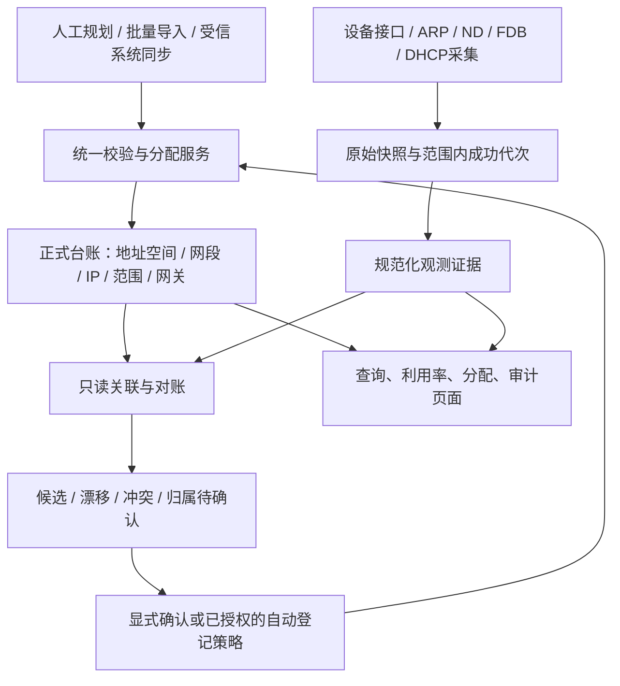

# Nexora IPAM 重整与 NetBox 核心能力对标建议书

- 编制时间：2026-11-05（Asia/Shanghai）。
- 状态：设计建议，尚未实施。
- 适用项目：`D:/netops/netsops-main`。
- 本地核查基线：HEAD `5e5c9e130d202a6a27f6684e75a03c9fb903af83` 加当前工作区文件；存在其他任务未提交变更，本文不修改它们。
- NetBox 源码基线：`4575af244a0cc9e3c0b431873ed52e2978911243`，提交时间 `2026-11-05T01:17:58Z`。该提交来自研究时的 main，不代表稳定发布版本或上线版本推荐。
- 交付范围：解释 NetBox IPAM 的管理机制，核对 Nexora 差距，提出目标模型、接口、采集流程、迁移方案与验收门槛。本文中的新增表、接口、状态和工期均为建议，不表示已经存在。

## 阅读导航

- 管理决策：第 1、2、15、18 节。
- 产品与使用流程：第 3、5、8、10 节。
- 后端与数据库实现：第 6、7、9、11、12、13 节。
- 采集与网络适配：第 4、8、9 节。
- 验收与交付：第 14、16、17 节。

## 1. 建议与任务目标

建议采用 NetBox 的核心资源模型和分配规则，在现有 Nexora 内重整 IPAM。保留 FastAPI、PostgreSQL、React、CMDB、权限、审计和采集基础，逐步替换范围判断不一致的路径。

需要达到的结果：

1. 每个网段、IP、地址池和网关都有明确地址空间；同地址在不同空间中可以合法存在。
2. 地址台账能回答“应分配给谁、用途是什么、何时变更”；采集能回答“在哪里、何时、通过什么证据观察到”。
3. 缺少 VRF、采集失败、没有发现终端，分别有明确状态，不被转换成全局、空闲或离线。
4. 自动分配对父子网段、保留区间、DHCP 池、虚拟网关和并发请求有一致行为。
5. 双核心、VRRP/HSRP、Anycast、IPv6 的管理建立在显式关系上。
6. 旧数据可以逐批迁移、核对和追溯，切换失败有经过演练的恢复路径。

“实现同样功能”分成三个交付层次：

| 层次 | 目标 | 边界 |
|---|---|---|
| 核心管理等价 | 路由域、网段层级、IP/区间管理、自动分配、接口绑定、虚拟网关、利用率、权限审计、批量操作 | 本次重整主线；应逐项验收 |
| 扩展 IPAM 对标 | RIR、Aggregate、RD/RT、VLAN 组、主地址、NAT 关系、角色、标签和资源导出 | 根据业务依赖逐步补齐，避免把所有扩展绑成一次发布 |
| Nexora 观测闭环 | ARP/ND、FDB、DHCP 同步、终端定位、归属异常和历史证据 | 结合 Nexora 采集能力建设，不把 NetBox 的模型成熟度当成采集正确性证明 |

本文不承诺 NetBox 全部插件、整个 DCIM/虚拟化系统或 REST 路径兼容；功能等价以第 14 节验收矩阵为准。

若要求完整覆盖 NetBox IPAM 导航，还需逐项盘点 ASN/ASN Range、RIR/Aggregate、Route Target、VLAN Group、VLAN Translation、Application Service 等对象。它们不能被“地址、网关、VRF已经正确”替代；本文将其列为后续扩展，避免把核心治理交付误称为整个产品完全等价。

## 2. 审查依据与证据边界

### 2.1 已完成核查

- 阅读用户提供的《NetBox IPAM 源码逻辑分析与 Nexora 设计参考》。其中建议作为审查材料，没有直接执行。
- 访问 NetBox 官方仓库与官方文档，固定本次源码提交，核对资源、查询、锁与分配实现。
- 对照 Nexora 的 schema、m0008 迁移、IPAM/CMDB API、服务、地址页面及接口快照路径。
- 两项只读分工分别核查模型/约束和采集/证据链；本文统一整合方案，未由子任务修改代码。

### 2.2 尚未核查

- 未访问部署数据库，因此没有实际脏数据数量、索引生效清单或存量规模。
- 未连接真实设备，没有各厂商、型号、软件版本的 VRF/ND/FDB 能力实测覆盖率。
- 未在本次部署 NetBox，没有宣称端到端行为已验证。
- 未修改业务代码、执行数据库迁移、提交、推送、部署或运行业务测试。

下文分别使用“源码事实”“设计建议”“实施时验证”表述。源码能够证明风险路径存在，不能证明某一用户数据已经经过该路径。

## 3. NetBox 如何实现 IPAM 管理

### 3.1 以明确的资源对象管理预期状态

NetBox 把地址资源拆成 RIR、Aggregate、Prefix、IPRange、IPAddress，分别表达资源来源、大块地址、网络前缀、连续地址段和登记地址。它们可以关联用途、租户、站点范围等业务信息。地址管理由这些登记关系支撑。[N1]

例如，“某地址属于服务器 A”需要正式分配关系；ARP 看到该地址的 MAC，是现场观测。两者可以对账，但不能互相代替。

### 3.2 VRF 区分地址空间，组织归属另外管理

VRF 表达独立路由域，允许不同域使用重叠地址。NetBox 未分配 VRF 的资源位于 global table；VRF 可以记录 RD、路由目标和唯一性策略。名称本身不能证明不同设备的路由域相同。[N2]

因此，站点是位置，VLAN 是二层范围，Tenant 是业务归属；它们不能被无条件替代成路由域。Nexora 还存在平台安全租户边界，需要在移植时单独保留。

### 3.3 按网络包含关系组织层级

Prefix 保存网络前缀，例如 `10.20.0.0/16`；IP 保存主机地址及掩码，例如 `10.20.10.8/24`。NetBox 的 IP 不依赖固定 `prefix_id` 外键才能存在；一般按同 VRF 的网络包含关系查询归属，最具体父网段可按最长前缀确定。Scope、VLAN 等提供管理信息。[N3][N4]

这意味着改变一个规划网段不需要靠复制 IP 行维持“树”；也不能因为已有同 CIDR 网段，就认定现场观察属于它。全局 container 的查询存在跨 VRF 展示特例，移植时应单独定义容器浏览，不能让该特例参与可写分配。[N8]

### 3.4 IP 绑定接口或虚拟网关组

登记 IP 可以关联物理设备接口、虚拟机接口或 FHRP 组；设备主地址是另外的选择关系。FHRP 用组和成员接口描述共享虚拟 IP。[N4][N6]

因此，“交换机端口看到了终端 MAC”不等于“终端 IP 分配给交换机端口”；“某核心有一个 SVI 地址”也不等于“它就是业务默认网关”。

### 3.5 按区间计算可用空间

NetBox 可用地址查询先计算边界，再扣除同空间已经登记的 host 和不可分配范围；用区间合并及惰性读取避免创建每一个可能 IP。子网划分则从父空间扣除已划分子空间。[N9]

该方法适合 IPv6，也能避免“前一万个地址都占用，就错误报告没地址”的有限扫描问题。

### 3.6 地址池策略与利用率分别控制

IPRange 的 `mark_populated` 影响可用空间，并限制新建范围内单个 IP；`mark_utilized` 控制该范围按全占用统计。两者是不同策略。它们不代表存在真实 DHCP 租约。[N5]

IPv4 常规前缀、/31、/32、IPv6 /127、/128 和 pool 模式的可用边界存在差异。应将这类规则封装为统一策略，严格核对选定 NetBox 基线与产品要求，不能在多个页面自行推断。[N8]

### 3.7 正式分配在受保护的写入流程中完成

NetBox 分配 API 获取 advisory lock 后重新计算可用资源，在事务中创建，资源不足返回冲突；普通 IP CRUD 也参与相应锁保护。查询“看起来可用”并不等于已经获得该 IP。[N10]

移植重点是“所有写入遵守同一规则和锁域”。仅在自动分配按钮里加锁，无法覆盖导入、编辑、释放、自动登记和后台恢复等入口。

### 3.8 利用率属于资源管理指标

NetBox 根据对象类型计算资源覆盖或登记利用率；它不是实时在线率。Nexora 应额外提供现场观察指标，并明确分母和时效。[N1]

## 4. Nexora 当前能力与具体差距

下列行号是本次工作区锚点，实施时以函数名和最新源码重新定位。

| 编号 | 源码事实 | 影响 | 核查入口 |
|---|---|---|---|
| G01 | 接口快照不带明确 VRF；候选可默认 global 后登记 | 未知变成确定归属 | `backend/services/ipam_service.py:1040,1228` |
| G02 | 发现占用只按 CIDR 判断，读取所有 active endpoint | 跨租户/路由域误占用 | `ipam_service.py:376,2199` |
| G03 | Prefix 校验含 site，地址冲突规则不含 site | 相同网段能建，登记 IP 却冲突 | `ipam_service.py:422,480` |
| G04 | 混合视图把 switch_id 补进台账 device_id，编辑表单读取混合值 | 接入位置可能被保存成分配对象 | `ipam_service.py:1749`、`src/pages/IPVlan/IPAddressTab.tsx:949` |
| G05 | 网关候选无 VRF 参数；网关主要为一组 IP/设备/接口字段 | 重叠网段候选混入，冗余关系表达不足 | `ipam_service.py:722`、`backend/database/schema.py:778` |
| G06 | ARP 归一化能够读取部分 VRF 信息，但写 arp_table 的路径未保留；通用 SNMP 结果不能默认证明 VRF | 新投影可能长期归属待确认 | `backend/services/ip_locator_service.py:454,4760`、`ipam_discovery_service.py:430` |
| G07 | Pool 已做边界/重叠校验，但自动分配器不读 pool；没有外部管理与占用显示策略 | DHCP 池/保留池可能无法阻止静态分配 | `ipam_service.py:2595,2216`、`backend/schemas/schemas.py:1609` |
| G08 | VIP API 接受 prefix_id，但当前 VIP 表及 INSERT 未保存该关系 | 校验后丢失前缀关联；不具备完整 FHRP 成员关系 | `schema.py:892`、`ipam_service.py:2939` |
| G09 | DHCP lease 缺少完整地址空间、池与来源关系 | 重叠地址租约和冲突判断缺乏范围 | `schema.py:913`、`ipam_service.py:3074` |
| G10 | 可用 IP 读取当前 subnet_id 的占用；最终冲突校验范围更大 | 父子网段分配可能选中冲突地址后报错，不继续寻找 | `ipam_service.py:2216,3182` |
| G11 | IP 提示有一万候选扫描上限；Prefix 提示有一千子网扫描上限；部分 IPv6 路径逐地址枚举 | 大空间的可用性与耗时不可预测 | `ipam_service.py:2232,3203,3258` |
| G12 | 迁移与 fresh schema 的唯一索引定义存在差别；历史重复可能导致索引跳过/延后 | 不能仅凭迁移文件认定部署具有完整约束 | `backend/database/migrations/m0008_enterprise_cmdb_ipam_phase0_phase6.py:188`、`schema.py:3192` |

应保留的基础：

- 现有 VRF、Prefix、地址、Pool、VIP、租约对象及 CRUD，避免重复造一套平行核心表。
- PostgreSQL `inet/cidr` 基础、Prefix 行锁、生命周期与释放隔离期、审计入口。
- `cmdb_collection_snapshots.successful_generation` 对最后成功接口代次的隔离。
- 新发现服务的 unknown/global 区分、原始证据、时效与显式登记/校准机制。
- ARP/FDB 采集、接口规范化、拓扑和定位基础，但它们需要统一范围与代次契约。

另外，旧 `ip_inventory` 导入已受显式恢复/初始化条件控制（`schema.py:4559`）。应保留这项防回流保护；不能把该段源码误判为每次正常启动都会自动重建 IPAM，也不能在新迁移中重新启用无范围导入。

## 5. 目标架构与统一原则

需要固定十条规则：

1. 正式资源必须有明确地址空间；未知仅允许存在于观测/待迁移记录中。
2. 全局路由表是已确认的网络上下文，不能由缺失字段推断。
3. Site、VLAN、业务归属不自动改变三层地址身份。
4. 原始观测不可被确认操作改写；确认关系另外记录来源、人员、依据和有效范围。
5. 端点所有权与接入位置分别建模。
6. 人工台账的空字段也不能由观测视图静默补入后再保存。
7. 地址空间、可用地址、分配、导入、利用率采用同一组领域服务。
8. 失败和部分成功只保留证据，不证明地址已消失；完整空表也不自动释放台账。
9. 所有正式写入经过授权、事务、并发保护、关系校验和审计。
10. 每条自动结论能解释依据和时间；置信分值不授予写权限，也不能替代明确归属。

## 6. 地址空间、VRF、站点与租户的模型调整

### 6.1 推荐引入一个统一的地址空间身份

建议补充 `ipam_address_spaces` 作为平台三层地址身份；复用 `vrfs` 管理具体 VRF 的名称、RD、RT 等属性。原因是 Nexora 需要同时管理多个互不连通、都没有配置 VRF 的默认路由表。

建议字段：

| 字段 | 含义与约束 |
|---|---|
| id | 非空稳定 ID，所有正式资源引用它 |
| security_tenant_id | 复用现有安全租户边界，不能由前端任意指定跨租户值 |
| name | 人可读名称，租户内唯一展示键 |
| kind | `global` 或 `vrf` |
| vrf_id | kind=vrf 必填并唯一映射一条现有 vrfs；global 必须为空 |
| allocation_policy | 分配策略版本、共享策略、观测占用策略的引用 |
| status / revision | 活动/停用状态及乐观并发版本 |

这不是再建立一份独立 VRF 目录：具体 VRF 属性以现有 `vrfs` 为准，地址空间只承载稳定域 ID 和隔离身份。服务与数据库应阻止 kind、vrf_id 和资源所属租户相互矛盾。

示例：

| 网络现状 | 平台表达 |
|---|---|
| 总部与分部默认路由表互通 | 可映射到同一个“企业默认域”，站点分别记录 |
| 两个独立园区都用 192.168.10.0/24，互不连通 | 分别建立“园区A默认域”“园区B默认域” |
| 一台核心包含 PROD、TEST 两个实例 | 分别映射两个 VRF 型地址空间 |
| 两台设备都叫 PROD，但管理网络彼此隔离 | 名称相同也不能自动合并 |
| 采集到 IP，但不知道设备查询的是哪个路由表 | 观测记录 address_space_id=NULL、context_status=unknown，等待确认 |

如果未来确认所有默认网络都属于一个全局空间，可以简化 UI；底层身份仍保持明确。不能通过默认给每个站点创建伪 VRF，代替网络归属核实。

### 6.2 补充设备本地上下文映射

建议 `ipam_device_routing_contexts`：设备 ID、本地实例名/表 ID、SNMP context 或受支持的查询上下文引用、地址族、address_space_id、来源、确认状态、最后验证时间。

- `default`、`public`、`_public_` 等由厂商适配层规范化，保留原始值。
- RD 和名字用于候选比对，不能独自授予跨设备合并权限。
- 同设备同一上下文的有效映射必须唯一；映射变更需要审计和重新对账。
- 无法识别的上下文留空，不映射到 tenant-default/global。
- 业务租户与平台安全租户分开表达；不为模拟 NetBox Tenant 而削弱现有鉴权。

### 6.3 正式资源的统一身份与唯一性

推荐核心查询键为 `(security_tenant_id, address_space_id, host_address)`；address_space_id 本身也必须验证安全租户归属。站点用于管理范围和定位校验，不作为不一致的隐式地址隔离键。

普通地址默认同空间 host 唯一，忽略 IPv6 文本写法和登记掩码差别。共享地址采用第 7.3 节策略。Prefix 在启用唯一策略时，同空间同 CIDR 唯一；父子包含合法。CIDR 正规化后两个前缀的重叠关系是包含或相等，不能靠“兄弟部分重叠”概念代替具体策略。

PostgreSQL 的普通唯一索引对 NULL 有特殊语义；建议正式数据的空间与网络类型字段非空，或明确使用经验证的归一化/NULLS NOT DISTINCT 约束。不能用空字符串伪造外键对象。[P1]

## 7. 资源模型与管理能力

### 7.1 Prefix：保留现有表，清晰区分用途和生命周期

- 正式字段：`address_space_id`、`prefix_cidr CIDR`、IP 版本、名称、状态、用途、VLAN、范围、业务归属、来源、revision。
- `network_type` 继续表达用途；container、active、reserved 等表达管理状态，两者分离。
- `parent_prefix_id` 可保留作缓存/兼容字段；权威归属由同空间网络包含关系决定，变更后重算并检查一致性。
- 一个网段可以有多个站点范围或跨站点用途；首阶段保留现有单 site 展示，但不让其决定地址身份。是否扩展 scope 关系在业务盘点后决定。
- 支持父网段分配子网、可用空间预览、批量创建、导入预检和归属变更预览。
- container 默认不直接分配主机 IP，避免管理树与实际业务子网混用。
- 不按 /24 判定服务器、按 /30 判定互联；掩码提供候选信息，用途由规则或确认给出。

### 7.2 IPAddress：地址、登记与绑定分别表达

复用 `ip_addresses`，统一当前 `address`、`ip_address`、`address_inet`、`subnet_id`、`prefix_id` 的职责：

- `host_address INET` 保存标准化 host；`mask_length` 保存登记/接口配置掩码，不能统一强制改成父 Prefix 掩码。
- `address_space_id` 是正式范围；`subnet_id/prefix_id` 首阶段保留兼容，逐步转成明确的规划归属或派生缓存，禁止两列互相矛盾。
- 地址可以先登记成未绑定对象；要绑定时必须使用已有、可授权的分配目标。
- `allocation_status` 管理登记/保留/释放；`observed_state` 是计算结果，不能混进同一 status。
- `source_type/source_ref` 指向人工申请、导入批次、发现确认或外部权威系统，不用它伪造所有权。
- IP 移域、改地址和改掩码需要专门流程，预览关联影响，不作为普通字段编辑静默执行。

建议新增 `ipam_address_assignments`，使用显式类型和可验证外键表达 `device_interface`、`vm_interface`、`fhrp_group`；现阶段没有稳定 VM 接口模型时不开放该目标。避免任意 type/id 指向不存在对象。

现有 device_id/interface_id 可在兼容期由 assignment 派生；接口属于哪台设备、是否跨安全租户、接口上下文是否对应目标空间必须校验。端点只知道资产而无接口时，记录未完成绑定关系，不能拿接入交换机补位。

### 7.3 共享地址与 NetBox 唯一性策略的对应

业务需要区分：同一虚拟网关的多个成员、同一 Anycast 地址的多个部署，以及疑似冲突的独立分配。

建议第一阶段默认严格唯一；第二阶段提供一个共享地址对象与多个 assignment，VIP 绑定 FHRP 组、组再关联成员接口。共享组必须明确，不能仅凭相同 IP 或多个 MAC 自动生成合法共享关系。

若目标包含 NetBox `enforce_unique=false` 的自由重复登记能力，应作为单独功能交付：允许多登记实例，共用规范 host 身份，按明确 duplicate_policy 校验并按不同 host 统计利用率。不能保留旧硬唯一索引后宣称已经支持该能力，也不能删除索引后依赖前端判断。须选择并验证资源行锁、约束触发器/受控写入等完整实现。

普通地址不得与未授权共享记录混存。共享角色双方、组关系和空间都要符合策略。历史重复地址先归类为待处理冲突，不能批量改成 Anycast/VIP 来通过迁移。

### 7.4 地址池与保留区间

复用 `ipam_pools`，补充下列策略：

| 字段/策略 | 建议行为 |
|---|---|
| management_mode | `local_static`、`reserved`、`external_dhcp`、`external_other` |
| allocation_allowed | 是否允许本地正式分配；不能由利用率开关隐式决定 |
| mark_populated | 对标不可再本地分配/创建单 IP 的范围策略 |
| mark_utilized | 是否按全范围计入规划占用 |
| source_system / external_id | 外部系统身份和幂等键 |
| sync_state / last_success_at | 外部同步的运行状态与最后成功时间 |

规则：同地址族、起止包含端点、start<=end、明确空间；范围跨父子 Prefix 的冲突应按地址空间检查。保留池默认不能从普通分配入口获取。外部 DHCP 池不允许本地静态分配，DHCP 租约进入观测表；如需同步正式登记，必须走受信来源策略和统一写入服务。

API 可支持从 Prefix 或 Range 获取候选与分配。两个开关应有独立说明，调整策略必须预览对现有 IP 的影响；启用 populated 后不能直接删除已登记 IP。

### 7.5 网关与 FHRP

建议新增或演进：

- `ipam_fhrp_groups`：空间、协议、组号、名称、配置来源。
- `ipam_fhrp_members`：组、设备接口、真实地址、规划优先级；同组成员按协议校验。
- `ipam_prefix_gateways`：Prefix、IP 地址对象、类型（单接口/冗余VIP/Anycast）、使用目的与首选关系。
- `ipam_gateway_observations` 或复用观测事件：当前角色、运行优先级、虚拟 MAC、设备报告时间和来源。

示例：业务网段 `192.0.2.0/24`，网关 VIP `.1`，两台核心接口 `.2`、`.3`。台账保存 VIP 与组关系；成员实际 Master/Backup 是带时间的观测状态。主备切换不应改变 IP 台账的归属，也不应产生伪 IP 冲突。

兼容期的 `prefixes.gateway/gateway_device_id/gateway_interface_id` 只作为简化投影；新关系是唯一权威写入源，不能让两套字段分别编辑。未识别协议的两个设备不可自动推断为 FHRP 组。

### 7.6 DHCP、DNS、NAT 与扩展资源

- DHCP：复用租约页面，区分“外部租约观测”和“地址规划”。租约有来源服务器/池/空间、租期、同步代次；租约到期只影响动态观测，不释放静态分配。
- DNS：先做名称登记和外部记录对账；写 DNS 需要独立连接配置、权限、幂等与失败补偿，不能把 dns_name 字段等同于已发布 DNS。
- NAT：以 inside/outside 地址关系表达一对一映射；PAT/端口策略另建能力，不把一个 IP 外键扩大解释成所有 NAT。
- RIR/Aggregate：作为地址来源与空间划分的规划视图，后置于范围正确性；不得把 Aggregate 当成默认 VRF。
- RD/RT：VRF 上记录配置关系；路由泄漏不自动合并两个 IPAM 地址空间。
- VLAN 组、租户/组织、角色、标签、设备主 IPv4/IPv6：复用 CMDB，补足关联与范围校验。没有底层对象时，不仅新增一个自由文本字段就宣称完成管理能力。

## 8. 采集、规范化与证据管理

### 8.1 每次采集必须知道自己查询了什么

建议统一 `collection_scope`：安全租户、设备、表类型、设备本地上下文、地址空间解析状态、地址族、采集器、覆盖范围、run_id、尝试代次、成功代次。

- ARP/ND 属于三层上下文；FDB 属于二层桥域/VLAN，地址族标记不适用。
- FDB 的 VLAN 编号与 VRF 不能直接画等号。VLAN、桥实例、接口映射和网段关系一致且唯一时，可以产生有依据的关联候选。
- 同设备一个 VRF 成功、另一个失败，只推进成功范围的代次。
- SNMP v2c/v3 或厂商私有 MIB 是否能按实例查询，要逐型号验证；通用 IP-MIB 读到数据不能证明覆盖所有 VRF。
- 不支持的域显示 unsupported/unknown，按策略选受支持只读 CLI/API 补充；不能伪装完整成功。

### 8.2 统一结果状态

| 状态 | 保存内容 | 能否做“本次没看到”的判断 |
|---|---|---|
| complete_nonempty | 完整成功非空、明确范围及行数 | 仅限同一范围，且只生成缺失观测 |
| complete_empty | 已证明完整遍历但零条记录 | 同上；不能自动判所有 IP 空闲 |
| partial | 部分成功、分页中断、部分表失败 | 不能；仅保留正向证据 |
| failed | 失败原因、尝试时间、保留上次成功事实 | 不能 |
| unsupported | 设备/版本不支持、能力依据 | 不能 |
| scope_unknown | 表内容可读但路由域未知 | 只能浏览或等待人工确认 |

新增区分 `complete` 与 `freshness`：最新一次失败、上次成功仍在时效内，必须同时展示两项，不把旧成功时间替换成失败时间。

### 8.3 观测的最小字段

复用 `ipam_discovery_snapshots/observations` 并补足必要字段：

`source_type, source_device_id, source_interface, local_context, address_space_id?, context_status, ip_family, ip, mac, vlan/bridge_domain, observed_at, run_id, generation, completeness, raw_evidence_ref, parser_version, expires_at`。

访问原始证据需要对应权限；脱敏后存储，不把 community、口令、Token 或完整敏感配置写入报告和接口。保留周期按规模设定，历史过期不删除正式台账。

### 8.4 来源能力矩阵与实际工作项

| 来源 | 可以证明什么 | 不能单独证明什么 | 改造工作 |
|---|---|---|---|
| 接口快照 | 某接口配置了某 IP/掩码；包含时可证明本地 VRF | 终端占用、默认网关、接入位置 | 增加 VRF/上下文，保留所有主次地址，保留最后成功代次 |
| ARP | 某路由域、某时刻的 IPv4 邻居 IP/MAC | IP 所有权、终端直接接在哪个端口 | 保留 VRF、来源接口、代次、完整性 |
| ND | IPv6 邻居及状态 | IPv6 全网终端清单；沉默终端不存在 | 独立 IPv6 采集与上下文覆盖验证 |
| FDB | MAC 在桥域/VLAN/端口出现 | IP 地址、三层 VRF、端点资产所有权 | 保留桥/VLAN映射及完整代次，识别上联、LAG、trunk |
| DHCP | 某来源分配/续租了某地址 | 已在线、已正确登记、实际物理端口 | 来源与池映射、租期、同步幂等 |
| Ping/探测 | 目标在特定时间对探测有响应 | 地址归属、无响应就空闲 | 保留探测源与范围；不参与所有权覆盖 |

### 8.5 IP→MAC→接入位置关联

1. 先确认 ARP/ND 的空间、来源接口、时间窗和 IP/MAC。
2. 找同一二层范围内的 FDB，检查时效和源站点是否符合已知拓扑。
3. 结合端口模式、LLDP/LAG/拓扑排除上联和中间路径。
4. 对唯一接入候选显示位置；多个候选显示路径/待确认，并保留原始证据。
5. 位置结果写入 observation/location，不能写进 IP assignment。
6. 合法虚拟 MAC、无线漫游、虚拟化迁移、MAC 抖动分别处理，不能把一个分值阈值当成全部例外规则。

站点是范围证据之一，不能简单要求源网关和接入设备必须同物理站点；跨站点网络需允许显式的拓扑/网络范围关系。

## 9. 对账、自动登记与分配策略

### 9.1 对账结果应可解释

| 台账与观测组合 | 显示/建议动作 |
|---|---|
| 未登记＋明确空间的近期证据 | 未登记使用；可生成登记候选 |
| 已分配＋符合该对象的有效证据 | 规划一致，并展示依据 |
| 已分配＋仅观察到相同 IP/MAC，尚无资产映射 | 已观测，所属对象待核实 |
| 已分配＋近期证据显示另一已确认对象使用 | 归属不一致，审核后处理 |
| 已分配＋无近期观测 | 未观测到；保持分配状态 |
| 保留地址＋近期占用 | 保留地址被使用 |
| 同一空间同 IP 出现不一致 MAC | 疑似冲突；先排除虚拟网关/共享/移动等合法场景 |
| 未知 VRF＋任意 IP | 归属待确认，不参与可写自动对账 |
| 台账与观测来自不同空间 | 独立记录，不按 IP 字符串合并 |

### 9.2 自动化分级

- 自动采集、归一化、生成候选：默认允许，受资产可见范围与采集策略限制。
- 自动关联位置：只读，必须可解释，歧义保留。
- 自动更新台账：默认关闭；仅对已配置权威来源、明确范围、字段白名单和审计策略开放。
- 发现登记：操作者预览目标空间/Prefix/绑定对象后确认；保留独立 scope assertion。
- 释放、跨域移动、覆盖人工分配：独立业务动作，不能因采集缺失触发。

观测确认关系应绑定观测版本及设备上下文；设备改站点、VRF 映射变更或 Prefix 移域后重新核验，不能永久继承旧确认。

### 9.3 两种可用性必须分开

建议接口返回：

- `registered_available_count`：纯规划规则下尚可登记的数量。
- `allocatable_now_count`：再扣除符合策略的近期明确占用、隔离期等后的可分配数量。
- `observation_coverage`：采集覆盖完整/部分/未知，不能因为数量为零就显示全网空闲。

Nexora 推荐默认启用“明确空间的近期观测占用阻止自动分配”，这是在 NetBox 登记规则上的产品扩展；只应用同空间证据，未知范围不跨空间冻结。若目标空间覆盖未知，自动分配按策略要求人工确认或阻止，不能静默称为安全可用。

### 9.4 分配与子网划分算法

建议同一个 availability 服务负责预览与提交：

1. 规范化地址族、目标空间、Prefix 或 Range，计算可用边界。
2. 读取该空间所有相交的正式地址，而非只读当前 subnet_id。
3. 扣除保留/外部范围、已登记网关、隔离期地址，以及策略允许使用的近期占用证据。
4. 对区间排序、求并集、计算空隙，分页返回候选与排除原因。
5. 子网划分按合法容器扣除已经划出的网络；聚合规划容器和已分配业务子网必须有明确规则。
6. 不枚举 IPv6 /64；请求少量候选时读取工作量应随登记记录/区间数增长。

示例：`192.0.2.0/24`，已登记 `.1/.2/.10`，外部池 `.100–.200`。纯规划可分配数为 `254-3-101=150`，首个为 `.3`。若同空间另有近期未登记 `.3`，推荐策略下当前首个为 `.4`、可分配数为149；其他空间观察到 `.3` 不影响本域。

### 9.5 并发与幂等

- 初始实现可按地址空间持有事务级 advisory lock，确保所有写入路径共同遵守；不能只锁某个 Prefix，遗漏跨父子/跨 Range 冲突。
- 在锁内重新计算候选、执行权限与策略校验、事务创建、写审计，然后提交。
- 锁按稳定 ID 派生，避免使用进程随机 hash；多空间操作固定加锁顺序并设置超时。
- 预览明确“不保留资源”；需要保留时创建有过期时间的正式 reservation。
- 幂等键绑定安全租户、操作者/服务主体和请求体摘要；相同键不同内容返回冲突。
- 批量默认全部成功或全部回滚；部分成功必须是明确选择的模式，逐项给出结果。
- 乐观 revision 防止页面旧数据覆盖新绑定；唯一约束作为最终防线，原始数据库错误转换为稳定业务错误。

## 10. 页面与日常操作设计

### 10.1 导航建议

保留现有 IPAM 导航，形成：地址空间/VRF、网段、IP 地址、地址池、网关/虚拟IP、发现记录、对账异常、利用率。DHCP 租约为外部观测入口，可从池和发现页进入，避免用户把租约当成静态地址分配。

不强制新增多个顶层模块；具体标签沿用现有风格，中文角色和类别复用共享字典。

### 10.2 地址页面

- 顶部始终显示当前安全租户、地址空间、网段和可选站点；默认展示正式登记。
- 可切换“登记 / 观测 / 合并查看”；合并查看只组合两套字段，不改变字段来源。
- 分配对象、资产、接入交换机、接入端口分栏。
- 分别显示登记状态、观测状态、最后观察时间、来源和归属状态。
- 编辑操作加载正式 record API，不直接使用混合列表行初始化台账字段。
- “登记发现地址”使用明确动作；未确认范围时先选择空间和网段。
- IPv4 小网段可用矩阵；IPv6 和大空间使用区间/分页，禁止渲染全部地址格子。

### 10.3 网段、VRF 与网关页面

- 网段树支持 IPv4/IPv6、容器与用途筛选、剩余可分配空间；明确统计范围。
- VRF 详情展示设备本地上下文映射、RD/RT、覆盖设备、采集能力和未知候选；同名对象可解释其区别。
- 网关显示终端使用的网关 IP、类型、组、成员接口真实地址和运行状态时间。
- 候选必须带空间、来源和采集时间；不以“只有一个 SVI”自动写入正式关系。
- 地址池说明本地可分配/保留/外部管理，以及利用率是否按全范围计算。

### 10.4 五项常用流程

| 用户操作 | 推荐交互与后端约束 |
|---|---|
| 规划新业务网段 | 选空间→选父容器→预览可用子网→用途/VLAN/范围→事务创建 |
| 给服务器分配 IP | 选业务网段/池→填用途与绑定对象→提交分配→返回正式登记和审计 |
| 纳管已有网络 | 收集接口/VRF快照→预览候选与未知→批量确认→登记，保留原始证据 |
| 处理未登记 IP | 查看证据→确认域与对象→登记或标为外部动态；不能默认归交换机 |
| 排查地址冲突 | 查看同域IP的时间线、MAC、DHCP、FHRP关系→确认异常→保留处理记录 |

## 11. API、权限与集成契约

以下为建议接口，不代表现有接口已经实现；优先复用 `/api/ipam`，在兼容期用明确版本/适配层控制字段变化。

| 能力 | 建议接口/调整 | 核心契约 |
|---|---|---|
| 地址空间 | `/api/ipam/address-spaces` | 所有结果受当前主体可见范围过滤 |
| 设备上下文映射 | `/api/ipam/routing-contexts` | 映射预览、显式确认、revision |
| 网段 | 保留 `/subnets`，增加 space 和规范字段 | 禁止静默跨域更新 |
| 可用 IP | `/subnets/{id}/available-ips` GET/POST | GET不保留；POST锁内分配；支持range约束 |
| 可用子网 | `/subnets/{id}/available-prefixes` GET/POST | 仅允许合法容器与请求长度 |
| 地址详情 | `/addresses/{id}` | 返回正式 record；observation 独立字段 |
| 网关候选 | 调整现有 gateway-candidates | 必须明确 space/context；unknown只供核查 |
| FHRP | `/fhrp-groups`、`/gateway-bindings` | 组、成员、VIP、Prefix完整关系 |
| 发现与对账 | 复用 `/endpoints`、`/reconciliation` | 只读，带证据代次与范围 |
| 登记/校准 | 复用显式确认接口 | evidence_id/version、目标、确认原因、revision |
| 导入 | `/imports/preview`、`/imports/{id}/commit` | 同一文件哈希、映射版本、逐项错误、幂等提交 |

错误建议包含稳定 `code`、用户可读 message、可见范围内 details、request_id，例如 `SCOPE_UNRESOLVED`、`ADDRESS_CONFLICT`、`RANGE_EXTERNALLY_MANAGED`、`STALE_REVISION`、`OBSERVATION_STALE`。不泄漏用户不可见租户的 IP、设备名或证据详情。

跨域移动同时校验源和目标权限；批量不得只校验第一行；接口绑定验证对象所属租户与设备关系。后台任务和导入使用受限服务主体，不能绕过同一写入服务。

权限复用 `require_permission/authorize_resource/enforce_resource_scope`；服务层仍应验证业务关系。审计记录 before/after、操作主体、来源、reason、幂等键、关联证据和迁移批次，避免只记录一个“成功”文本。

## 12. PostgreSQL 结构、索引与一致性

### 12.1 分阶段扩展现有表

| 对象 | 处理方式 | 关键注意事项 |
|---|---|---|
| vrfs | 保留并补全策略/RD/RT关系 | 现有租户内名称唯一规则是否足够需与空间映射一起调整 |
| prefixes | 增加 address_space_id、revision 等，保留旧字段过渡 | CIDR 标准化、非空、同域唯一及用途/状态分离 |
| ip_addresses | 增加空间/掩码/绑定关系；收敛重复字段 | host 标准化、生命周期、共享策略与约束相匹配 |
| ipam_pools | 增加外部管理、分配/利用率策略 | 范围重叠按域校验，不能只比较同 prefix_id |
| ipam_vips | 兼容映射到地址与组关系 | 原来缺失的 prefix 归属不能盲填 |
| ipam_dhcp_leases | 明确为观测，增加来源、空间/池、代次 | 历史无域数据待确认 |
| discovery snapshots/observations | 复用并补上下文/完整性 | 不覆盖原始内容；历史scope保持unknown |
| 新增关系 | 地址空间、设备上下文、assignment、FHRP、网关关系、迁移映射 | 最终DDL以真实数据库盘点后确定，避免与已有模块重复 |

### 12.2 数据库约束

- `inet/cidr` 列有效且非空后再启用正式约束；非法历史值先隔离。
- 正式资源的 address_space、tenant、FK 和关系对象一致；跨行一致性不能靠普通 CHECK 假装完成，应采用适合的复合 FK、触发器或受控写服务并配合约束。
- Prefix 同域相同 CIDR 的唯一规则要与 duplicate_policy 一致；父子包含继续支持。
- 普通 IP 同域 host 唯一；共享能力上线前重审旧唯一索引，不能无保护删除。
- 绑定对象删除默认保护或显式解绑；禁止删除 VRF 后把所有资源自动变成 global。
- 启用约束失败应显示迁移阻断和冲突清单；不能只打一条 warning 后宣称数据完整性已就绪。
- fresh schema 与升级迁移必须生成相同定义；检查 PostgreSQL catalog 中的索引定义、有效状态和验证状态，而不只检查索引名称。

### 12.3 查询与性能

- 同域地址分页、Prefix 包含查询、范围交集和最近观测是主要查询模式；依据实际 EXPLAIN 选择复合 B-tree、GiST/SP-GiST 或表达式索引，不预先声称某个索引适用于全部查询。[P2]
- 统计按 distinct host 与区间并集，避免父子重复、共享实例和重叠范围重复计数。
- 大量观测按时间清理/归档；是否分区由行数、查询与维护成本决定。
- 缓存键包含安全租户、空间、过滤条件和策略/数据版本，不能仅用IP或站点。
- 外部设备I/O不在数据库分配事务中执行；采集结果先落证据，再完成短事务登记。

## 13. 存量数据迁移、切换与回滚

### 13.1 先做只读盘点

输出脱敏的机器可读报告和人工审核清单，至少包含：

1. Prefix/IP/Pool/VIP/Lease/接口/观测数量与关联完整性。
2. 按拟定地址空间计算的重复CIDR、重复host、相互矛盾的site/tenant/VRF。
3. 空VRF、名称别名、同名不同域、缺失掩码、非法INET、空FK。
4. IP owner疑似指向接入交换机的记录；此项只能标为候选，不能自动清空。
5. DHCP池与静态分配冲突、VIP前缀不明、共享地址待分类。
6. 当前真实索引/约束定义、生效状态、迁移执行记录。
7. 仍能写旧台账的路径：导入、初始化恢复、API、任务、人工脚本。

### 13.2 Expand—映射—校验—切换—收敛

| 步骤 | 工作 | 退出条件 |
|---|---|---|
| M0 保护 | 数据库/配置/原始快照备份并验证恢复；记录版本 | 备份可恢复，不把“备份命令成功”等同演练完成 |
| M1 扩展 | 增加可空字段/新关系，不删旧列 | 旧应用仍能按受控兼容路径运行 |
| M2 映射 | 建legacy_id→canonical_id与确认依据，分批回填 | 每条数据可追溯；未知不伪造global |
| M3 核对 | 比较数量、集合、关系、重复、利用率和分配候选 | 差异有原因；核心域无未解释歧义 |
| M4 影子读 | 旧写入经适配维护新字段，新逻辑只读比较 | 不创建双主；写入失败整体回滚 |
| M5 试点切换 | 先选择清晰的小范围，统一新写服务 | 所有入口遵守新范围/锁规则 |
| M6 全量切换 | 按空间/站点组逐批切换并观察 | 关键验收通过，指标稳定 |
| M7 收敛 | 停写旧模型，移除兼容字段/接口 | 完成保留期与回滚窗口，旧路径不可回流 |

无法确认的历史数据保留为迁移待审核；不丢记录，不设成“可分配”。受影响空间可以进入“规划可看、分配受限”的状态，由明确策略处理。

### 13.3 回滚的实际边界

- 影子阶段：关闭影子读，保留新列与映射，不破坏旧服务。
- 试点阶段：暂停受影响空间写入，导出切换后的增量审计，验证旧模型能表达这些增量后再切回。
- 新共享/网关关系已投入使用后，旧模型可能无法无损表示；这时不能只回滚应用二进制。需要前滚修正，或执行已经演练的反向映射/数据库恢复流程。
- 数据库恢复会涉及恢复点之后的写入；实施计划必须给出增量恢复和业务停写窗口。
- 回滚不连接设备做配置撤销，因为本次IPAM重整本身不应修改设备配置；未来配置下发另走变更流程。

## 14. 验证计划与验收矩阵

本节是未来实施必须执行的计划，不是本次已经通过的测试结果。持久化验证全部使用隔离 PostgreSQL 18 测试数据库与项目共享fixture；设备使用脱敏样本或mock，真实设备只读验收另行获得授权。

| 编号 | 场景 | 必须达到的结果 |
|---|---|---|
| A01 | 两个明确空间使用相同CIDR和IP | 分别管理、分配、统计，不互相阻断 |
| A02 | 同域跨站点的同host重复申请 | 按统一唯一/共享策略处理，前后端一致 |
| A03 | 未知VRF接口快照生成网段 | 保持待确认，不默认为global |
| A04 | 显式global与unknown同时存在 | 独立显示，unknown不参与确定归属 |
| A05 | 同名本地VRF来自不同网络 | 没有映射确认不自动合并 |
| A06 | 一个VRF失败另一个成功 | 只推进成功上下文代次 |
| A07 | 完整成功空表 | 仅产生该范围缺失观测，不释放台账 |
| A08 | 部分成功、分页中断或超时 | 保留最后成功事实，不判离线/空闲 |
| A09 | 缺少VRF能力的SNMP结果 | 明确显示覆盖缺口，不能宣称全域成功 |
| A10 | 跨域发现同IP | 不改变本域可分配集合 |
| A11 | 父Prefix与子Prefix已有地址 | 候选正确扣除，能继续找到下一可用地址 |
| A12 | 外部DHCP池内静态申请 | 明确拒绝；池内租约仍可作为观测同步 |
| A13 | populated与utilized分别开关 | 分配与显示遵守独立规则 |
| A14 | /31、/32、/127、/128、IPv6 /64 | 边界符合策略，无大空间枚举 |
| A15 | 前10000地址或1000子网占用后仍有剩余 | 返回后续合法候选，不误报耗尽 |
| A16 | 同地址不同IPv6文本格式/不同掩码 | 规范host身份一致；掩码独立保存 |
| A17 | 多请求争抢最后一个IP | 恰好一个有效分配，其余稳定冲突，无重复 |
| A18 | 父子Prefix、Range、导入同时申请同host | 同一锁域与约束保护生效 |
| A19 | 同幂等键重试与不同请求体复用 | 重试返回原结果；内容改变返回冲突 |
| A20 | 批量第N条失败 | 默认全部回滚，台账/审计无伪成功 |
| A21 | 登记记录无owner但观测有switch | 查看/编辑其他字段不保存switch为owner |
| A22 | 绑定接口属于其他设备/租户 | 服务与约束拒绝，错误不泄漏对象 |
| A23 | 同站点不同域同网关IP | 候选不串域，不自动误选 |
| A24 | VRRP主备切换 | VIP和组关系不变，运行状态更新时间，无伪冲突 |
| A25 | 合法Anycast与真实冲突各一组 | 共享策略可解释；非共享重复仍告警 |
| A26 | 多MAC、移动、虚拟MAC、LAG/trunk | 保留歧义/路径，不能强填唯一端口 |
| A27 | 只有相同IP/MAC，没有资产映射 | 不宣称已确认资产所有权 |
| A28 | 释放后隔离期内重分配 | 被策略阻止，期满后可正式分配 |
| A29 | 租约到期或采集缺失 | 不释放静态地址 |
| A30 | Prefix缩小/移域、删除VRF | 预览关联影响并保护，不静默变global |
| A31 | 用户越权查询、导出、批量、原始证据 | 可见范围一致，错误无跨域信息泄漏 |
| A32 | fresh schema与历史升级 | 核心列/FK/索引语义相同，catalog核查通过 |
| A33 | 历史重复/NULL键/索引缺失 | 输出阻断清单；不能warning后假成功 |
| A34 | 重启与显式旧数据恢复 | 正常启动不复活旧网段；恢复仍受新范围规则保护 |
| A35 | 旧数据迁移后逐条追溯 | ID映射、来源与未解项可查，统计差异解释完整 |
| A36 | 试点后回滚演练 | 增量可恢复或明确前滚，无静默丢失新关系 |

### 14.1 指标计算验收

- 普通Prefix规划利用率：同空间不同host的登记占用与标记utilized范围求并集，再除以明确分母；共享地址只计一次。
- container：子Prefix空间并集覆盖率；禁止父子重复相加。
- 活跃观测数：时间窗内符合范围的观测host去重；同时显示覆盖状态。
- 未登记占用：明确范围且没有对应正式登记的近期host。
- 剩余可分配：统一availability服务计算，扣除策略约束；不靠“总数-在线数”。
- 对示例`/24`、父子嵌套、重叠Range和FHRP建立可手算数据集，逐项核对。
- IPv6可用边界与利用率分母分别定义；若选择与NetBox完全一致，按固定提交写行为样例，不假定两者分母永远相同。

### 14.2 性能验收建议

先以匿名模拟数据测试：十万登记IP、一百万观测、多个重复地址空间、IPv6 /64、嵌套网段和百级并发申请。规模为初始测试建议，正式门槛依据真实用户规模与测试硬件校准。

建议初始目标：常用分页查询P95≤1秒；无锁争用的单IP分配P95≤1秒；大网段不会随理论地址总数线性扫描。压测必须记录CPU/内存、并发数、数据规模、数据库计划与错误率；不把这些目标写成已达到指标。

### 14.3 实施时的验证入口

优先复用 `backend/tests/ipam/` 的分配、scope、snapshot、discovery、gateway候选测试；增加实际业务边界回归。数据库/迁移使用现有PG fixture，并运行仓库PostgreSQL-only策略扫描器（实施前定位当前脚本入口）。

前端沿用 `src/pages/IPVlan/*.test.tsx` 的受影响用例及 `npm run lint`，页面/打包变化再跑隔离目录生产构建。正式发布候选按 `netops-quality-gate` 执行完整后端和规定前端验证；公共验证同一代码状态只跑一次。

## 15. 实施阶段、顺序与工作量

工期为方案估算，不是承诺；假设一名后端、一名前端、共享网络适配与验证资源，核心投入约41–64人日。真实数据冲突量、厂商上下文能力和验收环境尚未盘点，可能改变估算。阶段之间存在依赖，不能把人日简单除以人数当日历周期。

| 阶段 | 估算 | 交付与范围 | 放行条件 |
|---|---|---|---|
| P0 盘点与契约 | 3–5人日 | 只读数据报告、空间规则、来源清单、差异样例、迁移映射草案 | 目标域与未知数据有明确处理规则 |
| P1 阻止错误归属 | 5–8人日 | unknown不自动global、同域占用、owner/location分离、网关候选范围、编辑加载正式记录 | G01–G05关键回归通过，台账无新增错误绑定 |
| P2 规划核心 | 10–15人日 | 空间模型、规范Prefix/IP、Range策略、区间分配、事务幂等、接口绑定与审计 | A01–A05、A10–A22、A28通过 |
| P3 采集与网关 | 10–16人日 | VRF上下文、ARP/ND/FDB完整代次、FHRP、VIP关联、对账与解释 | A06–A09、A23–A27、A29通过；主流设备样本覆盖 |
| P4 数据迁移与切换 | 8–12人日 | 历史映射、升级/fresh一致、影子读、试点、回滚、监测 | A30–A36通过，试点无未解释差异 |
| P5 验收与交付 | 5–8人日 | 全量门禁、用户操作说明、管理员排障、发布材料 | 核心矩阵与性能目标按约定通过 |

扩展RIR/Aggregate、完整RT策略、VM接口、DNS/DHCP双向集成、PAT及自由重复登记不含上述核心估算；盘点后单独排期。已具备的现成功能按核查结果扣减，不能重复计算建设工作。

建议先做P0/P1，让当前系统停止扩大错误；在它们完成后锁定P2最终DDL。正式发布、推送以及真实设备验证按项目规则取得对应授权，本建议书不触发这些动作。

## 16. 文件边界与团队实施分工

下列是拟修改文件/模块，实际实施按阶段单独创建计划与走查，避免一次改动全部内容。

| 责任 | 已有文件/目录 | 拟调整 |
|---|---|---|
| 主Agent/方案集成 | `docs/plans/`、`docs/walkthrough/` | 固定契约、分工、共享文件、证据与风险；最终审查 |
| 后端API与schema | `backend/api/ipam.py`、`backend/api/cmdb.py`、`backend/schemas/schemas.py` | 空间、assignment、gateway候选和正式record契约；权限与错误 |
| IPAM服务 | `backend/services/ipam_service.py`、`ipam_inventory_scope.py`、`ipam_discovery_service.py` | 统一空间、台账/观测分离、对账；适度拆出availability与allocation服务 |
| CMDB与接口 | `backend/services/cmdb_service.py`、`cmdb_cli_collection_service.py`、`cmdb_interface_snapshot_service.py` | VRF上下文与多地址快照；稳定接口身份 |
| 采集适配 | `backend/services/ip_locator_service.py`、`snmp_service.py`、`interface_collection_service.py`、`backend/main.py` | 统一范围、代次和来源契约；厂商差异收敛在适配层 |
| 数据库 | `backend/database/schema.py`、`backend/database/migrations/` | expand/backfill/validate、真实约束、兼容恢复与回滚 |
| 前端 | `src/pages/IPVlan/`、`src/types/ipam.ts`、`src/api/ipam.ts`、相关hooks | 正式台账、发现和组合视图分离；网关/VRF/池交互 |
| 验证 | `backend/tests/ipam/`、受影响采集/迁移测试、前端相邻测试 | fixture与PG并发/迁移、权限、端到端流程 |

执行规则：同一时间最多两个执行者，后端、前端可在契约确定后并行；schema/shared类型由主Agent指定唯一归属，采集器与IPAM同时改动的文件串行集成。执行者不覆盖已有用户更改，不继续拆子任务；公共验证由主Agent统一安排。

## 17. 主要风险、实施约束与剩余问题

| 风险 | 控制措施 |
|---|---|
| 旧数据本来就没有明确空间 | 候选映射+人工确认；保留unknown，不批量猜测 |
| 多条旧路径回流错误数据 | 盘点所有写入入口；统一服务；保留旧导入防回流保护 |
| 无损回滚被高估 | 在共享/网关新模型启用前演练反向映射，必要时采用前滚 |
| 厂商VRF采集能力差异 | 型号/版本能力矩阵、部分覆盖显式展示，不静默回退默认域 |
| 新旧字段双主 | 明确权威模型与兼容投影，单事务适配、逐步停旧写 |
| 大表迁移影响在线服务 | 分批回填、短事务、索引构建方案与锁窗口；依据规模验证 |
| 共享地址破坏唯一约束 | 独立策略/关系/测试，不直接删除唯一索引 |
| 过多扩展拖慢核心治理 | 先放行P0–P2，再做观测闭环和扩展对象 |

实施前需由P0拿到证据解决的事项：实际PG索引/历史数据量、所有默认路由域连通关系、主要厂商/版本清单、VM接口与资产绑定可复用范围、外部DHCP/DNS权威来源，以及期望是否包含NetBox自由重复登记和全部扩展对象。

这些问题不阻止编写方案和执行只读盘点；会影响最终迁移DDL、数据修复范围和上线门槛。

## 18. 建议采用的实施决策

三种路线的比较：

| 路线 | 适用条件 | 主要代价与结论 |
|---|---|---|
| NetBox作权威IPAM，Nexora集成 | 可以接受两套系统的运维，优先直接获得现成管理能力 | 需要SSO、ID映射、权限同步与接口集成；NetBox是唯一台账写入权威，Nexora只提供观测和受控提交，禁止双向任意覆盖 |
| 在Nexora内移植领域规则 | 希望一个平台完成资产、IPAM、采集和对账 | 需要完成本文模型、数据与验证工作；推荐路线，优先复用现有对象，形成统一服务 |
| 继续逐点补旧判断 | 只需短期缓解个别问题 | 无法保证范围、分配与迁移长期一致；可用于P1止错，不应作为完整重整方案 |

新增地址空间身份属于Nexora针对多个独立默认域的适配建议，并非NetBox原表的逐字段复制。如果P0确认现有VRF对象能够完整承担该身份，也可以选择扩展现有对象；无论用哪张表，正式资源范围非空、未知不冒充global、映射可追溯这三条不变。最终表结构应在P0结果基础上一次确定，避免两个平行的路由域目录。

1. 采用NetBox的核心资源/层级/分配思路，保留Nexora技术栈和现有对象，不复制整个平台。
2. 以统一地址空间身份解决独立global网络和VRF映射问题，未知状态留在观测层。
3. 将台账、观测、位置和确认关系分开，使用户看得懂字段来源，编辑只能修改正式数据。
4. 统一可用空间、分配、导入、迁移与利用率规则，所有写入参与同一事务/锁策略。
5. 先修范围与写入边界，再补FHRP、IPv6、外部池和完整采集代次。
6. 采用可追溯的增量迁移、影子比对、试点和回滚演练，验收通过后再扩展覆盖范围。

核心等价的交付判断应是：用户能可靠规划、分配、绑定、回收和审计地址；相同IP在不同空间不会混淆；每条现场结论有范围、来源和时间；歧义和失败被明确展示。

## 19. 参考资料与证据索引

### 19.1 官方资料

- [N1 NetBox IPAM功能说明](https://netboxlabs.com/docs/netbox/features/ipam/)
- [N2 NetBox VRF](https://netboxlabs.com/docs/netbox/models/ipam/vrf/)
- [N3 NetBox Prefix](https://netboxlabs.com/docs/netbox/models/ipam/prefix/)
- [N4 NetBox IPAddress](https://netboxlabs.com/docs/netbox/models/ipam/ipaddress/)
- [N5 NetBox IPRange](https://netboxlabs.com/docs/netbox/models/ipam/iprange/)
- [N6 NetBox FHRPGroup](https://netboxlabs.com/docs/netbox/models/ipam/fhrpgroup/)
- [N7 固定研究提交](https://github.com/netbox-community/netbox/commit/4575af244a0cc9e3c0b431873ed52e2978911243)
- [N8 固定提交：IPAM模型](https://github.com/netbox-community/netbox/blob/4575af244a0cc9e3c0b431873ed52e2978911243/netbox/ipam/models/ip.py)
- [N9 固定提交：IPAM QuerySets](https://github.com/netbox-community/netbox/blob/4575af244a0cc9e3c0b431873ed52e2978911243/netbox/ipam/querysets.py)
- [N10 固定提交：IPAM分配API](https://github.com/netbox-community/netbox/blob/4575af244a0cc9e3c0b431873ed52e2978911243/netbox/ipam/api/views.py)
- [N11 固定提交：VRF模型](https://github.com/netbox-community/netbox/blob/4575af244a0cc9e3c0b431873ed52e2978911243/netbox/ipam/models/vrfs.py)
- [N12 固定提交：FHRP模型](https://github.com/netbox-community/netbox/blob/4575af244a0cc9e3c0b431873ed52e2978911243/netbox/ipam/models/fhrp.py)
- [P1 PostgreSQL 18约束与NULL唯一性](https://www.postgresql.org/docs/18/ddl-constraints.html)
- [P2 PostgreSQL 18 GiST索引及网络类型操作类](https://www.postgresql.org/docs/18/gist.html)
- [P3 PostgreSQL 18网络地址类型](https://www.postgresql.org/docs/18/datatype-net-types.html)

官方在线文档可继续变化；实现字段、边界和API行为优先按固定提交复核，并在开发开始时选择要对标的稳定版本。若直接移用源码而非独立实现业务规则，应同时核对对应提交的许可证与依赖要求。

### 19.2 本地证据入口

- 用户参考材料：`D:/data/downloads/NetBox_IPAM_%E6%BA%90%E7%A0%81%E9%80%BB%E8%BE%91%E5%88%86%E6%9E%90%E4%B8%8E_Nexora_%E8%AE%BE%E8%AE%A1%E5%8F%82%E8%80%83.md`。
- 第4节G01–G12中的本地源码锚点。
- `.agents/AGENTS.md`，以及 backend、network-drivers、data-migrations、quality-gate规范。
- 对应走查：`docs/walkthrough/walkthrough_20261105_1300_01_NetBox对标IPAM重整建议书.md`。

## 20. 本次完成说明

本次实际修改仅为本建议书及对应走查。进行了资料与源码静态核对、文档结构与引用检查；没有执行本建议书中的实施步骤。开发、真实数据修复和上线效果均须以后续实施记录及验收结果为准。

[N1]: https://netboxlabs.com/docs/netbox/features/ipam/
[N2]: https://netboxlabs.com/docs/netbox/models/ipam/vrf/
[N3]: https://netboxlabs.com/docs/netbox/models/ipam/prefix/
[N4]: https://netboxlabs.com/docs/netbox/models/ipam/ipaddress/
[N5]: https://netboxlabs.com/docs/netbox/models/ipam/iprange/
[N6]: https://netboxlabs.com/docs/netbox/models/ipam/fhrpgroup/
[N8]: https://github.com/netbox-community/netbox/blob/4575af244a0cc9e3c0b431873ed52e2978911243/netbox/ipam/models/ip.py
[N9]: https://github.com/netbox-community/netbox/blob/4575af244a0cc9e3c0b431873ed52e2978911243/netbox/ipam/querysets.py
[N10]: https://github.com/netbox-community/netbox/blob/4575af244a0cc9e3c0b431873ed52e2978911243/netbox/ipam/api/views.py
[P1]: https://www.postgresql.org/docs/18/ddl-constraints.html
[P2]: https://www.postgresql.org/docs/18/gist.html
