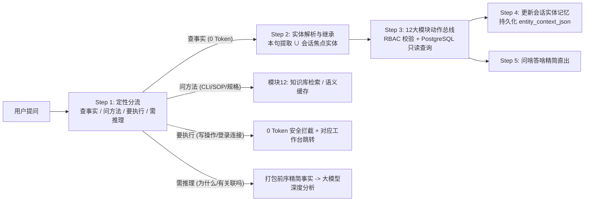

# 实施计划：十二大功能模块跨模块零 Token 实体记忆与统一只读意图总线

- 创建时间：2026-11-27 08:39
- 目标仓库：`D:\netops\netsops-main`
- 状态：待评审（尚未修改业务代码）

---

## 1. 任务目标

将 Nexora AI Copilot 从“零散正则补丁 + 孤立查表”升级为 **「以会话实体记忆为纽带、打通十二大功能模块、全程 0 Token 查事实、按需进大模型推理」** 的统一架构：

1. **会话级实体工作记忆（Entity Working Memory）**：支持跨轮锁定并持久化当前焦点对象（设备 `id/hostname/ip/vendor/site`、厂商、站点、网段、机柜、候选集），实现：
   > `1.1.1.1 这台设备的信息`（④ 资产/CMDB）→ `这台设备最近登录了几次`（① 操作工作台 PAM）→ `它现在有告警吗`（③ 告警管理）→ `最近配置改过没`（⑦ 配置管理）→ `上联连着谁`（② 实时监控/拓扑）→ `有关联变更工单吗`（⑨ 工单管理）
   **整条跨模块追问链全程 0 Token、毫秒级本地 PostgreSQL 响应、内部数据零外发**。
2. **十二大模块「对象 × 模块动作」正交路由总线**：彻底解耦“对象提取/继承”与“模块动作分发”，杜绝模块间互相劫持。
3. **「问啥答啥」的精简直出渲染**：问详情给精简档案卡，问次数先给数字再附明细，问有没有先给“有/无”结论，不再机械倾倒 8 章节资产大表。
4. **六道安全与语义边界护栏**：防焦点串台、防多目标瞎猜、严格 RBAC 权限校验与凭据物理隔离、防同词异义撞车、焦点持久化不断片、因果推理平滑移交大模型。

---

## 2. 现状与核心问题

1. **缺乏跨轮实体记忆**：当前路由只看单句字面词或仅继承单一 `asset_analysis` 域；上一轮查完 `1.1.1.1` 后，下一轮问「这台设备最近登录了几次」无法自动继承 `1.1.1.1`，也无法跨模块跳到 `pam_sessions`。
2. **十二大模块覆盖残缺**：目前本地零 Token 仅覆盖了资产统计、告警统计、IP/MAC 定位及少量 IPAM/拓扑查询；**操作工作台（PAM 登录/命令审计）、机柜 U 位、CMDB 站点/凭据健康、配置漂移/合规、自动化巡检与任务、变更工单、容量趋势、平台系统审计** 尚未接入统一总线。
3. **回答模板与提问粒度错配**：单台设备信息查询、局部数量核对全部复用冗长的 8 章节全量报表，体验生硬。

---

## 3. 十二大功能模块 × 本地只读总线设计矩阵

| 序号 | 功能模块 | 对应 PostgreSQL 核心表（只读） | RBAC 权限门禁 | 支持的 0 Token 核心动作 | 精简输出样式 |
|---|---|---|---|---|---|
| **0** | **全网总览（首页对齐）** | `devices`, `alert_events`, `inspection_runs` | `ai.assistant` | 今日网络整体状态 / 总览 | 一句话总览（在线率 + 严重告警 + 自动化成功率） |
| **1** | **操作工作台** | `pam_sessions`, `pam_command_events`, `pam_access_requests` | `pam:view` | 设备/用户登录次数、最近谁登录过、活跃会话、高危命令记录 | 首行登录次数结论 + 最近 N 条登录时间/用户/协议/来源表 |
| **2** | **实时监控** | `devices`, `interfaces`, `topology_links` | `monitoring:view` | 设备在线状态与 CPU/内存、接口 UP/DOWN 与异常口、LLDP 拓扑邻居 | 首行状态摘要 + 异常接口/邻居链路精简表 |
| **3** | **告警管理** | `alert_events`, `devices` | `monitoring:view` | 有无告警、未处理/严重告警数、按设备/厂商/时间告警列表 | 首行“有/无 + 数量”结论 + 未恢复告警优先明细表 |
| **4** | **资产与配置** | `devices`, `physical_assets`, `racks` | `assets:view` | **单设备档案卡（如 `1.1.1.1` 信息）**、按条件设备数/列表、机柜 U 位与功耗占用 | 单设备输出 8 字段档案卡；统计句输出一行汇总 + 必要分布 |
| **5** | **IPAM 地址管理** | `prefixes`, `ip_addresses`, `ipam_pools`, `ipam_dhcp_leases`, `ipam_vips` | `ipam:view` | 网段利用率/剩余 IP、IP/MAC 交换机端口定位、DHCP/VIP 查询 | 首行利用率结论 + 网段/定位证据表 |
| **6** | **CMDB 基础数据** | `sites`, `vlans`, `credentials`（仅元数据列） | `cmdb:view` | 站点列表、VLAN 列表、凭据绑定与健康状态（**物理级禁读密码/密钥列**） | 站点/VLAN/凭据健康状态摘要表 |
| **7** | **配置管理** | `config_backups`, `config_drift_results`, `compliance_findings` | `configs:view` | 最近配置备份/变更次数、配置漂移设备、合规基线未通过项 | 首行变更/漂移/违规数 + 精简记录表 |
| **8** | **自动化** | `inspection_runs`, `inspection_results`, `scheduled_jobs` | `automation:view` | 今日/近期巡检异常项、定时作业状态与成功率 | 首行成功率/异常数 + 失败/异常任务表 |
| **9** | **工单管理** | `change_orders` | `tickets:view` / `change:view` | 待审批变更工单、指定设备关联的近期变更工单 | 首行工单数 + 工单号/标题/状态/申请人/时间表 |
| **10** | **容量与报表** | `racks`, `prefixes`, `interfaces` | `monitoring:view` | 高水位网段（>80%）、高占用机柜、端口占用率排行 | 容量瓶颈 Top N 清单 |
| **11** | **平台管理** | `users`, `audit_logs` | `admin` / `audit:view` | 最近系统操作审计、账号数量与角色分布 | 权限校验通过后输出近期审计摘要 |
| **12** | **AI 中心** | `ai_knowledge_*`, `ai_semantic_qa_cache` | `ai.assistant` | 多厂商命令/SOP 直出、语义缓存、**跨模块因果推理（唯一消耗 Token 处）** | 原文+引用 或 LLM 综合分析 |

---

## 4. 六道边界护栏（核心防错设计）

1. **防焦点串台（Scope Isolation）**：
   - 仅当句子含指代词（`这台` / `那台` / `它` / `该设备` / `这个网段` / `该机柜`）或主语省略的单体属性问句（如 `最近登录了几次`、`在哪个机柜`、`上联连着谁`、`最近改过配置吗`）时，才继承 `active_device`；
   - 若含全网限定词（`全网` / `所有` / `全部` / `我们` / `系统里`）或显式新对象（如从 `1.1.1.1` 切到 `华为`），立即按新范围执行并刷新焦点；
   - **所有回复首行强制回显生效范围**（如 `查询对象：S6850-1 (1.1.1.1)` 或 `查询范围：全网`）。
2. **防多目标歧义（Ambiguity Guard）**：
   - 当上一轮返回多个候选设备（如拓扑邻居返回 3 台对端），用户问「对端那台有告警吗」时，本地 0 Token 返回候选确认提示，不随机猜测。
3. **防越权与防泄密（RBAC & Secret Isolation）**：
   - 统一封装 `check_module_read_access(user, module)`，复用 `core.rbac` 角色权限体系；无权限时 0 Token 返回友好权限说明；
   - SQL 白名单列投影：严禁任何模块 SELECT `password*`、`*secret*`、`*private_key*`、`*community*`、`*token*`。
4. **防同词异义撞车（4-Way Qualifier）**：
   - Step 1 先按句式强特征分为四类：`HOW_TO`（怎么配/什么命令 → 模块 12 知识库）、`ACTION_EXEC`（帮我重启/执行/登录 → 0 Token 只读拦截+跳转提示）、`REASONING`（为什么/有关联吗/根因分析 → 携带前序精简事实进 LLM）、`FACT_QUERY`（多少/几次/谁/有没有/状态/信息 → 1~11 模块 0 Token 总线）。
5. **焦点持久化（Persistent Entity Context）**：
   - 在 `ai_conversations` 表幂等增加 `entity_context_json TEXT DEFAULT '{}'`（`ADD COLUMN IF NOT EXISTS`），随每轮对话自动读写，服务热重载或隔天重开会话不丢焦点。
6. **平滑移交大模型（Fact-Grounded Escalation）**：
   - 当进入 `REASONING` 分支时，将当前会话最近查出的跨模块精简事实作为结构化 `Local Verified Facts` 注入本轮提示词，做到“查数 0 Token、推理有实据”。

---

## 5. 影响范围与拟新增/修改文件

### 新增文件
1. `backend/ai/services/entity_context.py`
   - 负责设备/IP/主机名/网段/机柜/站点的本地 PostgreSQL 实体解析、指代消解、歧义检测，以及 `ai_conversations.entity_context_json` 的幂等读写。
2. `backend/ai/services/module_bus.py`
   - 十二大功能模块统一只读适配器与 RBAC 权限门禁（覆盖模块 0~11 的全部只读查询与“问啥答啥”精简渲染器）。
3. `backend/tests/ai/test_twelve_module_entity_bus.py`
   - 端到端多轮跨模块串联测试（覆盖 `1.1.1.1 设备信息 -> 最近登录几次 -> 有没有告警 -> 最近配置变更 -> 拓扑邻居 -> 机柜位置 -> 变更工单 -> 全网严重告警防串台 -> 无权限拦截 -> 因果推理移交 LLM`）。

### 修改文件
1. `backend/ai/services/local_router.py`
   - 升级为四向分流器（`FACT_QUERY` / `HOW_TO` / `ACTION_EXEC` / `REASONING`）并对接 `entity_context` + `module_bus`。
2. `backend/ai/services/assistant.py`
   - 在 `chat()` 与 `chat_stream()` 中传入 `conversation_id` 与当前用户 `roles/permissions`，完成跨轮焦点读写与 12 模块 0 Token 调度。
3. `backend/ai/api/assistant.py`
   - 将当前认证用户的角色/权限信息透传至 `ai_assistant_service`，供 `module_bus` 做模块级 RBAC 校验。
4. `backend/ai/mcp/registry.py`
   - 同步补齐 `/device`、`/pam`（登录审计）、`/racks`、`/drift`、`/inspections`、`/tickets` 等模块级快捷指令与 MCP 只读工具。

---

## 6. 分阶段实施步骤

1. **阶段一：会话实体记忆层（`entity_context.py`）**
   - 实现 `ai_conversations.entity_context_json` 幂等列支持；
   - 实现 IP / Hostname / Vendor / Prefix / Site / Rack 解析器与指代词绑定、全网重置、多候选歧义判断。
2. **阶段二：十二大模块只读能力总线与 RBAC（`module_bus.py`）**
   - 实现模块 0~11 的只读查询器、RBAC 权限校验、敏感字段隔离及“问啥答啥”精简 Markdown 渲染（特别是单设备档案卡、PAM 登录统计、机柜 U 位、配置漂移/合规、巡检异常、变更工单）。
3. **阶段三：四向定性路由与主链路集成（`local_router.py` + `assistant.py` + `api/assistant.py` + `mcp/registry.py`）**
   - 打通 `chat()` / `chat_stream()` 的实体上下文加载、0 Token 模块执行、焦点回写、以及 `REASONING` 分支的跨模块事实移交。
4. **阶段四：全套单测与回归门禁验证**
   - 运行跨模块多轮串联测试与既有 AI 安全/Copilot/RAG 回归测试集。

---

## 7. 验证计划

1. **核心场景多轮零 Token 串联测试（必过门禁）**：
   - 第 1 轮：`1.1.1.1 这台设备的信息` → 命中模块 4（单设备档案卡，0 Token，焦点锁定 `1.1.1.1`）
   - 第 2 轮：`这台设备最近登录了几次` → 自动继承 `1.1.1.1` → 命中模块 1（PAM 会话统计，0 Token）
   - 第 3 轮：`它现在有告警吗` → 自动继承 `1.1.1.1` → 命中模块 3（单设备告警结论，0 Token）
   - 第 4 轮：`最近配置改过吗` / `在哪个机柜` / `有关联变更工单吗` → 分别命中模块 7 / 4 / 9（全部 0 Token）
   - 第 5 轮：`全网今天有多少严重告警` → **防串台校验**：自动脱离单设备焦点，按全网统计（0 Token）
   - 第 6 轮：无 `pam:view` 权限用户查登录记录 → **RBAC 校验**：0 Token 拒绝并提示权限不足
   - 第 7 轮：`结合上面的登录和告警分析下为什么闪断` → **平滑移交校验**：进入 LLM 推理分支
2. **自动化检查命令**：
   - `.\.venv\Scripts\python.exe -m py_compile` 全部改动文件
   - `.\.venv\Scripts\python.exe -m pytest backend/tests/ai/test_twelve_module_entity_bus.py backend/tests/ai/test_local_router_and_cache_stability.py backend/tests/ai/test_token_optimization_suite.py backend/tests/ai/test_asset_analysis.py -q`
   - 前端如有类型同步则执行 `npx vitest run src/pages/ai/Copilot` 与 `npm run build`

---

## 8. 风险与回滚思路

- **数据安全**：所有 12 模块查询严格使用参数化只读 `SELECT` + 列白名单 + `sanitize_data()` 脱敏 + 用户级 RBAC 门禁，零写操作。
- **数据库兼容性**：`ai_conversations.entity_context_json` 使用 PostgreSQL 标准 `ALTER TABLE ... ADD COLUMN IF NOT EXISTS`，幂等无锁风险、兼容全部历史会话。
- **可回滚性**：核心能力独立封装在 `entity_context.py` 与 `module_bus.py`，并支持配置开关 `AI_MODULE_BUS_ENABLED=true` 一键降级回退。
