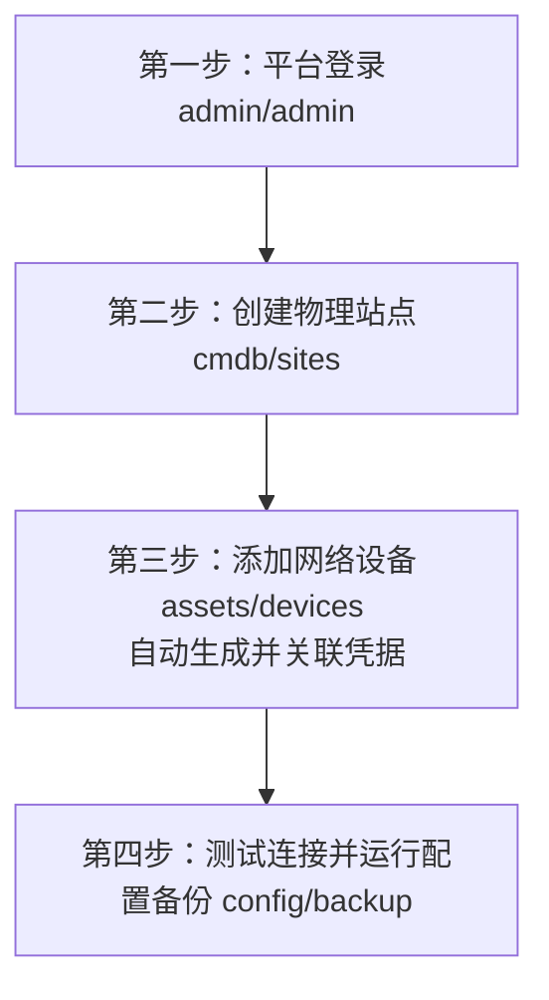

# Nexora NetOps 平台使用手册 (主目录与总览)

欢迎阅读 Nexora 网络自动与智能运维平台产品使用手册。本手册面向网络工程师、系统管理员和 IT 运维人员，旨在指导您快速掌握 Nexora 的全套核心能力。

## 1. 平台概述与设计哲学

Nexora 采用 **“数据先行 (Data-First)”** 的设计理念。传统的运维工具通常将各种功能（如备份、监控、巡检）做成一个个孤立的脚本或系统。而在 Nexora 中，**整个网络的数据只保存一份，所有的功能都围绕着这套核心数据图谱展开。**

* **CMDB 基础数据**与**资产台账**是基石，描述了网络里“有什么”。
* **IPAM 地址管理**提供了资源的逻辑分配边界。
* **配置、监控、告警和自动化**则基于上述数据做上层业务执行与分析。

---

## 2. 11大核心功能模块手册索引

平台主页由 11 个核心业务模块组成。我们将各功能模块详细拆分为专栏子手册，请点击下方链接阅读相应的详细配置与操作说明：

| 模块序号 | 功能模块名称 | 英文名称与路径 | 主要包含的子功能与子菜单 | 详细操作手册链接 |
| :---: | :--- | :--- | :--- | :--- |
| **00** | **主控制台** | Dashboard (`/`) | 系统运行指标概览、任务动态、主机资源、快速入口 | 本文档（见下文快速上手） |
| **01** | **操作工作台** | Operation Workspace (`/access/workspace`) | 终端接入与登录、特权会话校验、PAM会话审计与回放 | [1. 操作工作台手册](file:///e:/data/netsops/docs/walkthrough/walkthrough_操作工作台手册.md) |
| **02** | **实时监控** | Monitoring (`/monitor/overview`) | 设备流量监控、物理拓扑发现与呈现、接口链路图谱 | [2. 实时监控手册](file:///e:/data/netsops/docs/walkthrough/walkthrough_监控与流量采集手册.md) |
| **03** | **告警管理** | Alerts (`/alerts/desk`) | 活动告警控制台、历史告警查询、告警静默维护、告警规则定义 | [3. 告警管理手册](file:///e:/data/netsops/docs/walkthrough/walkthrough_告警管理手册.md) |
| **04** | **资产与配置** | Assets (`/assets/dashboard`) | 设备资产台账、服务器台账、机房机架（物理空间/功耗）看板 | [4. 资产与配置手册](file:///e:/data/netsops/docs/walkthrough/walkthrough_资产与机架管理手册.md) |
| **05** | **IPAM地址管理** | IPAM (`/ipam/prefixes`) | 子网前缀树、IP分配详情、VLAN/VRF与子网联动 | [5. IPAM地址管理手册](file:///e:/data/netsops/docs/walkthrough/walkthrough_IPAM地址管理手册.md) |
| **06** | **CMDB基础数据** | CMDB Core (`/cmdb/credentials`) | 凭据管理、物理站点规划、VRF二层隔离、VLAN与租户划归 | [6. CMDB基础数据手册](file:///e:/data/netsops/docs/walkthrough/walkthrough_凭据与站点手册.md) |
| **07** | **配置管理** | Config (`/config/backup`) | 配置备份、配置检索、版本差异比对、配置合规性审计与漂移 | [7. 配置管理手册](file:///e:/data/netsops/docs/walkthrough/walkthrough_配置变更手册.md) |
| **08** | **自动化** | Automation (`/automation/tasks`) | 作业任务执行、业务场景编排、Playbook剧本管理、定时任务 | [8. 自动化手册](file:///e:/data/netsops/docs/walkthrough/walkthrough_自动化剧本手册.md) |
| **09** | **工单管理** | Tickets (`/change-orders/all`) | 变更单审批流、变更合规表控制、自动化变更实施与审计 | [9. 工单管理手册](file:///e:/data/netsops/docs/walkthrough/walkthrough_变更工单手册.md) |
| **10** | **容量与报表** | Reports (`/capacity/analysis`) | 接口流量趋势分析、系统月/周报表导出、资源利用率预估 | [10. 容量与报表手册](file:///e:/data/netsops/docs/walkthrough/walkthrough_容量与分析报表手册.md) |
| **11** | **平台管理** | Platform (`/management/audit`) | 审计日志、用户多角色RBAC控制、多因子MFA绑定、系统设置 | [11. 平台管理手册](file:///e:/data/netsops/docs/walkthrough/walkthrough_系统管理手册.md) |

---

## 3. 平台快速上手流

为了让系统尽快运转并开始备份或监控设备，请遵循以下推荐的“第一步”工作流：

### 3.1 步骤 1：访问与登录
* **界面预览**：
  
* 打开浏览器，访问控制台。输入默认凭据 `admin` / `admin` 进入系统。

### 3.2 步骤 2：在 CMDB 规划您的第一个站点
* 进入 **CMDB基础数据 -> 站点管理**。
* 创建一个站点（如 `金桥数据中心`），并指定地理位置。这有助于后期的资产地域归类。

### 3.3 步骤 3：在资产台账录入设备
* 进入 **资产与配置 -> 设备台账**。
* 点击“添加设备”，填写设备名称、IP 地址、选择平台类型（如 Huawei VRP、Cisco IOS 等），输入设备的 SSH 用户名、登录密码、Enable 密码等连接参数。
* **后台自动化机制**：当您保存设备时，系统后台会**自动**在凭据中心为您生成对应的加密凭据条目（命名格式为 `cred-{主机名}-{设备ID前缀}`），并自动与该设备关联。您**不需要**手动先去凭据中心创建凭据。

### 3.4 步骤 4：测试连接与运行备份
* 在设备台账页面，点击设备旁的“测试连接”按钮。若连接成功，控制台将显示“已连接 (Online)”。
* 随后即可前往 **配置管理 -> 配置备份** 手动触发“立即备份”，即可看到设备配置被成功爬取。

