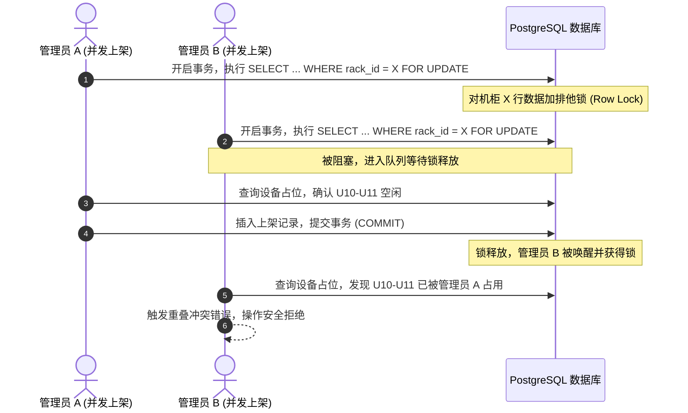

# 4. 资产与配置产品使用手册 (Assets & Inventory)

资产管理模块是整个平台账本的核心，支持网络设备、服务器的精细化建模，以及机房机架的可视化排布管理。

## 1. 核心功能概述

本模块包含以下子菜单：
1. **设备台账 (Device Inventory)**：所有交换机、路由器和安全设备的硬/软件资产管理。
2. **机架管理 (Rack Management)**：可视化机房机柜（U 位布局、额定功率消耗、总配重限制等）看板。
3. **物理服务器 (Server Inventory)**：非网络主机的服务器等基础设施资源台账。

---

## 2. 详细操作步骤

### 2.1 设备资产管理与录入
* **添加设备操作**：
  
  点击 **“添加设备”**，需要录入以下基础和高级属性：
  * **基本属性**：名称、IP 地址、选择平台类型（如 Huawei VRP、Cisco IOS 等）。
  * **站点属性**：指定地理站点，用于物理归类。
  * **凭据与连接选项**：在此录入设备的 SSH 登录用户名、密码和 Enable 密码。在您保存设备资产时，系统后台会自动将敏感连接信息进行加密，并同步在凭据中心生成对应的加密凭据条目，实现资产与凭据的自动化双向绑定，管理员无需手动创建或关联凭据。
* **批量导入/导出**：支持通过 Excel 模板批量导入和导出所有设备资产台账。

### 2.2 可视化机架排布设计 (Rack visualizer)
* **机柜列表与指标**：
  
  进入 **机架管理**，卡片会直观展示每个机柜的“空间占用”与“功耗预估”。
* **绘制立面图**：
  * 卡片右侧展示一个 42U 的机架渲染组件。
  * 每当设备指定了机架 ID 和起始 U 位（例如关联在 `Cabinet-A1` 的第 10 到 11U 空间），机架看板对应位置就会填满色块并显示该设备的 `hostname`。
  * **功耗与载荷计算**：机柜会自动汇总所有上架设备的 `power_watts`（功率）之和。如果总功耗接近机柜设定的最大输入限制（如 6000W），进度条将发出警报，从而指导现场布线，避免配电过载。机架关联 API 实现可参考 [racks.py](file:///e:/data/netsops/backend/api/racks.py)。

---

## 3. 机柜 U 位分配与冲突校验算法说明

Nexora 平台为了保证物理设备排布的合理度与可靠性，设计并落地了一套高精度、抗并发的 U 位扫描与判定方案。以下为该方案的底层机制剖析：

### 3.1 区间重叠判定数学模型 (Conflict Detection)
当用户尝试在机柜的某一面（前侧 `front` 或后侧 `rear`）上架一台高度为 $H$（如 2U）的设备，其起始位置为 $U_{start}$，则该设备占用的物理区间为：
$$[\text{StartU}, \text{EndU}] = [U_{start}, U_{start} + H - 1]$$

系统会遍历当前机柜同一侧已上架的所有设备，对于任意一台已有设备 $i$（占用区间为 $[E_{start, i}, E_{end, i}]$），若两区间满足以下关系，则判定为**空间重叠冲突**：
$$\text{StartU} \le E_{end, i} \quad \text{AND} \quad \text{EndU} \ge E_{start, i}$$

在代码实现中，该检测由后端 [rack_service.py](file:///e:/data/netsops/backend/services/rack_service.py) 的 `_check_u_constraints` 校验函数强制拦截，一旦发生冲突将拒绝写入并向用户抛出 `ValueError` 重叠警告。

### 3.2 首次适应扫描与上架策略及布线架构模式 (Placement Strategy & Cabling Architectures)

在数据中心机房物理规划中，U位的划分和分配策略通常紧密关联于以下三种经典布线与设备摆放架构：

1. **TOR (Top of Rack - 柜顶接入)**：
   * **设计特点**：接入交换机部署在每个机柜的顶部（例如 42U 机柜的 U40-U42）。服务器通过较短的双绞线或 DAC 直连电缆直接接入本柜的 TOR 交换机，机柜间只需走光纤，极大地简化了列头布线。
   * **系统策略对应**：系统提供的 **“顶部优先 (Top First)”** 自动扫描上架算法能够完美迎合 TOR 模式。扫描顺序从 $TotalU - H + 1$ 递减至 $1$。自动将网络交换机优先排布至机柜最上方的空闲 U 位。

2. **MOR (Middle of Rack - 柜中接入)**：
   * **设计特点**：接入交换机或列头配线设备统一安装在单个机柜的正中间（例如 U20-U22）。这种方式兼顾了柜内上方和下方服务器的物理连线长度，减少长线缆的堆积。
   * **系统策略对应**：支持指定特定的预选 U 位进行碰撞校验。系统底层会根据 MOR 规划，首先在中间高度区域进行物理空间交叉排他校验。

3. **EOR (End of Row - 列头接入)**：
   * **设计特点**：接入交换机集中部署在整排机柜最末端的专用列头柜（EOR 柜）中。整排中其他机柜仅部署服务器和配线架，所有设备通过长距离的柜间水平电缆集中布线到列头柜。
   * **系统策略对应**：本地服务器机架采用 **“底部优先 (Bottom First - 默认)”** 算法。循环变量 $u$ 从 $1$ 递增至 $TotalU - H + 1$，自底向上安装重型服务器和配线设备，以保证重心平稳和进风口温度分布的合理性，而所有上架设备将安全地通过网络接口逻辑链路向 EOR 柜汇聚。

**资产优先原则**：
* 如果待安装的资产在录入时已经显式指定了 `planned_start_u`（预选U位）或指定了有效 `rack_unit` 数值，系统将优先检测该位置；若该预留位置无冲突，则直接采用；
* 只有当没有指定位置或原位置冲突时，系统才启动上述扫描算法，根据策略计算并向用户推荐最适合的空闲起始 U 位。

### 3.3 并发竞争事务锁 (SELECT ... FOR UPDATE)
在大型割接或多管理员并行操作期间，可能发生“管理员 A 和 B 看到同一个 U 位空闲并同时提交上架”的竞争情况。

为了解决该 Race Condition，Nexora 在 PostgreSQL 驱动下采用了排他锁方案：

* **控制层**：在 `_check_u_constraints` 函数执行一开始，会先发出 `SELECT 1 FROM racks WHERE id = ? FOR UPDATE` 锁定对应的机架数据行。
* **效果**：强制对同一机架的操作进行**串行化（Serialization）**。这样能确保即使两人同时点击“确认安装”，也必定有一个人先拿锁写入，另一个人获得锁后会读取到更新后的机架立面图，从而由于重叠报错被安全拦截。
