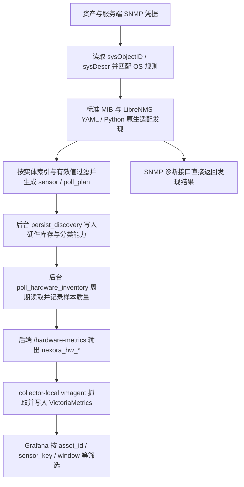

# SNMP 硬件采集逻辑与根因审查

## 文档状态

本 walkthrough 保留 16:00 阶段的只读逻辑审查证据。用户之后已批准完整 LibreNMS 迁移、移除 Python 硬件采集逻辑及推送工作区变更；这些实施结果见 [1648 迁移 walkthrough](walkthrough_20261007_1648_01_LibreNMS原生硬件采集迁移.md)。本文件的“当前/尚未实施”表述是原始审查时点的历史状态，不能覆盖后续实现状态。真实设备的现场根因仍未确认。

## 原始审查状态与结论（历史记录）

用户要求先确认根因、审核后实施。代码实现已停止，本次只读审查以任务前 `main` 源码 `d510c59b8370efe8912fd0c508aea650eb2423e4` 为准，使用 `git show HEAD:<path>` 排除先前本地试改的影响。

代码层面已确认两处 Comware 适配差异：有效内存使用率会因容量缺失被整体丢弃；原生适配遗漏 LibreNMS PHP 中的机框私有温度节点。CPU 首次发现过滤零值、内存只选 module/正使用率则与项目锁定的 LibreNMS 上游一致。尚未获得用户真实设备的 sysObjectID、原始 Walk、持久化库存、抓取状态或时序查询结果，因此现场设备的唯一根因仍待证据确认。

截图中的运行时长和接口正常，只能证明相关 SNMP 分支有数据，不能证明硬件发现、后台采样和硬件时序链路正常。

## 原有调用链

- `snmp_discovery_service.py` 同时合并标准 HOST-RESOURCES-MIB、ENTITY-SENSOR-MIB 与 LibreNMS 规则探测。
- `probe_librenms_hardware` 读取 processors/mempools/sensors YAML 定义；对匹配 `vendor=h3c/comware` 且 `os_key=comware` 的设备执行 Python 原生适配。导入规则不等于执行完整 LibreNMS PHP 引擎。
- `background_monitor_service.py` 负责自动发现落库，再按已发现的 poll_plan 采样。发现阶段没有建立 sensor，后续库存采样不会自行补出该 sensor。
- `snmp_hardware_inventory_service.py` 保存每个实体/测量类型的记录，输出启用且未退休的 sensor；数值指标要求质量 good、数值有限。
- `grafana_metrics.py` 还会把过期的 good 样本转为 stale，不再输出其硬件数值。阈值为采样间隔三倍与配置值的较大者，下限 180 秒。
- `monitoring_compiler.py` 为 collector-local 生成 `platform_hardware_inventory`，抓取后端 `/hardware-metrics`，间隔 60 秒。普通 network_snmp 原始指标与这条库存链路分开。
- Grafana 的 CPU、内存、温度面板查询 `nexora_hw_cpu_usage_percent`、`nexora_hw_memory_usage_percent`、`nexora_hw_temperature_celsius`，并关联 `nexora_hw_sensor_info`。原始 `hh3cEntityExt*` 指标存在不等于该面板有规范化指标。

## 与 LibreNMS 的逐项核对

项目 `backend/vendor/librenms/source-manifest.json` 固定上游提交：`6c26b4fe4a40f7b392c19c36a44257212736e38c`。

| 项目 | 任务前本地逻辑 | 固定版本 LibreNMS | 判断 |
|---|---|---|---|
| CPU | Walk `.25506.2.6.1.1.1.1.6`；首次发现跳过值 0，已发现 sensor 后续允许 0 | `Comware.php` 首次发现同样排除 0 | 与上游一致；真实设备首次返回 0 时可能没有库存，但不能称为迁移错误 |
| 内存实体 | 同一 index 的 entPhysicalClass 必须为 module(9)，使用率必须 >0 | module/正使用率条件相同 | 与上游一致；是否适合现场返回值需核实 |
| 内存容量 | 使用率 `.8` 有效后，仍强制要求容量 `.10` 有同 index 正值，否则丢弃整行，连百分比也不建立 | `fillUsage` 允许容量缺失，`fillMissingRatio` 可保留百分比 | 已确认额外过滤条件，能导致本应可显示的使用率缺失 |
| 机框温度 | Comware 原生 CPU/内存适配不读取 `.12`/`.13`；YAML 没有该温度定义；标准 ENTITY-SENSOR/光模块路径另行存在 | PHP 温度发现读取 `.12`，关联 module/sensor 实体，跳过 65535；`.13` 为可选阈值 | 已确认缺少机框私有温度适配；只提供该表的设备可能无机框温度 |
| 64 位容量 `.32` | 没有在该原生适配使用 | 此固定版本 Comware.php 同样读取旧 `.10` | 可作为后续兼容方案，不归类为相对上游的遗漏 |

本地关键位置（均为任务前 HEAD 行号，工作树因试改已发生偏移）：

- `backend/services/snmp_hardware_probe_service.py:2622`：Comware CPU/内存原生适配。
- 同文件 `2668`：CPU 零值首次发现过滤；`2738`：module 过滤；`2747`：强制正容量；`4394`：Comware 适配调用。
- `backend/vendor/librenms/resources/definitions/os_discovery/comware.yaml`：导入的 YAML 中有状态和功率，未包含上述机框温度 PHP 逻辑。
- `backend/services/snmp_hardware_inventory_service.py:1161`：数值输出要求 good。
- `backend/api/grafana_metrics.py:680`、`716`：过期阈值与 stale 判定。
- `backend/services/monitoring_compiler.py:1234`：本地采集器硬件抓取任务。

上游证据：

- [Comware CPU / 内存发现](https://raw.githubusercontent.com/librenms/librenms/6c26b4fe4a40f7b392c19c36a44257212736e38c/LibreNMS/OS/Comware.php)
- [仅有百分比时的比例补齐逻辑](https://raw.githubusercontent.com/librenms/librenms/6c26b4fe4a40f7b392c19c36a44257212736e38c/LibreNMS/Util/Number.php)
- [Comware 机框与光模块温度发现](https://raw.githubusercontent.com/librenms/librenms/6c26b4fe4a40f7b392c19c36a44257212736e38c/includes/discovery/sensors/temperature/comware.inc.php)

注意：上游用 100 作为百分比计算基数，不意味着设备真实内存为 100 字节；后续方案不能伪造实际字节容量。

## 为什么 HCL 成功不能验证真实设备

这部分是根据代码的条件推导，尚无现场返回值作证。

- 如果 HCL 返回非零 CPU、module 实体、正内存使用率和正 `.10` 容量，原逻辑会创建对应 sensor。
- 如果真实设备有有效 `.8` 使用率，但 `.10` 不支持、没有同 index 行或返回 0，本地会把百分比一起过滤；这是已确认的代码条件。
- 如果真实设备只在私有 `.12` 表提供机框温度，不在标准 ENTITY-SENSOR-MIB 返回该值，现有路径不能创建该机框温度 sensor。
- 如果 OS 规则未匹配到 comware，原生 H3C 分支不执行；需要 sysObjectID 和实际命中规则确定。
- 如果库存已存在但后台采样失败或停止，数值变 missing/invalid/stale，面板同样为空。
- 如果库存/导出正常，但硬件抓取任务缺失、失败，或 Grafana 标签筛选不匹配，面板也会空；不能从当前截图排除这些情况。

## 现场根因的只读确认顺序

| 检查点 | 必需证据 | 如何定位 |
|---|---|---|
| 身份与规则 | sysObjectID、sysDescr、命中 OS/rule | 确认是否进入正确的厂商原生适配 |
| 设备原始硬件表 | CPU `.6`、内存 `.8/.10`、温度 `.12`、entPhysicalClass 与 entPhysicalName；保留所有返回 index | 原始值有效但发现为空，定位规则/关联/过滤；未返回值则继续区分不支持、SNMP view 限制和超时 |
| 后台库存与样本 | 该 device_id 的分类能力、active/enabled sensor、last_quality、last_success | 发现正常但库存空，定位后台发现/持久化；库存有但质量差或时间旧，定位采样 |
| 指标导出 | `/hardware-metrics` 中该设备的 nexora_hw_* 与 quality | 库存有效但不输出，核对禁用/退休/过期与规范化 |
| 时序库 | 硬件抓取任务状态、该 asset_id 的规范化序列 | 导出有效但时序库没有，定位抓取或写入 |
| 看板 | 同一 asset_id / sensor_key / CPU window 与硬件筛选变量 | 时序库有而看板空，定位查询与变量 |

不需要修改设备配置或公开 SNMP community。缺少这些数据时，只能确认代码缺陷与触发条件，不能确认此现场设备的唯一原因。

## 诊断页现状与待审核方案

原有 `/api/platform-registry/snmp-hardware-discovery-test` 已返回 identity、规则、分类状态、发现到的 value/raw_value、OID/index；前端已有硬件探测结果表。它直接运行发现函数，不调用后台库存持久化，也不读取后台最新样本。因此“发现到 sensor”不能代表后台周期采样成功或 Grafana 已入库。

待用户审核的方向：对照显示设备实时硬件读数与后台最近样本，明确列出命中规则、OID 返回行数、index、质量和最后成功时间；将发现、周期采样、指标抓取与看板数据的结果分开。尚未执行用户审核后的正式实现。

## 先前试改与验证记录

用户要求先审核前，已存在本地试改；没有提交、推送、部署，也没有访问或配置真实设备。收到停止代码修改要求后，仅核对任务前源码并更新这两份文档，没有继续修改业务代码或执行前端构建。

先前试改涉及：

- `backend/services/snmp_hardware_probe_service.py`
- `backend/services/snmp_hardware_diagnostic_service.py`（新文件）
- `backend/services/snmp_discovery_service.py`
- `backend/services/background_monitor_service.py`
- `backend/api/devices.py`
- `backend/tests/snmp/test_snmp_hardware_probe_service.py`
- `backend/tests/snmp/test_snmp_hardware_diagnostics.py`（新文件）
- `backend/tests/snmp/test_snmp_walk_api.py`
- `backend/tests/monitoring/test_background_monitor_hardware_discovery.py`
- `src/components/SnmpMib/components/LiveWalkInspector.tsx`
- 新前端文件：`HardwareDiagnosticSummary.tsx`、`hardwareDiagnosticTypes.ts`、`hardwareDiagnosticUtils.ts`、`HardwareDiagnosticSummary.test.tsx`

先前完成的检查：专用临时 PostgreSQL 数据库上运行所选 13 个 SNMP/后台测试文件，97 passed（158.40s），日志 `artifacts/snmp_hardware_diagnostics_20261007.log`；临时数据库已删除。相关 Python 文件编译通过，`scripts/validate_postgresql_only.py` 0 violation。这些结果仅说明试改的后端测试状态，不证明用户现场根因，也不代表功能已完成交付。

未完成：前端专属测试尚未收到成功结果；统一 TypeScript 检查和生产构建尚未执行；真实设备、用户部署后台、vmagent/VictoriaMetrics 与真实 Grafana 页面均未验证。

保留了用户原有 `.agents/skills/netops-grafana-dashboards/SKILL.md`、容量测试文档/脚本、`handoff.md` 及已有未跟踪文件，不将它们纳入本任务修改。

## 剩余风险与下一步

主 Agent 负责整理现有逻辑和审查结论；子 Agent 实现均已停止。当前没有阻塞只读代码分析的问题，尚缺现场证据来闭合根因。

下一步为用户审核本报告与触发条件。审核前不继续实现、提交或部署。若后续继续实施，先根据实际 OID 证据确定最小修改范围，重新检查现有试改，再完成对应前端门禁和现场只读验收。回滚先前试改仅限上述本任务差异，不覆盖用户已有修改，不使用 reset --hard / clean。
