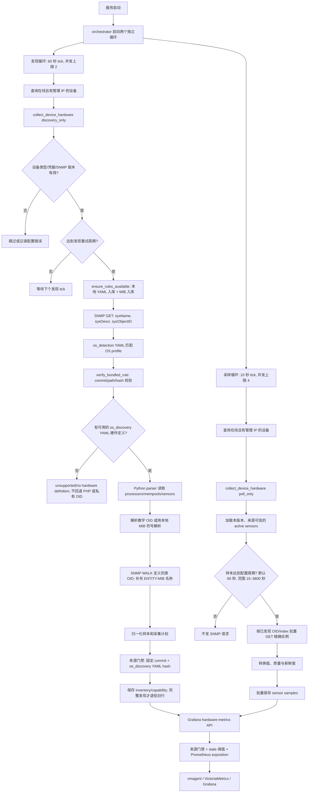
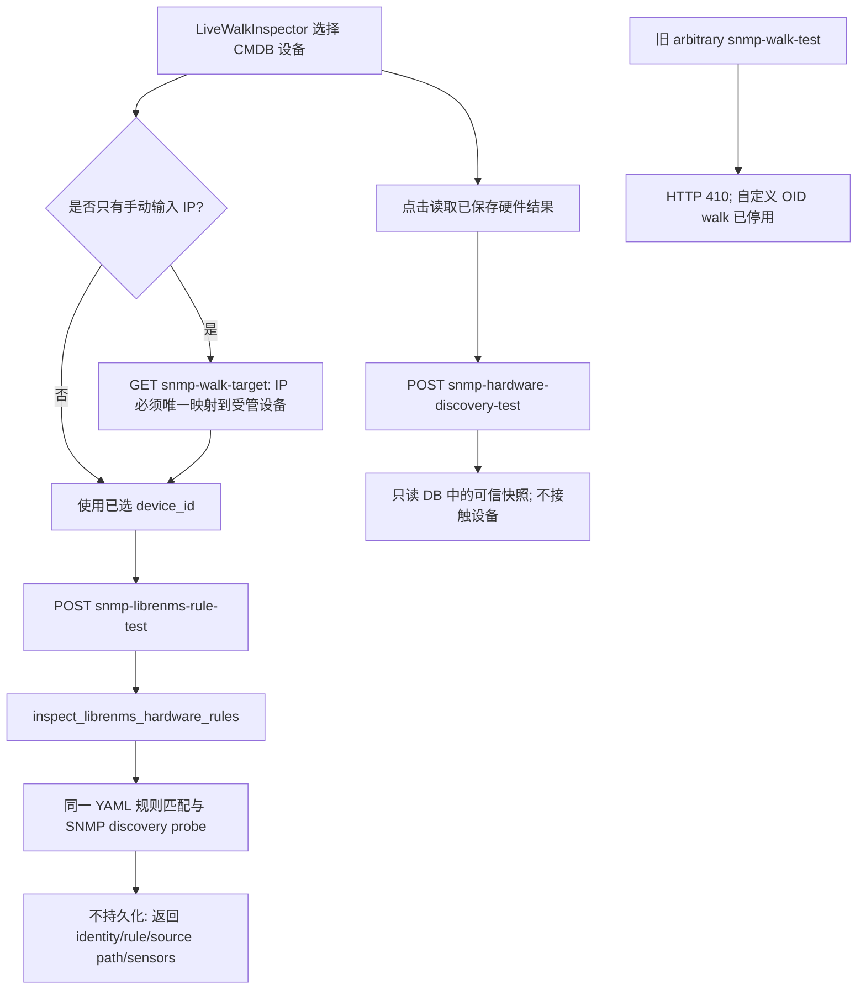

# 多厂商规则与采集周期审计

## 完成摘要

- 已确认硬件采集不是 LibreNMS PHP 运行时。运行时读取固定版本的 LibreNMS OS detection/discovery YAML，由 Nexora Python 服务解释规则并执行 SNMP；本地没有运行 LibreNMS daemon，也不需要在 Compose 中增加 LibreNMS 服务。
- 已从本地规则包移除 27 个未被采集链调用的 PHP adapter/model/helper 副本（包含 `app/Models/Mempool.php` 和 `includes/discovery/sensors/current/comware.inc.php`），并从来源清单移除相应 PHP 条目。删除不改变采集行为，也不会补齐缺失的 YAML 规则。
- 固定上游版本为 `6c26b4fe4a40f7b392c19c36a44257212736e38c`。当前有 136 个 OS detection YAML 和 122 个 OS discovery YAML；14 个 profile 没有 discovery YAML：`acsw`、`allied`、`ciscome1200`、`ciscospa`、`cyan`、`dell-sonic`、`dlinkap`、`edgecos`、`equallogic`、`juniperex2500os`、`pixos`、`ruckuswireless-sz`、`sanos`、`smartax-mdu`。
- 这 136 个 profile 是项目当前 vendor 清单的范围，不是 LibreNMS 上游的全部 OS profile：清单有 26 个 asset vendor，其中 25 个在固定上游版本中有 OS profile；DPtech 是唯一没有匹配 upstream OS profile 的 asset vendor。MIB 子目录是文件组织/映射结构，不与 asset vendor 名称严格一一对应。
- Nexora parser 对范围内 136 个 profile 均生成了 identity 规则；其硬件定义兼容性结果为 90 个 `supported`、46 个 `partial`，91 个 profile 解析到至少一项 processors/mempools/sensors 定义。45 个 `partial` profile 没有解析出这三类定义，另一个是 AIROS：其两个温度定义依赖设备 version 的 skip 条件，缺少 version 时会 fail closed。NX-OS YAML 有一条保守的内存格式修复诊断，但也没有上述传感器定义。这个结果是执行器自身的兼容性分类，不代表与 LibreNMS PHP 执行结果已逐厂商做过差分验证。
- 当前上游 `sensors/current` 目录在固定 commit 下有 32 个 PHP 文件。与现有 profile 同名的有 `ciscosb`、`comware`、`dell-powervault`、`edgecos`、`exos`、`nokia-1830`、`procurve`。旧 bundle 只拷贝了 Comware 一个；这些 PHP 模块都不被运行时调用，因此没有把其余 PHP 模块补拷进来，而是移除了该不完整的 PHP 快照。对应 YAML 文件是否存在也不代表其中有硬件定义：例如 `dell-powervault` 有 discovery YAML，但当前 parser 解析到 0 项硬件定义；`edgecos` 没有 discovery YAML。
- 已核对 2,357 个 MIB manifest mappings（2,356 个唯一上游文件，含共享 scope 映射），覆盖当前映射的 35 个 LibreNMS vendor 子目录及 16 个根依赖。H3C Comware 子树 271 个文件，Huawei 子树 240 个文件并供 Huawei/Yunshan 共用。MIB 原始大小约 156.5 MiB；内存 ZIP 评估约 20.32 MiB（约 87% 压缩），本次没有生成 ZIP 或修改运行时加载方式。

## 测试夹具来源路径复核

- 复查发现 `HardwareDiagnosticSummary.test.tsx` 仍用 `LibreNMS/OS/Comware.php` 模拟本地采集结果，且 `source_type` 写成旧的 `librenms_adapter`。这只是前端测试夹具，不会执行 PHP，但会把旧来源展示成当前来源，和 YAML-only 运行链不一致。
- 已将夹具改为 `source_type=librenms_rule`、`resources/definitions/os_discovery/comware.yaml`，并增加断言确保诊断结果不展示 `.php` 来源；轮询器失败路径测试里的规则来源也改为同一 YAML 路径。
- `test_librenms_source_policy.py` 中仍有一个 PHP 路径字符串，专门作为不可信来源输入，验证运行时来源策略会拒绝 PHP；它不是规则文件或执行入口。
- 针对此次修正重新验证：`npm run test:frontend -- src/components/SnmpMib/components/HardwareDiagnosticSummary.test.tsx --run` 为 10 passed；`uv run --no-project pytest tests/monitoring/test_snmp_hardware_poller_service.py -q` 为 8 passed。

## 当前采集调用流程

### 周期发现、采样与 Grafana 导出

循环 tick 不是设备的实际采样周期。默认实际采样间隔由 `SNMP_HARDWARE_SAMPLE_INTERVAL_SECONDS` 控制，缺省 60 秒，限制在 15 到 3600 秒。发现成功后默认 24 小时重发现；partial 结果 1 小时重试；失败/不支持状态 15 分钟重试。Grafana 查询步长与设备 SNMP 采样周期是两件事。

### SNMP 诊断页

诊断页实时规则探测与后台发现调用相同的 YAML discovery executor；“读取已保存结果”只读取数据库样本。`/platform-registry/snmp-walk-test` 返回 410，不接受任意 OID 或任意目标凭据。

## 规则来源与 Python parser 边界

调用顺序如下：

1. `backend/engine/orchestrator.py` 启动分离的发现、采样循环。
2. `backend/services/snmp_hardware_poller_service.py` 校验资产、凭据和 SNMP 版本，并按重试/采样周期决定是否调用发现或采样。
3. `backend/services/librenms_rule_service.py` 的 `ensure_rules_available()` 从本地 bundle 导入 YAML 规则和 MIB；`parse_rules()` 读同名的 detection/discovery YAML；`resolve_rule()` 根据设备 identity 选择匹配项。这个步骤不下载 GitHub 内容。
4. `backend/services/librenms_source_policy.py` 校验固定 commit、manifest 路径和 SHA-256。当前可信硬件样本必须指向 `resources/definitions/os_discovery/*.yaml`。
5. `backend/services/snmp_hardware_probe_service.py` 的 `probe_librenms_hardware()` 解释结构化定义、调用 SNMP、产生 normalized sensors；`poll_hardware_inventory()` 按已保存的 OID/index 发精确实例 GET。
6. `backend/services/snmp_hardware_inventory_service.py` 保存发现结果与样本。`backend/api/grafana_metrics.py` 只导出通过可信来源门禁的硬件数据。

Python parser 的工作不只是加载文件：它把 YAML 条件和传感器定义转换成 Nexora 的内部 rule contract、SNMP 请求和样本计划。但它没有运行 LibreNMS PHP 框架，因此“完全等价于 LibreNMS 全部运行逻辑”尚未证明。遇到未支持的 YAML 语义会降低兼容性或标为 unsupported；YAML 文件存在也可能没有可采集的硬件定义。

## 修改文件与验证

- 更新 `backend/vendor/librenms/README.md` 和 `source-manifest.json`，明确 YAML-only runtime 和缺失 profile 数量。
- 删除来源清单中 27 个未执行 PHP source/helper 副本；运行时来源验证索引现在只认 manifest 中的规则 YAML。
- 更新 `backend/tests/snmp/test_librenms_source_policy.py` 与 `backend/tests/monitoring/test_grafana_metrics_export.py`，使当前来源样例对应 YAML，而不是 PHP adapter。
- `uv run --no-project pytest tests/snmp/test_librenms_source_policy.py tests/snmp/test_librenms_mib_source_sync.py tests/snmp/test_snmp_hardware_probe_service.py tests/monitoring/test_grafana_metrics_export.py -q`：26 passed。
- `npm run test:frontend -- src/components/SnmpMib/components/HardwareDiagnosticSummary.test.tsx --run`：10 passed。该组件测试中的 source path matcher 改为正则，以匹配规则路径与 commit/version 拼接显示的 DOM 文本。
- 对 `source-manifest.json` 完成 JSON 解析和规则文件完整性检查：258/258 YAML SHA-256 精确匹配，136 detection、122 discovery、2,357 MIB mappings，未发现 PHP 文件或 PHP manifest source keys。
- 用户确认 `192.168.204.128` 尚未更新当前工作区代码。本轮未部署、未重启 Docker，也未重新读取生产时序数据；该主机的旧页面/旧样本不能验证本轮改动，以上结论仅描述当前工作区。

## 未验证项与风险

- 没有对 122 份 discovery YAML 的每个指标、单位、skip 条件、MIB 符号和 SNMP 结果逐厂商与 LibreNMS 官方运行实例做 differential comparison，因此不能确认所有转换结果完全一致。
- 136 个 profile 中，45 个当前没有被 Nexora 解析出 `processors/mempools/sensors` 条目：14 个缺少 `os_discovery` YAML，另 31 个虽有该 YAML，但其中没有解析到这三类 `data` 定义。该统计只针对 YAML-backed 硬件传感器路径，不表示 LibreNMS 整体运行时对这些设备完全没有采集逻辑，也不表示其他 SNMP 或接口监控不可用。缺口应明确标为 unsupported，不用自定义厂商 OID 静默补齐。
- 本次 ZIP 仅做体积评估，未生成压缩归档；运行时和 Docker 仍读取逐个 MIB 文件。
- 部署版本、生产样本间隔和 Grafana 曲线需要在部署了此工作区改动后另行核验。
