# NetOps RBAC 权限管控审核及整改意见书

> 审核结论：当前系统具有 RBAC 的核心构件和多项有效安全控制，但角色、资源范围、审批与后台执行的约束尚未形成一致闭环。不能据此认定满足完整的 RBAC 标准功能要求，也不建议以当前授权实现承载生产配置变更和使用管理凭据的自动化作业。
>
> 推荐方向：用户管理界面保留“管理员 / 普通用户”两种账号类型；后台通过少量、按资源分配的业务能力、团队范围和执行授权控制变更。界面简化与权限收敛可以同时实现。

## 1. 审核说明

| 项目 | 本次审核基线 |
| --- | --- |
| 审核日期 | 2026-10-11，Asia/Shanghai |
| 项目 | NetOps / Nexora |
| Git HEAD | `e529df23a35e8ced015caca8223979654f79b38b` |
| 实际代码状态 | 当前工作区，包括既有未提交变更；不能将上述 HEAD 当作全部被审代码的唯一快照 |
| 主要范围 | 用户与会话、粗角色和资源 profile、资源范围、变更工单、配置审批、Playbook、即时命令、脚本及定时作业、凭据选择、审计和撤权 |
| 交付性质 | 源码审核、隔离验证及详细整改建议；本次没有实施业务整改 |
| 运行限制 | 不调用真实设备、不使用真实凭据或 OTP、不发送审批通知；持久化测试使用本次新建的临时 PostgreSQL 数据库 |
| 未作出的判断 | 未核实当前 Windows 服务的有效 `ENVIRONMENT`、实际账号授权、真实设备账号权限、容器中旧版本代码和互联网暴露状态；不据此断言已经发生越权或数据泄露 |

本报告的“已证实”主要指当前代码的检查条件、调用关系和模拟分支行为，不等于已在生产设备上完成攻击验证。严重性按整改优先级给出，没有计算 CVSS，也不是认证机构的合规证书。

证据分为三类：**S：静态源码证据；T：本次运行的既有测试；R：合成身份、模拟数据库或模拟驱动下的行为复核**。R 类检查会明确注明其限制。已有测试通过，只证明其覆盖的控制仍然有效，不能覆盖本报告中尚未加入业务测试的所有缺陷。

## 2. 规范依据和判断边界

### 2.1 RBAC 的规范对象

RBAC 的正确缩写是 **Role-Based Access Control，基于角色的访问控制**。核心关系可以表示为：用户分配角色，角色获得权限，权限规定对对象执行哪些操作，会话使用已获授权的角色。NIST 的公开材料将 Core RBAC 与角色层级、静态职责分离和动态职责分离区分为不同组件；不能把所有可选组件都写成基础 RBAC 的强制要求。[NIST RBAC FAQ](https://csrc.nist.gov/Projects/role-based-access-control/faqs)

本次确认的标准目录为 **INCITS 359-2012 (R2022)**，目录包含 RBAC 参考模型和系统/管理功能规范。其完整标准正文未开放获取，因此本报告依据公开模型进行工程审核，没有声称完成付费标准的逐条认证评估。[ANSI 官方标准目录](https://webstore.ansi.org/standards/incits/incits3592012r2022)

| 判断项 | 应当怎样理解 | 不应据此直接判违规的实现 |
| --- | --- | --- |
| 用户—角色分配 UA | 能确定当前主体拥有哪些授权角色 | 用户仅有一个角色、角色存储为字段，不自动违反 Core RBAC |
| 角色—权限分配 PA | 能确定角色对资源的允许操作 | 权限映射写在代码里，不自动违反 Core RBAC |
| 会话与授权 | 会话只能使用主体被授权的角色，操作必须经过权限判断 | 不一定必须提供“登录后选择多个角色”的复杂 UI |
| 角色层级 | 如果声明支持层级，继承语义须明确且一致 | 简单三档角色可以实现有限层级；不代表已实现完整管理规范 |
| SSD | 对角色分配施加互斥约束，例如不能同时分配冲突角色 | 不是所有 Core RBAC 系统都必须实现完整 SSD |
| DSD | 对会话中激活的角色组合施加约束 | 某张工单禁止自批属于上下文职责分离，不能直接宣称已实现完整 DSD |
| 资源范围和租户 | 在权限判断中加入对象与业务边界 | 租户隔离、站点和设备组范围不是 Core RBAC 一项通用强制字段 |
| MFA、工单、变更窗口 | 保护高风险业务操作的额外条件 | 不应将“所有 RBAC 操作都必须 MFA”写成标准要求 |

本项目已经采用租户、scope、审批快照和实施 MFA 作为保护机制，因此本次同时审核它们是否在所有相关执行入口生效。对企业运维，可用 NIST SP 800-53 的 AC-2、AC-3、AC-5、AC-6 等控制作为账号管理、访问执行、职责分离和最小权限的设计参照，具体适用项仍需按组织风险确定。[NIST SP 800-53 Rev.5](https://csrc.nist.gov/pubs/sp/800/53/r5/upd1/final)

### 2.2 工程授权基线

后端应默认拒绝，逐次检查请求，验证对象访问权限，并明确撤权后的行为。前端隐藏按钮只改善体验，不能承担授权职责。这些是本报告采用的工程基线，不是假称 INCITS 标准的逐条原文。[OWASP Authorization Cheat Sheet](https://cheatsheetseries.owasp.org/cheatsheets/Authorization_Cheat_Sheet.html)

## 3. 总体评估

### 3.1 是否符合 RBAC

**模型构件层面：存在可以识别的 Core RBAC 基础。工程执行层面：存在足以改变实际权限边界的缺口。目前不能给出“已符合完整 RBAC 规范且变更授权合格”的结论。**

| 审核维度 | 当前结果 | 主要理由 |
| --- | --- | --- |
| 身份和会话认证 | 有有效基础控制 | HTTP 会话读取数据库中最新用户角色/profile/status，数据库异常拒绝；已有会话撤销保护 |
| 用户—角色、角色—权限 | 具备核心关系，但权威语义不统一 | `role`、`role_profile`、`role_id` 的含义和实际使用不一致 |
| 角色层级 | 有有限实现 | `require_role` 使用三档粗角色层级；资源权限使用另一套 profile 逻辑 |
| API 默认认证 | 有全局保护 | 主 FastAPI 应用挂载全局 HTTP `/api` 鉴权，未显式声明的接口采用方法级默认策略 |
| 操作权限一致性 | 不满足当前产品“资源角色收敛权限”的预期 | 资源接口看 profile；工单、脚本、计划作业等仍大量只看粗角色 |
| 对象范围 | 部分模块有效，部分执行入口缺失 | Playbook 有设备范围校验；即时自动化、定时任务和 parsed-command 未统一使用 |
| 职责分离 | 有局部保护，缺少跨入口一致性 | 正式工单和版本审批禁止自批；配置验证码审批允许选择本人 |
| 审批内容绑定 | 不完整 | 有工单批准快照，但执行路径未完整比较；验证码未绑定实际作业或命令摘要 |
| 高权限凭据使用 | 不一致 | 即时执行有粗管理员限制；定时作业和 parsed-command 存在不同规则 |
| 撤权和后台执行 | HTTP 有及时更新路径，后台与长连接不足 | 后台作业没有可验证的服务主体授权；暂停恢复传入审批人身份；WebSocket 只检查握手 |
| 可追溯审计 | 有框架，关键字段与脱敏不足 | 有固定 `admin`/`scheduler` 作者、缺审批关联，更新 payload 可保留 OTP |
| 完整 SSD/DSD | 未证实、未声明合格 | 局部工单规则不等于完整标准组件 |

### 3.2 必须保留的现有控制

1. **全局 API 认证。** [main.py:494](../../backend/main.py:494) 挂载 `enforce_api_access`；[api_security.py:41](../../backend/core/api_security.py:41) 使用精确公开路径例外、识别显式 RBAC 依赖并提供方法级回退。不能因某个 route 没有局部鉴权参数，就判定匿名用户能调用。
2. **即时执行的管理员凭据限制。** [automation.py:240](../../backend/api/automation.py:240) 检查请求的凭据角色；[automation.py:357](../../backend/api/automation.py:357) 解析凭据时传入 `allow_admin`。
3. **正式工单 maker/checker、状态锁和批准快照。** [transition.py:34](../../backend/api/change_orders/transition.py:34) 通过 PostgreSQL 行锁串行化状态变化；第 68 行禁止申请人自批；第 152、164 行记录和比较批准快照，实施路径在 PostgreSQL 下要求 MFA。
4. **Playbook 受控步骤和不可变版本。** [routes.py:104](../../backend/api/playbooks/routes.py:104) 校验受控步骤，原始命令被拒绝；[playbook_version_service.py](../../backend/services/playbook_version_service.py) 管理不可变版本和独立审批。
5. **Playbook 设备范围和注册动作检查。** [routes.py:266](../../backend/api/playbooks/routes.py:266) 对设备校验租户/站点/设备组以及 `playbook.execute`、`command.execute`；[platform_registry_service.py:1940](../../backend/services/platform_registry_service.py:1940) 还会检查动作、设备范围、敏感动作和安全查询命令。
6. **定时 raw 作业对已绑定平台设备的拒绝。** [scheduler_service.py:589](../../backend/services/scheduler_service.py:589) 拒绝带 `platform_profile_id` 的设备走这条原始命令/脚本执行路径。NSOT 分支也会清除任意命令、脚本、配置模式和管理凭据选项。
7. **已有验证码基本安全措施。** 配置审批使用安全随机 token、五分钟有效期、三次尝试上限和消费后删除；MFA 分支会重新检查审批人的账号/MFA 状态。不能把“未绑定内容”误写成“现有 token 可无限顺序重复消费”。

### 3.3 整改优先级总览

优先级是本报告建议的实施顺序：**P0 为生产配置变更开放前的阻断项；P1 为权限体系统一和可运营性整改；P2 为管理体验和维护一致性整改。** 条件式风险要结合实际部署启用情况判断，不代表本次确认已被利用。

| 编号 | 问题 | 建议优先级 | 证据 |
| --- | --- | --- | --- |
| F01 | Shell 被无条件判为查询，前缀分类不能保证只读 | P0 | S、R07、R08 |
| F02 | 定时作业及 parsed-command 的高权限凭据选择缺少统一授权 | P0 | S、R08、R12、R14 |
| F03 | 已批准工单未完整绑定实际执行，实施 MFA/快照路径可被旁路 | P0 | S、R02 |
| F04 | 配置审批允许申请人选择本人，审批资格只看粗角色 | P0 | S、R03 |
| F05 | 审批凭证不绑定操作摘要，进程内状态不能支持一致消费和持久追溯 | P0 | S、R04 |
| F06 | 作业、即时命令及设备查询缺少统一对象范围控制 | P1；多租户写操作提升为 P0 | S、R07、R12 |
| F07 | 非法 composite 过滤器会扩大到全量活动设备 | P0 | S、R12 |
| F08 | 批准后执行当前可变脚本，缺发布状态和不可变版本约束 | P0 | S、R12 |
| F09 | 发布版本/自定义 Playbook 的工单门禁与场景路径不一致 | P1 | S、R05 |
| F10 | Playbook 批准恢复将审批人替换为执行主体 | P1 | S、R06 |
| F11 | 粗角色、profile 和管理员判断语义不一致 | P1 | S、R01 |
| F12 | tenantless 或缺主体 ID 的授权回退过宽 | P1；多租户启用前为 P0 | S、R09 |
| F13 | 全局管理员与租户管理员没有明确区分 | P1；存在租户管理员时为 P0 | S、R10 |
| F14 | scope 配置可静默失效，无法清晰表达“受限但零授权” | P1 | S、R11 |
| F15 | 后台运行、暂停恢复和长连接撤权语义不足 | P1 | S、R12 |
| F16 | 工单团队、实施者、租户与豁免语义未统一 | P1 | S |
| F17 | 审计主体、执行授权关联和 OTP 脱敏不足 | P1 | S、R13 |
| F18 | 请求控制的审批跳过依赖部署环境字符串 | P1；错误部署于生产时为 P0 | S，当前配置未核实 |
| F19 | 停用账号仍可获得登录成功响应和无效 token | P2 | S |
| F20 | 两档账号 UI、有效权限展示和权威角色字段未完成收敛 | P2 | S |

## 4. 详细发现与整改要求

### F01：任意 Shell 被当作查询，查询前缀不是安全边界

**事实与位置。** [automation.py:283](../../backend/api/automation.py:283) 通过脚本类型或 shebang 判断 Shell；第 298–305 行无条件设置 `is_config=False`、`is_query_only=True`，跳过后续工单/配置审批分支，连请求的 `isConfig=True` 也不改变这条分支。非 Shell 在第 316–334 行按前缀判断只读。[devices.py:3261](../../backend/api/devices.py:3261) 的 parsed-command 使用类似规则。`ip ` 等前缀包含可改变状态的子命令，Shell 组合表达式也不能由开头的 `pwd`、`cat` 判断其效果。

**调用链。** [automation_service.py:16](../../backend/services/automation_service.py:16) 将查询模式转换为引擎 `command`；[orchestrator.py:27](../../backend/engine/orchestrator.py:27) 选择驱动并执行；Linux 路径 [linux_driver.py:50](../../backend/engine/drivers/linux_driver.py:50) 最终调用 SSH `exec_command`。驱动的“command 模式”本身不能把 Shell 限制为只读。

**触发与影响。** 已认证且达到 Operator 的用户，在可走原始执行的目标服务器上提交 Shell；实际影响取决于设备连接账号的权限。即便不能选择管理员凭据，普通设备账号也可能具有较多写权限。R07 以模拟驱动确认没有消费审批凭证且 `is_config=False`；R08 以无副作用的组合字符串确认前缀检查接受了 Shell 语法。没有执行真实命令。

**范围限制。** 这与受控 Playbook 的 `action_code` 路径不同，后者有原始命令禁用和安全查询校验。scheduler 的已绑定平台 guard 也确实存在；即时自动化虽查询了 `platform_profile_id`，本次追踪的 AutomationService/执行编排路径未见同等 guard。不能将 scheduler 的保护当作所有执行接口共有的保护。

**整改。** 任意 Shell/客户端命令默认视为需要受控执行授权；读任务仅执行经过审核、发布并绑定参数 schema 的采集动作。对于服务器查询，避免拼接整段 Shell；采用固定程序和经验证参数，或受控采集器。仅增加分号黑名单不足以证明只读。执行 API 的 `is_config` 应由服务端动作元数据确定，客户端字段只能表达请求，不能降低风险等级。

**验收。** shebang、脚本类型 Shell、客户端声明 `isConfig=False` 均不能免除服务端判定的变更授权；复合表达式和写入型子命令不能进入只读采集通道。测试使用模拟 SSH；已有安全注册查询仍能正常运行。

### F02：高权限凭据选择在不同入口采用不同规则

**事实与位置。** [scheduled_jobs.py:370](../../backend/api/scheduled_jobs.py:370) 接受 `use_admin_creds`，创建/更新仅要求粗 Operator，没有即时执行接口上的管理员选择校验。runner 在通过已绑定平台 guard 后，由 [scheduler_service.py:601](../../backend/services/scheduler_service.py:601) 直接选择管理凭据。

另一入口 [devices.py:3284](../../backend/api/devices.py:3284) 将客户端 `auth_role` 传入 collector，函数没有认证用户参数供凭据授权使用。[operational_data_service.py:1507](../../backend/services/operational_data_service.py:1507) 在 `admin` 时选择管理凭据，`auto` 也可在普通凭据缺失时回退管理凭据。全局 API 门禁会限制认证和粗角色，但不能替代这里的设备/凭据使用授权。

**触发与影响。** 定时作业针对未绑定平台、允许原始执行的设备/服务器，且管理凭据已配置；或者 Operator 调用 parsed-command 并指定管理凭据角色。风险是“代表用户使用更高权限连接”，不要求把明文密码返回给用户。R12、R14 使用合成凭据确认选择路径，没有解密或使用实际凭据。

**整改。** 单独定义 `credential.use` 和 `credential.use_privileged`，与 `credential.view_secret`、凭据编辑严格分开。授权绑定设备、动作、模板版本、执行原因和期限；所有入口和 worker 通过同一凭据 broker 领取一次执行所需的连接信息。普通账号不得通过修改作业标志、`auth_role=admin` 或 `auto` 回退扩大权限。受授权的只读服务可以使用专用高权限设备账号，但只能执行批准动作，用户不能任意替换命令。

**验收。** 相同主体/设备/动作在即时、定时、parsed-command 和 Playbook 中得到同一凭据授权结果；不具备提权使用权的主体指定 admin 返回 403，普通凭据缺失时不能静默提权。审批清单改变凭据角色后必须重新审批。

### F03：工单批准状态被当作执行许可，批准快照和实施 MFA 未形成执行闭环

**事实与位置。** 正式工单在 [helpers.py:87](../../backend/api/change_orders/helpers.py:87) 计算批准摘要，在 [transition.py:164](../../backend/api/change_orders/transition.py:164) 比较摘要并要求 PostgreSQL 实施 MFA。即时执行却在 [automation.py:339](../../backend/api/automation.py:339) 只查询工单 `status`，`approved` 或 `implementing` 即视为有效。

Playbook 工单查询 [routes.py:1117](../../backend/api/playbooks/routes.py:1117) 没有读取批准设备集合、批准命令摘要、申请人、租户和执行授权。第 1079 行的检查只验证状态、可解析的窗口和可选的 scenario/platform。非法非空日期解析成 `None`，随后跳过窗口检查，R02 已复核。空模板也不会提供精确执行绑定。自动匹配最近工单不足以证明用户获得那张工单的执行许可。

**触发与影响。** 具备执行入口粗角色/动作权限的用户提供一个已批准但不对应当前设备或命令的工单号，或者直接使用 `approved` 状态跳过进入实施时的 MFA 与快照比较。即时原始配置路径存在实质写入风险。对于受控 Playbook，当前正常注册动作受安全查询限制，不能因此认定已能下发任意配置。

**附加事实。** [transition.py:196](../../backend/api/change_orders/transition.py:196) 将 `execution_token_id` 与 `execution_token_consumed_at` 同时写入结果元数据。本次检索未发现下游执行器验证/消费该字段；它当前是记录字段，不是有效的一次执行能力凭证。

**整改。** 将“批准工单”转为对不可变执行清单的批准；进入实施只创建受限、持久化的 execution grant。所有实际执行入口必须验证 grant 的主体、设备、版本、参数摘要、凭据模式、期限、次数和当前撤销状态。工单号仅用于定位，不再直接代表许可。非空非法时间返回 422；生产写作业要求明确的带时区窗口。

**验收。** 同工单换设备、命令、变量、版本、凭据角色或执行主体均拒绝；未完成实施 MFA 的写作业不能执行；过期/非法窗口拒绝；重复请求按规定的幂等语义处理，不能重复下发。

### F04：配置审批可选择自己，审批资格与资源权限脱节

**事实与位置。** [config_approval_service.py:158](../../backend/services/config_approval_service.py:158) 核验账号 active、粗角色为 Administrator/Operator、同租户和申请人有效性，但没有比较申请人 ID 与审批人 ID，也没有检查审批动作的资源授权。R03 以相同 ID 的合成申请人与审批人复现候选校验通过。

**影响。** 普通 Operator 可以选择本人并验证自己的因子。这可以构成身份再验证，但不能替代项目声称的独立变更审批。正式工单/Playbook 的独立审批保护不能自动覆盖此通道。

**整改。** 所有独立审批统一以不可变用户 ID 拒绝自批；审批人必须具有对应资源和风险等级的 `approve` 权限，且属于该审批策略允许的候选集合。普通操作者持有执行权不应自动获得审批权。若某场景仅需本人 MFA，应命名为“实施身份验证”，不要把它记录成独立审批。

**验收。** 同一 ID 即使改名也不能自批；审批人被撤销审批权后不能完成决策；所有账号类型包含管理员都遵守自批限制。紧急例外走明确的专门流程，不走此比较的隐式 bypass。

### F05：验证码凭证没有绑定实际操作，状态仅保存在进程内

**事实与位置。** [automation.py:430](../../backend/api/automation.py:430) 接受受枚举约束的客户端 `approval_type`。[config_approval_service.py:272](../../backend/services/config_approval_service.py:272) 保存预览和 `extra_fields`，但 [verify_code:436](../../backend/services/config_approval_service.py:436)、[consume_approval:511](../../backend/services/config_approval_service.py:511) 主要绑定申请人、类型、有效期和 verified 状态，没有接收并比较当前 job/device/command/script 摘要。R04 复核了接口条件。

**影响。** 同一申请人可将某类操作的批准凭证用于另一份同类型操作，或在获取批准后改变设备/命令/计划/提权标志。消费者之间的操作类型也不够精细，创建、修改、启用等行为不应仅以统一 `scheduled_job` 类型表达。

**持久化问题。** `_pending_approvals` 是进程内字典，多 worker 或进程重启会丢失/不共享状态，无法提供数据库级的一致批准和追溯。现有消费后删除对单进程顺序请求有保护；本次没有证明同一 token 可无限重放，也未进行实际并发攻击。MFA 分支重查审批账号状态，邮箱/飞书验证码分支没有相同的撤权重验，已 verified 的记录也没有统一复核审批资格。

**整改。** 服务端由完整草稿生成 canonical manifest 和摘要，审批 UI 展示的内容与实际被批准摘要一致。批准记录落 PostgreSQL；token 只引用批准记录，不携带可由客户端替换的权威字段。消费时行锁或条件 UPDATE，检查 actor、operation、object、revision、digest、期限、撤销状态和用量，创建 execution/outbox 与消费在同一事务中完成。

**因子建议。** 审批人应在自己的认证会话中确认；其 MFA 是对审批决策的再验证。申请人转述审批人的 OTP 不能证明审批人本人在系统中确认了执行清单，尤其不应要求审批人将 TOTP 分享给申请人。

**验收。** 同类型换 job、操作、设备、脚本版本、时间或提权标志均拒绝；批准后重新编辑自动使原批准无效；双 worker 只允许一个符合策略的消费；进程重启后状态可恢复；日志和数据库通用审计不保存原始 OTP。

### F06：计划作业、即时执行和 parsed-command 缺少统一对象授权

**事实与位置。** [scheduled_jobs.py:51](../../backend/api/scheduled_jobs.py:51) 的列表只用普通查询条件；详情按 job ID 查询，写接口为 Operator，没有作业 tenant/owner/设备范围授权。[automation.py:290](../../backend/api/automation.py:290) 和 [devices.py:3238](../../backend/api/devices.py:3238) 按设备 ID 查询，也没有与 Playbook 同等的设备租户/站点/设备组检查。作业表 [schema.py:3796](../../backend/database/schema.py:3796) 缺 tenant 和创建者稳定 ID 等关联字段。

**NSOT 差异。** [nsot_collection_preview_service.py:547](../../backend/services/nsot_collection_preview_service.py:547) 的交互预览使用用户范围过滤；[scheduler_service.py:264](../../backend/services/scheduler_service.py:264) 从全体在线设备解析保存条件，未引入同一执行主体的授权边界。NSOT 仍是只读工作流，但只读不代表可以跨租户采集和阅读事实数据。

**范围限制。** runner 确实支持 site、tag、IP、ID 等选择条件，也能在匹配为空时跳过 NSOT。问题是“选择条件没有与授权集合求交或验证”，不是“没有解析任何目标范围”。单租户全局共享作业可以是政策选择，但必须明确哪些普通用户可读取、修改或运行哪些作业。

**整改。** 添加 `scheduled_job`、`script`、`change_order`、`credential` 的明确权限 catalog；所有按 ID 访问先校验资源归属。列表在 SQL 层限定租户和允许资源集合，详情/操作再次验证。预览、保存和运行统一使用目标解析服务，分别标记可见、可执行、无权对象。批量写作业包含任一未获授权目标时，默认整体拒绝，避免悄悄执行一部分变更。

**验收。** 租户 A 用户不能查询/修改/执行租户 B 作业与设备；只获站点 A 权限的用户不能保存站点 B 目标；预览、保存、执行的边界一致；无设备授权不能退回全量。

### F07：非法 composite JSON 会将限制条件清空

**事实与位置。** [scheduler_service.py:388](../../backend/services/scheduler_service.py:388) 解析 `device_filter` 失败时使用 `{}`，然后仅保留 active 条件，从而查询全部活动设备。未知 scope 在第 460 行落入字面 ID 分支。R12 已在全模拟 runner 中复核过滤器失败后的查询与执行调用。

**触发与影响。** 保存了损坏或非预期过滤器、迁移造成内容不匹配，或者用户主动构造非法值。对写作业/管理凭据作业，这可能扩大变更影响范围；对采集作业也会造成越界采集和设备负载增加。

**整改。** 用严格 schema 验证 scope 类型及其各自的参数。非法 JSON、未知字段、非法 scope、空 composite 和权限解析失败均应停止任务并记录安全原因；只有服务端明确批准的 `all` 才能代表全量。权限约束与选择条件分别保存，不能用清空选择条件表达授权。

**验收。** 非法 JSON、`null`、数组、空对象、未知 scope 均不能进入全量查询；旧非法任务迁移到暂停/需修复状态；测试断言执行器调用次数为零，而不只检查返回错误文案。

### F08：脚本发布与实际执行内容缺少不可变绑定

**事实与位置。** [scheduled_jobs.py:390](../../backend/api/scheduled_jobs.py:390) 的 `script_run` 只检查脚本 ID 非空，虽然文案要求已发布脚本。[scheduler_service.py:525](../../backend/services/scheduler_service.py:525) 运行时查询当前 `name/content/script_type`，不查发布状态、不可变版本或批准 checksum。[automation.py:185](../../backend/api/automation.py:185) 允许 Operator 更新 content、version、status；即时执行第 268 行也没有发布状态 gate，且客户端 command 可以覆盖脚本内容。

**影响。** 批准的作业引用 script ID，但实际执行可在批准后随编辑变化；字符串 `version` 不等于不可变版本实体。未发布/被停用脚本也可能被现有调度引用。对原始 Shell/CLI 作业，这是批准内容与执行内容不一致的高风险路径。

**整改。** 将脚本版本生命周期与已有 Playbook 版本机制对齐：draft 可编辑，提交后冻结，独立批准后 publish；作业绑定 `script_version_id + checksum`。正文、解释器、参数 schema、权限要求、连接类型都纳入摘要。禁用/撤销版本后阻断后续新运行。发布者不能把修改草稿直接声明为已发布；即时执行不能用客户端 command 覆盖批准版本。

**验收。** 发布正文修改被拒绝；修改草稿不改变既有批准作业的执行内容；切换版本需要重审；未发布/撤销版本执行器调用次数为零；实际执行日志记录准确版本和摘要。

### F09：版本与自定义 Playbook 路径跳过场景工单门禁

**事实与位置。** [routes.py:1201](../../backend/api/playbooks/routes.py:1201) 检查所选版本为 PUBLISHED，但第 1219 行将 `scenario` 设为 `None`。第 1242 行风险只取 scenario，随后第 1250 行仅在 `scenario` 存在且非 low 时查工单。版本 definition 的 high 风险没有进入相同门禁，自定义受控 phases 也没有统一风险判断。R05 使用标记 high 的合成发布版本，确认未调用工单 resolver，并停在 phase approval，不启动执行器。

**影响与限制。** 风险策略随入口类型变化。当前受控步骤会拒绝 raw command，注册动作检查安全查询；不能把该问题描述成“high 版本可直接任意修改设备配置”。但它已经违背版本风险元数据的预期，也会让后续扩展写动作时继承危险旁路。

**整改。** 服务端从所有实际解析动作、版本元数据和参数计算执行风险，统一调用审批/工单策略。对于只读已发布采集动作，策略可以不要求变更工单；对于任何入口的写/高风险动作，同一策略都必须生效。版本发布审批、一次运行批准和工单实施授权分别记录，不相互冒充。

**验收。** 相同动作集合经 scenario、published version、自定义受控请求进入相同策略；客户端 `risk=low` 不得降低服务端判断；受控 raw command 拒绝测试继续通过。

### F10：批准后恢复执行使用审批人身份

**事实与位置。** [routes.py:539](../../backend/api/playbooks/routes.py:539) 完成决策后，在第 549 行向 `_resume_approved_execution` 传入当前审批用户；第 178–190 行又把该用户传入 `_run_playbook`。R06 使用模拟引擎确认恢复 actor 是审批人，而不是原发起人或明确的服务执行主体。

**触发与影响。** 作业暂停等待审批，最后一名审批人完成决策。管理员审批后可能使后续动作使用更宽身份；仅有 approve、没有 command.execute 的发布审批人也可能导致执行失败。审批者、请求者与执行者的日志和权限判断发生混淆。

**整改。** execution 存储 `requested_by_id`、`run_as_principal_id` 和批准者 ID 列表；批准人只改变批准记录，不能隐式改变 run_as。恢复时重新加载明确的执行主体并校验其当前权限和执行 grant。若使用服务主体，必须预先批准该服务主体在这些目标上执行这些动作。

**验收。** 管理员批准普通用户请求后，run_as 不自动变管理员；审批人只有 approve 权时不需要获得 execute 权；发起人的授权若撤销，按人类授权策略阻断恢复；服务主体路径按其明确 grant 判断。

### F11：role、profile 和管理员资格语义不一致

**事实与位置。** [rbac.py:153](../../backend/core/rbac.py:153) 的 `require_role` 仅看粗角色层级；第 192 行存在 profile 时使用 profile 权限替换粗动作映射，不求交。多数计划作业/工单/脚本路由只用前者，资源模块用后者。R01 表明 Operator + Platform Viewer 可通过 Operator gate，但 `playbook.execute` 为 deny。

[users.py:574](../../backend/api/users.py:574) 将粗 Administrator 或 System Administrator profile 视为用户管理员；scope API [access_scopes.py:22](../../backend/api/access_scopes.py:22) 却只接受粗 Administrator。Viewer + System Administrator 对 GET 和 POST 还会受到不同方法级 fallback 影响。

**判断。** 将 profile 定义为独立资源角色可以是政策选择；其当前“收窄基础角色”的 UI/注释与替换逻辑、只看粗角色的接口并不一致。不能仅凭角色表写在代码里断言不符合 RBAC；这里的问题是同一主体的有效权限随接口实现而变化。

**整改。** 建立单一 `effective_permissions` 与管理员能力判定。显式声明旧 profile 是“替代业务能力”“附加能力”还是“限制集合”，迁移时不得混用。将高风险接口改为动作权限依赖，方法级 fallback 只作认证/兼容兜底，不承担业务授权。若短期继续兼容，限制矛盾 role/profile 组合并给出一致矩阵。

**验收。** 粗角色 × profile × action 的矩阵覆盖所有关键入口，尤其 Operator+Viewer、Viewer+Maintainer、Viewer/Operator+System Administrator；用户管理、scope 管理与作业执行遵循同一能力定义。

### F12：缺租户或稳定主体 ID 时回退授权过宽

**事实与位置。** [rbac.py:249](../../backend/core/rbac.py:249) 只有双方租户非空才比较；tenantless 用户会跳过不匹配判断，若无 scope 行则第 271 行放行。R09 已复核中心谓词。第 254 行缺 user ID 时也直接放行，可能将不完整的内部 actor 当作获授权主体。

**适用条件。** 对中央授权函数的所有调用不应一概宣称跨租户均能成功：某些服务还会先检查 tenant。普通 HTTP session 通常有稳定 ID，缺 ID 分支主要是内部调用契约风险。迁移 [m0228_admin_tenant_assignment.py:14](../../backend/database/migrations/m0228_admin_tenant_assignment.py:14) 明确只修复 bootstrap admin，不能假设所有现有用户都有 tenant。

**整改。** 要求租户的资源，普通主体缺 tenant 时拒绝；缺主体 ID 时也拒绝。全局服务/系统管理员通过明确 principal 类型和能力表达，不用 tenantless 或虚构管理员字典表达。迁移未知归属账号时先隔离、由管理员确定归属，不能批量赋予默认租户来“修复”权限。

**验收。** tenantless 普通用户、缺 ID actor、跨租户用户均无法通过租户资源授权；显式全局主体仅按允许能力放行；服务层不能通过自行构造 role=Administrator 绕过执行 grant。

### F13：所有粗 Administrator 都是全局管理员，租户管理员语义不清

**事实与位置。** [rbac.py:246](../../backend/core/rbac.py:246) 在 tenant/scope 检查前放行 Administrator；[rack_scope_service.py:70](../../backend/services/rack_scope_service.py:70) 也明确保留全局管理员行为。与此同时中央函数文档说明带 tenant 的用户不能跨租户，用户创建按 actor tenant 赋值，用户管理与 scope 管理却没有一致的 actor/target tenant 校验。R10 记录了当前 bypass 行为。

**判断。** 如果所有 Administrator 都被组织定义为全局管理员，这是政策选择，不能仅凭跨租户放行认定 RBAC 违规。若产品存在租户管理员，当前粗字段会授予不应具有的全局管理权。

**整改。** 使用明确的管理范围：系统全局管理权与租户管理权分别授权。可仍在普通账号 UI 上显示“管理员”，但高级管理页面必须显示其管理范围。管理员能力不能隐式绕过独立审批、批准内容绑定和审计。跨租户接管必须明确记录目标租户和原因。

**验收。** 租户管理员不能列出、修改、切换到或重设其他租户用户的范围；全局管理员通过显式能力执行这些操作并审计；文档、API 和 UI 的描述一致。

### F14：scope 可静默失效，清空范围不等于撤权

**事实与位置。** [access_scope_service.py:51](../../backend/services/access_scope_service.py:51) 校验范围类型和全局动作集合，但没有校验 `resource_type` 属于 catalog，也没有验证 action 属于该资源。R11 复核拼写错误 `playbok` 被接受；授权按正确 `playbook` 查询不到行后回退粗/profile 权限。

[rbac.py:239](../../backend/core/rbac.py:239) 明确保留无 scope 行的 legacy 行为；[access_scope_service.py:64](../../backend/services/access_scope_service.py:64) 清空 scope 删除所有行，因此“清空权限范围”可能恢复角色范围，而不是零授权。其他资源没有匹配 scope 行时也单独回退。

**判断与整改。** 有明确兼容注释，不能把所有无 scope 放行直接判作缺陷。但系统缺少可表达、可运营的“受限且没有资源”的模式。增加显式 `scope_mode=legacy/restricted` 或等效状态：restricted 下空集合为 deny；legacy 仅对受控迁移用户保留。拒绝未知资源、不支持的动作和无意义的 global scope_id。定义多个 scope 是并集还是层级交集，租户边界始终在外层限制。

**验收。** 拼写错误返回 422 且不改库；restricted 空集合拒绝；legacy 与 restricted 的行为可查询、可审计；删除最后一条受限授权不扩大其他资源的权限。

### F15：后台与长连接缺少明确的撤权及执行主体语义

**事实与位置。** [scheduler_service.py:316](../../backend/services/scheduler_service.py:316) 只验证作业存在且 enabled，后续不读取创建者账号、角色或资源授权；第 857 行调度加载启用任务。R12 验证 runner 不查询 users。[engine.py:415](../../backend/api/playbooks/engine.py:415) 接受传入 actor 快照；部分内部动作第 247 行缺 actor 时构造管理员身份。Playbook WebSocket [routes.py:1347](../../backend/api/playbooks/routes.py:1347) 只在握手验证 session 和 execution scope，后续循环不再校验撤权。

**影响与政策边界。** HTTP 新请求读取最新权限是正向控制，但不能自动覆盖已启动任务、暂停后恢复和长连接。不能笼统要求所有定时任务在创建者登出后停止：以正式服务主体授权的组织采集任务可以持续运行。当前问题是没有保存、校验这种独立的运行授权。

**整改。** 区分两种运行模式：个人授权作业在执行前重查账户/权限；服务作业绑定专用受限主体和组织批准的长期 grant，创建者只是审计来源。账号停用、权限撤销、grant 撤销分别定义影响。高风险批次在领取任务和每个目标开始前复核授权修订号，停止尚未执行的部分。WebSocket 在撤销事件或合理校验周期关闭，不再推送失权输出。

**验收。** 个人作业降权/停用后下一次运行拒绝；组织服务作业不依赖创建者 token，但其服务授权撤销后停止；暂停恢复不使用旧 actor；长连接撤销后不再收到敏感事件。应定义并量化可接受的撤销生效时延。

### F16：工单组、实施者与租户语义没有与授权模型统一

**事实与位置。** [transition.py:73](../../backend/api/change_orders/transition.py:73) 最终审批要求粗 Administrator；分配初审/终审人有稳定 ID 检查和组条件。但实施阶段第 91 行主要允许申请人或管理员，用户管理中的 implementer 组并未成为实施授权条件。申请人自批判断仍依赖保存的 username，其他审阅者判断使用 ID，身份改名时语义可能不同。

工单表 [schema.py:3604](../../backend/database/schema.py:3604) 没有统一 tenant_id；列表/详情与操作没有完整对象范围策略。`authorization_exempt` 在请求 schema 和创建时可存储，本次未发现其被实际执行门禁读取，**不能据此断言现有执行豁免已经生效**。它仍是需定义权威归属的模糊字段。

**整改。** 团队用于审批分派与工作队列，业务能力用于 authorize；人员 ID 用于对象上的 maker/checker 约束。普通用户可以在被授予审批能力且处于相应团队范围时审批，不需要获得用户管理等系统管理权。实施者单独分配，申请人可按正常策略兼任实施者，但不能独立批准自己。高风险策略可额外禁止批准者兼任执行者。补齐工单租户和可见/操作规则。豁免只由服务端标准变更/紧急策略生成，记录 policy、依据和批准人。

**验收。** 改名不能突破自批限制；初审/终审资格与团队范围匹配；普通业务审批人不能管理账号；实施者权可表达且受设备/窗口限制；客户端豁免字段不能直接取得执行授权。

### F17：审计不能完整回答“谁批准了什么、谁以谁的权限执行”

**事实与位置。** [scheduled_jobs.py:759](../../backend/api/scheduled_jobs.py:759) 将整个更新 payload 写入审计 changes；[audit_service.py:10](../../backend/services/audit_service.py:10) 脱敏 token/password 等键，没有覆盖 `approval_code`，R13 已确认 OTP 保留。原始 commands 中含秘密时，单纯键名脱敏也不能发现全部敏感内容。启停路径第 517 行没有同等审计事件。

定时执行作者 [scheduler_service.py:551](../../backend/services/scheduler_service.py:551) 固定为 scheduler，巡检记录用 scheduler:jobID，未关联每次运行的请求者/批准者/grant。即时执行历史 [devices.py:316](../../backend/api/devices.py:316) 的辅助函数使用固定 admin 作者；自动化模块导入审计函数但关键即时执行路径未见统一事件调用。

**整改。** 审计事件保存 actor_id、requester_id、run_as_principal_id、approver_ids、tenant_id、resource、action、policy_version、grant_id、manifest_digest、execution_id 和关联 request/job/order IDs。采用事件专用 allowlist 字段，不保存完整请求体。OTP/token 永不进入通用审计；命令保存批准版本引用与摘要，必要正文另行加密保存并限制读取、设置保留期。记录 allow/deny/revoke/skip 的理由码。

**验收。** 从任一 execution 可追溯批准清单和权限决策；更新/启停/删除/运行/拒绝全部留痕；审计样本中没有 OTP/token/凭据；作者不能由客户端或固定 admin 文本伪造。

### F18：客户端审批跳过仅受 ENVIRONMENT 字符串限制

**事实与位置。** [scheduled_jobs.py:319](../../backend/api/scheduled_jobs.py:319)、第 476、654 行在 `ENVIRONMENT != 'production'` 时接受请求中的 skip flag；删除也有类似 skip 参数。当前 Windows 运行进程的有效配置未读取，因此本次只确认条件性风险，不判定当前已启用生产旁路。

**整改。** 正式发行运行模式必须采用明确的服务器配置并在启动校验，禁止通过业务请求体跳过写作业授权。开发测试若需要模拟审批，使用测试依赖注入或明确隔离的 mock execution 模式，不能因此拥有真实设备写能力。将“无需变更审批的只读标准采集”表达为服务端策略，而不是测试 skip。

**验收。** 正式部署即使环境字段缺失/拼写错误也不启用绕过；生产请求的 skip 字段无效或拒绝；开发模拟模式不能连接真实写执行器；环境与策略状态可供管理员检查但不泄露配置秘密。

### F19：停用账号可以收到成功登录结果，但 token 随后失效

**事实与位置。** [users.py:784](../../backend/api/users.py:784) 的普通密码登录分支在签发 session 前未统一检查 active；[users.py:493](../../backend/api/users.py:493) 的后续会话查询只接受 active，所以停用用户得到 token 后仍不能通过 HTTP 授权。MFA verify 路径有账号状态检查。

**影响与限制。** 这是认证响应与实际账号状态不一致，容易形成“登录后卡住/退出”的体验；本次没有证明停用账号因此取得有效访问。当前所审用户更新 SQL 未提供统一 status 更新行为，需确认停用操作的正式入口，不能只在数据库中维护状态。

**整改/验收。** 密码验证后、签发 MFA ticket/session 前统一检查 status，以一致的登录失败响应处理；提供受权限保护、可审计的停用/启用流程并撤销相关授权。停用账号无论 MFA 与否都不能获得 session 或登录临时 ticket；已存在 HTTP session 继续失效。

### F20：管理界面与实际权威角色状态不一致

**事实与位置。** [UsersTab.tsx:236](../../src/pages/UsersTab.tsx:236) 仍显示三档角色、额外 profile 和工单组，未满足“普通用户/管理员”两档诉求。profile 的收窄说明与 F11 的替换行为不同。[useAuth.ts:153](../../src/hooks/useAuth.ts:153) 的会话轮询主要处理 401，成功时没有同步服务端最新权限；App 使用本地缓存角色展示按钮。

数据库有 `roles` 与 `users.role_id`，鉴权实际主要使用 `users.role`；创建和角色更新未统一维护 role_id。当前未使用的字段不会自动形成即时越权，但后续引入 DB 角色时可能形成两个权威来源。

**整改/验收。** 普通创建用户仅显示账号类型和组织/团队；高级授权在团队/资源权限页面维护，并可查看有效权限及来源。成功会话刷新同步权限修订号和能力；服务端始终独立授权。统一权威角色分配，旁路字段迁移或退役。角色降级后按钮及时更新且 API 已拒绝；升级后 UI 与 API 一致；不能仅把 Operator 改名为普通用户而保留无范围的执行权。

## 5. 现有授权链与需要修复的连接点

| 入口 | 已有门禁 | 当前缺口 | 应统一接入 |
| --- | --- | --- | --- |
| 正式工单 transition | 粗角色、指定人/团队、非自批、Pg 锁、批准摘要、实施 MFA | 运行器不使用其执行令牌；对象/租户与业务能力不足 | change_order 动作授权 + execution grant |
| 即时 automation/execute | Operator、显式 admin 凭据粗限制 | Shell/前缀、设备范围、发布版本、完整工单绑定 | command/script 动作 + 目标范围 + grant + 凭据使用 |
| parsed-command | 全局 Operator 方法回退、查询前缀 | 无 actor 对象授权、admin 选择缺校验、查询效果不可信 | 受控采集动作 + 设备范围 + credential.use |
| 定时作业 CRUD | Viewer/Operator、验证码（取决于模式） | profile/对象边界、审批摘要、特权标志、可变脚本 | scheduled_job 动作 + 不可变 revision 批准 |
| 定时 runner | enabled、目标选择、已绑定平台 raw guard | 执行主体、授权撤销、批准目标/版本、非法过滤器 | 服务/个人 grant + worker 重验 |
| Playbook execute | execute 权限、设备 scope、发布版本、受控 phases、快照 | 统一风险/工单规则、工单精确绑定 | policy 风险判定 + execution grant |
| Playbook phase approval | 非自批、锁、批准步骤、tenant/approve | resume actor 换人；审批/执行范围不完全等价 | 独立 approve 决策 + 原 run_as 重验 |
| Playbook WebSocket | 握手 token + execution scope | 撤权后连接缺复核 | session/grant 修订通知与关闭 |

审批人、发起人、执行主体和设备登录账号是四个不同概念。它们可以在业务上部分重合，但必须显式记录，不能把批准人传给执行器就默认获得执行许可，也不能因设备账号能执行某条命令就认为请求用户已经获得授权。

## 6. 建议目标模型：账号简单，授权明确

### 6.1 面向用户只保留两种账号类型

| 账号类型 | 默认能力 | 不因账号类型自动获得的能力 |
| --- | --- | --- |
| 普通用户 | 登录、个人设置、查看获准资源、创建/管理自己的草稿和申请 | 任意命令、管理凭据、所有设备、审批自己、发布脚本、管理账号 |
| 管理员 | 在其管理范围内管理账号、团队、策略、系统设置并查看管理审计 | 免审执行任意生产变更、审批本人申请、忽略批准清单、无痕接管其他租户 |

“普通用户”不应直接等价于当前无范围的 Operator。“管理员”也不应等价于所有业务限制都无效。账号类型回答“是否管理平台”，具体授权回答“可对哪些资源做哪些动作”。

普通用户需要运维执行能力时，由管理员在团队或资源授权页分配，例如“网络运维团队，可对华东设备组运行指定已发布巡检模板”。用户不必在注册表单理解 Template Developer、Release Manager、Scheduler Administrator 等全部技术角色。

短期仍可保留旧 role/profile 字段作迁移适配，但新 UI 和新授权不能建立在互相矛盾的旧字段上。正式变更执行能力应逐项迁移，不能将全部历史 Operator 无条件映射成“所有生产设备执行者”。

### 6.2 后台分为四层职责

1. **账号与会话：** 人类用户/服务主体、是否启用、所属租户、管理范围、会话有效性和身份验证强度。
2. **角色与资源：** 用户或团队获得少量内置业务能力，例如查看、编写、执行、审批、调度；角色在某一租户/资源集合上生效。
3. **业务约束：** 当前是否为申请人/指定审批人/实施人，工单状态、窗口、风险级别及 maker/checker 要求。
4. **执行授权：** 对某一不可变清单的批准及有限使用权；worker 再次验证并领取执行权，凭据 broker 只为该执行提供必要连接能力。

可称为 **RBAC + 资源范围 + 上下文约束**。上下文可以借鉴 ABAC 思路，但不需要第一期就引入复杂通用策略引擎；先用集中且可测试的服务实现。

### 6.3 团队与工单组

团队宜表示稳定组织责任，例如网络运维、服务器运维、安全、业务负责人。申请、技术评审、批准和实施是工单上的职责或策略步骤，不必为每个新用户设置四个独立勾选框。

| 概念 | 建议职责 | 授权方式 |
| --- | --- | --- |
| 运维团队 | 拥有资产、维护模板、接受实施任务 | 团队获得资源范围与操作角色，成员按规则继承 |
| 审批团队/业务负责人 | 为某类业务影响作决策 | 必须同时有 approve 能力；组成员身份只决定候选或分派 |
| 申请人 | 发起本次变更 | 工单保存稳定 ID；无需长期“申请组”资格才能提交普通申请 |
| 技术评审人 | 评估方案、回滚和范围 | 根据策略选择，与申请人分离；高风险可与最终批准人分离 |
| 实施人 | 在窗口内执行批准清单 | 本人有执行权限，且属于该工单指定实施主体/授权委托 |
| 系统管理员 | 管理平台身份与策略 | 不因平台管理权成为所有变更的业务批准人 |

正常变更可以采用“两人闭环”：A 申请并实施，B 独立批准。高风险变更可增加技术评审、业务批准、实施分离；不应对所有任务固定要求三个人，造成流程堆积后又出现绕行入口。

### 6.4 推荐权限矩阵

以下是目标政策建议，不是当前已实现行为。“管理员”列中的管理范围也须明确为全局或指定租户。业务能力可分配给普通账号，不要求把业务审批者升为管理员。

| 操作 | 普通用户默认 | 已授执行能力 | 已授审批能力 | 已授模板维护能力 | 管理员 |
| --- | --- | --- | --- | --- | --- |
| 查看资产/事实/执行输出 | 仅可见范围 | 仅可见范围 | 仅工作所需范围 | 仅维护范围 | 管理范围内；敏感输出另受保护 |
| 新建本人变更草稿 | 允许 | 允许 | 允许 | 允许 | 允许 |
| 修改草稿 | 本人/明确协作者 | 同左 | 不能修改别人待审批正文 | 可协作编辑获准模板 | 受状态约束；修改导致重新审批 |
| 审批变更 | 不允许 | 不因执行权获得 | 对应范围，禁止自批 | 不因编写权获得 | 须有审批资格，禁止自批 |
| 发布模板/脚本版本 | 不允许 | 不允许 | 须另有 publish 能力 | 默认仅编写和提交 | 按发布策略，作者不能独立审发 |
| 运行只读标准采集 | 不默认允许全量 | 对获准模板和设备允许 | 不因审批权获得 | 仅受控测试范围 | 按设备/采集策略 |
| 执行生产写变更 | 不允许 | execute 权 + 有效执行 grant + 窗口/step-up | 不因审批权获得 | 不因维护权获得 | 同样需要业务执行授权 |
| 创建只读长期采集计划 | 不允许 | 另有 schedule 能力或管理员代建 | 不因审批权获得 | 不因维护权获得 | 创建受限服务授权后运行 |
| 创建写作业计划 | 不允许 | execute + schedule + 已批准 revision | 独立批准对应 revision | 可提供发布版本 | 同样需要完整批准 |
| 使用管理凭据 | 不允许 | 须有 use_privileged 且清单获批 | 不因审批权获得 | 默认不允许 | 按凭据使用策略，不是自动解密权 |
| 查看凭据明文 | 不允许 | 默认不允许 | 不允许 | 不允许 | 仅专门秘密访问策略；普通管理权不足 |
| 管理账号/角色/策略 | 不允许 | 不允许 | 不允许 | 不允许 | 指定管理范围内允许 |
| 紧急执行 | 不允许 | 有紧急能力与专门短期 grant | 按紧急批准策略 | 不默认允许 | 显式紧急路径，完整审计和事后复核 |

### 6.5 最小权限与高风险约束的组合

建议授权公式：

```text
允许操作 = 有效主体/会话
        AND 角色允许该资源动作
        AND 对象处于获准租户/资源范围
        AND 当前业务状态和人员职责允许
        AND 所需执行授权与不可变清单一致且仍有效
        AND 所需身份再验证已满足
```

只读标准动作可以不需要最后两项的变更授权条件，但仍需要主体、动作和对象范围校验。数据库/策略查询失败、无稳定主体、缺租户、非法范围或未知动作均拒绝。管理员绕过只能出现在明确的管理策略里，不得隐式绕过独立审批和执行清单绑定。

## 7. 变更工单、标准采集和自动化作业怎样简化

### 7.1 用风险决定审批步骤

ServiceNow 的官方材料将标准变更、正常变更、紧急变更分别处理，并用审批策略的输入/决策生成审批要求。这可以作为流程分层参考，不能据此声称所有大型企业都采用同一套组名或审批层数。[ServiceNow 变更类型](https://www.servicenow.com/docs/r/it-service-management/change-management/change-types.html)，[审批策略](https://www.servicenow.com/docs/r/it-service-management/change-management/change-approval-policy.html)

| 场景 | 推荐流程 | 执行边界 |
| --- | --- | --- |
| 日常 NSOT/SNMP/只读巡检 | 管理员一次配置受控采集计划和服务授权；后续按计划运行 | 已发布只读动作、限定设备/凭据/频率，不接受任意 Shell |
| 标准、重复、低风险写变更 | 先审批标准模板和适用条件，具体实例匹配规则后使用预批准策略 | 实例目标、参数、版本仍生成清单；超范围转正常变更 |
| 正常配置变更 | 提交清单→独立批准→实施前 step-up→窗口内执行→结果验证 | 批准内容不可替换；实施人有 execute 权 |
| 高风险/跨站点变更 | 技术评审、业务批准，按影响增加人员职责分离 | 严格窗口、最大批次/并发、失败停止和回滚约束 |
| 紧急变更 | 专门紧急入口、短期限/小范围、强身份确认、即时审计和补审 | 不通过 `skip_approval` 或普通管理员 bypass 实现 |

### 7.2 NSOT 每日采集不宜每次输入审批验证码

建议页面默认只展示名称、采集对象、采集内容、频率、启用状态和最近结果。服务端固定执行已发布只读工作流。管理员首次批准一个有租户/范围/凭据/频率约束的采集计划，作业修改影响授权边界时再审核。

现有 NSOT 分支清除了 arbitrary command 和 privileged flag，可以保留。仍需补齐服务主体、设备范围、审计和撤销规则。只读采集可能接触敏感网络事实和设备高权限账号，不能因不需要变更工单就取消权限校验。

### 7.3 可借鉴 AWX 的资源授权方式

AWX 将模板执行、资源使用、编辑和秘密可见性分开，允许用户执行获准模板而无需看到连接秘密。预绑定到已授权模板的 inventory/credential 与运行时任意选择资源不是同一种授权，NetOps 也应分开处理。[AWX 24.6.1 官方 RBAC 文档](https://docs.ansible.com/projects/awx/en/24.6.1/userguide/rbac.html)

第一期无需照搬其全部角色名称。保留“可运行这个模板”“可维护这个模板”“可审批这些变更”“可管理这些团队”几个清晰入口即可；scope 和能力在后台统一计算。

## 8. 统一授权服务与接口契约

### 8.1 一个权威授权服务

建议集中提供以下职责，名称仅为设计建议：

```text
authorize(actor, action, resource, context) -> AuthorizationDecision
resolve_targets(actor_or_service, selector, operation) -> AuthorizedTargetSet
prepare_execution(actor, draft_revision) -> ExecutionManifest
approve_manifest(approver, manifest_id, digest, factor_context) -> ApprovalDecision
claim_execution(run_as, grant_id, manifest_digest, idempotency_key) -> ExecutionLease
issue_connection_capability(lease, device_id, action_id) -> RestrictedCredentials
```

`AuthorizationDecision` 至少记录 allow、reason_code、policy_version、permission/scope 来源和授权修订号。不要把 FastAPI 的 Depends 实现本身当作唯一授权服务，worker、CLI 和长连接也要使用同一业务授权逻辑。

资源和上下文必须由服务端加载：客户端的 tenant_id、actor、author、approver role、risk、`is_config`、admin flag 都不是权威输入。可信系统调用同样要求注册服务主体，而不是构造一个管理员 user dict。

### 8.2 补齐权限 catalog

| 资源 | 最少动作建议 | 特殊约束 |
| --- | --- | --- |
| user/team/policy | view、create、update、disable、assign | actor/target 管理范围；防止自行提权 |
| change_order | view、create、edit_draft、submit、review、approve、implement、cancel | 人员职责、状态、风险和 tenant |
| scheduled_job | view、create、edit_draft、approve、enable、disable、execute、delete | owner/team、revision、服务 grant |
| script/playbook | view、edit_draft、submit、approve、publish、execute、schedule、revoke | 不可变版本、作者/批准者分离 |
| command/action | view、test、execute | 发布 action、参数 schema、设备范围、读写效果 |
| credential | use、use_privileged、manage、view_secret | 秘密可见性与使用权分离，限定设备/动作 |
| execution/output | view、cancel、retry、rollback | 执行 scope、原清单、重试次数/幂等与回滚授权 |

避免用 HTTP method 代替业务动作：POST 查询可以是 read；DELETE 作业也不是任何 Operator 都有 delete 权。全局门禁继续负责默认认证和明确公开例外，具体动作由资源授权负责。

### 8.3 明确 scope 组合方式

建议第一期采用：**先限定租户，再对同类允许范围求并集，最后与动作和批准目标求交。** 例如用户具有站点 A 或设备组 G 的 command.execute，可执行两者范围的并集，但不能超出租户，也不能超出本次批准清单。

```text
实际可执行目标 = 已批准的精确设备集合
               ∩ run_as 当前可执行设备集合
               ∩ 当前租户边界
               ∩ 动作适用设备集合
```

对于变更，交集导致目标减少时不要悄悄执行剩余设备；返回范围变化，要求确认/重审。只读采集可按已批准的动态选择器运行，但必须限制租户、范围和数量，并记录每次解析结果。

### 8.4 接口返回和界面提示

建议稳定错误码：`AUTH_REQUIRED`、`ACCOUNT_DISABLED`、`PERMISSION_DENIED`、`RESOURCE_SCOPE_DENIED`、`APPROVAL_REQUIRED`、`SELF_APPROVAL_DENIED`、`MANIFEST_CHANGED`、`VERSION_NOT_PUBLISHED`、`WINDOW_INVALID`、`WINDOW_EXPIRED`、`STEP_UP_REQUIRED`、`GRANT_REVOKED`、`GRANT_ALREADY_CLAIMED`。

401 用于无有效认证；403 用于已认证但无权；422 用于非法参数；409 用于状态/修订/内容改变。对象是否存在涉及敏感信息时，可对无权对象采用一致的 404 策略，避免枚举；对自己有权的操作要保留可解释理由。普通用户 UI 显示“没有此设备的执行权限”“作业内容已变化，需要重新审批”等可行动提示，不显示内部角色枚举或 grant 实现细节。

## 9. 不可变执行清单、批准和执行能力

### 9.1 批准什么

推荐执行清单最少包含：

| 类别 | 权威字段 |
| --- | --- |
| 身份 | tenant_id、requester_id、run_as_principal_id、允许实施人的 ID/委托规则 |
| 目标 | 排序去重的设备 ID 集合；每个目标的租户；必要的资产身份修订；最大目标数 |
| 操作 | resource/action、job/order ID 与 revision、读写/风险分类 |
| 版本 | playbook/script 的不可变版本 ID 与 checksum；平台 action release 与动作 checksum |
| 参数 | 完成 schema 验证和默认值展开后的参数；参数摘要；秘密引用 ID，不包含明文秘密 |
| 凭据 | 可使用的 credential 引用/角色、是否提权、相关用途限制 |
| 时间和次数 | not_before、expires_at、变更窗口、最大运行次数/重试规则 |
| 执行约束 | dry_run、并发、批次、超时、失败停止条件、回滚版本和范围 |
| 策略 | policy_version、要求的审批规则/身份强度、清单 schema 版本 |

完整设备集合适合写变更；不能只批准“站点名称”，之后执行时任意扩大站点设备数量。长期只读采集可批准动态选择器，但要批准 selector schema/摘要、租户/允许范围、最大设备数和版本升级规则，记录每次实际集合。新设备加入写目标集合应触发新清单。

### 9.2 如何保证摘要可靠

服务端先归一化设备 ID、时间、参数类型和默认值，再生成稳定 canonical JSON，保存正文和 SHA-256 摘要。摘要本身不是授权，也不是签名；权威来自受保护的数据库批准记录、访问控制和执行器的比较。如果跨信任边界传递离线能力，再采用服务端签名/消息认证方案，并验证受众、期限和摘要。

批准后影响执行的任何字段变化都产生新 revision，原批准不得沿用。姓名、工单展示标题等纯展示变化可不要求重审，但必须明确不影响清单解析。客户端不能选择忽略某字段参与摘要。

平台动作在运行时使用 [platform_registry_service.py:1980](../../backend/services/platform_registry_service.py:1980) 的 current release，因此只冻结 Playbook phases 尚未冻结 action_code 最终解析的定义。写作业必须固定具体 release/action 摘要；发布新 current release 不得默默改变已批准作业。只读长期采集可有独立的“接受经过批准的采集版本升级”策略，但每次需记录最终版本。

### 9.3 批准和执行不能混成同一状态

```mermaid
flowchart TD
    A[草稿与目标解析] --> B[服务端冻结执行清单]
    B --> C[独立审批人确认摘要]
    C --> D[实施主体身份再验证]
    D --> E[事务内领取执行授权并创建任务]
    E --> F[Worker 重验主体 范围 版本 窗口]
    F --> G[凭据服务提供受限连接能力]
    G --> H[执行与结果验证]
    H --> I[审计关闭或受控回滚]
    B --> J[内容改变产生新修订]
    J --> B
```



版本批准说明模板内容经过审核；工单批准说明具体业务实施被接受；phase approval 是运行阶段的额外条件；step-up 说明实施者刚完成规定的身份验证。四者不能互相替代。

### 9.4 PostgreSQL 原子领取与任务派发

建议在同一事务完成：锁定 grant/manifest → 检查状态和次数 → 比较当前主体、清单摘要、窗口与撤销状态 → 创建带唯一 idempotency key 的 execution → 增加 grant 用量/绑定 execution → 写 outbox 和审计 → 提交。队列只传 execution ID，worker 从数据库读取权威内容。

不能先消费 token 再异步保存任务而没有补偿语义；否则数据库错误会造成“批准已消耗、作业不存在”。也不能只签发 token 而允许 worker 绕过中央授权。对一次变更的默认策略可设为一个逻辑 execution；相同幂等 key 返回原 execution，重试设备属于原 execution 的受控子步骤，不能靠换 key 再执行一遍。

不宜把网络写操作称为严格的 exactly-once：worker 在设备接受命令后、结果落库前中断时，系统可能不知道命令是否已执行。应设计执行 lease、状态核对和有条件重试，避免盲目重复高风险命令。

### 9.5 身份再验证和长任务

实施 MFA 可授予针对某一清单/执行的短期 step-up proof，不能成为全局管理员令牌。延迟计划任务不保存原始 TOTP，也不在午夜要求无人值守服务输入人的 OTP；由事先批准的服务 grant 执行，并在每次触发时检查窗口/期限/撤销。高风险人工实施按策略在领取执行权前完成本人验证。

执行期间权限变化时，终止尚未开始的目标并记录原因；已提交给设备的命令不一定可撤回。回滚必须绑定原执行的目标和批准回滚版本，不能开放另一个“rollback 任意命令”入口。紧急停止与安全回滚的权责要预先定义。

## 10. PostgreSQL 数据设计与迁移建议

以下为设计提案，不是本次已经创建的业务表。优先复用已有版本、审批、审计和 execution 数据，不要求第一期建立通用 IAM 大平台。

### 10.1 最小必需数据

| 数据实体 | 必需字段/关系 | 第一阶段可以怎样落地 |
| --- | --- | --- |
| 主体与权威角色 | principal ID/type/status/tenant/admin scope/authz revision | 人类主体复用 users；服务主体独立登记；选定一个角色分配权威来源 |
| 资源范围状态 | subject、resource/action、scope、mode | 复用 user_resource_scopes，补 strict/restricted 语义和资源校验 |
| 作业修订 | job ID、tenant、owner ID、revision、definition digest、status | 先为 scheduled_jobs 增加稳定关联，再创建不可变 revision |
| 变更清单 | manifest ID、tenant、requester、run_as、canonical body、digest、schema/policy version | 可以作为统一执行表关联，不必把大 JSON 复制到每个模块 |
| 批准决策 | manifest/revision/digest、approver ID、decision、decided_at、factor metadata | 持久化独立决策，审批 OTP 另用安全短期表/流程，不存明文 |
| execution grant | manifest ID、allowed principal、not_before/expires、max_runs/used、status、revoked_at | worker 领取的权威能力记录 |
| execution 与 outbox | grant/manifest/job/order ID、idempotency key、run_as、lease/status/result | 扩展现有执行表，事务 outbox 保证任务可恢复派发 |
| 策略与团队 | team memberships、scoped role bindings、policy revision | 第二阶段按需要引入，少量固定 role 定义也可先满足需求 |

### 10.2 约束和索引

1. 主体、job、order、manifest、decision、grant、execution 之间使用稳定 ID/FK；用户名仅作显示快照。跨租户关系不能只依赖调用方传入正确 ID，优先使用带 tenant 的组合 FK 或统一事务校验。需要租户的正式运行数据补齐后设 NOT NULL。
2. 授权状态/动作/范围类型使用约束；数据库和服务端都拒绝未知值。`scope_type=global` 的 scope_id 必须采用一个明确的规范值；restricted 空授权可表达。
3. manifest/发布版本禁止原位修改；修订号与摘要记录不可变。批准记录的 manifest、approver 和 decision 不可被普通 UPDATE 覆盖，纠正操作用追加事件。
4. execution 的 idempotency key 在相应 tenant/principal 或 grant 范围唯一。grant 的 `used_runs <= max_runs`、期限先后和状态迁移用约束/条件 UPDATE 保证；并发测试使用真实 PostgreSQL。
5. 每个 execution 的 grant/manifest FK 不为空（需授权的类型）；写作业不得只存一个展示工单号。审核并固定脚本/动作版本引用。
6. 索引至少覆盖 tenant+资源状态、owner/team 查找、审批待办、grant status+expires、execution 幂等键、outbox 未发送状态。不要用全表逐行 Python scope 检查代替列表 SQL 过滤。
7. 时间使用 `TIMESTAMPTZ`；输入必须带时区或有明确组织时区转换规则。历史 TEXT 时间解析失败先隔离修复，不能自动解释为“无窗口限制”。

### 10.3 原字段处理

| 当前字段/机制 | 处理建议 |
| --- | --- |
| users.role / role_profile / role_id | 明确单一权威模型；先建立适配映射，再迁移；不要三个字段同时独立授予管理员权限 |
| created_by/author username | 保留显示快照，另加稳定 requester/owner/run_as ID；不要继续用固定 admin 归因 |
| approval_token / approval_code | 不进入 job definition 和通用审计；短期验证引用批准记录；原始 OTP 不落通用日志 |
| change_ticket/order_number | 用于展示和定位，执行关联稳定 order/manifest/grant ID |
| result_detail.execution_token_* | 在新 grant 成为权威后标记 legacy 记录，不将旧随机字符串自动升级为有效能力 |
| authorization_exempt | 改为服务端 policy outcome，客户端字段拒绝或忽略并审计；历史值逐项评估 |
| use_admin_creds | 从任意 flag 改为清单中的受授权凭据模式，不能单独触发提权 |
| device_filter JSON | 严格 schema + selector revision/digest；非法历史值暂停等待修复 |

### 10.4 迁移与回滚

先只读盘点：tenantless 账号、冲突角色/profile、未知 scope、范围空值、启用 raw 脚本作业、管理凭据标志、未发布脚本引用、非法时间/过滤器、无法关联稳定 owner 的任务。盘点只报告数量和 ID，不导出凭据正文。

随后新增字段/表并兼容读取，明确映射现有合法授权；对旧受限用户显式写 restricted 模式，对合法无范围兼容用户标记 legacy 并安排确认。新用户默认最小权限。旧高风险任务在首次按新链执行前生成清单并重新批准；不能根据 enabled/status=approved 自动伪造历史审批。

可以对新旧权限决策做影子比较，以定位误拒绝和历史过宽授权；**影子阶段不能放行已经明确识别的 Shell/提权/过滤器旁路**。正式执行先落地 P0 阻断，再逐步迁移只读和低风险服务任务。

回滚应用时保留新批准/执行记录可读性与审计，不重新开放 P0 绕行入口；必要时暂停写执行，只恢复读取和管理功能。恢复用户误拒绝应增加明确授权或修复数据，不能退回“无 scope 一律允许”。每一步先在隔离 PostgreSQL 迁移副本验收，再按后续获得授权的部署流程执行。

## 11. 分阶段实施与文件边界建议

### 阶段 A：先修复 P0 执行旁路

| 工作包 | 目标 | 主要文件/模块 | 通过条件 |
| --- | --- | --- | --- |
| A1 原始执行与凭据 | Shell 默认受控；停止前缀作为唯一只读判据；统一 admin credential 使用 | automation.py、devices.py、operational_data_service、automation_service/worker | F01/F02 对应拒绝测试通过，合法注册只读动作仍运行 |
| A2 审批与工单绑定 | 禁止自批；精确操作摘要；正式工单实施 gate 连接实际执行 | config_approval_service、change_orders、执行 routes | 错主体/设备/命令/窗口/MFA 均不能到驱动 |
| A3 计划安全 | 非法 selector 拒绝；发布脚本不可变绑定；旧高风险任务需重新批准 | scheduled_jobs、scheduler_service、脚本版本服务 | F07/F08 行为阻断；没有全量回退 |

A1 可以先对未获新授权的原始写执行返回明确的“需要批准的变更执行”；不能只把 is_config 改为 True 却仍接受任意已批准工单号。A2/A3 需要主 Agent 先确定 grant/版本契约，避免不同模块各自实现 token。

### 阶段 B：统一权限、范围和运行主体

| 工作包 | 目标 | 边界与依赖 |
| --- | --- | --- |
| B1 授权核心 | catalog、effective permissions、restricted scope、tenant/admin 语义 | core/rbac + scope 服务，统一权威；后续接口依赖它 |
| B2 资源 API | 工单、作业、脚本、parsed/即时接口逐个接入对象权限 | 主 Agent 分配互不冲突文件包；只读 SQL 过滤与写校验共用语义 |
| B3 执行与恢复 | 独立 run_as、worker claim、撤销、WebSocket 更新 | 修复审批人 actor 替换；服务作业与个人任务不同策略 |
| B4 审计与身份管理 | 事件 allowlist、稳定主体、账号停用与角色刷新 | 先定义事件字段，再接各入口；脱敏测试随实现提交 |

公共授权核心变化属于基础设施影响，不能只跑某一个页面的测试；阶段 B 集成时按项目 quality gate 执行所需完整验证。当前本报告的 76 项聚焦测试不是未来公共基础设施整改的发布验收替代品。

### 阶段 C：简化 UI 和业务流程

1. 用户创建/编辑只显示管理员/普通用户和组织团队；展示有效权限来源，高级授权由管理员进入资源/团队授权页面。
2. 工单按风险自动生成所需评审步骤；不要求每个新用户手选申请/初审/终审/实施组。
3. NSOT 计划作为只读采集配置，正常日常运行不需要申请人每次传递审批验证码。
4. 写作业展示被冻结的目标、版本、参数、窗口和批准状态；编辑后明确提示“需重新审批”，禁止后台悄悄换版本。
5. 当前用户权限变更时更新客户端能力，不再只刷新 token 是否有效；服务端拒绝仍为最终边界。

### 阶段 D：长期治理

按组织规模增加授权到期复核、服务主体凭据轮换、紧急权限补审、审批 SLA 和拒绝事件分析。先保证规则正确和可解释，再考虑对接外部 IAM/SSO 或通用策略引擎；这些工具不能自动修复应用内部工单绑定与执行旁路。

各阶段的提交、迁移、部署和真实设备验证应另作为明确实施任务；本报告没有执行这些操作。工期应在确认租户模式、紧急政策及设备执行能力后估算，本次不编造固定人日或承诺上线日期。

## 12. 整改验收矩阵

以下为需要实现后纳入的验收用例，**不是声称这些目标行为当前全部通过**。所有持久化测试使用隔离 PostgreSQL，驱动/通知模拟；先验证授权拒绝时驱动调用次数为零，再验证合法路径。

| 用例 | 检查场景 | 预期结果 | 关联 |
| --- | --- | --- | --- |
| A01 | 匿名访问所有受保护 HTTP 执行/管理接口 | 401，handler/driver 不执行 | 全局边界 |
| A02 | 合法只读 POST 与精确公共路径 | 正确放行；相似路径不扩展例外 | 全局边界 |
| A03 | 普通用户无执行授权请求任意命令 | 403，零执行 | F01/F11 |
| A04 | Operator+Platform Viewer 请求作业创建/运行 | 按统一能力拒绝，不能只看粗角色 | F11 |
| A05 | Viewer/Operator+System Administrator 组合 | 所有管理接口遵循一个明确一致政策 | F11/F13 |
| A06 | 普通用户通过 self-profile 修改 role/group/actor | 拒绝或忽略权限字段，主体仍是认证身份 | 身份边界 |
| A07 | tenantless、缺主体 ID 请求租户资源 | 拒绝；不授予隐式全局权 | F12 |
| A08 | tenant A 请求 tenant B 设备/job/order/output | 列表无数据，详情/操作拒绝 | F06/F13 |
| A09 | 租户管理员管理别租户用户或 scope | 拒绝；全局管理员能力单独验证 | F13 |
| A10 | 拼写错误资源、不支持的 action、未知 scope | 422，无保存 | F14 |
| A11 | restricted 用户清空最后一个 scope | 保持零授权，不变 unrestricted | F14 |
| A12 | scope/role 查询数据库异常 | deny，零执行，不退回粗角色 | 授权核心 |
| A13 | shebang/Shell + isConfig=false/true | 风险由服务端决定，无 grant 则零执行 | F01 |
| A14 | 组合表达式、写子命令被提交为 query | 不进入标准只读通道 | F01 |
| A15 | 受控 Playbook raw command 字符串/非法步骤 | 拒绝，既有 bounded-shape 保护保留 | 正向控制 |
| A16 | 普通账号将 admin flag/auth_role 放入不同入口 | 无 use_privileged 时一律拒绝 | F02 |
| A17 | 普通凭据缺失、admin 已配置，使用 auto | 未获批准不得静默提权 | F02 |
| A18 | 申请人与审批人同 ID，包含改名情况 | 自批拒绝，管理员也遵守 | F04/F16 |
| A19 | Operator 无 approve 能力被选为审批人 | 拒绝，不以粗角色代替资格 | F04 |
| A20 | 获取批准后替换 job ID/操作类型/设备集合 | MANIFEST_CHANGED/范围错误，零执行 | F05 |
| A21 | 替换脚本版本、正文、参数、窗口或凭据角色 | 原批准失效，需重审 | F03/F05/F08 |
| A22 | 仅提供另一张 approved 工单号 | 无精确 grant 不执行 | F03 |
| A23 | 写作业未完成所需实施 step-up | STEP_UP_REQUIRED，零执行 | F03 |
| A24 | 非空非法窗口、过期、尚未开始、结束早于开始 | 参数/窗口错误，零执行 | F03 |
| A25 | 双 worker 并发领取一个单次 grant | 同一逻辑 execution 或一个成功一个拒绝 | F05 |
| A26 | 消费后数据库回滚/任务派发中断 | 无丢失批准；outbox 可恢复，不重复写 | F05 |
| A27 | 同 idempotency key 重试 | 返回原执行，不再下发一遍 | F03/F05 |
| A28 | pending/未发布/撤销脚本版本被调度 | 拒绝，驱动调用零 | F08 |
| A29 | 批准后编辑脚本草稿或发布新的版本 | 原作业内容不变；显式换版需重审 | F08 |
| A30 | 发布新平台注册动作 current release | 写作业仍固定原已批准 action release | 版本清单 |
| A31 | 相同动作经 scenario/version/custom controlled 路径 | 风险/工单策略一致 | F09 |
| A32 | 非法 JSON、null、array、空 composite、未知 selector | 拒绝，不查询全量作可执行目标 | F07 |
| A33 | 写目标包含一个无权或身份变化设备 | 整体阻断/重审，不悄悄执行子集 | F06 |
| A34 | NSOT 预览、保存、实际调度的相同范围 | 可见/可执行边界一致，记录实际目标 | F06 |
| A35 | 个人作业创建者停用、降权或撤销 scope | 下一次 claim 拒绝；未开始目标停止 | F15 |
| A36 | 正式服务采集任务创建者登出 | 按服务 grant 继续；服务撤权后停止 | F15 |
| A37 | 管理员批准暂停 Playbook | run_as 不变管理员，approver 仅记录决策 | F10 |
| A38 | approve-only 用户完成审批 | 可批准但不要求取得 command.execute；执行看原 run_as | F10 |
| A39 | 暂停期间原执行主体失权 | 恢复重验并拒绝，不使用旧 actor | F10/F15 |
| A40 | WS 连上后撤销 token/账号/view scope | 在规定时限内关闭且不再发送敏感输出 | F15 |
| A41 | 请求含 skip_approval，ENVIRONMENT 缺失/拼错 | 正式模式不绕过；mock 模式不接真实写设备 | F18 |
| A42 | 作业创建、更新、启停、删除、执行、拒绝 | 审计关联 actor/manifest/grant/execution | F17 |
| A43 | 审计 payload 含 token、OTP、敏感 command | 通用日志无明文；只存 allowlist 与摘要 | F17 |
| A44 | 停用账号密码正确，MFA 开/关两条路径 | 不能签发 session 或临时登录 ticket | F19 |
| A45 | 管理员降级/用户升级后已有页面 | 客户端刷新能力；直接 API 始终遵守新权限 | F20 |
| A46 | 紧急变更或回滚请求 | 限定原/批准范围、短期授权、独立审计，无普通 bypass | 紧急策略 |

发布门槛建议：P0 相关拒绝与合法路径测试全部通过；新旧授权矩阵没有未裁决差异；多租户模式的 F06/F12/F13 完成；授权数据库故障时不执行；变更 grant 与设备执行审计能够完整关联。不能用“UI 看不到按钮”或“收到审批验证码”作为通过条件。

## 13. 本次验证结果与证据包

### 13.1 既有测试

实际执行以下四个文件中的测试，共 **76 passed，362.72 秒**，pytest 退出码 0：

```text
.venv/Scripts/python.exe -m pytest -q
  backend/tests/security/test_api_access_boundary.py
  backend/tests/security/test_audit_regressions.py
  backend/tests/security/test_user_tenant_assignment.py
  backend/tests/platform_registry/test_playbook_versions.py
```

实际由审计 harness 一次批量运行。它先通过共享 PostgreSQL 测试工具创建专用 `nexora_pytest_rbac_audit_source_*` 空源库，将子进程 DATABASE_URL 指向该库，再使用测试模板/每测试临时库；没有把正在运行的应用数据库初始化为测试源。结果记录显示专用源库已删除。运行不进入应用 lifespan，不连接真实设备。

这些测试覆盖全局匿名边界、方法级 fallback、即时 admin 凭据选择限制、会话当前身份/撤销、自助提权阻断、MFA/终端控制、用户租户赋值、Playbook 版本不可变、自批与 tenant/scope、受控步骤、phase approval 和输出保护。没有因此证明本报告的配置 token 摘要绑定、原始脚本 gate、后台授权和工单执行闭环已经正确。

### 13.2 模拟检查

| 编号 | 本次确认行为 | 验证范围 |
| --- | --- | --- |
| R01 | Operator gate 接受 Platform Viewer，而资源 execute 拒绝 | Depends 谓词；未创建任务 |
| R02 | approved + 非法非空窗口通过工单执行 helper | helper；无工单/设备执行 |
| R03 | 相同申请人/审批人 ID 通过配置审批候选验证 | 合成 DB 行；未发送通知/因子 |
| R04 | token 校验/消费无实际 job/script digest 入参 | 合成进程内 token；未发起替换任务 |
| R05 | high 发布版本进入 phase approval 但不调用工单 gate | DB/scope/snapshot 模拟；执行器没有启动 |
| R06 | phase approval 恢复把审批用户传给引擎 | 引擎 AsyncMock，无凭据解析 |
| R07 | Shell 即使 isConfig=true 仍以非配置模式进入执行 stub | 直接 route 调用，所有设备/凭据/历史模拟 |
| R08 | parsed-command 接受无副作用组合字符串并传递 admin auth_role | collector 模拟；未运行 Shell/SSH |
| R09 | tenantless Operator 无 scope 通过租户资源谓词 | 中央授权谓词；没有读取其他租户数据 |
| R10 | Administrator 跳过 target tenant 比较 | 记录全局管理员政策；条件式缺陷 |
| R11 | 未知 `playbok` scope 名被接受并尝试保存 | 所有 SQL 模拟；未改变实际权限 |
| R12 | 非法 composite 变全量 active 查询，读取当前脚本，选择管理凭据，不查 creator | 整个 runner DB/驱动/通知/凭据模拟 |
| R13 | audit sanitizer 隐藏 token，但保留 approval_code | 纯函数与合成值 |
| R14 | operational helper 按 admin 参数选择管理凭据且无 actor 输入 | 合成 vault/options，无 SSH client |

补充模拟脚本第一次运行遇到测试 harness 对数据库兼容模块的 patch 清理错误；改为 patch 真实来源模块后通过。该问题发生在审计脚本中，没有修改业务代码，也不影响已经完成的 pytest；随后在扩展 R14 后再次运行补充检查，8 项均通过。报告只采用完成并断言通过的结果。

### 13.3 可复核文件

- [主测试及 R01–R06 结果](rbac_evidence_20261011_1330_01/audit_checks.json)
- [R07–R14 结果](rbac_evidence_20261011_1330_01/additional_policy_probes.json)
- [隔离执行 harness](rbac_evidence_20261011_1330_01/run_audit_checks.py)
- [补充模拟检查](rbac_evidence_20261011_1330_01/run_additional_policy_probes.py)
- [源码基线与哈希](rbac_evidence_20261011_1330_01/source_baseline.json)

验证脚本中的账号、token、OTP、IP 和凭据均为专门构造的合成数据。脚本不是应用运行的一部分，不能将其中的 mock 或测试配置引入生产。

## 14. 整改后的运营要求

1. **授权复核：** 对拥有 execute、approve、publish、use_privileged、跨租户管理和紧急能力的主体进行定期复核；频率由组织风险确定，权限应有负责人和需要时的到期时间。
2. **服务主体：** 每个采集/自动化服务有 owner team、用途、范围、版本升级策略、凭据策略和撤销入口；不能共享泛化 system-admin 身份。
3. **可观测性：** 统计 grant 拒绝/撤销、清单变化、非法范围、非发布版本、跨租户请求、意外提权回退和执行失败；日志只输出 ID/摘要和理由，不输出秘密。
4. **性能：** 列表采用一次授权 SQL 过滤；执行准备批量加载主体/设备/权限；缓存有 authz revision 和失效规则。不能为了登录或批量执行更快，把审批/范围数据库异常转换为 allow。
5. **紧急处理：** 使用有明确时限、范围和用途的紧急能力，记录声明的事件/原因并按组织政策复核。管理员直连调试不应形成长期未审自动化作业。
6. **事故排查：** 首先通过 execution→grant→manifest→approval→policy→principal 的关联核对“批准什么、执行什么、使用什么身份”；不能只查一个工单号和最后状态。

## 15. 需要确定的业务政策与默认建议

以下问题会影响最终实施，但不影响本次缺陷证据和 P0 改善方向。本报告给出建议默认值，后续实施任务可以据实际组织调整。

| 政策问题 | 推荐默认 |
| --- | --- |
| 是单租户还是多租户 | 当前单租户可简化 UI，但保留一致 tenant 校验；所有 Administrator 的全局范围明确披露 |
| 普通用户是否默认具有生产 execute | 否；普通默认查看获准资源和提交申请，执行能力通过团队/资源授权 |
| 业务批准者是否必须是系统管理员 | 否；普通账号获得限定 approve 能力即可 |
| 申请人与实施人是否必须不同 | 正常变更可以同人，批准者独立；高风险按政策增加分离 |
| 长期采集能否持续运行 | 可以，使用组织批准的受限服务主体；不依赖人的登录 token |
| 写变更可否自动匹配工单 | 展示建议可以；执行必须明确关联不可变清单和 grant，不能只匹配 scenario 名称 |
| 已批准写任务能否跟随脚本 latest | 否；固定版本，换版重审 |
| 只读采集能否跟随新发布版本 | 仅在明确批准的升级策略内，仍记录实际版本与范围 |
| 管理员可否自批或无痕执行 | 否；紧急路径单独设计并记录 |
| 清空资源授权含义 | restricted 下为无权；legacy 兼容必须显式标注 |

## 16. 交付与结论

本次交付意见书、编制计划和脱敏证据包；新增的 Python 文件只用于审计复核。未修改鉴权、工单、脚本、作业、前端或生产数据库代码；未提交、推送或部署整改。

意见书共列出 20 项发现（7 项 P0、11 项 P1、2 项 P2；部分优先级随租户/部署政策升级）和 46 项未来整改验收用例。39 个相关源码/测试文件记录哈希，文档链接和编号校验结果见 [document_checks.json](rbac_evidence_20261011_1330_01/document_checks.json)。

结论是：**NetOps 不是“没有 RBAC”，但存在多套授权判断并行、审批证据未约束最终执行、后台主体与撤权不明确的情况。当前应先完成七项 P0 闭环修复，再统一对象范围和业务能力，最后将用户 UI 收敛为管理员/普通用户。**

最关键的整改验收问题应是：“这个已认证主体，是否有权在这组设备上，以这个凭据角色，执行这个被冻结的版本和参数，并且仍处于独立批准的窗口及授权次数内？”每个写执行入口和 worker 都能一致回答、拒绝错误请求并留下可追溯证据后，才适合开放生产变更自动化。

## 17. 参考来源

本报告的具体缺陷来自当前项目源码与上述测试；以下公开材料用于模型与工程基线，不构成外部机构对项目的认证。

1. [ANSI：INCITS 359-2012 (R2022) 标准目录](https://webstore.ansi.org/standards/incits/incits3592012r2022) — 版本和规范范围，完整正文未取得。
2. [NIST：RBAC FAQ](https://csrc.nist.gov/Projects/role-based-access-control/faqs) — Core、层级与职责分离组件的公开说明。
3. [NIST：早期 RBAC 标准草案](https://csrc.nist.gov/csrc/media/projects/role-based-access-control/documents/rbac-std-draft.pdf) — 仅作开放历史模型解释材料，不冒充当前标准完整正文。
4. [NIST：SP 800-53 Rev.5](https://csrc.nist.gov/pubs/sp/800/53/r5/upd1/final) — 访问、账号、职责分离、最小权限与审计控制参照。
5. [OWASP：Authorization Cheat Sheet](https://cheatsheetseries.owasp.org/cheatsheets/Authorization_Cheat_Sheet.html) — 后端逐次检查、默认拒绝与对象访问工程基线。
6. [AWX：官方 RBAC 文档（24.6.1）](https://docs.ansible.com/projects/awx/en/24.6.1/userguide/rbac.html) — 模板执行、资源使用和秘密访问分离的开源实现参考。
7. [ServiceNow：Change types](https://www.servicenow.com/docs/r/it-service-management/change-management/change-types.html)，[Change approval policy](https://www.servicenow.com/docs/r/it-service-management/change-management/change-approval-policy.html) — 企业产品中的风险分层及策略审批参考，不宣称所有企业采用同一流程。
