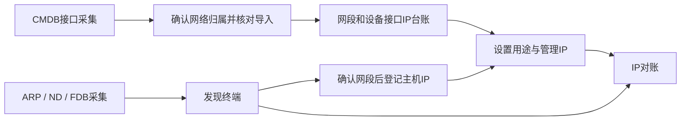

# 完成摘要

本轮按用户连续反馈处理网段主列表的归属/操作含义、自动维护与用途未确定重叠，以及接口导入将来源条目误计为网段、目标空间选择后未核对当前台账的问题。另将终端 ARP 采集和终端台账视图限定为明确标注的接入交换机/AP。

## 当前完整操作流程

1. 在资产/CMDB准备设备站点与采集凭据，在CMDB接口页执行接口采集，检查成功/失败详情。
2. IPAM网段页“从接口IP生成”读取每设备最后一次成功的接口快照。选择来源，确认Global/VRF，再核对实际网段与接口IP。**生成成功时会同时登记设备接口IP，不需要到终端页重复登记。**
3. 确认网段用途：设备互联、管理、业务或Loopback等。用途与网络归属分开；“已归属Global”不代表用途已确定。
4. 日常点击网段或“管理IP”查看、登记/分配地址；维护用途、设备与接口。地址池仅在需要管理可分配范围时使用；迁移归属仅在明确要切换路由域时使用。
5. 终端是独立链路：ARP/ND提供IP/MAC关系，FDB提供MAC所在端口。终端采集只从显式角色为接入交换机或AP的设备运行；通用switch不会被推断为接入交换机。发现记录不是正式台账；对需要登记的主机，确认网段归属后用“登记到IPAM”。已登记的设备接口IP无需重复登记。
6. 用IP对账核查登记与现场证据的差异。来源缺失/失败不等于IP空闲或设备离线。

## 实际问题与证据

- 实际浏览器主列表21条网段，分类方式auto21且用途unclassified21；SQL分别统计classification_status和network_type，两者可重叠。schema的classification_status默认auto，不能据此声称用途已识别。
- 实际浏览器导入弹窗35个候选条目，包含同一/30两端设备各一条；已选择25项时原按钮却称25网段。主列表已有21个Global网段，但候选仍因未映射设备上下文显示35pending。
- 空间选项同时存在真实Global空间和名为global的VRF，原先“global · global”文案不能表达二者差别。
- 浏览器检查只读/筛选/本地选择，没有点击最终生成或保存。
- `backend/services/ip_locator_service.py` 的周期 ARP 采集候选先按物理资产角色（有值时）或设备角色（回退）筛选，只接受 access/AP 及明确别名。`backend/services/ipam_discovery_service.py` 的终端列表同样隐藏其他角色的历史观察；底层记录仍保留供 IP 定位和对账使用。
- 网段确实由接口采集推导：取接口采集前缀长度，其次解析原始 IP/CIDR，再取同接口快照掩码，最后才对明确环回接口缺省 /32 或 /128；使用 `ip_interface(...).network` 规范化网络地址。修复了原本兜底 `lo*` 过宽、用途分类与掩码兜底不一致的问题。显式 Loopback 按接口角色赋用途 `loopback`，掩码仍尊重设备采集值。
- IPAM 终端登记：原来源记录已有明确 Global 地址空间时，弹窗仍要求手工选 Prefix；现由后端在该地址空间内按 IP 唯一匹配最具体的活动 Prefix，前端自动选择并说明空间和网段，用户直接确认登记。SNMPv2c 默认表在设备没有配置 VRF/未知上下文时按 Global 处理；只在租户唯一活动 Global 空间时自动映射，多 Global 空间不猜测。无匹配 Prefix 时阻止登记并引导先建网段。若采集仍携带 unknown VRF 上下文，则保留手动确认；显式 Global 来源后端只允许写入 Global address space。
- 终端重复观察：同一站点/租户 + IP + MAC + VLAN 的跨设备/上下文样本若时间不同，只在页面采用最新一次；原始观察仍保留在 current-context 存储中。相同最新时间仍有多个上下文时继续并列显示以便核对。登记接口也会拒绝已经被更新样本取代的观察。
- 终端页列名改为“IPAM 主机名”和“采集设备”；采集设备优先显示实际 ARP/ND 源设备，避免把 IP 台账中登记为 S6850-3/S6850-4 的地址持有设备误看成采集源。
- 终端页默认筛选 `terminal`（接入口主机 + 待核主机），隐藏通过 CMDB 当前接口 IP / 管理地址或虚拟网关识别的基础设施记录；更多筛选可选“全部判定”或只看基础设施。摘要仍反映所有范围内观察，因此仍显示被隐藏的基础设施数量。此筛选不删除原始 ARP 观察，IP 定位继续保留完整证据；终端登记 API 同样拒绝基础设施 IP。
- 接口导入现进入 `InterfaceImportReview` 只读核对步骤；新 `POST /api/ipam/prefixes/interface-import-preview` 按选中源记录和显式空间检查当前台账，并按目标空间+CIDR聚合；确认后仍调用原生成接口。未映射空间会阻止提交；用户选择的 Global 空间覆盖随选中候选一起送入预览及生成。

## 分工及文件

- 前端子Agent：PrefixManagementTab.tsx/test主列表、归属标签、分类筛选分区和日常/更多操作。
- 主Agent：InterfaceImportReview.tsx/test、后续父页面接入、统一流程说明与验收。
- 后端子Agent：ipam_service.py、api/ipam.py、新增test_interface_import_preview.py，只读目标预览与精确的接口登记来源识别。

## 验证

- `npm run lint`（`tsc --noEmit`）：终端登记自动匹配和“默认只看终端”筛选修改后通过。
- Python `ast.parse`：`ip_locator_service.py`、`ipam_discovery_service.py`、`ipam_service.py`、`backend/api/ipam.py` 语法通过；本轮终端筛选后端改动再次检查通过。
- `git diff --check`：相关后端、前端、计划与走查文档通过。
- 浏览器只读检查了当前 `/ipam/endpoints`：实际示例包含 Global/默认与范围待确认两种上下文；同设备同 IP/MAC/VLAN 的较旧上下文记录会被最新样本覆盖显示。终端表默认筛选的最新代码尚未在浏览器复核。
- 未运行 pytest/Vitest；未触发真实设备采集或写入 IPAM 数据，也未部署。

## 风险与回滚

不修改真实网段归属、用途、设备配置或业务数据；不把单接口IP的明确登记关系推断为整个设备的上下文映射。旧source ID变化时要求刷新，不静默转移选择。角色修改只改变终端周期采集及终端列表投影，不影响实时IP定位的路由/核心设备候选；既有非接入观察没有删除。保留前轮已验证的改动，回滚本轮文件差异即可。未提交、推送或部署。

## 用户追加：网关关联、行操作与大列表搜索

- 根因：编辑网段表单向 `/api/ipam/prefixes/gateway-candidates` 查询同前缀的接口快照，但旧逻辑仅在用户先填写网关 IP 并命中唯一候选后，才会选择网关设备。候选列表虽显示接口，不等于已确认为网关；旧提示也会把“有候选但网关 IP 未匹配”笼统说成“未找到候选”。
- 现在只有一个接口候选、候选归属已确认、且候选 `address_space_id` 等于表单所属空间时，前端才自动关联设备和可唯一匹配的接口。已关联的设备候选以成功状态显示。候选归属不明或有多个候选时不会猜测，提示分别说明归属待核/候选冲突；候选设备也可直接从设备下拉框选择。自动关联设备不会顺带填写“默认网关 IP”，两字段继续独立。
- 网段列表行内三个并排入口收成一个“管理”菜单；菜单包含“管理 IP”、“编辑网段（用途、网关等）”、网络归属确认/迁移、地址池、删除。原“设置用途”与“完整编辑”调用同一表单，现合并为一个编辑入口，删除仍保留确认流程。
- “从接口 IP 生成”弹窗新增服务端 `q` 搜索参数，最多120字符；先在完整候选快照上按 CIDR、IP、设备、接口、站点标识及路由上下文筛选，再做状态筛选与分页。总候选统计不随搜索改变，匹配数量及页数随查询更新，选中过的其他页候选仍保留。
- “核对导入结果”弹窗对已选网段分组增加关键词筛选和每页8项的分页，只渲染当前页；搜索 CIDR、空间、状态及预览中显示的设备/接口/IP，不改变导入统计或最终提交的所选候选。
- 本追加只改前端、候选查询 API/服务与既有前端交互断言；不涉及数据库结构或现场数据。

## 本追加验证

- `npm run lint`（`tsc --noEmit`）：通过。
- `vite build --outDir %TEMP%/netsops-ipam-prefix-ui-20261112`：通过，构建输出放在临时目录，未覆盖工作区已有 `dist/`。
- Python `ast.parse` 检查 `backend/api/ipam.py` 与 `backend/services/ipam_service.py`：通过；`git diff --check`：通过（仅提示工作树已有文件的 LF/CRLF 转换信息）。
- 未运行 pytest/Vitest；未对目标运行时页面做浏览器复核，因此这轮是源码、类型和生产构建验证，不代表部署页面已更新。
- 搜索在当前被授权可见的 CMDB 接口候选中筛选；未确认空间的候选仍显示为待确认。地址空间映射、候选快照和网关 IP 均不自动写库；未部署。
