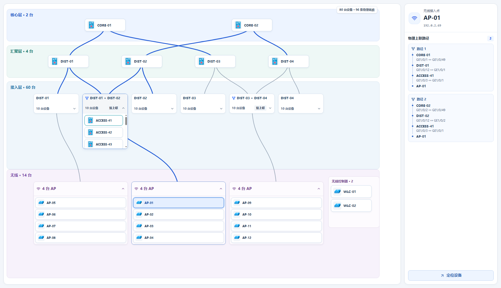
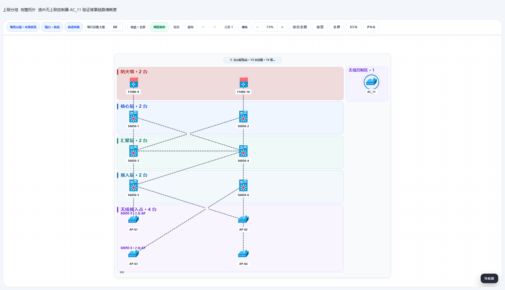

# 拓扑链路可见度与分组示意

## 结果

- 完整拓扑只有在选中设备确实关联到物理链路时才进入链路聚焦；选中没有上联的无线控制器时，其余链路保持清晰。聚焦时背景链路透明度提高到 0.4。
- 正式「上联分组」视图恢复分层画布，展示边界、核心、汇聚、接入和无线设备；按确认的物理链路绘制层间连接，双上联合并显示为同一接入组。
- 分组图按实际画布高度同步调整图层位置和 SVG 坐标，避免连线随浏览区域被纵向拉长。无线组默认展开并显示 AP 名称，控制器单独展示。
- 右侧显示设备的每条上联路径和端口信息；点击接入设备或 AP 后，高亮路径。

## 验证

- npm run lint：通过。
- Vite production build 输出到临时目录：通过。保留工作区已有的 dist/index.html 修改。
- Edge 浏览器预览，1720×990：60 台接入交换机样本共 80 台设备、96 条确认物理链路，显示 6 个接入上联组、3 个 AP 组和 2 个 WLC；画布宽高与实际可用视口对齐。
- 13 台设备小样本下，选中无物理上联的控制器时，完整拓扑 14 条链路均保持 0.96 不透明度；点击 AP-01 后显示 4 条上联路径，11 条分组连线高亮。

## 预览

## 范围

浏览器验证使用合成拓扑样本；未连接本地虚机的实时数据，也未部署或推送。
