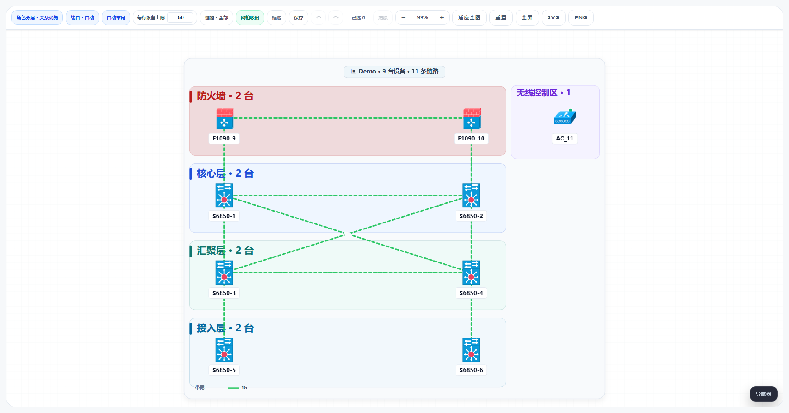
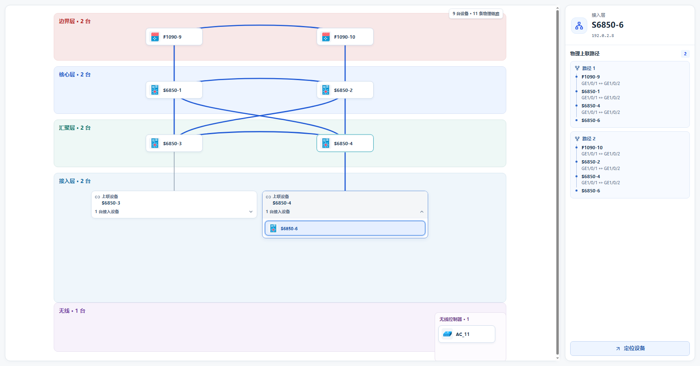

# 拓扑居中与上联标识

- 完整拓扑：`src/utils/topologyRoleLayout.ts` 根据有线设备的最右端限制无线控制器栏的位置，`src/components/TopologyGraph.tsx` 复用站点和无线控制区的内边距。自动排布减少有线色带里的单侧留白，保存的手动坐标沿用原逻辑。
- 上联分组：`src/components/TopologyUplinkGroups.tsx` 和 CSS 将画布内容水平居中，用关系图标与「上联设备」标识区分上联名称与接入成员。多个上联显示实际数量。
- 验证：`git diff --check` 和 `npm run lint` 通过。运行 `node node_modules/vitest/vitest.mjs run src/utils/topologyRoleLayout.test.ts`，17 项通过。Vite 生产构建输出到临时目录，构建通过。
- Edge 本地预览采用 9 台设备和 11 条合成链路。完整拓扑中有线设备与色带的横向中心坐标一致。分组展开显示「上联设备 S6850-4」「1 台接入设备」和接入成员 S6850-6。
- 验证范围为本地源码和合成数据，尚无虚机部署结果。可回退上述前端文件恢复此前展示。

