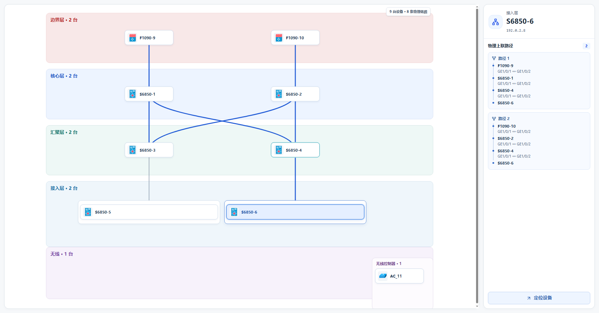

# 接入分组卡片

- `src/components/TopologyUplinkGroups.tsx` 及对应 CSS 将单成员分组改为直接展示可点击的接入设备。多成员组保留设备数量和展开操作，接入卡片省去已在其他层展示的上联名称。
- 分组和连线仍依照确认的物理链路计算。多上联显示数量，未发现上联时显示待确认。选择接入设备可查看右侧路径。
- `npm run lint`、`git diff --check` 和临时目录的 Vite 生产构建均通过。`src/components/TopologyUplinkGroups.test.tsx` 的两项相关检查通过，覆盖单设备直接选择及多设备展开。
- Edge 使用 9 台设备样本检查了接入卡片，并在 S6850-5 和 S6850-6 间切换选中设备。验证范围为本地合成数据。

