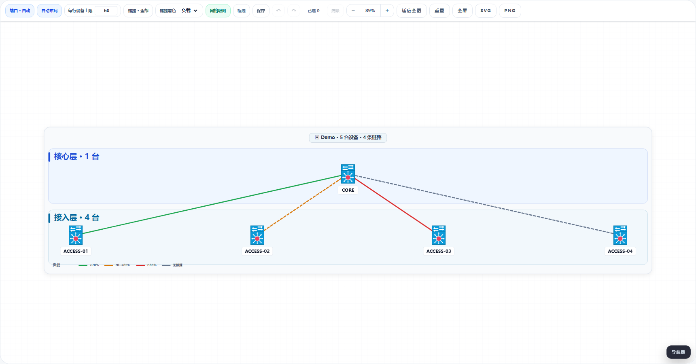

# 拓扑链路负载着色

- `src/components/TopologyGraph.tsx` 增加「链路着色」切换。带宽为默认，负载模式同步更新线条、图例、导航器和悬停提示。
- `src/utils/topologyLinkLoad.ts` 取两端有效利用率的较高值。低于 70% 为绿，70% 至低于 85% 为橙，85% 及以上为红，缺少有效数据或链路已中断、陈旧为灰。实线与虚线沿用证据状态。
- `src/hooks/useTopology.ts` 导出优先保留画布中的 SVG 图例，没有内嵌图例时按当前着色模式补上。
- `node node_modules/vitest/vitest.mjs run src/utils/topologyLinkLoad.test.ts src/utils/topologyGraphLinks.test.ts` 共 6 项通过。Edge 使用合成拓扑验证了四种颜色、原线型和悬停数值，导出后的 SVG 保留负载色与图例。`npm run lint`、`git diff --check` 和临时目录生产构建通过。
- 验证使用样本数据。回退上述前端文件及测试即可恢复此前的带宽着色。

