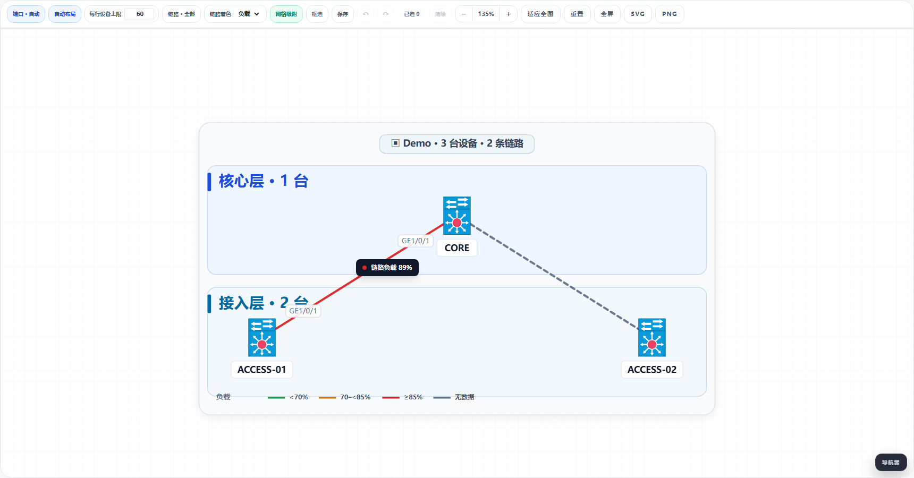

# 拓扑负载悬停

- `src/components/TopologyGraph.tsx` 让可见线条不拦截指针，由透明命中线接收鼠标事件。负载模式在画布内直接显示提示，不依赖浏览器原生 SVG 标题弹出。
- Edge 使用合成链路和鼠标移动验证：红线显示「链路负载 89%」，灰线显示「负载无数据」，鼠标离开后消失，切回带宽后不显示负载提示。
- `node node_modules/vitest/vitest.mjs run src/utils/topologyLinkLoad.test.ts src/utils/topologyGraphLinks.test.ts` 共 6 项通过。
- `npm run lint`、`git diff --check` 和临时目录生产构建通过。
- 验证范围为本地浏览器与合成数据。回退组件改动即可恢复原行为。

