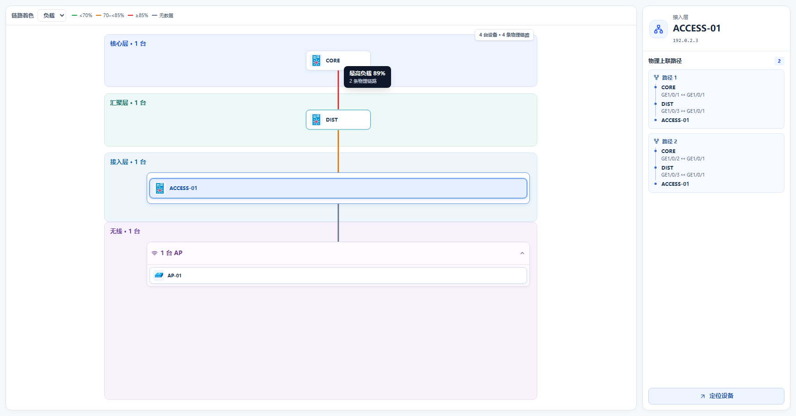

# 上联分组负载提示

- `src/components/TopologyUplinkGroups.tsx` 和对应 CSS 新增「路径 / 负载」着色切换。悬停读数在两种着色模式均可用。
- 线条继续表示确认的物理连接。合并线按有效读数的最大值着色，并显示物理链路数量；缺测显示灰色。
- Edge 在分组模式实际移动鼠标，确认单线显示 72%，合并线显示最高 89% 与两条物理链路，缺测正确显示且离开后隐藏。
- `node node_modules/vitest/vitest.mjs run src/utils/topologyLinkLoad.test.ts` 三项通过。`npm run lint`、`git diff --check` 和临时目录 Vite 构建通过。
- 验证使用合成拓扑，未部署到虚机。

