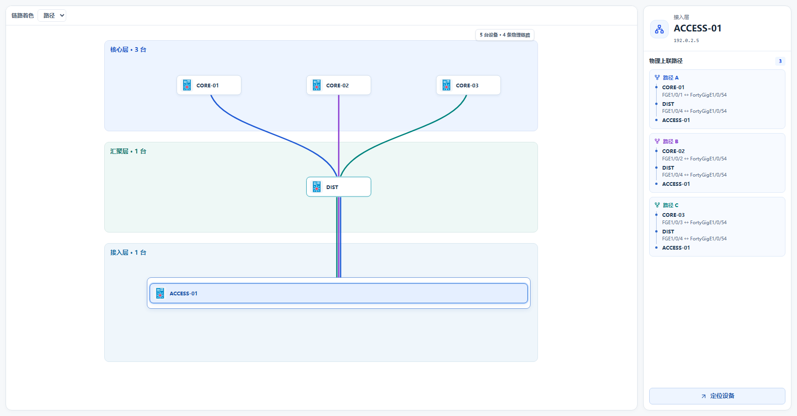

# 上联路径配色与负载匹配

- `src/components/TopologyUplinkGroups.tsx` 在路径着色模式按 A、B、C 区分上联，图中的线与右栏标题同色，共用段并排绘制。链路端点对齐固定高度的接入与 AP 卡片。
- `src/utils/topologyCore.ts` 补齐前端 10G、40G 端口别名，确保拓扑和监控名称可归一到同一个匹配键。
- `src/components/TopologyGraph.tsx`、`src/utils/topologyLinkLoad.ts` 区分数值 0、低于 0.1% 的有效读数与缺测。灰线提示进一步显示端口遥测缺失、无有效利用率或链路不可用。
- 三份聚焦测试共 11 项通过，`npm run lint`、`git diff --check` 和临时目录生产构建通过。Edge 使用合成拓扑验证三条路径、共用段、右栏同色和完整拓扑的低读数与缺测提示。
- 尚未使用虚机的端口遥测验证，端口别名补齐无法为未采集的接口产生读数。回退前端组件和工具即可恢复。

