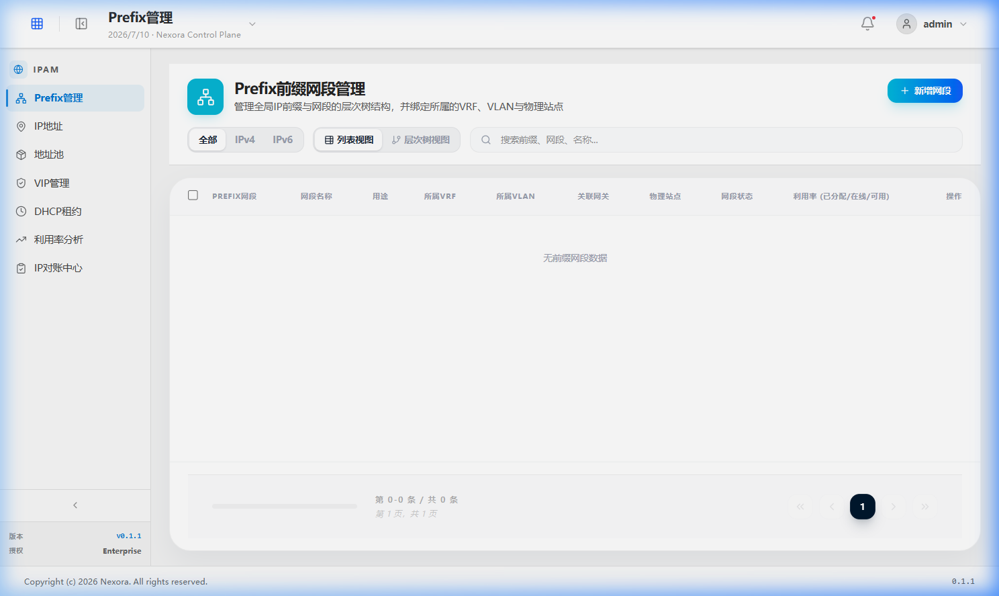

# Nexora NetOps 前缀列表用户使用手册

> 版本：v1.0
> 编制日期：2026-07-24
> 适用页面：`/ipam/prefixes`

## 1. 功能简介

“Prefix 前缀网段管理”用于统一维护企业 IPv4/IPv6 网段，并查看网段的层次关系、用途分类、VRF、VLAN、网关、站点和地址利用率。

前缀数据支持两种来源：

- **接口采集生成**：根据当前 CMDB 接口采集结果自动生成网段和接口 IP。
- **人工维护**：用户通过“新增网段”创建，或编辑已有网段的属性。

系统还会使用路由表、LLDP、ARP、MAC/VLAN 等只读采集证据，对前缀进行补充识别和分类。采集不会修改设备配置。



## 2. 进入页面

登录 Nexora NetOps 后，进入：

```text
IPAM → Prefix管理
```

也可以直接访问：

```text
http://<系统地址>:5150/ipam/prefixes
```

页面顶部提供以下操作：

| 操作 | 用途 |
|---|---|
| 新增网段 | 手工创建一个 CIDR 前缀 |
| 从接口 IP 生成 | 预览并选择由接口采集结果生成的前缀 |
| IPv4 / IPv6 | 按地址族筛选 |
| 列表视图 | 查看全部前缀及属性 |
| 层次树视图 | 查看父网段与子网段关系 |
| 搜索框 | 按前缀、网段名称或描述检索 |

## 3. 推荐使用流程

建议首次使用或新增设备后按以下顺序操作：

1. 在 CMDB 中确认设备在线、凭据有效、厂商平台正确。
2. 执行“立即同步全网数据”，或等待接口采集任务完成。
3. 打开 Prefix 管理，点击“从接口 IP 生成”。
4. 检查候选网段、接口数量和站点/VRF 信息。
5. 选择需要登记的候选项，点击“确认生成”。
6. 返回列表，检查用途分类、冲突状态和利用率。
7. 对“待确认”“混合网段”或“冲突”项目进行人工复核。

## 4. 从接口 IP 生成前缀

### 4.1 数据来源

生成窗口读取当前接口采集结果：

- 首选 `interfaces` 表中的接口 IP 和前缀长度。
- 如果接口快照缺少掩码，会尝试使用 `ip_inventory` 中同接口的掩码。
- 环回接口没有前缀长度时，IPv4 自动按 `/32`，IPv6 自动按 `/128` 处理。
- 无法确定前缀长度、地址非法或地址与掩码无法组成有效网段的接口会进入“跳过”列表。

### 4.2 候选项状态

| 状态 | 含义 |
|---|---|
| 待创建 / New | 当前作用域还没有相同前缀，可以生成 |
| 已存在 / Existing | 相同租户、站点、VRF 下已经有该前缀，不会重复创建 |
| 已跳过 / Skipped | 地址、掩码或前缀长度不完整，需要先修复接口采集数据 |

候选前缀按以下作用域去重：

```text
前缀 + 租户 + 站点 + VRF
```

因此，同一个 CIDR 在不同站点或不同 VRF 下可以分别登记。

### 4.3 生成结果

生成完成后，系统会返回：

- 创建的前缀数量
- 已存在的前缀数量
- 登记的接口 IP 数量
- 已存在的接口 IP 数量
- 因冲突或校验失败而跳过的 IP 明细

该操作是幂等的：重复点击不会重复创建相同前缀或相同接口 IP，也不会删除旧的人工数据。

> 注意：接口生成只使用当前接口采集结果，不会读取或恢复历史 IPAM 前缀。

## 5. 手工新增或编辑前缀

点击“新增网段”后，至少填写：

- 前缀/CIDR，例如 `10.1.12.0/24`、`1.1.1.1/32`、`2001:db8::/64`
- 网段名称或用途
- 所属站点、VRF、VLAN（如适用）
- 网关设备和网关接口（如适用）
- 网段类型
- 状态

新增子网时可以选择父网段并填写期望前缀长度，系统会推荐下一个可用子网。系统会校验：

- CIDR 格式是否正确
- IPv4/IPv6 前缀长度是否合法
- 同一租户、VRF、站点作用域内是否存在重叠
- 父子网段关系是否合理

编辑已有前缀时，前缀本身作为资源标识不可随意修改；如需调整地址空间，建议新建正确前缀后迁移地址数据。

## 6. 列表字段说明

| 字段 | 说明 |
|---|---|
| Prefix 网段 | 标准化后的 CIDR，如 `10.1.12.0/24` |
| 网段名称 | 业务名称或系统生成名称 |
| 用途 | 管理、业务、服务器、用户接入、传输、VPN 等分类 |
| VRF | 路由实例归属 |
| VLAN | 关联 VLAN 信息 |
| 关联网关 | 网关设备/接口 |
| 物理站点 | 前缀所属站点 |
| 网段状态 | active、reserved、deprecated 等生命周期状态 |
| 利用率 | 已登记、在线、可用地址数量及百分比 |
| 操作 | 编辑、删除或查看关联 IP |

点击前缀或地址数量，可以进入该前缀下的 IP 地址明细。

## 7. 自动分类和状态卡片

页面顶部的分类卡片用于快速判断数据质量：

| 卡片 | 处理建议 |
|---|---|
| 自动分类 | 系统依据接口名称、网段长度及采集证据自动判断 |
| 人工保护 | 已人工维护或人工覆盖的前缀，自动任务不应覆盖关键属性 |
| 待确认 | 证据不足，建议补充用途、站点、VRF 或 VLAN |
| 混合网段 | 同一前缀出现多种接口角色，建议确认是否存在地址规划混用 |
| 冲突 | 同作用域存在跨站点重复或重叠，需要先处理地址规划问题 |
| 已老化 | 连续采集未再发现，确认设备是否下线或接口是否变更 |

分类主要依据：

- `Loopback/Lo`：优先识别为 Loopback。
- `Management/Mgmt/OOB/MGT`：识别为管理网。
- `Tunnel/VPN/GRE/IPsec`：识别为 VPN。
- `WAN/MPLS/Serial/Cellular`：识别为广域/传输网。
- `VLAN/IRB/BVI`：识别为用户接入或三层网关网段。
- `/30`、`/31`、IPv6 `/127` 且发现邻居：优先识别为传输网段。
- 证据不足时标记为“待确认”，不会强行猜测用途。

## 8. “立即同步全网数据”后的处理

统一同步完成后，建议按以下顺序刷新：

1. 先确认 `/cmdb/interfaces` 中接口 IP、前缀长度和运行状态已更新。
2. 再打开 `/ipam/prefixes`，刷新前缀列表。
3. 如果列表仍为空，点击“从接口 IP 生成”检查候选项。
4. 如果候选项为空，查看生成窗口中的“跳过接口”原因。

常见原因：

- 接口没有 IP 地址。
- 接口采集没有获取到掩码/前缀长度。
- 接口被识别为二层接口且没有 IP 采集标志。
- 设备或接口采集任务失败。
- 用户当前站点、租户或权限范围不包含目标数据。

## 9. 删除与数据安全

删除前缀会级联删除该前缀下登记的 IP 地址，因此属于高风险操作。执行前应确认：

- 该前缀不再被业务使用。
- 没有需要保留的 IP 地址、地址池或 VIP 关联。
- 没有依赖该前缀的路径分析或终端定位数据。

批量删除前，先通过搜索和 IPv4/IPv6 筛选缩小范围，并逐项确认选中数量。

## 10. 权限建议

| 操作 | 建议权限 |
|---|---|
| 查看前缀 | Viewer |
| 新增/接口生成 | Prefix Create |
| 编辑前缀 | Prefix Update |
| 删除前缀 | Prefix Delete |
| 批量删除 | 仅授予 IPAM 管理员 |

生产环境建议普通运维人员只拥有查看和生成候选项权限，删除和跨站点修改由 IPAM 管理员审批。

## 11. 运维检查清单

每次采集或地址规划变更后，建议检查：

- 是否出现新的“待确认”前缀。
- 是否出现“冲突”或“混合网段”。
- 环回口是否以 `/32` 或 `/128` 出现。
- 直连网段和接口网段是否已登记。
- 网关、VRF、VLAN、站点是否完整。
- 高利用率网段是否需要扩容。
- 已老化前缀是否确实下线。
- 接口采集失败项是否需要补采或修复凭据。

## 12. 相关页面

- CMDB 接口架构：`/cmdb/interfaces`
- 前缀管理：`/ipam/prefixes`
- IP 地址管理：`/ipam/ips`
- 地址池：`/ipam/pools`
- 利用率分析：IPAM → 利用率分析
- 统一事实库：`/assets/nsot`
