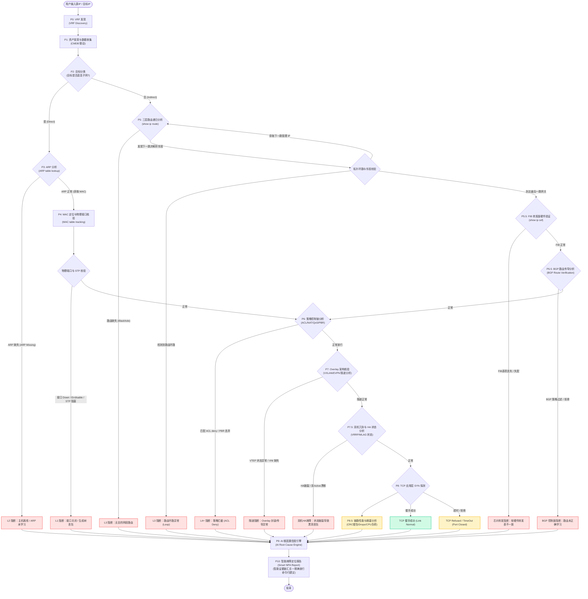

# Smart Trace / Network Path Analyzer (NPA) 15阶段商用排障架构与流转决策规范

**Smart Trace**（网络路径分析器，Network Path Analyzer / NPA）是 NetOps 智能网络平台的核心故障定位与拓扑还原引擎。该引擎通过模拟 TAC 资深技术支持专家（TAC Principal Engineer）的排障思维，将控制层面（Control Plane）的数据流与转发层面（Forwarding Plane）的真实状态解耦分析，实现**跨 VRF、跨 Overlay 隧道、跨网络协议**的故障定位。

---

## 一、 15阶段排障生命周期架构说明

### P0. VRF Discovery (VRF 发现)
排障首要阶段。针对多租户、重叠 IP 地址（Overlapping IPs）的数据中心与专线场景，自动检索设备上的 VRF 分布。
- **采集命令**：Cisco: `show vrf`；Huawei/H3C: `display ip vpn-instance`；Juniper: `show instance`。
- **作用**：确保后续所有的路由查找（`show ip route vrf xxx`）均在正确的业务 VRF 上下文中执行，防止跨 VRF 路由泄漏/冲突导致的误判。

### P1. Asset Discovery (资产关联与信息收集)
输入源 IP/宿 IP 后，引擎自动扫描 CMDB、资产表及设备接口配置。
- **作用**：识别源/宿主机的归属物理设备（如接入交换机端口、VLAN ID）、所用接口的协议参数、MTU 和业务归属。如果 IP 未在 CMDB 中，触发网关 ARP/MAC 实时搜索。

### P2. Target Classification (目标分类)
判定目标 IP 所处的子网层级类型。
- **直连子网目标（Direct Subnet）**：跳过三层寻路，直接引入 **P3 (ARP) / P4 (MAC) 物理层分析**。
- **非直连网段目标（Remote Subnet/VIP/Loopback）**：引入 **P5 (Route) 路由递归分析**。

### P3. ARP Analysis (二层 ARP 分析)
针对直连设备，登录网关路由器，查询 ARP 表项获取目标 MAC。
- **CLI 命令**：Cisco: `show ip arp {ip}`；Huawei/H3C: `display arp | include {ip}`；Juniper: `show arp no-resolve | match {ip}`。
- **逻辑分支**：
  - **ARP 缺失 (ARP Missing)**：判定为主机离线或 VLAN 配置错配，诊断终止。
  - **ARP 正常**：提取 MAC 地址，传递到 P4。

### P4. MAC Analysis (MAC 定位与物理接口核验)
依据目标的 MAC 地址，在二层交换机中追踪对应的物理端口与 VLAN。
- **CLI 命令**：`show mac address-table address {mac}` / `display mac-address {mac}`。
- **健康核验**：检查锁定物理端口的 **Link Status**（UP/DOWN / Errdisable）及 **STP 状态**（Blocking / Forwarding），定位由于环路引发的生成树阻塞或单向链路故障。

### P5. Route Recursion (路由递归分析)
对非直连目标，从源网关开始进行路由表递归查询。
- **CLI 命令**：Cisco: `show ip route {target_ip}`；Huawei/H3C: `display ip routing-table {target_ip}`；Juniper: `show route {target_ip}`。
- **追踪机制**：解析下一跳 IP 和出接口。通过 `show cdp/lldp neighbors` 匹配物理邻居设备名，再在资产中转换其管理 IP，跳转至下一跳路由器重复路由递归，直到路由不可达或到达最后一跳网关。

### P5.5. FIB Verification (FIB 转发面验证)
验证设备的路由控制平面（Routing Table）与芯片转发平面（FIB Table）是否一致。
- **CLI 命令**：Cisco: `show ip cef {target_ip}`；Huawei/H3C: `display fib {target_ip}`；Juniper: `show route forwarding-table destination {target_ip}`。
- **作用**：检查是否存在“软硬件转发表不一致”的疑难杂症（即控制面有路由但 ASIC 芯片中 FIB 表项丢失导致硬件丢包）。

### P6. Policy Analysis (策略控制链分析)
在链路上的防火墙、安全网关及路由器执行 ACL 过滤检测。
- **检测项目**：接口入向/出向 **ACL/IP Access-group**、防火墙安全策略（**Security Policy**）、**NAT** 转换表项、**PBR**（策略路由）规则及 **QoS** 丢包阈值。

### P6.5. BGP Analysis (BGP 路由传导分析)
多跳路径如经过 BGP 边界自治系统（ASBR）或反射器（RR），检验 BGP 控制平面。
- **CLI 命令**：`show bgp ipv4 unicast {target_ip}` / `show ip bgp neighbors {ip} advertised-routes`。
- **作用**：判断路由是否被 BGP Import-Policy / Export-Policy 过滤，或者由于 Community/AS-Path 属性异常导致路由无法 Installed 进主路由表。

### P7. Overlay Analysis (Overlay 隧道架构分析)
分析底层的物理 Underlay 承载网络之上是否存在虚拟 Overlay 隧道。
- **检测项目**：**VXLAN VNI** 绑定状态、**VTEP** 隧道可用性、**BGP EVPN Type-2/Type-5** 路由通告及 **IPsec VPN / SD-WAN** 隧道保活状态。

### P7.5. HA Analysis (双机冗余与状态分析)
排查双机热备（Active/Active 或 Active/Standby）、堆叠或集群结构。
- **CLI 命令**：Cisco: `show standby brief` / `show vpc`；Huawei/H3C: `display vrrp` / `display irf` / `display css status`。
- **排查隐患**：分析 VRRP/HSRP 脑裂（Split Brain）、vPC Peer-link 中断、多活脑裂及主备频繁漂移。

### P8. TCP Validation (TCP 端口 SYN 验证)
发起 TCP 握手验证（如 22, 80, 443, 3306）。
- **作用**：当物理层、网络层和策略层完全正常时，通过 TCP 三次握手结果直接判定是网络链路不通，还是宿主机系统防火墙（Windows Firewall/iptables）阻断或应用未监听。

### P8.5. Performance Analysis (链路性能与拥塞分析)
实时收集路径上所有接口的硬件计数器与设备负荷。
- **采集指标**：接口错包（**CRC / Input Errors**）、拥塞丢包（**Drops / Queue Drops**）、双工半双工冲突（Collision）以及节点设备的 **CPU 负荷（>80%）** 和 **内存利用率（>90%）**。
- **作用**：定位“能通但极慢、频繁丢包抖动”等亚健康状态。

### P9. AI Root Cause Engine (AI 根因置信度引擎)
智能故障诊断的核心大脑。
- **作用**：整合 P0 到 P8.5 阶段收集的所有控制面/转发面数据及硬件异常指标，对比专家故障库进行关联分析，自动生成多维度的**证据链**并计算出**故障点置信度百分比**（Confidence Rating）。

### P10. Smart Report (智能故障定位报告)
输出最终诊断报告，提供精确到设备、物理端口、甚至单条命令行（CLI Commands）的修复建议。

---

## 二、 商业化付费功能分级矩阵 (Tiered Feature Matrix)

为了将 NetOps 平台作为高付费价值的商业化系统，Smart Trace 划分为三个收费等级：

| 功能模块 (Modules) | Community (社区免费版) | Professional (专业版) | Enterprise (企业旗舰版) |
| :--- | :---: | :---: | :---: |
| **P1. 资产发现 / P2. 目标分类** | ✓ | ✓ | ✓ |
| **P3. ARP 分析 / P4. MAC 定位** | ✓ | ✓ | ✓ |
| **P5. 三层路由递归跟踪** | ✓ | ✓ | ✓ |
| **P8. 基础 TCP 端口验证** | ✓ | ✓ | ✓ |
| **P0. VRF 发现与多路由上下文** | ✗ | ✓ | ✓ |
| **P5.5. FIB 转发面硬件验证** | ✗ | ✓ | ✓ |
| **P6. ACL/NAT/QoS/PBR 策略核验** | ✗ | ✓ | ✓ |
| **P6.5. BGP 路由传导分析** | ✗ | ✓ | ✓ |
| **P7.5. 双机冗余与 HA 状态排查** | ✗ | ✓ | ✓ |
| **P8.5. 错包拥塞与 CPU 性能分析** | ✗ | ✓ | ✓ |
| **P7. Overlay (VXLAN/EVPN/SD-WAN)** | ✗ | ✗ | ✓ |
| **P9. AI 根因引擎与置信度推导** | ✗ | ✗ | ✓ |
| **P10. 一键生成 CLI 修复配置方案** | ✗ | ✗ | ✓ |

---

## 三、 Smart Trace 诊断阶段命令与排障映射表 (Command & Trouble Map)

| 诊断阶段 (Phase) | 平台 (Platform) | 核心 CLI 网络命令 (Commands) | 异常判断指标 (Anomaly Indicators) | 定位故障层级 |
| :--- | :--- | :--- | :--- | :--- |
| **P0. VRF 发现** | Cisco IOS / VRP | `show vrf` / `display ip vpn-instance` | 目标 IP 归属 VRF 未关联，查询路由无上下文 | 路由虚拟化 (VRF) |
| **P3. 二层 ARP 分析**| Cisco IOS / VRP | `show ip arp {ip}` / `display arp` | `ARP Missing` / 表项无记录 (主机不在线) | L2 链路层 (L2) |
| **P4. MAC 定位** | Cisco IOS / Junos | `show mac address-table address {mac}` | 端口为 `Blocking` (STP丢包) / 物理端口 `Down` | L1 物理层 (L1) |
| **P5. 路由递归** | Cisco IOS / VRP | `show ip route {ip}` / `display ip routing-table` | `Subnet not in table` / 路由黑洞 / 环路超时 | L3 网络层 (L3) |
| **P5.5. FIB 验证** | Cisco IOS / VRP | `show ip cef {ip}` / `display fib {ip}` | FIB 表中表项缺失或下一跳不一致 (软硬件表失配) | ASIC 转发面 |
| **P6. 策略分析** | Cisco IOS / ASA | `show access-lists` / `show security-policy` | ACL 匹配到 `deny` 拦截规则且 `hitcnt` 增加 | L4 安全策略 (L4) |
| **P6.5. BGP 分析** | Cisco IOS / Junos | `show ip bgp neighbors {ip} advertised-routes` | 路由被 BGP 出向/入向策略过滤，未 Installed | BGP 控制面 |
| **P7. Overlay 分析**| Cisco NXOS / VRP | `show vxlan vni` / `display l2vpn peer` | VTEP 状态异常 / VNI 绑定错误 / BGP EVPN 路由未同步 | Overlay 隧道层 |
| **P7.5. HA 分析** | Cisco IOS / VRP | `show standby brief` / `display vrrp` | 脑裂 (Split Brain) / 双 Master 多活 / 状态频繁摆动 | HA 冗余层 |
| **P8.5. 性能分析** | Cisco IOS / VRP | `show interface` / `show processes cpu` | 接口 `CRC` 错包增加 / `Queue Drops` 拥塞 / CPU > 80% | 物理链路与芯片负荷 |
| **P9. AI 根因引擎**| NPA Engine | Correlation Algorithm | 置信度偏低 / 证据链断裂 (缺少关键日志/指标) | 诊断分析层 |

---

## 四、 Smart Trace 决策流转判定图 (Mermaid)

