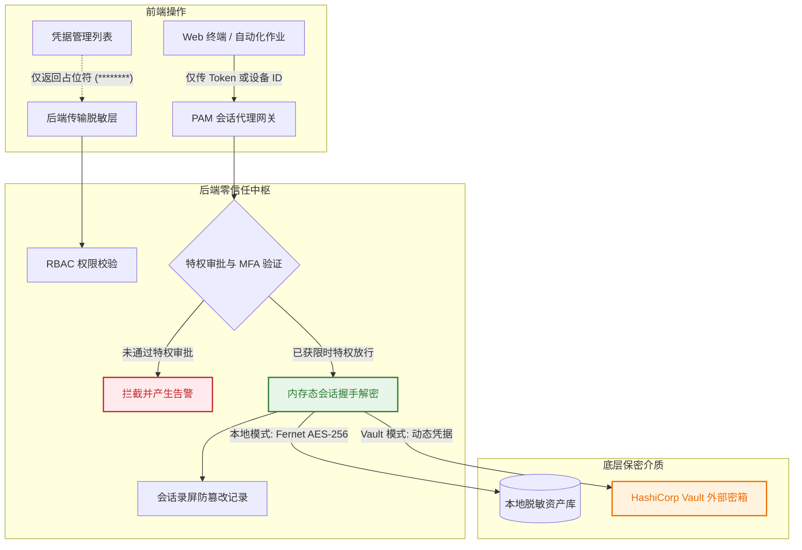

# 🛡️ Nexora NetOps 凭据管理与 PAM 安全性深度架构探讨记录

**记录时间**: 2026-05-16 夜
**核心议题**: 凭据管理页面的权限边界与安全性保障 —— “哪怕操作人员拥有管理员 (Admin) 权限，如何防止其窃取或滥用核心网络设备和物理服务器的最高特权凭据？”

---

## 1. 核心矛盾与安全诉求
在传统的运维管理工具中，系统管理员往往拥有数据库直连或查看明文口令的特权，一旦发生内部威胁（Insider Threat）或 Admin 账号被攻破，整个数据中心的底层资产将面临灭顶之灾。
针对这一问题，Nexora NetOps 抛弃了简单的“单点放行”模式，全面转向**零信任（Zero-Trust）与特权访问隔离（Privileged Access Management, PAM）**架构。

---

## 2. 当前系统架构下的四大纵深防御枷锁

### 🔒 A. 传输展示层：绝对零明文与防抓包
* **全端脱敏拦截**：无论是普通操作员还是系统最高管理员，在调用 `/api/devices` 或 `/api/physical-assets` 时，后端在输出层将所有敏感凭据（如 `password`、`admin_password`、`enable_password`、`snmp_community` 等）全量替换为 `********` 或空值。
* **浏览器阻断**：操作人员在前端列表中只能看到“凭据已录入/未录入”的状态，即便利用浏览器控制台或截包器抓取网络流，也无从获取密码明文。

### 🔒 B. 存储隔离层：内存态即焚与 Vault 企业保险箱
* **Fernet 加密与密钥分离**：本地保存的密文均由 `backend/core/crypto.py` 基于行业顶级对称加密（AES-128/256）存储。解密所需的主密钥隔离存储于物理服务器的 `NETOPS_SECRET_KEY` 环境变量中，数据库中仅有密文。
* **外部保险箱直连**：原生支持外部企业级 HashiCorp Vault 架构 (`credential_source = 'vault'`, `vault_path`)。系统完全不存密文，每次建立会话时动态下发单次 Token，完成握手后变量即刻从内存中彻底抹除。

### 🔒 C. 特权审批层：PAM 双重凭据模型与限时提权
* **普通 vs 特权通道分离**：日常监控和基本巡检仅采用普通用户凭据 (`normal_password`)。
* **提权工单卡点**：如需执行高危写操作或进入设备特权模式（Enable/Root），必须提交 **PAM 特权提权工单 (`pam_access_requests`)**。提权操作需经过安全主管或多因子（MFA / PIN）核验放行，放行后授予的临时访问权限具备严格的时间窗口限制（例如 2 小时自动收回）。

### 🔒 D. 会话代理层：底层直通与防篡改录屏审计
* **后端安全网关直连**：前端 Xterm 终端连接或自动化任务流，仅传递会话凭证和资产标识。所有密码校验均在后台沙箱网络引擎内运行。
* **防篡改录像回放**：通过 SSH 或代理拉起的每一秒会话动作、所有命令与系统回显，均被完整录制存入 `data/pam_recordings`，形成了强有力的司法级操作防伪溯源链条。

---

## 3. 明日（次日）继续探讨的核心议题与优化方向

1. **凭据细粒度 ACL 与多租户/部门隔离**：
   * 如何在现有 RBAC 基础上，进一步实现不同运维小组只能管理对应业务线设备的凭据（例如网络组 vs 系统组相互隔离）。
2. **紧急打破玻璃机制（Break-Glass Emergency Access）**：
   * 当遇到核心骨干网瘫痪且审批主管均无法联络的极端危急情况，如何设计安全的“紧急一键破窗登录”机制，并在破窗后自动联动全数据中心的高级别短信与邮件警报。
3. **密码自动轮转（Password Rotation Automation）**：
   * 进一步探讨如何利用定时调度引擎对全域网络设备和服务器定期自动生成高强随机密码并回写底层系统，实现凭据周期的完全自动化自闭环。
