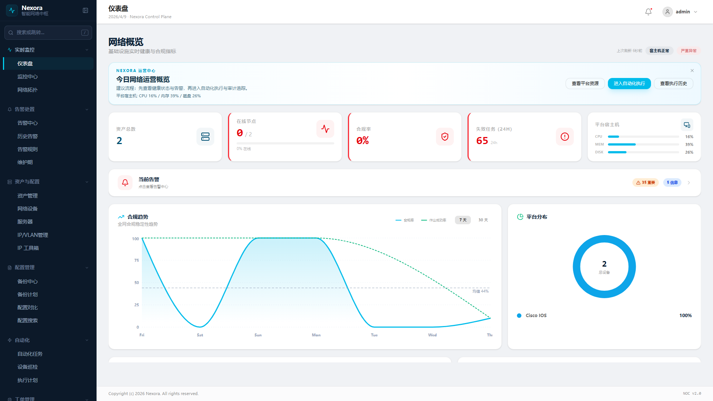
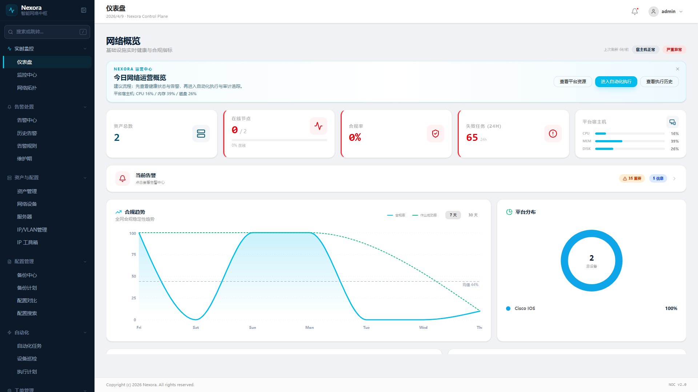
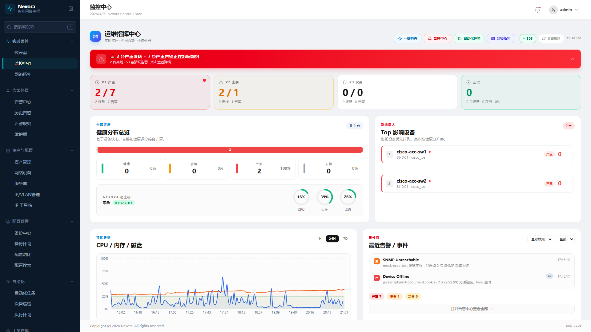
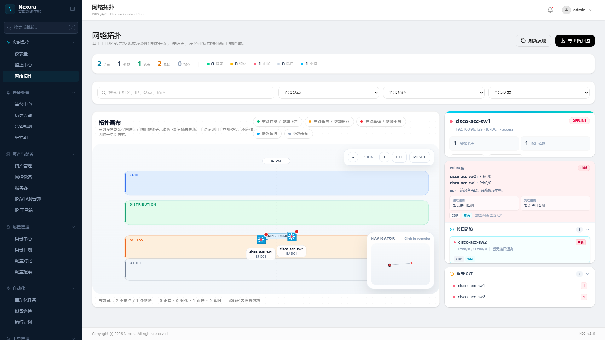

# Nexora 功能详解（一）：实时监控 — 仪表盘 / 监控中心 / 网络拓扑

> 本篇是 Nexora 系列文章第一篇，介绍「实时监控」模块下的三个子功能。系列目录见 [项目整体介绍](zhihu.md)。

---

运维平台打开之后第一眼该看到什么？肯定不是一堆密密麻麻的设备列表，而是一个一目了然的全局总览——**当前有多少设备在线、哪些指标异常、整体合规状态如何**。Nexora 的「实时监控」就是干这个的，包含三个子页面：仪表盘、监控中心、网络拓扑。

---

## 1. 仪表盘

登录进来默认落到仪表盘页面，内容分上下两部分。

**上半部分**是核心 KPI 卡片区域：设备总数、在线率、活跃告警数、今日备份数、合规评分，再加上主机资源面板（CPU、内存、磁盘利用率的概览）。数字变化会有动画效果，打开页面一眼就能知道当前全网是什么状态。

**下半部分**是图表区：合规趋势折线图、平台分布饼图、设备状态分布、告警趋势等。时间范围可选，图表用的 Recharts，鼠标悬停有 tooltip，数据直观。

### 设计思路

仪表盘的定位是「开门见山」。运维人员早上打开平台，扫一眼就知道全网是否正常、有没有需要紧急处理的事项。所有数据都通过后端聚合接口一次拉回来，前端渲染延迟在 200ms 以内。

如果你管理的设备在 500 台以内，这个仪表盘的加载速度基本感觉不到延迟。

---

## 2. 监控中心

监控中心是比仪表盘更「实操」的页面。仪表盘是宏观总览，监控中心则提供更详细的实时状态信息。

页面主要展示：
- **设备实时状态列表**：每台设备的在线/离线状态、CPU/Memory 利用率、最后采集时间
- **关键指标卡片**：不同于仪表盘的聚合数据，这里更侧重实时指标的变化
- **异常设备高亮**：CPU 或内存超阈值的设备会用红色/橙色标注，一眼就能找到需要关注的目标

### 和仪表盘的区别

简单说：仪表盘是给领导和运维主管看的「大屏」，监控中心是运维工程师日常盯着的「工作台」。一个看全局，一个看细节。

数据来源是同一套后端 API，只是前端展示维度不同。监控中心的数据默认 30 秒自动刷新。

---

## 3. 网络拓扑

拓扑可视化是网络运维平台的标配功能。Nexora 的拓扑页面支持：

- **自动发现**：基于 LLDP/CDP 协议，自动采集设备间的邻居关系，构建拓扑图
- **手动编辑**：对于没有 LLDP 数据的设备，可以手动添加节点和链路
- **分层布局**：核心层 / 汇聚层 / 接入层自动分层，也支持自由拖拽布局
- **交互操作**：点击节点查看设备详情，鼠标悬停看端口信息，双击跳转设备管理页

### 实际体验

拓扑图在设备量 100 台以内时渲染很流畅，拖拽和缩放都不卡。500 台设备的全量拓扑可能会有点密集，建议用分组过滤（按站点/角色）来查看局部拓扑。

拓扑数据持久化在后端数据库，页面刷新不会丢失布局。如果设备拓扑发生变化（比如链路中断），重新执行一次发现就能更新。

---

## 小结

「实时监控」模块解决的是运维的第一个问题：**当前全网什么状态？有没有异常？**

三个子页面各有侧重：
- **仪表盘**：宏观总览、KPI 聚合、合规趋势
- **监控中心**：实时详细状态、异常设备定位
- **网络拓扑**：可视化设备连接关系、物理/逻辑拓扑

日常使用建议：早上上班先看仪表盘，有异常再深入监控中心和拓扑排查。

---

> 下一篇：[告警处置篇](zhihu-part2.md) — 告警中心 / 历史告警 / 告警规则 / 维护期
>
> 系列目录：[项目整体介绍](zhihu.md)
