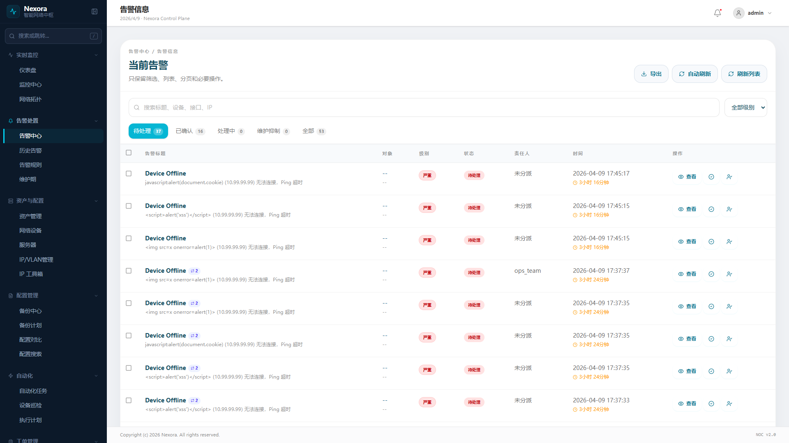

# Nexora 功能详解（二）：告警处置 — 告警信息 / 告警规则 / 维护期

> 本篇是 Nexora 系列文章第二篇，介绍「告警处置」模块。系列目录见 [项目整体介绍](zhihu.md)。

---

设备多了之后，告警管理就成了运维的核心工作之一。每天几十上百条告警，如果没有一套好的流程来分类、确认、追踪，很容易遗漏关键告警，或者在噪音里淹没真正的问题。

Nexora 的「告警处置」模块包含三个核心子项：告警信息（工作台）、告警规则、维护期。

---

## 1. 告警信息 (Alert Desk)

告警信息是日常最常用的页面，所有实时告警都在这里集中展示与处理。

### 告警列表

默认展示所有活动状态的告警，每条记录包含：告警标题、严重度（Critical / High / Medium / Low / Info）、触发时间、来源设备、告警类型。列表支持按严重度、类型、设备等多维度筛选。

### 告警确认与追踪

点击某条告警即可进入详情面板。运维人员可以对告警进行「确认」操作，表示已有人介入处理。系统会记录确认人、确认时间及处理进度，实现告警的全生命周期闭环。

---

## 2. 告警规则 (Alert Rules)

告警不可能全靠手动盯着看，得有自动化的规则来触发。告警规则页面就是配置这些逻辑的地方。

每条规则定义了：
- **触发条件**：什么指标超过什么阈值（比如 CPU > 90% 持续 5 分钟）。
- **严重度**：触发后生成什么级别的告警。
- **作用范围**：哪些设备或设备组适用这条规则。
- **通知策略**：触发后通过什么渠道（飞书、钉钉、邮件）通知谁。

通过灵活的规则配置，可以过滤掉大量的冗余信息，只把真正有风险的情况推送给运维人员。

---

## 3. 维护期 (Maintenance)

运维免不了要做升级、割接、机房搬迁这些计划内维护。这段时间里设备可能会短暂离线，如果不做处理，会产生一大堆无意义的噪音告警。

维护期功能允许设定一个时间窗口。在这个窗口内，指定范围内的设备产生的告警将自动静默，不会触发通知，也不会干扰正常的告警盯防。

---

## 小结

「告警处置」模块解决的是运维的第二个核心问题：**出了问题怎么发现、怎么处理、怎么追踪？**

三个子页面形成一个完整链路：
- **告警规则** → 定义异常逻辑
- **告警信息** → 实时处置、状态确认
- **维护期** → 过滤计划内噪音

日常使用建议：先把告警规则配好，然后日常只需要盯着「告警信息」工作台。做维护前记得提前设定维护期。

---

> 上一篇：[实时监控篇](zhihu-part1.md) | 下一篇：[资产管理篇](zhihu-part3.md)
>
> 系列目录：[项目整体介绍](zhihu.md)
