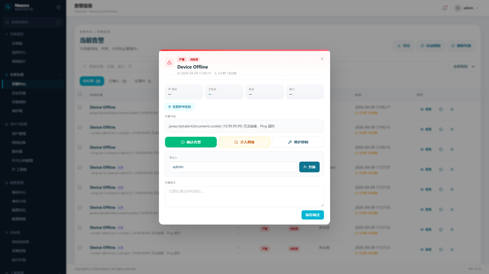
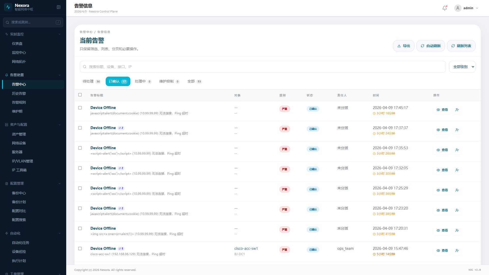
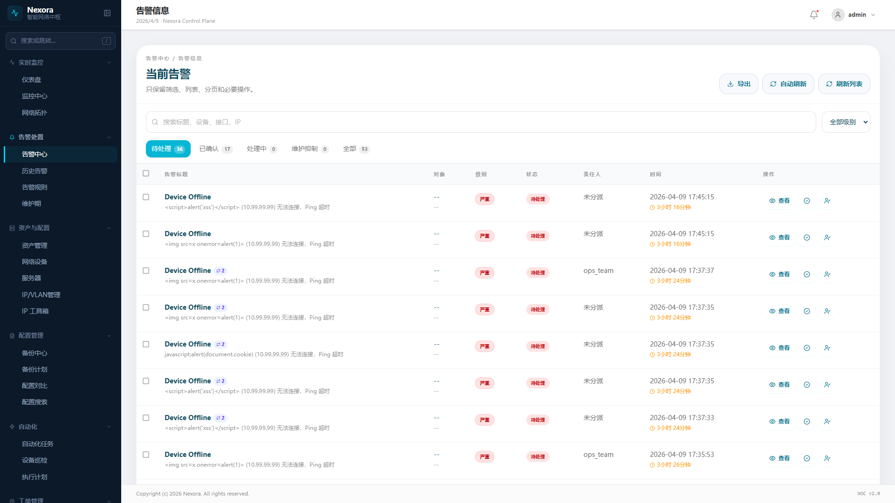
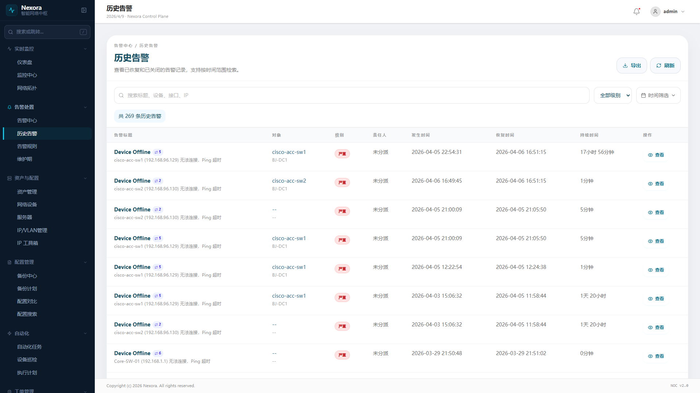
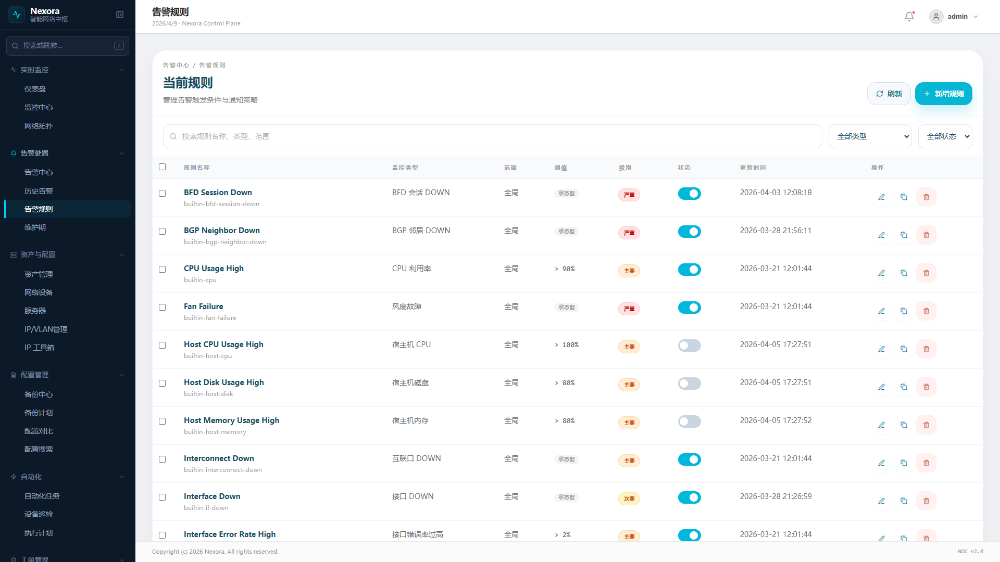
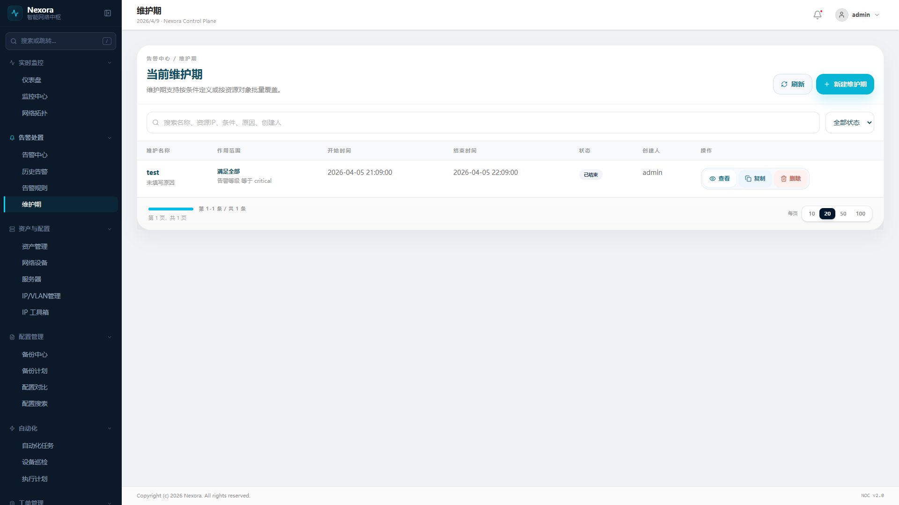

# Nexora 功能详解（二）：告警处置 — 告警中心 / 历史告警 / 告警规则 / 维护期

> 本篇是 Nexora 系列文章第二篇，介绍「告警处置」模块。系列目录见 [项目整体介绍](zhihu.md)。

---

设备多了之后，告警管理就成了运维的核心工作之一。每天几十上百条告警，如果没有一套好的流程来分类、确认、追踪，很容易遗漏关键告警，或者在噪音里淹没真正的问题。

Nexora 的「告警处置」模块包含四个子页面：告警中心、历史告警、告警规则、维护期。下面一个一个说。

---

## 1. 告警中心

告警中心是日常最常用的页面，所有实时告警都在这里处理。

### 告警列表

默认展示「待处理」（Open）状态的告警，每条记录包含：告警标题、严重度（Critical / High / Medium / Low / Info）、触发时间、来源设备、告警类型。列表支持按严重度、类型、设备等多维度筛选。

2589 条告警加载进来没有明显延迟，分页流畅。

### 告警详情

点击某条告警的「查看」按钮，右侧弹出详情面板：

详情里展示：
- 完整的告警描述和建议措施
- 来源设备信息（设备名、IP、型号）
- 告警时间线（触发 → 确认 → 处理 → 关闭）
- 关联的历史告警

### 告警确认操作

看完详情之后可以「确认」告警，表示有人在处理了。确认后告警从「待处理」标签移到「已确认」标签：

再切回「待处理」，标签切换流畅，状态实时更新：

### 实际使用建议

日常工作流：打开告警中心 → 按严重度排序（Critical 优先）→ 查看详情确认影响 → 确认告警并开始处理 → 处理完关闭。

告警列表支持自动刷新，新告警进来会有提示。如果团队有多个人同时看告警，平台会记录谁确认了哪条，避免重复处理。

---

## 2. 历史告警

已经解决或关闭的告警都归档在这里。

主要用途：
- **事后分析**：某台设备反复出问题，拉历史告警看看规律
- **报告取证**：月度汇报或者审计的时候，导出某个时间段内的告警数据
- **趋势追踪**：看告警数量是在增加还是减少，判断基础设施的健康趋势

支持按时间范围、设备、类型、严重度等多条件组合查询。数据量大的时候分页加载，不会一次拉全量。

---

## 3. 告警规则

告警不可能全靠手动盯着看，得有自动化的规则来触发。告警规则页面就是配置这些规则的地方。

每条规则定义了：
- **触发条件**：什么指标超过什么阈值（比如 CPU > 90% 持续 5 分钟）
- **严重度**：触发后生成什么级别的告警
- **作用范围**：哪些设备或设备组适用这条规则
- **通知方式**：触发后是否发邮件 / webhook 通知

### 使用场景

举几个常见的规则：

| 规则名 | 条件 | 严重度 |
|--------|------|--------|
| CPU 高利用率 | CPU > 90% 持续 5min | High |
| 内存告警 | Memory > 85% | Medium |
| 接口 Down | Interface OperStatus = Down | Critical |
| 设备离线 | SNMP 不可达 > 3 次 | Critical |

规则创建好之后，后端 SNMP 采集引擎会按周期检查，条件满足就自动生成告警到告警中心。

---

## 4. 维护期

运维免不了要做升级、割接、机房搬迁这些计划内维护，这段时间里设备可能会短暂离线或指标异常。如果不做处理，维护期间会产生一大堆无意义的告警，干扰正常的告警盯防。

维护期功能就是解决这个问题：设定一个时间窗口 + 影响的设备范围，在这个窗口内产生的告警自动静默，不会弹到告警中心。

### 关键字段

- **维护窗口名称**：说明白这次维护是干什么的
- **开始/结束时间**：精确到分钟
- **影响设备**：可以选单台设备、设备组、或按站点选
- **状态**：计划中 / 进行中 / 已结束

维护期结束后，之前静默的告警如果条件仍然满足，会重新生成。不会因为维护期结束就把真实问题吞掉。

### 实际经验

建议养成习惯：**做任何计划内维护之前都先创建维护期**。不然半夜割接的时候告警刷屏，值班的同事会被吵醒白折腾。

---

## 小结

「告警处置」模块解决的是运维的第二个核心问题：**出了问题怎么发现、怎么处理、怎么追踪？**

四个子页面形成一个完整链路：
- **告警规则** → 定义什么情况算异常
- **告警中心** → 实时看到异常、分派处理
- **历史告警** → 事后追溯和分析
- **维护期** → 过滤计划内噪音

日常使用建议：先把告警规则配好，然后日常只需要盯告警中心就行。做维护前记得设维护期。月底拉历史告警出报告。

---

> 上一篇：[实时监控篇](zhihu-part1.md) | 下一篇：[资产与配置篇](zhihu-part3.md)
>
> 系列目录：[项目整体介绍](zhihu.md)
