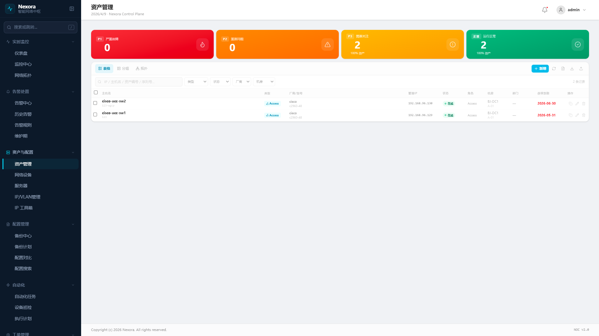
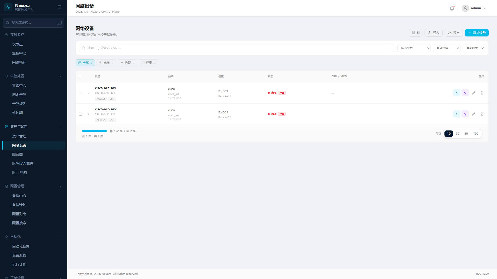
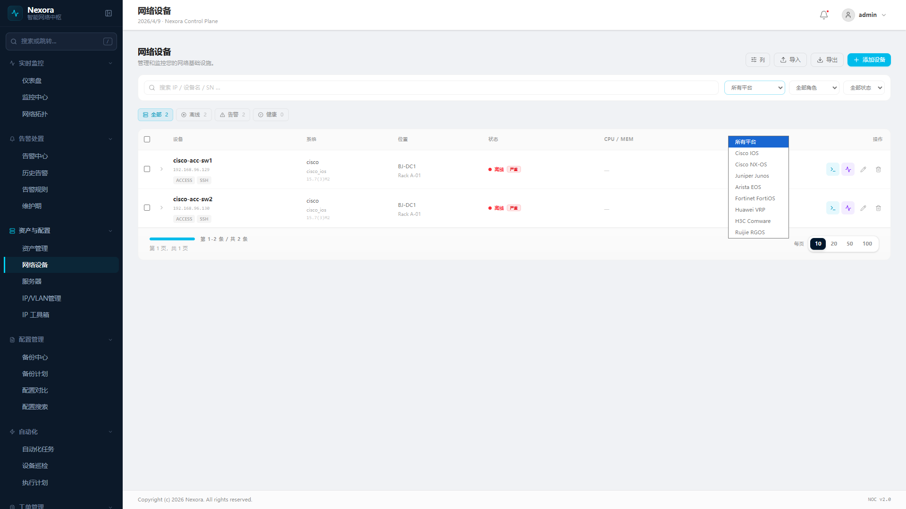
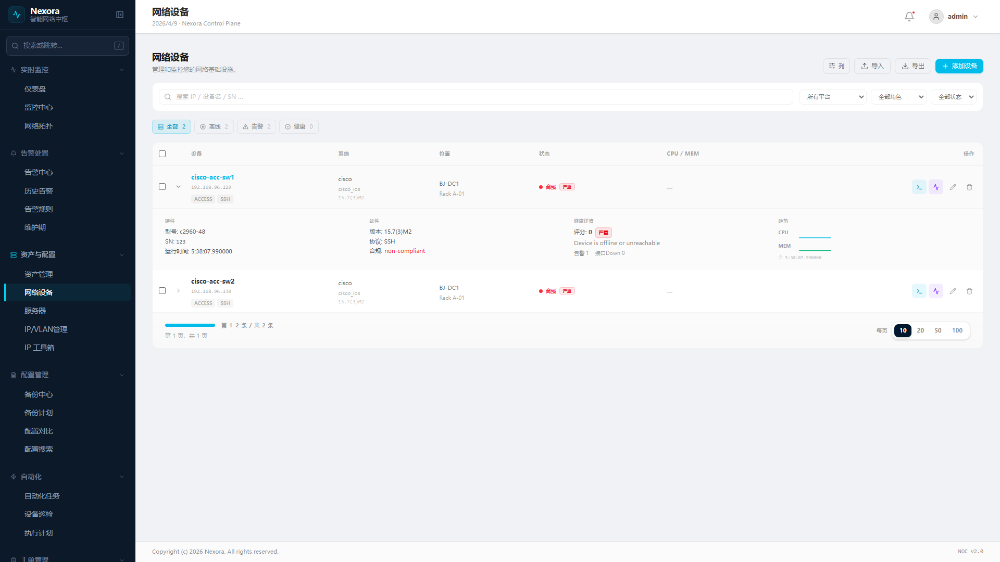
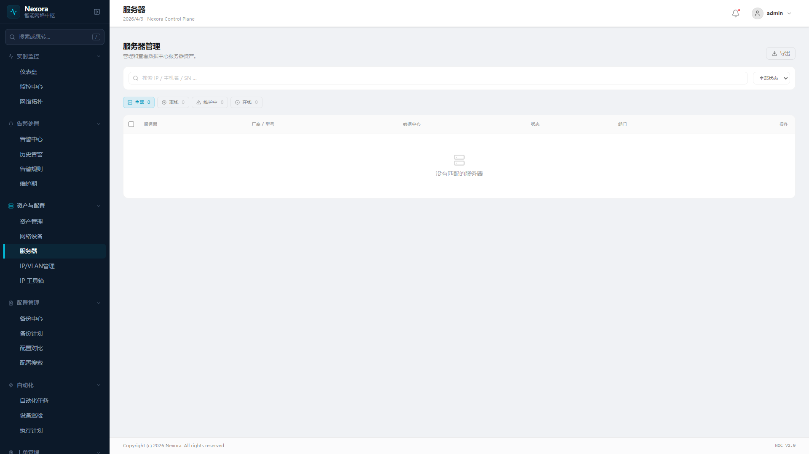
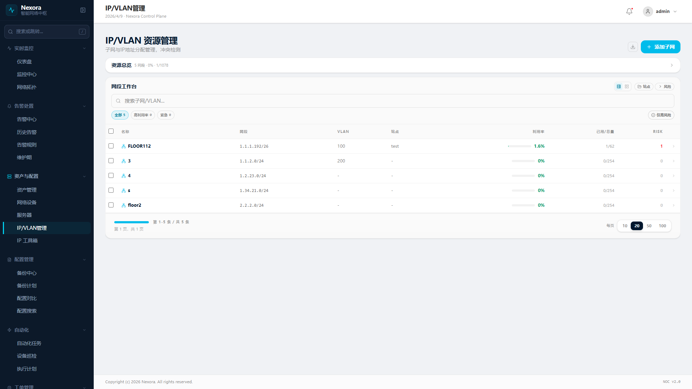
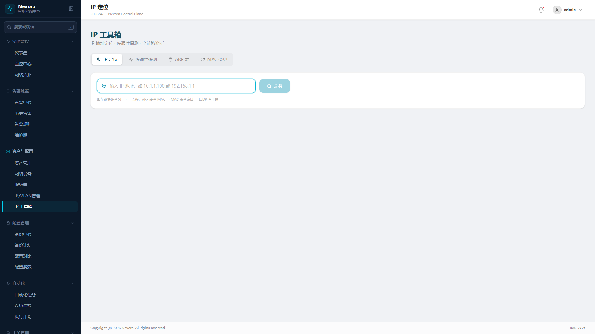

# Nexora 功能详解（三）：资产与配置 — 资产管理 / 网络设备 / 服务器 / IP-VLAN / IP工具箱

> 本篇是 Nexora 系列文章第三篇，介绍「资产与配置」模块。系列目录见 [项目整体介绍](zhihu.md)。

---

网络运维有个基础问题：**你管的东西到底有多少、都在哪、什么状态？** 如果连资产都说不清，后面的监控、告警、自动化全都是空中楼阁。

「资产与配置」是 Nexora 里内容最丰富的模块，包含 5 个子页面，覆盖从宏观统计到具体设备管理、从 IP 规划到网络工具的完整链路。

---

## 1. 资产管理

资产管理是整个模块的总览入口，提供全网资产的聚合统计视图。

页面展示的核心数据：
- **资产总数**：网络设备 + 服务器的汇总
- **分类统计**：按设备类型（路由器/交换机/防火墙/服务器）、按厂商（Cisco/Huawei/H3C/Arista/Juniper）、按站点、按状态的分布
- **健康概览**：在线率、离线设备列表、最近新增/退役设备

这个页面的定位是「资产总账」，运维主管和管理层看这一页就够了。需要具体操作某台设备的话，再往下钻到网络设备或服务器页面。

---

## 2. 网络设备

这是资产模块里日常用得最多的页面。所有网络设备（交换机、路由器、防火墙等）的增删改查都在这里。

### 设备列表

503 台设备全量加载，默认 50 条/页，列表包含：设备名、管理 IP、厂商、型号、OS 版本、状态（在线/离线/维护中）、站点、角色。

### 搜索与筛选

顶部搜索栏支持模糊搜索（设备名、IP 都行），输入即搜不用回车。旁边是平台筛选下拉框，选个 `cisco_ios` 就能只看 Cisco 设备：

还可以按站点、角色、状态等多条件组合筛选。500 台设备搜索 `SW-BJ`，毫秒级出结果。

### 设备详情弹窗

点击某台设备，弹出详情模态框。信息分几个区块：

- **基本信息**：设备名、管理 IP、厂商型号、OS 版本、序列号
- **网络信息**：协议支持、SNMP 社区字符串（脱敏显示）
- **位置信息**：站点、机房、机柜、U 位
- **连接状态**：最后在线时间、SSH/SNMP 可达性

底部还有一排快捷操作按钮：

这些按钮包括：
- **连通性测试**：Ping 目标设备，验证网络可达
- **SNMP 测试**：尝试 SNMP Get，验证 SNMP 配置是否正确
- **SSH 测试**：尝试 SSH 登录，验证凭据是否有效
- **查看配置**：跳转到该设备最新的配置备份

这个设计很实用——拿到一台新设备的信息后，不用切换页面就能快速验证连通性。

### 设备管理操作

设备的增删改操作都在列表页面完成：
- **新增**：填表单，必填字段有设备名、管理 IP、平台类型、凭据
- **编辑**：在详情弹窗里直接改
- **删除**：支持批量，有二次确认
- **导入**：支持 CSV 批量导入，方便从其他系统迁移

---

## 3. 服务器

服务器管理页面和网络设备页面结构类似，但字段有差异——服务器侧重 CPU/Memory/磁盘容量、操作系统、用途、负责人等信息。

1002 台服务器加载也很快。支持同样的搜索、筛选、分页、详情查看功能。

### 和网络设备的区别

两个页面虽然 UI 结构差不多，但后端数据模型是分开的：
- 网络设备走 `devices` 表，有 platform_type、firmware、SNMP 配置等字段
- 服务器走 `servers` 表，有 cpu_cores、ram_gb、disk_gb、os_type 等字段

分开管理是因为网络设备和服务器的运维关注点不同。网络设备关注配置备份和命令下发，服务器更关注系统指标和应用状态。

---

## 4. IP/VLAN 管理

网络规模大了之后，IP 地址和 VLAN 的规划管理就变成一个头疼的问题。很多团队还在用 Excel 记 IP 分配表，一旦有人忘记更新就乱套了。

Nexora 内置了 IPAM（IP Address Management）模块：

主要功能：
- **子网管理**：创建子网段，定义网关、掩码、用途描述
- **IP 分配**：每个 IP 的分配状态（空闲 / 已分配 / 保留）、绑定设备、分配时间
- **VLAN 管理**：VLAN ID、名称、描述、关联子网
- **冲突检测**：同一个 IP 被分配给多台设备时会告警
- **利用率统计**：每个子网的使用率可视化，快满了会高亮提醒

### 实际价值

有了 IPAM 之后，最大的好处是**规划新 IP 时不用翻 Excel 了**。直接看哪个子网还有空闲地址，点一下就分配。而且每次分配都有记录，谁什么时候分的都能追溯。

---

## 5. IP 工具箱

除了 IPAM，Nexora 还提供了一套常用的网络工具集：

工具列表：
- **IP 定位器**：输入一个 IP，查出它在哪台设备的哪个 VLAN、哪个接口上学习到的（基于 ARP/MAC 表关联）
- **子网计算器**：输入 IP 和掩码，自动计算网络地址、广播地址、可用主机范围
- **Ping 测试**：从平台服务器向目标 IP 发 Ping
- **端口检测**：检测目标 IP 的指定端口是否开放

### 使用场景

最常用的是 IP 定位器。比如有人报"10.1.2.100 这个 IP 不通了"，你不知道它接在哪台交换机上，用 IP 定位器一查就知道了——设备名、端口、VLAN、MAC 地址全给你列出来。

这比登录十几台交换机一台一台 `show arp` + `show mac address-table` 快多了。

---

## 小结

「资产与配置」模块解决的是运维的基础性问题：**把家底搞清楚**。

五个子页面层层递进：
- **资产管理** → 宏观总览、分类统计
- **网络设备** → 具体设备管理、详情查看、连通性验证
- **服务器** → 服务器专属管理
- **IP/VLAN 管理** → IP 地址和 VLAN 规划
- **IP 工具箱** → 日常网络排查工具

建议：先把设备资产导入完整（支持 CSV 批量导入），然后配好 SNMP 参数，后面的监控、告警、备份、自动化功能才能跑起来。资产数据是一切的基础。

---

> 上一篇：[告警处置篇](zhihu-part2.md) | 下一篇：[配置管理篇](zhihu-part4.md)
>
> 系列目录：[项目整体介绍](zhihu.md)
