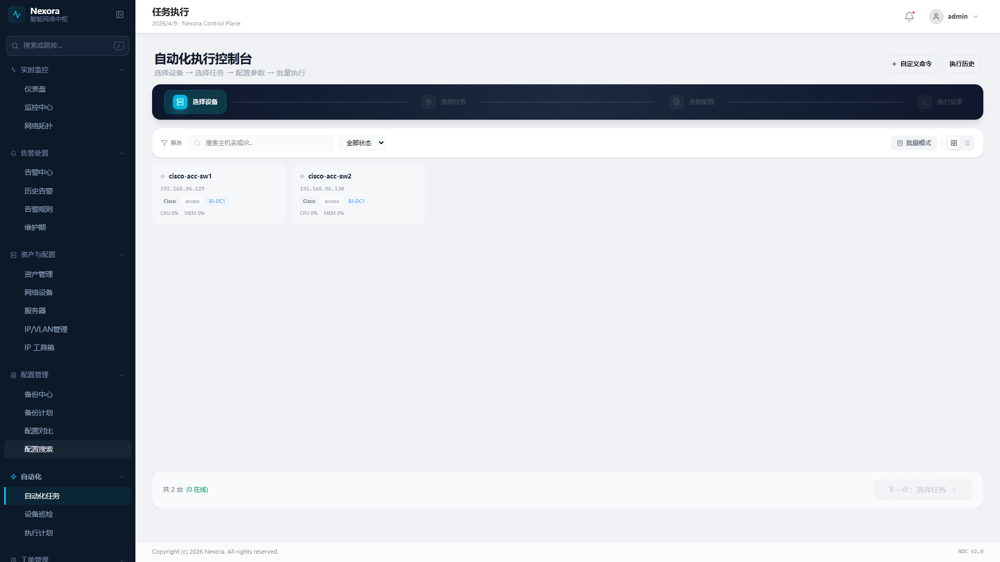

# Nexora 功能详解（四）：自动化 — 直接执行 / 方案库 / 执行历史

> 本篇是 Nexora 系列文章第四篇，介绍「自动化与合规」模块下的自动化子模块。系列目录见 [项目整体介绍](zhihu.md)。

---

自动化是 Nexora 最核心的能力，也是这个平台区别于“纯监控工具”的关键。前面几个模块（监控、告警、资产）都是在“看”，自动化模块是在“做”——把配置下发、日常维护等重复性工作真正自动化起来。

自动化子模块包含三个核心功能：直接执行、方案库、执行历史。

---

## 1. 直接执行 (Direct Execution)

直接执行（原 Task Runner）采用三步向导式设计，将一次自动化操作拆解为清晰的流转过程。

### 选设备与即时查询

运维人员可以在网格中快速筛选并勾选目标设备。选中后，系统会弹出 **Quick Query 面板**，支持一键查询接口状态、路由表、ARP/MAC 表等，确保在执行变更前对设备状态有充分了解。

### 参数化执行

填入命令或选择预设逻辑后，系统会进入**执行决策面板**。这是安全控制的核心：
- **阻塞性校验**：自动检测必填项、平台兼容性及高风险操作。
- **Dry-Run (模拟执行)**：默认开启，系统会模拟下发过程而不产生实际变更，确保脚本渲染正确。

---

## 2. 方案库 (Scenario Library)

方案库是预定义的最佳实践集合，内置了大量常用网络运维场景。

每个场景卡片都标注了**风险等级**（LOW / MEDIUM / HIGH），并内置了完整的流水线：
1. **Pre-Check**：前置健康检查。
2. **Execute**：主配置下发。
3. **Post-Check**：后置业务验证。
4. **Rollback**：失败后的自动回滚逻辑。

目前已涵盖 VLAN 调拨、BGP 邻居建立、ACL 规则更新等 20+ 典型场景。

---

## 3. 执行历史 (Execution History)

所有的自动化操作（无论是手动触发还是定时调度）都会被完整记录在执行历史中。

- **实时输出**：基于 WebSocket 技术，支持在大规模并发执行时实时看到每台设备的日志流。
- **状态追踪**：详细记录每台设备的执行时长、各阶段状态及最终输出结果。
- **回溯审计**：支持按时间、用户、任务类型检索历史记录，方便事后复盘。

---

## 小结

「自动化」模块的设计理念是：**效率提升，安全优先**。

- **直接执行** → 灵活的临时操作下发。
- **方案库** → 标准化的专家经验沉淀。
- **执行历史** → 透明化的操作追踪与复盘。

建议：先在测试设备上试用 Dry-Run 模式，熟悉流程后再正式下发。

---

> 上一篇：[资产管理篇](zhihu-part3.md) | 下一篇：[配置中心篇](zhihu-part5.md)
>
> 系列目录：[项目整体介绍](zhihu.md)
