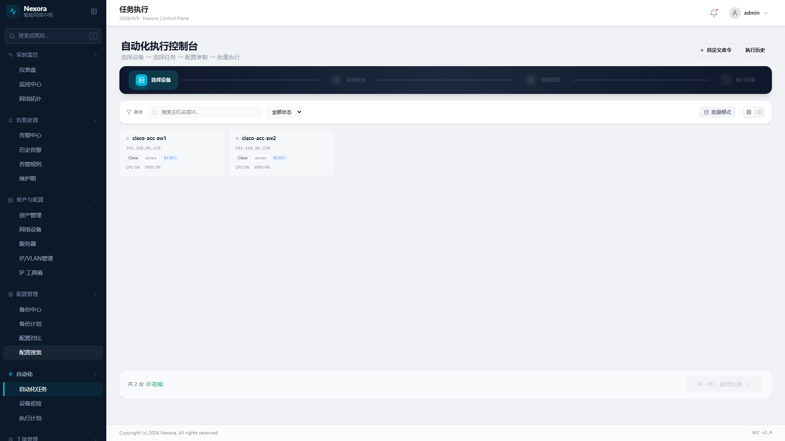
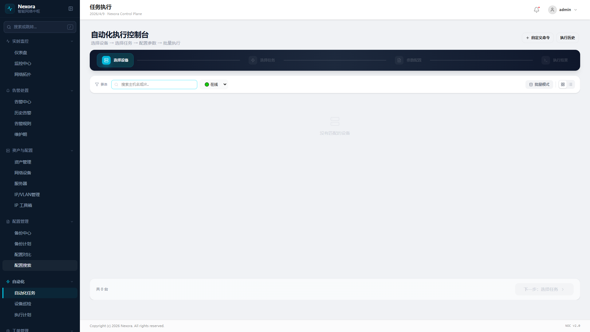
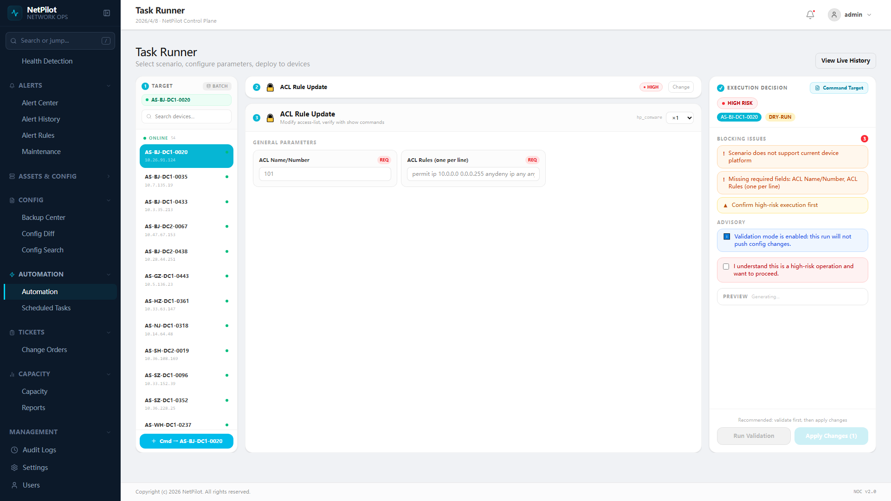
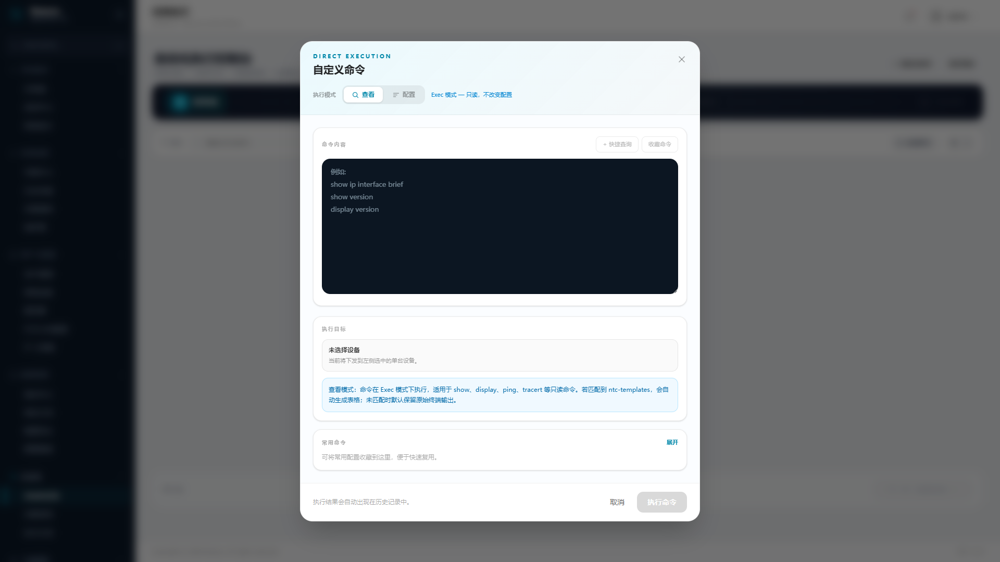
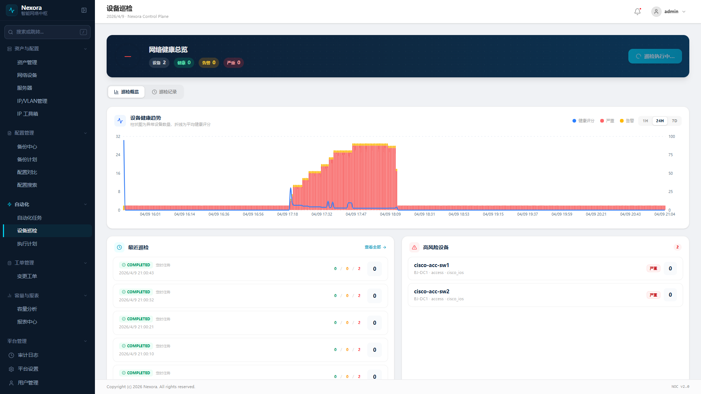
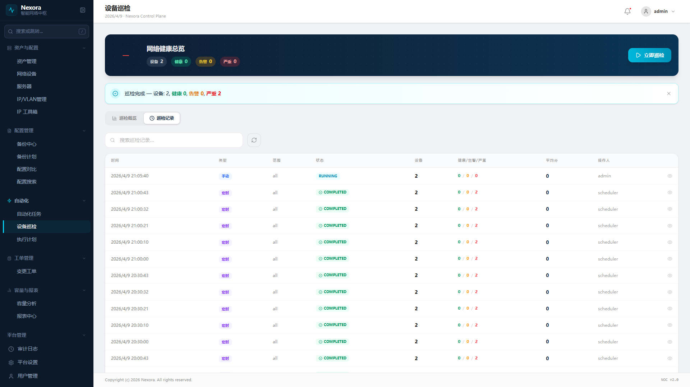
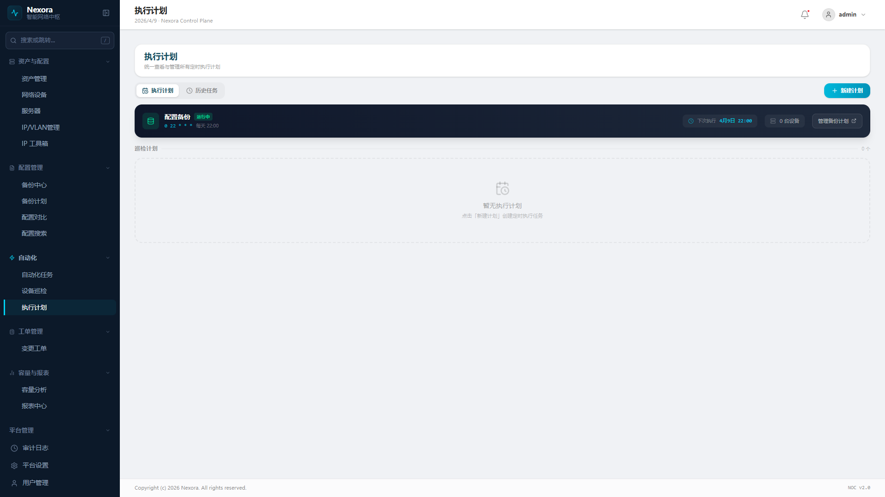
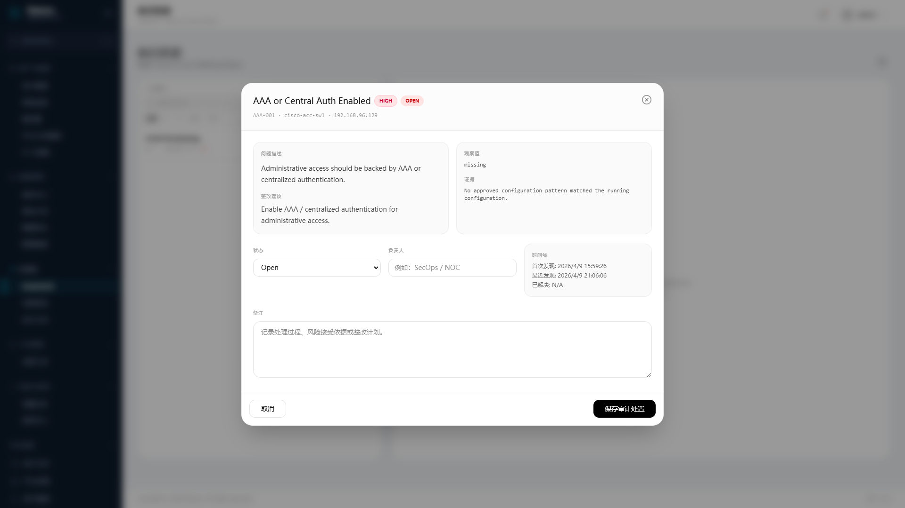

# Nexora 功能详解（五）：自动化 — 自动化任务 / 设备巡检 / 执行计划

> 本篇是 Nexora 系列文章第五篇，介绍「自动化」模块。系列目录见 [项目整体介绍](zhihu.md)。

---

自动化是 Nexora 最核心的能力，也是这个平台区别于"纯监控工具"的关键。前面几个模块（监控、告警、资产、配置）都是在"看"，自动化模块是在"做"——把配置下发、设备巡检、日常维护这些重复性工作自动化起来。

这个模块包含三个子页面：自动化任务（Task Runner）、设备巡检、执行计划。

---

## 1. 自动化任务（Task Runner）

这是整个平台的重头戏。Task Runner 采用三步向导式设计，把一次自动化操作拆成三个清晰的步骤。

### 第一步：选设备

进入 Task Runner，左侧展示在线设备网格，右边是场景库卡片，下方是执行决策区。

设备网格支持搜索和筛选。比如输入 `AS-BJ` 缩小范围，再勾选「仅在线」过滤掉离线设备，选中目标设备：

选中设备后，界面变化很明显：
- 设备卡片高亮显示
- 右侧弹出 **Quick Query 面板**：提供 Interfaces、ARP Table、MAC Table、VLAN、LLDP、Routes 等快捷查询按钮
- 底部出现自定义命令入口

Quick Query 这个设计很实用——还没开始做自动化，先快速查一下设备当前状态，确认操作前提条件。

### 第二步：选场景

点下一步进入场景选择页面，内置了一套场景库：

| 场景名 | 风险等级 | 说明 |
|--------|---------|------|
| VLAN Provisioning | LOW | VLAN 创建与配置 |
| BGP Neighbor Setup | HIGH | BGP 邻居配置 |
| ACL Rule Update | HIGH | ACL 规则更新 |
| Interface Shutdown/Recovery | MEDIUM | 接口启停 |
| NTP Server Configuration | LOW | NTP 配置 |
| SNMP Hardening | MEDIUM | SNMP 安全加固 |
| Static Route Management | MEDIUM | 静态路由管理 |
| OSPF Neighbor Configuration | HIGH | OSPF 邻居配置 |

每张场景卡片都标了风险等级，用颜色区分（绿色 LOW / 橙色 MEDIUM / 红色 HIGH），一眼就能看出哪些操作需要格外小心。

每个场景背后定义了完整的执行流程：**Pre-Check → Execute → Post-Check → Rollback** 四个阶段。不是简单地推命令上去就完事，而是有前置检查、后置验证、失败回滚的完整 pipeline。

### 第三步：参数配置与执行

选了场景之后，系统弹出参数表单。比如选了 ACL Rule Update，需要填 ACL Number 和 Rules：

填好参数后，右侧是**执行决策面板**——这是安全控制的核心：

决策面板展示：
- **BLOCKING ISSUES**：阻塞性问题（必须解决才能执行）。比如平台不匹配、必填字段缺失、高风险需确认
- **ADVISORY**：提醒性信息。比如默认开启了 DRY-RUN 模式
- **Run Validation**：干跑验证，不实际下发配置
- **Apply Changes**：真正执行

### 安全机制

Task Runner 内置了多层安全控制：

1. **DRY-RUN 模式**：默认开启，跑一遍流程但不实际推配置。确认无误后再关闭 DRY-RUN 执行
2. **BLOCKING ISSUE**：系统自动检测阻塞条件，有未解决的阻塞条件时 Apply 按钮不可点
3. **高风险确认**：HIGH RISK 场景必须手动勾选确认复选框
4. **平台匹配校验**：场景定义了支持的平台（比如 ACL 场景只支持 Cisco），选了不匹配的设备会阻塞
5. **操作审计**：每次执行（包括 DRY-RUN）都记录到审计日志

这套机制确保了"想推就推"不会发生——必须过了所有校验才能下发。

### 自定义命令

除了预设场景，还可以用自定义命令直接向设备推任意命令：

自定义命令分两种模式：
- **查询模式**：执行 show 类命令，只读不改
- **配置模式**：执行配置命令，需要更高权限

---

## 2. 设备巡检

巡检是定期对设备做健康检查，说白了就是把运维人员每天手动查的那些指标自动化起来。

### 巡检概览

概览页展示：
- 上次巡检时间和结果摘要
- 设备健康评分分布
- 待处理的巡检问题

### 巡检检查项

触发一次巡检后，平台对目标设备跑一套预定义的检查：

| 检查项 | 说明 | 判定标准 |
|--------|------|---------|
| 连通性 | Ping + SSH | 不通则 Critical |
| CPU 利用率 | SNMP 采集 | > 90% 为异常 |
| 内存利用率 | SNMP 采集 | > 85% 为异常 |
| 温度 | SNMP 采集 | 超设备阈值为异常 |
| 接口状态 | show interfaces | Admin Up + Oper Down 为异常 |
| 合规状态 | 合规规则检查 | 不合规为 Warning |

跑完之后给出健康评分（0-100）和问题聚合。

### 巡检记录

每次巡检都有完整记录，可以回溯某台设备某次巡检的具体结果——哪些检查通过了、哪些有问题、问题是什么严重度。

### 使用建议

建议每天至少跑一次全量巡检（可以配合执行计划自动调度），重点设备（核心交换机、出口路由器）可以提高频率到每 4 小时一次。

---

## 3. 执行计划

自动化任务和设备巡检都可以手动触发，但日常运维中很多操作是需要定期执行的。执行计划就是把这些操作调度起来。

### 调度配置

和备份计划类似，基于 Cron 表达式调度：
- 支持预设模板（每日、每周、每月、自定义）
- 创建好后展示 Cron 的自然语言描述（"每天凌晨 3 点"）
- 展示预计下 5 次执行时间

### 作用范围

执行计划可以按多个维度过滤作用设备：
- **按平台**：只对 Cisco 设备执行
- **按角色**：只对核心层设备执行
- **按位置**：只对北京站点的设备执行
- **按设备组**：自定义分组

### 执行历史

每次执行（无论手动还是计划触发）都记录在执行历史里：触发时间、执行状态、目标设备列表、成功/失败数、执行耗时。点进去能看到每台设备的详细输出。

---

## 小结

「自动化」模块是 Nexora 的核心竞争力：

- **Task Runner** → 三步向导式配置下发，内置场景库 + 安全校验 + DRY-RUN
- **设备巡检** → 自动化健康检查，出评分给报告
- **执行计划** → Cron 调度，让自动化真正"自动"

关键设计理念：**安全优先**。DRY-RUN 默认开启、BLOCKING ISSUE 阻塞执行、高风险需确认、全程审计追踪。不会因为自动化反而搞出更大的故障。

建议：先熟悉内置场景库，然后从低风险场景（NTP 配置、SNMP 加固）开始试用，确认流程没问题后再用到 BGP/ACL 这些高风险场景。

---

> 上一篇：[配置管理篇](zhihu-part4.md) | 下一篇：[工单与合规篇](zhihu-part6.md)
>
> 系列目录：[项目整体介绍](zhihu.md)
