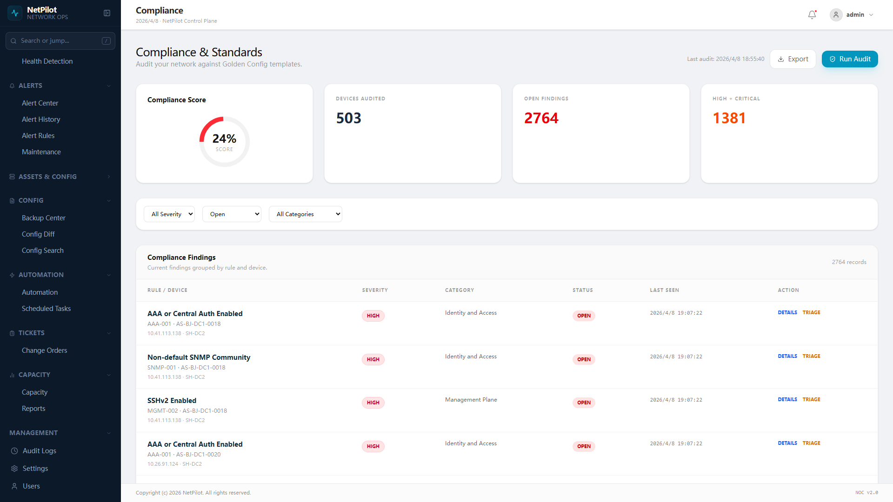

# Nexora 功能详解（六）：合规审计 — 合规检测 / 修复建议

> 本篇是 Nexora 系列文章第六篇，介绍「自动化与合规」模块下的合规子模块。系列目录见 [项目整体介绍](zhihu.md)。

---

网络运维到了一定规模，就不能再“谁想改就改”了。除了自动化执行，还需要有一套合规基线来约束和审计。Nexora 的「合规审计」模块专注于配置合规性，确保全网设备始终符合安全标准与最佳实践。

---

## 1. 合规概览 (Compliance Overview)

合规概览页面展示了全网的整体安全态势，是管理层最关注的“红黑榜”。

- **合规评分**：基于所有设备的审计结果计算出的百分制评分，评分越高表示风险越低。
- **违规统计**：按严重度（Critical / High / Medium / Low）对全网违规项进行分类统计。
- **治理趋势**：展示合规评分随时间的变化曲线，直观评估一段时间内的合规治理效果。

---

## 2. 合规检测 (Compliance Audit)

合规检测是该模块的核心引擎。系统会根据预定义的 **Golden Config（黄金配置）** 模板，对设备实际配置进行深度扫描与比对。

### 审计规则集

平台内置了一套符合主流厂商（Cisco/Huawei/H3C）安全基线的规则，例如：
- **认证审计**：是否启用了集中认证（AAA/TACACS+）。
- **协议安全**：是否禁用了不安全的协议（如 Telnet、SNMPv1/v2c）。
- **加密策略**：是否使用了强加密算法及 SSH v2。
- **标准配置**：NTP、Syslog、SNMP 团体名等是否符合企业统一标准。

### 发现详情 (Findings)

每条审计发现都会提供详尽的上下文：
- **违规证据**：直接定位并高亮显示配置中的违规行。
- **风险等级**：明确该项违规的安全风险权重。
- **修复建议**：提供符合基线的标准配置模板。

---

## 3. 自动化修复 (Remediation)

发现问题只是第一步，解决问题才是目的。Nexora 支持针对合规违规项进行自动化修复。

- **一键修复**：在查看违规详情时，可直接点击“一键修复”，平台会根据预设的修复模板自动生成 CLI 脚本。
- **批量治理**：支持对同类违规项进行跨设备的批量修复，极大提升了合规治理的效率。
- **闭环验证**：修复完成后，系统会自动触发二次审计，验证违规项是否已彻底闭合。

---

## 小结

「合规审计」模块解决的是运维的治理与安全问题：**配置符合标准吗？哪里不安全？怎么修复？**

- **合规检测** → 发现隐患。
- **修复建议** → 提供标准。
- **自动化修复** → 消除风险。

建议：先建立起企业的 Golden Config 基线，然后定期（如每周）执行一次全网合规审计，稳步提升网络整体的安全水位。

---

> 上一篇：[配置中心篇](zhihu-part5.md) | 下一篇：[容量与报表篇](zhihu-part7.md)
>
> 系列目录：[项目整体介绍](zhihu.md)
