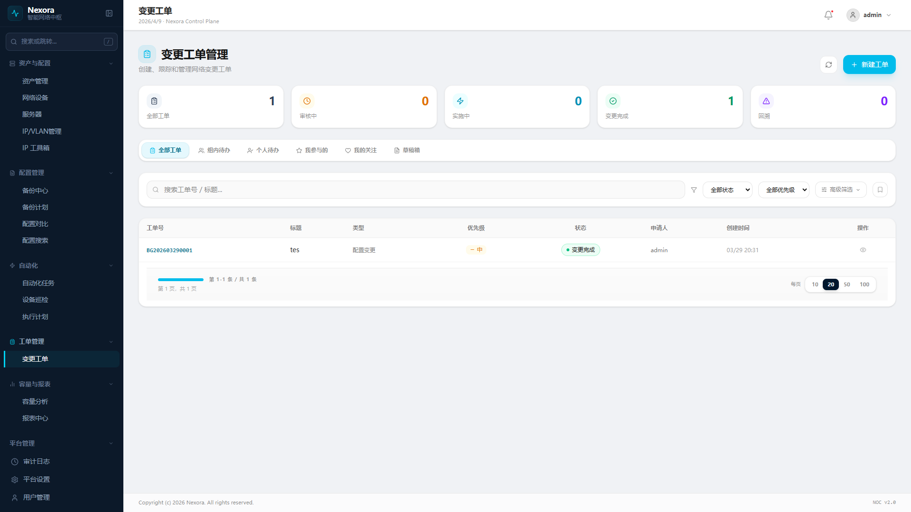
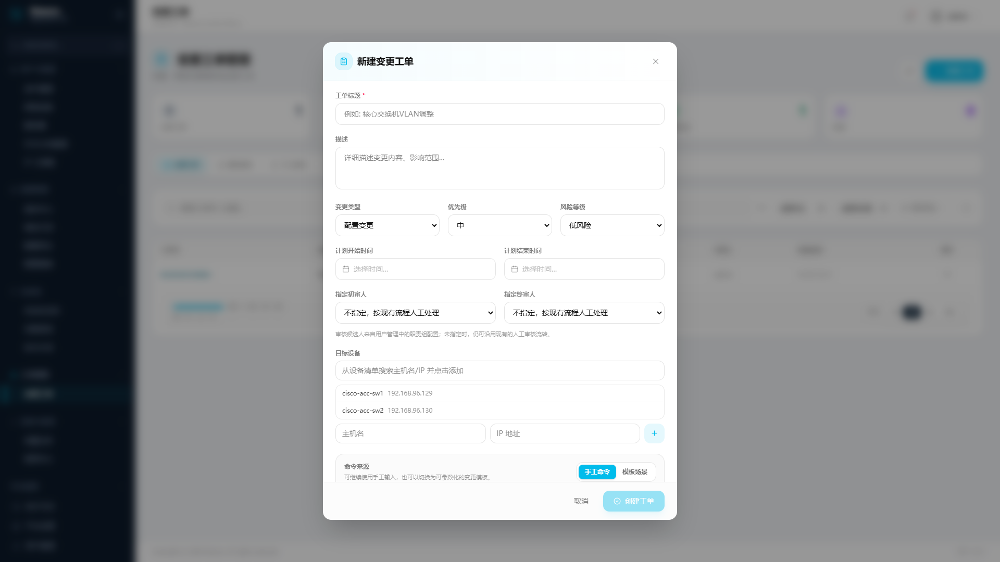
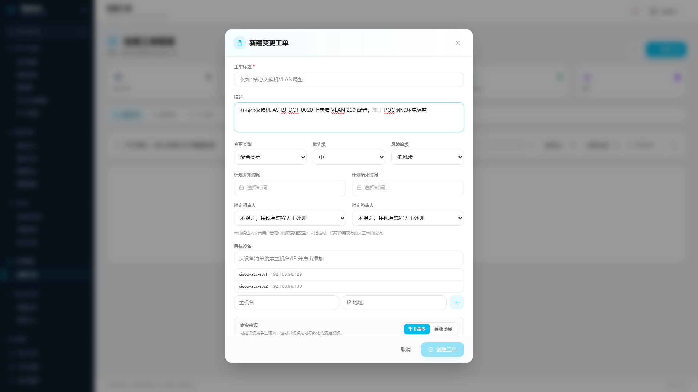
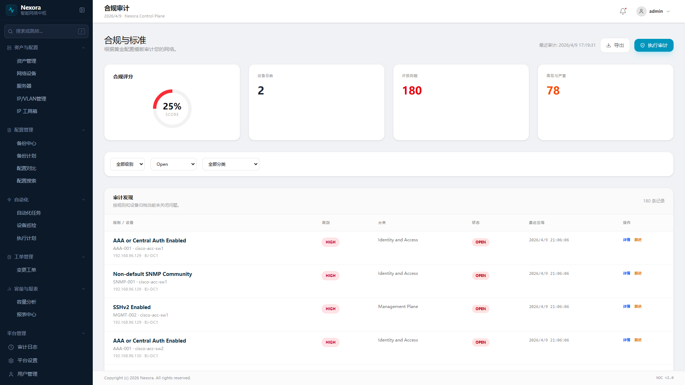
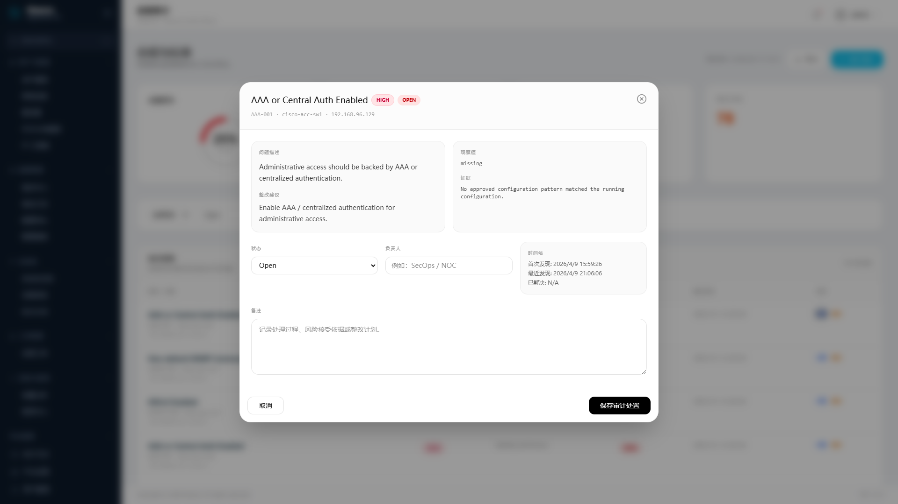

# Nexora 功能详解（六）：工单与合规 — 变更工单 / 合规检查

> 本篇是 Nexora 系列文章第六篇，介绍「工单管理」和「合规检查」两个模块。系列目录见 [项目整体介绍](zhihu.md)。

---

网络运维到了一定规模，就不能再"谁想改就改"了。得有变更审批流程，得有合规基线检查。这两个模块虽然导航位置不同，但逻辑上高度关联——变更工单管"怎么改"，合规检查管"改完符不符合标准"。

---

## 1. 变更工单

变更工单是运维流程规范化的核心。在 Nexora 里，任何涉及设备配置变更的操作都建议走工单流程。

### 工单列表



列表展示所有工单：工单号、标题、类型、优先级、风险等级、当前状态、创建人、创建时间。支持按状态（待审批 / 已批准 / 执行中 / 已完成 / 已驳回）和优先级筛选。

### 创建变更工单

点「+ 新建工单」打开表单：



工单表单的字段设计覆盖了变更管理的关键信息：

**基本信息区**：
- 工单标题
- 变更描述（详细说明这次改什么、为什么改）
- 变更类型（标准变更 / 紧急变更 / 计划变更）
- 优先级（Low / Medium / High / Critical）
- 风险等级（Low / Medium / High）

**目标设备与时间**：
- 选择本次变更涉及的设备（支持多选）
- 计划执行时间窗口



**执行内容**：
- 要执行的命令列表
- 回退方案（如果变更出问题了怎么恢复）


回退方案是必填项——这是变更管理的基本要求。没有回退方案的变更不应该被批准。

### 审批流程

工单提交后进入审批流。Nexora 实现了**三层审批**：

```
申请人 → 初审人 → 终审人 → 执行人
```

每一步都有状态追踪：
- **申请人**：创建工单，提交审批
- **初审人**：技术层面审核变更方案是否合理
- **终审人**：管理层面审核风险是否可控
- **执行人**：审批通过后执行变更

审批可以通过或驳回，驳回需要填写理由。执行完成后，工单记录完整的时间线——谁在什么时间做了什么操作，审计追踪一清二楚。

### 角色分配

审批流中的角色绑定在用户管理里配置。每个用户除了系统角色（Administrator / Operator / Viewer），还可以分配工单角色（申请人 / 初审人 / 终审人 / 执行人），实现更细粒度的权限控制。

### 适用场景

变更工单对于正规一点的运维团队来说是刚需：
- 等保要求的变更审批留痕
- ITIL 流程中的变更管理
- 多人协作时避免"不知道谁改了什么"
- 紧急变更也要走流程，事后补单

---

## 2. 合规检查

合规检查关注的是设备配置是否符合安全基线和最佳实践。

### 合规概览


概览页展示整体合规态势：
- **合规评分**：全网设备的加权合规分数
- **合规缺陷总数**：按严重度分布
- **趋势图**：合规评分的历史变化
- **Top 违规设备**：最需要关注的设备列表

### 执行合规审计

点「执行审计」按钮，平台对所有设备跑一轮合规检查。检查内容基于预定义的合规规则集：



审计完会生成结果列表，每条记录是一个合规发现（Finding），包含：
- 规则名称
- 严重度（Critical / High / Medium / Low）
- 影响设备
- 状态（Open / 已修复 / 已豁免）

### 合规发现详情

点进某条发现，看到完整的详情信息：


详情包括：
- **规则描述**：这条规则检查什么
- **修复建议**：建议怎么改
- **观测值**：设备实际的配置值
- **证据**：从设备上采集到的具体配置行
- **责任人**：分配给谁处理
- **时间线**：发现时间、状态变更历史

### 合规规则示例

平台内置了一套网络安全基线规则，比如：

| 规则 | 严重度 | 说明 |
|------|--------|------|
| AAA or Central Auth Enabled | HIGH | 是否启用了 AAA 或集中认证 |
| SSH v2 Required | HIGH | 是否使用 SSH v2（禁用 v1） |
| Password Complexity | MEDIUM | 密码是否符合复杂度要求 |
| SNMP v3 Required | MEDIUM | 是否使用 SNMPv3（禁用 v1/v2） |
| NTP Configured | LOW | 是否配置了 NTP 时间同步 |
| Logging Enabled | LOW | 是否启用了日志记录 |

这些规则可以自定义和扩展。

### 合规发现处理



发现的处理流程：
1. **确认问题**：看到发现后确认是真实问题还是误报
2. **分配责任人**：指派给对应的运维人员
3. **修复**：按建议修改设备配置
4. **验证**：再跑一轮审计确认已修复
5. **豁免**（可选）：某些发现如果有合理理由不修复，可以标记为豁免并记录原因

800 条合规发现在页面上筛选和翻页都很流畅，没有性能问题。

---

## 两个模块的协同

变更工单和合规检查经常是联动使用的：

1. **合规审计**发现某台设备 SSH v1 没禁用
2. 创建**变更工单**，计划修改该设备的 SSH 配置
3. 工单审批通过后，通过**自动化任务**下发配置
4. 再跑一轮**合规审计**确认问题已修复

这就是一个完整的合规闭环：发现 → 计划 → 执行 → 验证。

---

## 小结

- **变更工单** → 流程化的变更管理，三层审批 + 全程审计 + 回退方案
- **合规检查** → 基线检查 + 自动化审计 + 发现追踪 + 修复验证

这两个模块对于有等保要求或者 ITIL 流程要求的团队来说基本是必备的。即使没有这些硬性要求，养成"改配置走工单、定期跑合规"的习惯，也能大幅降低运维事故风险。

---

> 上一篇：[自动化篇](zhihu-part5.md) | 下一篇：[容量与报表篇](zhihu-part7.md)
>
> 系列目录：[项目整体介绍](zhihu.md)
