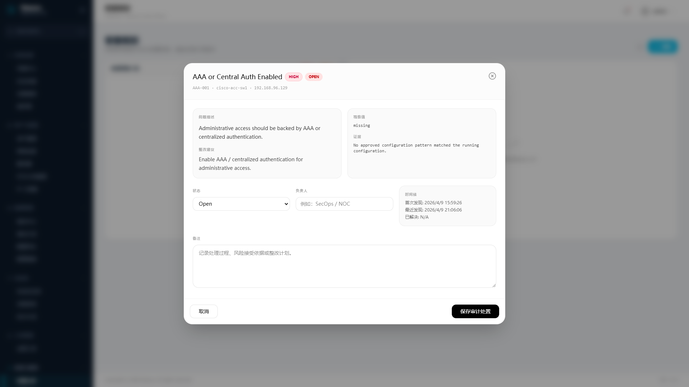
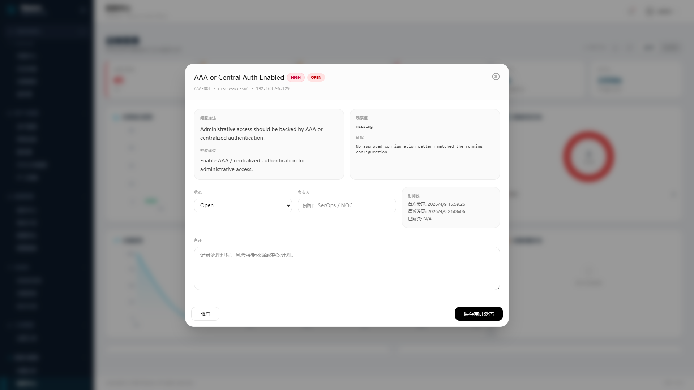

# Nexora 功能详解（七）：容量与报表 — 容量分析 / 报表中心

> 本篇是 Nexora 系列文章第七篇，介绍「容量与报表」模块。系列目录见 [项目整体介绍](zhihu.md)。

---

运维不光要处理眼前的问题，还得往前看。**哪台设备快到瓶颈了？上个月的可用率多少？MTTR 有没有改善？** 这些问题需要数据来回答。

「容量与报表」模块就是为此而设，包含容量分析和报表中心两个子页面。

---

## 1. 容量分析

容量分析做的事情是：基于历史数据预测未来趋势，提前告诉你哪些设备什么时候会资源不够用。

### 概览页

概览页展示：
- **全网平均利用率**：CPU、Memory、磁盘的平均利用率
- **高负载设备 TOP 列表**：哪些设备的资源利用率最高
- **趋势概览**：最近 7 天 / 30 天的利用率变化

### 设备级详情

选中某台设备，能看到更详细的信息：
- **历史趋势图**：CPU、Memory、接口流量的时间序列曲线
- **预测曲线**：基于历史数据做线性外推，预测未来几周的利用率走势
- **容量预警**：预测某个资源什么时候到 80%、什么时候到 95%

比如平台可能会告诉你："这台核心交换机的 CPU 按当前增长趋势，大概 35 天后会到 80%，67 天后会到 95%。" 这就给了你提前规划扩容的时间窗口。

### 流量热点

除了设备级的资源分析，容量分析还能识别**流量热点接口**——哪些端口的流量长期处于高位，可能需要做链路扩容或流量调度。

### 实际价值

容量分析解决的是"被动救火"到"主动规划"的转变：
- 不等设备 CPU 100% 告警了才去处理，而是提前几周就知道要扩容
- 不等链路跑满了才去加带宽，而是看到趋势后提前申请资源
- 汇报的时候有数据支撑："根据容量分析，我们需要在 Q3 之前给北京机房增加 2 台核心交换机"

---

## 2. 报表中心

报表中心聚合了平台各模块的 KPI 数据，提供可视化的运营报表。

### 报表页面

页面分几个区块：

**核心 KPI 面板**：

| 指标 | 说明 |
|------|------|
| 可用率 | 全网设备平均在线率 |
| 任务成功率 | 自动化任务执行成功率 |
| 合规评分 | 全网合规检查评分 |
| 活跃告警数 | 当前未处理的告警数 |
| MTTR | 平均恢复时间（Mean Time To Repair） |
| MTTA | 平均确认时间（Mean Time To Acknowledge） |

**趋势图表**：
- 任务执行趋势（每日任务数 + 成功率）
- 合规趋势（评分变化曲线）
- 告警来源分布（按设备 / 按类型 / 按严重度）

### 时间范围

时间范围支持选 7 天或 30 天，数据每 30 秒自动刷新。大屏展示的时候接着看就行，不用手动刷新。

### Excel 导出

报表数据支持导出为 Excel 文件，导出的文件是多 Sheet 格式：

| Sheet | 内容 |
|-------|------|
| KPI Summary | 核心指标汇总 |
| Task Trends | 任务执行趋势数据 |
| Compliance Trends | 合规评分趋势数据 |
| Alert Distribution | 告警来源分布 |

写周报月报的时候，直接导出 Excel 贴进去就行，不用手动抄数据。

### MTTR 和 MTTA

这两个指标对运维团队来说很重要：

- **MTTR（平均恢复时间）**：从告警触发到问题解决的平均时长。越短说明团队响应和处理能力越强
- **MTTA（平均确认时间）**：从告警触发到有人确认的平均时长。越短说明监控值守做得越好

这两个指标可以作为运维团队的 KPI 考核依据，也是向管理层汇报运维质量的关键数据。

---

## 小结

「容量与报表」模块服务于运维的"看长线"需求：

- **容量分析** → 资源利用率趋势、容量预测、扩容规划
- **报表中心** → KPI 聚合、趋势可视化、Excel 导出

建议使用方式：
- 每周看一次容量分析，关注 TOP 高负载设备和预警时间
- 每月导出一次报表，用于月报和运维回顾
- 把 MTTR 和 MTTA 作为团队考核指标持续跟踪

---

> 上一篇：[工单与合规篇](zhihu-part6.md) | 下一篇：[平台管理篇](zhihu-part8.md)
>
> 系列目录：[项目整体介绍](zhihu.md)
