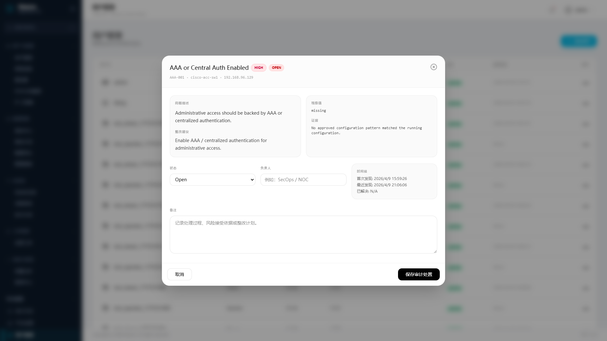

# Nexora 功能详解（八）：平台管理 — 审计日志 / 平台配置 / 用户管理

> 本篇是 Nexora 系列文章最后一篇，介绍「平台管理」模块。系列目录见 [项目整体介绍](zhihu.md)。

---

前面七篇介绍的都是面向网络运维业务的功能，而本篇关注的是平台自身的安全与管理——确保“谁在什么时间、什么地点、做了什么事情”都清晰可查。

「平台管理」包含三个核心子项：审计日志、平台配置、用户管理。

---

## 1. 审计日志 (Audit Logs)

审计日志记录了平台上发生的所有关键操作和系统事件，是安全审计与故障追溯的基石。

- **多维追踪**：记录操作时间、操作人、来源 IP、操作类型及具体的目标设备。
- **不可篡改**：日志一旦写入即持久化存储，满足行业等保合规要求。
- **敏感过滤**：内置 `SanitizeFilter`，自动对日志中的凭据、密码等敏感信息进行脱敏处理。

---

## 2. 平台配置 (Configuration)

这里是平台的“中枢神经”，统一管理支撑自动化与监控运行的核心参数。

- **全局变量**：集中维护 NTP、DNS、Syslog 等全网通用的配置参数，支持模板动态引用。
- **认证凭据**：管理用于登录设备的 SSH/SNMP 认证信息，所有敏感数据均采用 AES-256 加密存储。
- **通知渠道**：配置飞书、钉钉、邮件等外部通知接口，确保告警信息实时触达。

---

## 3. 用户管理 (User Management)

用户管理负责定义平台的访问边界与操作权限。

- **RBAC 权限控制**：基于角色的权限管理（Administrator、Operator、Viewer），覆盖菜单可见性与后端 API 调用权限。
- **账号生命周期**：支持用户账号的创建、禁用及密码强制重置。

---

## 系列总结

到这里，Nexora 的 6 大主菜单、30+ 个核心功能点就全部介绍完了。回顾整个系列：

| 篇目 | 模块 | 核心价值 |
|------|------|---------|
| [整体介绍](zhihu.md) | 全局 | 项目定位、技术栈、功能总览 |
| [第一篇](zhihu-part1.md) | 实时监控 | 仪表盘 / 监控中心 / 拓扑 / 健康巡检 |
| [第二篇](zhihu-part2.md) | 告警处置 | 告警信息 / 规则 / 维护期屏蔽 |
| [第三篇](zhihu-part3.md) | 资产管理 | 设备列表 / IP-VLAN / 标签系统 |
| [第四篇](zhihu-part4.md) | 自动化 | 直接执行 / 方案库 / 执行历史 |
| [第五篇](zhihu-part5.md) | 配置中心 | 备份历史 / 差异对比 / 配置搜索 / 漂移检测 |
| [第六篇](zhihu-part6.md) | 合规审计 | 合规检测 / 修复建议 / 自动化修复 |
| [第七篇](zhihu-part7.md) | 容量与报表 | 容量规划 / 运营报表中心 |
| [第八篇](zhihu-part8.md) | 平台管理 | 审计日志 / 平台配置 / 用户管理 |

项目还在持续迭代中，欢迎在 GitHub 上交流想法。

---

> 上一篇：[容量与报表篇](zhihu-part7.md)
>
> 系列目录：[项目整体介绍](zhihu.md)
