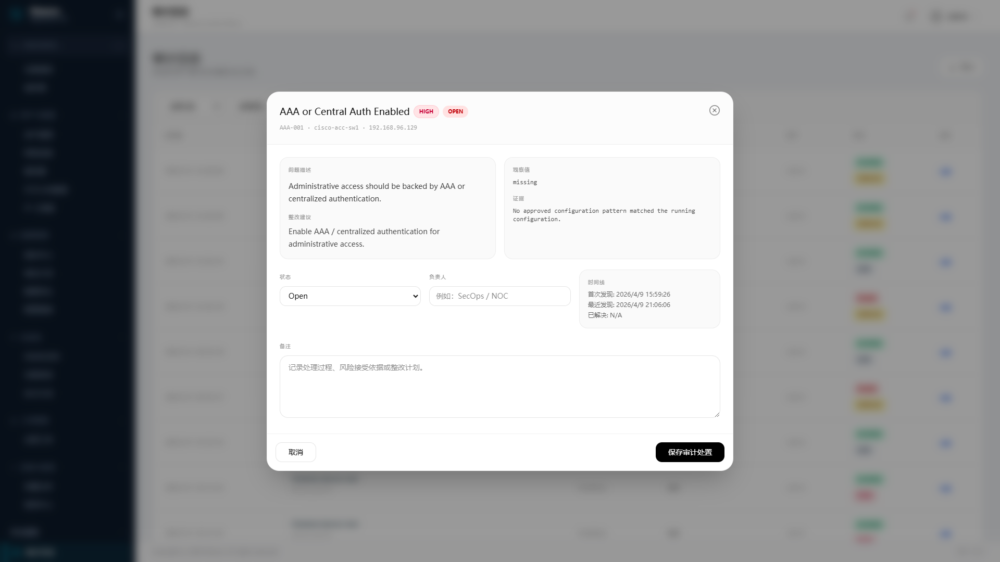
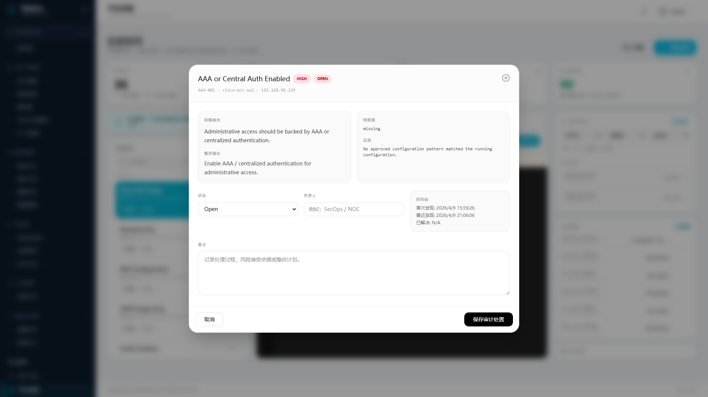
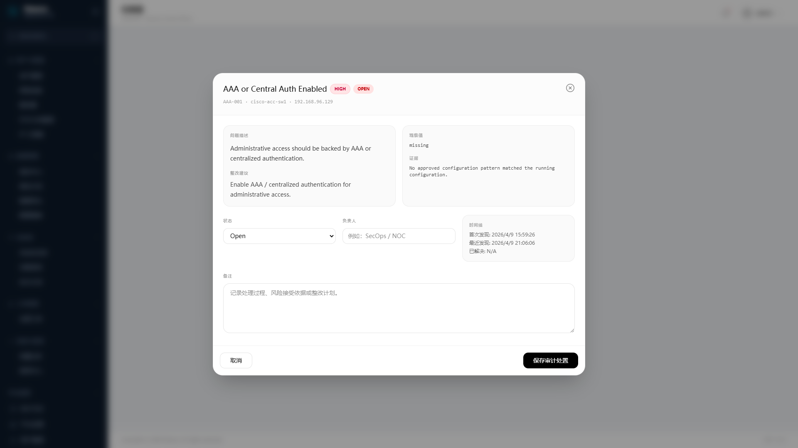

# Nexora 功能详解（八）：平台管理 — 审计日志 / 平台设置 / 用户管理

> 本篇是 Nexora 系列文章最后一篇，介绍「平台管理」模块。系列目录见 [项目整体介绍](zhihu.md)。

---

前面七篇讲的都是面向网络运维业务的功能，这篇讲的是平台本身的管理——谁能用、谁能做什么、做了什么全都记下来。

「平台管理」包含三个子页面：审计日志、平台设置、用户管理。看起来不起眼，但对安全合规和团队协作非常关键。

---

## 1. 审计日志

审计日志记录了平台上发生的所有操作和系统事件，是安全审计和事后追溯的基础。

### 日志列表

每条审计记录包含：
- **时间戳**：精确到毫秒
- **操作类型**：登录、登出、设备操作、配置变更、告警处理、工单操作等
- **分类**：认证、设备管理、配置管理、自动化、告警、系统
- **严重度**：Info / Warning / Error / Critical
- **操作目标**：具体是哪台设备、哪条工单、哪个配置
- **执行人**：谁做的
- **来源 IP**：从哪个 IP 操作的

5077 条审计日志在列表里翻页加载都很快。

### 多维过滤

支持按分类、严重度、状态、时间范围做组合筛选。比如要查"过去 7 天内所有配置变更操作"，选好条件一点就出来。

### 导出

筛选结果支持导出为文件，做等保或安全审计的时候直接拿去用就行。

### 安全设计

审计日志有几个安全层面的设计：
- **不可篡改**：日志一旦写入，普通用户无法删除和修改
- **脱敏输出**：日志内容经过 `SanitizeFilter` 过滤，密码、密钥等敏感信息不会出现在日志里
- **IP 追踪**：每条操作记录来源 IP，异常操作可以追溯到具体的网络位置

---

## 2. 平台设置

平台设置管理全局配置和模板，是自动化功能的基础支撑。

### 配置模板编辑器

平台设置的核心功能是**配置模板管理**：

- **模板格式**：支持 Jinja2 和 YAML 两种格式
- **全局变量**：可以定义 Key-Value 形式的全局变量，模板里通过 `{{ variable_name }}` 引用
- **模板验证**：提交前验证语法是否正确
- **渲染预览**：填入变量值后预览模板渲染结果，确认输出符合预期

### 模板绑定

模板可以绑定作用范围：
- **按平台**：这个模板适用于 Cisco 设备
- **按角色**：这个模板用于核心层交换机
- **按位置**：这个模板用于北京站点

绑定好之后，在自动化场景里引用模板时，系统会自动根据目标设备的属性匹配正确的模板。

### 准备度评分

设置页面还有一个「准备度评分」（Readiness Score）功能——检查模板是否都配齐了、全局变量是否都填好了、自动化场景是否都关联了模板。分数越高说明平台配置越完整，自动化跑起来越那么不容易出错。

### 使用建议

刚部署完平台之后，建议先把平台设置配好：
1. 创建全局变量（NTP 服务器地址、Syslog 服务器、DNS 等公共参数）
2. 为每个厂商创建基础配置模板
3. 绑定模板到对应的平台和角色
4. 检查准备度评分，补齐缺失项

---

## 3. 用户管理

用户管理控制「谁能登录」和「谁能做什么」。

### 用户列表

列表展示所有系统用户：用户名、角色、状态（启用 / 禁用）、最后登录时间、创建时间。

### RBAC 三级角色

Nexora 实现了三级 RBAC（Role-Based Access Control）：

| 角色 | 权限范围 |
|------|---------|
| **Administrator** | 全部权限。用户管理、平台设置、所有业务操作 |
| **Operator** | 操作权限。设备管理、配置备份、自动化执行、告警处理、工单操作 |
| **Viewer** | 只读权限。只能查看，不能修改或执行任何操作 |

权限控制贯穿前后端：
- **前端**：根据角色隐藏或禁用操作按钮（Viewer 看不到「编辑」「删除」按钮）
- **后端**：API 层通过 `require_role()` 装饰器校验，即使绕过前端直接调 API 也会被拦截

### 工单角色

除了系统角色，还可以给用户分配**工单流程角色**：
- 申请人
- 初审人
- 终审人
- 执行人

这些角色控制用户在变更工单流程中的权限。比如一个 Operator 可以是申请人和执行人，但不能是终审人（终审通常给团队 Lead 或 Manager）。

### 用户操作

- **新增用户**：填用户名、密码、角色、工单角色
- **编辑用户**：修改角色、重置密码、启用/禁用账号
- **禁用用户**：离职人员不删除账号（保留审计追踪），而是禁用

---

## 补充：设备健康检测

平台管理导航下还可以访问设备健康检测页面，提供平台自身和设备连接状态的快速检查：

健康检测会检查：
- 后端服务是否正常运行
- 数据库连接是否正常
- SNMP 引擎状态
- 设备连接池状态
- 最近的错误日志摘要

这个页面主要用于排查平台本身的问题——设备连不上了，先来这里看看是平台的问题还是网络的问题。

---

## 小结

「平台管理」模块虽然不是日常高频使用的功能，但它是整个平台的安全和治理基石：

- **审计日志** → 全操作审计追踪、安全合规取证
- **平台设置** → 模板管理、全局变量、准备度评估
- **用户管理** → RBAC 权限控制、工单角色分配

建议：
- 部署初期就把用户角色分配好，遵循最小权限原则
- 审计日志定期归档（平台自带 TimedRotatingFileHandler）
- 平台设置的准备度评分尽量保持在 80% 以上

---

## 系列总结

到这里，Nexora 的 8 个导航模块、25 个子功能就全部介绍完了。回顾一下整个系列：

| 篇目 | 模块 | 核心价值 |
|------|------|---------|
| [整体介绍](zhihu.md) | 全局 | 项目定位、技术栈、功能总览 |
| [第一篇](zhihu-part1.md) | 实时监控 | 全局态势感知 |
| [第二篇](zhihu-part2.md) | 告警处置 | 异常发现与处理 |
| [第三篇](zhihu-part3.md) | 资产与配置 | 资产家底管理 |
| [第四篇](zhihu-part4.md) | 配置管理 | 配置生命周期 |
| [第五篇](zhihu-part5.md) | 自动化 | 核心自动化能力 |
| [第六篇](zhihu-part6.md) | 工单与合规 | 流程规范与安全基线 |
| [第七篇](zhihu-part7.md) | 容量与报表 | 趋势分析与运营数据 |
| [第八篇](zhihu-part8.md) | 平台管理 | 安全治理与基础配置 |

项目还在持续迭代中，有想法或建议欢迎在 GitHub 上交流。

---

> 上一篇：[容量与报表篇](zhihu-part7.md)
>
> 系列目录：[项目整体介绍](zhihu.md)
