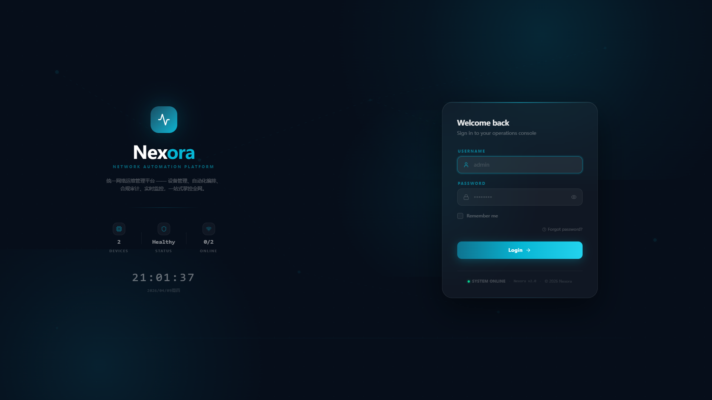
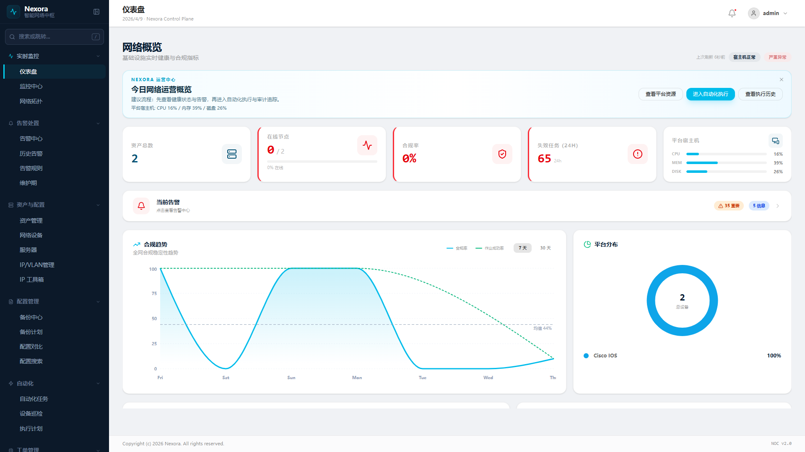

# 自研开源网络自动化平台 Nexora — 项目整体介绍

做网络运维的朋友应该都有同感：设备一多起来，光是每天查告警、备份配置、跑巡检这些基础活儿就能把人耗掉大半天。市面上的商业工具要么贵、要么重、要么不好二次开发，中小团队很难用得起来。

所以我自己搓了一个——**Nexora**，一个面向中小网络运维团队的一站式自动化运维平台。从设备管理到告警处置，从配置备份到自动化下发，从合规检查到变更审批，日常运维能用到的功能基本都塞进去了。

下面简单介绍一下这个项目。

---

## 技术栈

先说技术选型：

| 层 | 技术 |
|---|------|
| **前端** | React 19 + TypeScript + Vite + TailwindCSS |
| **后端** | Python 3.10+ / FastAPI / Pydantic |
| **数据库** | PostgreSQL 17 |
| **设备驱动** | Netmiko + Scrapli（工厂模式，自动 fallback） |
| **监控采集** | SNMPv2/v3 + TextFSM 解析 |
| **部署** | Docker Compose / Ubuntu 一键脚本 |

前端用了青色系暗色主题，色彩体系基于 `#06b6d4`，图表用 Recharts，动画用 motion。支持中英文切换、桌面/平板/手机三端自适应。

后端认证走 Bearer Token + RBAC 三级角色（Administrator / Operator / Viewer），凭据用 Fernet/AES + PBKDF2 加密存储，日志有脱敏过滤。

---

## 登录与第一眼

打开平台先过登录页：

输入账号密码进来，第一眼看到的是仪表盘——KPI 卡片、主机资源面板、合规趋势图、平台分布饼图，一屏总览全局：

---

## 功能模块总览

整个平台按左侧导航栏划分为 **8 大模块**，一共 **25 个子菜单**，覆盖网络运维的主要场景：

### 一、实时监控

| 子菜单 | 说明 |
|--------|------|
| 仪表盘 | 全局 KPI 总览、主机资源、合规趋势、平台分布 |
| 监控中心 | 实时设备状态面板、关键指标一屏展示 |
| 网络拓扑 | 可视化拓扑图、LLDP/CDP 自动发现、设备连接关系 |

### 二、告警处置

| 子菜单 | 说明 |
|--------|------|
| 告警中心 | 实时告警列表、详情面板、确认/关闭操作 |
| 历史告警 | 已解决告警归档查询 |
| 告警规则 | 自定义告警阈值和触发条件 |
| 维护期 | 设定维护窗口、屏蔽误报 |

### 三、资产与配置

| 子菜单 | 说明 |
|--------|------|
| 资产管理 | 全网资产概览、分类统计 |
| 网络设备 | 设备 CRUD、搜索筛选、详情弹窗（含连通性/SNMP 测试）|
| 服务器 | 服务器清单与管理 |
| IP/VLAN 管理 | IP 地址池与 VLAN 规划 |
| IP 工具箱 | IP 定位、子网计算、常用网络工具 |

### 四、配置管理

| 子菜单 | 说明 |
|--------|------|
| 备份中心 | 按需/批量配置备份、备份内容查看 |
| 备份计划 | Cron 定时备份、预设模板、覆盖统计 |
| 配置对比 | 两版本并排 Diff、变更高亮、快速导航 |
| 配置搜索 | 全配置库全文检索、正则、预设快捷关键字 |

### 五、自动化

| 子菜单 | 说明 |
|--------|------|
| 自动化任务 | 三步向导（选设备→选场景→配参数执行）、DRY-RUN、风险校验 |
| 设备巡检 | 周期性健康检查：Ping/SSH/CPU/Memory/合规 |
| 执行计划 | Cron 调度、自然语言描述、预计时间预览 |

### 六、工单管理

| 子菜单 | 说明 |
|--------|------|
| 变更工单 | 全生命周期：创建→审批→执行→归档、三层审批流 |

### 七、容量与报表

| 子菜单 | 说明 |
|--------|------|
| 容量分析 | CPU/Memory 趋势、容量预测、流量热点识别 |
| 报表中心 | 可用率、MTTR、MTTA、合规评分，支持 Excel 导出 |

### 八、平台管理

| 子菜单 | 说明 |
|--------|------|
| 审计日志 | 全操作审计追踪、多维过滤、可导出 |
| 平台设置 | Jinja2/YAML 模板编辑器、全局变量管理 |
| 用户管理 | RBAC 三级角色、变更工单角色分配 |

---

## 其他亮点

- **多厂商适配**：支持 Cisco IOS/NX-OS/IOS-XE、Huawei VRP、H3C Comware、Arista EOS、Juniper JunOS，驱动层工厂模式封装，Netmiko 连不上自动 fallback 到 Scrapli。
- **凭据加密**：设备密码用 Fernet/AES + PBKDF2 加密存储，数据库里只存 `enc:v1:` 开头的密文。
- **日志脱敏**：`SanitizeFilter` 过滤，密码和密钥不会被打到日志文件里。
- **国际化**：前端中英文一键切换。
- **响应式布局**：桌面、平板、手机三端自适应——

---

## 性能实测

拿 httpx 写了个异步压测脚本，PostgreSQL + 单进程 FastAPI，数据库里灌了 503 台网络设备 + 1002 台服务器 + 2589 条告警 + 5077 条审计日志。关键数据：

| 场景 | 吞吐量 | P50 延迟 | P95 延迟 |
|------|--------|---------|---------|
| 常规负载（并发20） | 62-93 req/s | 158-318ms | 451-680ms |
| 高并发（并发50） | 57-83 req/s | 382-591ms | 1.6-2.3s |
| 混合负载（并发30, 8端点随机） | 72.2 req/s | 297ms | 1051ms |
| 极限压力（并发100） | 103.8 req/s | 903ms | 1081ms |

全程 0 错误。500 台设备规模、十几个人同时用，完全够了。生产环境开 4 个 worker 还能线性提升 3-4 倍。

---

## 系列文章导航

这篇是项目整体介绍，后面按功能模块分别写了详细文章，每篇都带截图：

1. [实时监控篇](zhihu-part1.md) — 仪表盘 / 监控中心 / 网络拓扑
2. [告警处置篇](zhihu-part2.md) — 告警中心 / 历史告警 / 告警规则 / 维护期
3. [资产与配置篇](zhihu-part3.md) — 资产管理 / 网络设备 / 服务器 / IP-VLAN / IP工具箱
4. [配置管理篇](zhihu-part4.md) — 备份中心 / 备份计划 / 配置对比 / 配置搜索
5. [自动化篇](zhihu-part5.md) — 自动化任务 / 设备巡检 / 执行计划
6. [工单与合规篇](zhihu-part6.md) — 变更工单 / 合规检查
7. [容量与报表篇](zhihu-part7.md) — 容量分析 / 报表中心
8. [平台管理篇](zhihu-part8.md) — 审计日志 / 平台设置 / 用户管理

---

## 谁适合用

- 手上管几十到几百台网络设备的运维团队
- 日常需要做配置备份、变更审批、合规检查
- 不想花钱上商业工具，需要一个开源、部署简单、功能覆盖面广的平台
- 有一定 Python/React 开发能力，想二次开发的技术团队

项目还在持续迭代中，有问题可以在 GitHub 上提 issue。

---

> 项目地址：GitHub（开源） | 技术栈：React 19 + FastAPI + PostgreSQL | 许可证：MIT
