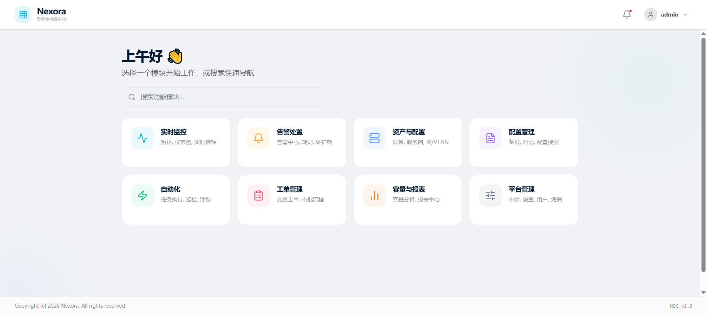
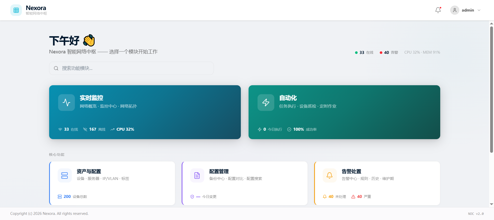

做网络运维的朋友应该都有同感：设备一旦上规模，光是每天的配置备份、告警处理、合规审计这些“琐事”就能耗掉大半天。市面上的商业工具要么昂贵沉重，要么二次开发门槛极高，对于中小规模的运维团队来说，往往“杀鸡焉用牛刀”，且难以灵活适配。

于是，**Nexora** 诞生了。它是一个专为中小团队打造的一站式网络自动化运维平台，旨在通过一个统一的控制台，覆盖从资产台账、运行监控到自动化执行、变更审批的全生命周期工作流。

下面简单介绍一下这个项目。

---

先看支撑整个平台运行的“骨架”：

| 维度 | 选型 | 核心价值 |
|---|---|---|
| **前端** | React 19 + Vite + TS | 极致的响应速度与组件化开发体验 |
| **样式/UI** | TailwindCSS v4 + Lucide | 极简主义设计，全平台响应式适配 |
| **后端** | FastAPI + Python 3.10+ | 异步高并发处理能力，天然适配网络 IO 场景 |
| **数据库** | SQLite / PostgreSQL 17 | 轻量化部署与生产级存储的无缝切换 |
| **驱动层** | Netmiko + Scrapli | 多厂商兼容，工厂模式实现自动 Fallback 机制 |
| **采集引擎** | PureSNMP + TextFSM | 结构化数据提取，不依赖底层 C 库，部署零压力 |
| **可视化** | Recharts + D3.js | 专业级的运维指标可视化与动态网络拓扑展示 |

前端采用了深邃的暗色系主题，配合 **Framer Motion** 的微交互效果，让运维操作不再枯燥。后端安全性上，我们采用了 **Bearer Token + RBAC** 细粒度权限控制，敏感凭据（如 SSH 密码）均经过 **AES + PBKDF2** 加密处理，确保数据底座安全。

---

Nexora 提供了开箱即用的**初始化向导**，引导用户配置全局变量、修改管理员凭据并设置告警通道。默认管理员账号 `admin/admin`。对于初次部署的用户，系统会预置一套“演示机柜”和“虚拟设备”，让你在还没接入真实设备前就能体验完整的业务流程。

仪表盘是运维人员的“作战指挥室”。我们通过 KPI 卡片、主机资源实时负载、合规趋势图和设备分布统计，让你一秒掌握全网健康度：

---

## 功能模块总览

平台目前由 **8 大模块、25 个核心功能点**组成，形成了一套闭环的网络运维体系：

### 一、 可观测性 (Observability)
*   **多维看板**：从全局 KPI 到明细指标，支持多 Sheet 数据导出。
*   **监控中心**：聚焦接口级实时流量、带宽利用率及 Flap 震荡检测。
*   **动态拓扑**：基于 D3.js 渲染，支持 LLDP/CDP 自动关联，节点链路状态实时着色。

### 二、 自动化中心 (Automation)
*   **脚本执行**：三步式向导操作（设备筛选 -> 场景选择 -> 参数填入），支持 **Dry-Run** 预览。
*   **Playbook 编排**：复杂的配置逻辑通过 YAML 模版和 Jinja2 渲染，实现“一键批量变更”。
*   **精细化排期**：内置高级 Cron 调度引擎，预计执行时间一目了然。

### 三、 配置中心 (Configuration)
*   **全量备份**：定时/手动抓取 running-config，支持全文正则检索。
*   **配置漂移检测**：自动扫描设备当前配置与“基准版本”的差异，通过彩色 Diff 视图精准定位非合规变更。
*   **行级回滚**：支持选择特定配置行进行回滚预览，降低变更风险。

### 四、 资产与 IPAM
*   **CMDB 资产台账**：覆盖网络设备、服务器、站点、角色等全维度信息维护。
*   **可视化机柜**：42U 前后视图展示，支持设备拖拽上架及 U 位利用率统计。
*   **IPAM 资源管理**：子网冲突检测、IP 分配进度可视化及全网终端位置定位（IP/MAC Locator）。

### 五、 告警与工单
*   **告警工作台**：支持维护期屏蔽、告警合并及多级通知策略。
*   **变更工单**：全生命周期管理（创建 -> 审批 -> 执行 -> 归档），确保每一行命令都有据可查。
*   **合规审计**：内置合规巡检引擎，自动输出风险报告与整改建议。

---

- **容量预测**：不仅仅是展示历史趋势，Nexora 内置了简单的线性外推模型，可预测未来 30 天的 CPU/内存/带宽风险，并给出“距阈值天数”评估。
- **混合驱动能力**：原生适配 Cisco、华为、华三、Arista、Juniper 等主流厂商，SSH 连不上自动尝试回退协议，确保自动化执行的稳定性。
- **安全底座**：集成 **HashiCorp Vault** 可选凭据存储，支持密码自动轮换及脱敏日志过滤，符合企业级安全合规要求。
- **极致的响应式体验**：无论是在机房用手机调试，还是在办公室用带超宽屏巡检，UI 都能完美适配。

---

## 性能实测

拿 httpx 写了个异步压测脚本，PostgreSQL + 单进程 FastAPI，数据库里灌了 503 台网络设备 + 1002 台服务器 + 2589 条告警 + 5077 条审计日志。关键数据：

| 场景 | 吞吐量 | P50 延迟 | P95 延迟 |
|------|--------|---------|---------|
| 常规负载（并发20） | 62-93 req/s | 158-318ms | 451-680ms |
| 高并发（并发50） | 57-83 req/s | 382-591ms | 1.6-2.3s |
| 混合负载（并发30, 8端点随机） | 72.2 req/s | 297ms | 1051ms |
| 极限压力（并发100） | 103.8 req/s | 903ms | 1081ms |

全程 0 错误。500 台设备规模、十几个人同时用，完全够了。生产环境开 4 个 worker 还能线性提升 3-4 倍。

---

## 系列文章导航

这篇是项目整体介绍，后面按功能模块分别写了详细文章，每篇都带截图：

1. [实时监控篇](zhihu-part1.md) — 仪表盘 / 监控中心 / 网络拓扑
2. [告警处置篇](zhihu-part2.md) — 告警中心 / 历史告警 / 告警规则 / 维护期
3. [资产与配置篇](zhihu-part3.md) — 资产管理 / 网络设备 / 服务器 / IP-VLAN / IP工具箱
4. [配置管理篇](zhihu-part4.md) — 备份中心 / 备份计划 / 配置对比 / 配置搜索
5. [自动化篇](zhihu-part5.md) — 自动化任务 / 设备巡检 / 执行计划
6. [工单与合规篇](zhihu-part6.md) — 变更工单 / 合规检查
7. [容量与报表篇](zhihu-part7.md) — 容量分析 / 报表中心
8. [平台管理篇](zhihu-part8.md) — 审计日志 / 平台设置 / 用户管理

---

## 谁适合用

- 手上管几十到几百台网络设备的运维团队
- 日常需要做配置备份、变更审批、合规检查
- 不想花钱上商业工具，需要一个开源、部署简单、功能覆盖面广的平台
- 有一定 Python/React 开发能力，想二次开发的技术团队

项目还在持续迭代中，有问题可以在 GitHub 上提 issue。

---

> 项目地址：GitHub（开源） | 技术栈：React 19 + FastAPI + PostgreSQL | 许可证：MIT
